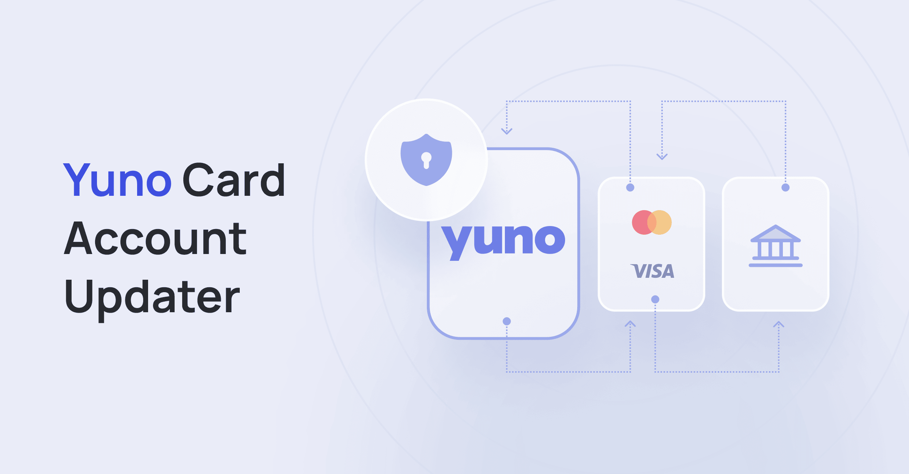

O Card Account Updater (CAU) é um recurso disponível na Yuno para manter a integridade dos cartões de crédito ou débito armazenados, evitando problemas causados por dados de cartão vencidos ou desatualizados. Quando os clientes informam os dados do cartão para cobrança recorrente ou serviços de assinatura, o Card Account Updater garante que os dados armazenados do cartão continuem atualizados. Com o Card Account Updater da Yuno, nenhum esforço de desenvolvimento adicional é necessário: os dados do seu cartão são atualizados automaticamente em segundo plano.

<Frame></Frame>

## Benefícios do Card Account Updater {#benefits-of-card-account-updater}

* **Maiores taxas de sucesso de pagamento:** a atualização automática dos dados do cartão reduz a probabilidade de transações com falha por cartões vencidos ou substituídos, garantindo uma taxa de sucesso maior para pagamentos recorrentes.
* **Melhor experiência do cliente:** ao garantir um serviço sem interrupções, os clientes não precisam atualizar manualmente os dados do cartão, o que gera uma experiência mais fluida e positiva.
* **Custos operacionais reduzidos:** as atualizações automáticas diminuem a necessidade de intervenções manuais e de atendimentos ao cliente relacionados a problemas de pagamento, economizando tempo e recursos.
* **Aumento de receita:** taxas de aprovação de transações mais altas se traduzem em menos pagamentos perdidos e, potencialmente, em mais receita.
* **Segurança e conformidade:** centralizar as atualizações de cartão dentro do vault garante que os dados sensíveis do cartão sejam tratados com segurança e estejam em conformidade com as normas e os padrões aplicáveis.
* **Eficiência operacional:** simplificar o processo de atualização dos dados do cartão ajuda a manter a eficiência operacional e a consistência entre os sistemas de pagamento.
* **Retenção de clientes:** minimizar interrupções no serviço causadas por falhas de pagamento pode ajudar a manter a fidelidade e a retenção dos clientes.

## Como funciona? {#how-does-it-work}

O serviço Card Account Updater funciona de forma assíncrona, independentemente do fluxo de pagamento. As atualizações de cartão são feitas automaticamente, então não é necessário tratar respostas individuais do serviço.

A Yuno atualiza os dados do cartão nos seguintes cenários:

* O cartão passou da data de validade.
* A conta associada ao cartão está fechada, desativada ou sinalizada.

Quando a data de validade do cartão já passou, a Yuno pode atualizar todos os dados do cartão ou apenas a data de validade. A opção usada depende da abordagem do emissor do cartão para a substituição de cartões.

Depois que um cartão é atualizado, a Yuno envia um webhook para notificar você sobre a mudança. **O`vaulted_token` e o `fingerprint` do cartão cadastrado continuam os mesmos, então você não precisa alterar nada na sua integração**. Esse webhook contém o seguinte:

* A data de validade mais recente, os últimos quatro dígitos e o Issuer Identification Number (IIN).
* O motivo da atualização.
* Os dados do cartão que está sendo substituído.

O bloco de código a seguir apresenta um exemplo de notificação:

```json
{
  "type": "enrollment",
  "type_event": "enrollment.update",
  "account_id": "493e9374-510a-4201-9e09-de669d75f256",
  "retry": 0,
  "version": 2,
  "data": {
    "payment_method": {
      "id": "03c3aae1-ed42-4be6-bc24-de5487f58491",
      "account_id": "493e9374-510a-4201-9e09-de669d75f256",
      "name": "VISA ****1111",
      "description": "VISA ****1111",
      "type": "CARD",
      "category": "CARD",
      "country": "CO",
      "status": "ENROLLED",
      "customer_id": "2f38972e-2427-43b7-95be-ee4cf21cef1b",
      "created_at": "2024-09-10T15:04:10.453741Z",
      "updated_at": "2024-09-10T15:04:10.453745Z",
      "enrollment": {
        "session": null,
        "sdk_action_required": false
      },
      "verify": {
        "vault_on_success": false,
        "currency": null,
        "payment": null
      },
      "detail": {
        "card": {
          "holder_name": "John Doe",
          "expiration_month": 3,
          "expiration_year": 26,
          "iin": "41111111",
          "lfd": "1111",
          "security_code_length": 3,
          "number_length": 16,
          "brand": "VISA",
          "issuer_name": "JPMORGAN CHASE BANK N A",
          "issuer_code": null,
          "type": "CREDIT",
          "category": "CREDIT",
          "country_code": "US",
          "country_name": "United States of America",
          "fingerprint": "d244e20d-43a1-43f7-9b48-0a76423be35e",
          "created_at": "2024-09-10T15:04:10.453799Z",
          "updated_at": "2024-09-10T15:04:10.453800Z"
        },
        "card_data_history": [
         {
          "holder_name": "John Doe",
          "expiration_month": 3,
          "expiration_year": 24,
          "iin": "4222222",
          "lfd": "2222",
          "security_code_length": 3,
          "number_length": 16,
          "brand": "VISA",
          "issuer_name": "JPMORGAN CHASE BANK N A",
          "issuer_code": null,
          "type": "CREDIT",
          "category": "CREDIT",
          "country_code": "US",
          "country_name": "United States of America",
          "fingerprint": "d244e20d-43a1-43f7-9b48-0a76423be35e",
          "provider_data": {
                 "id": "MASTERCARD",
                 "status": "UPDATED"
          },
          "created_at": "2024-09-10T15:04:10.453799Z",
          "updated_at": "2024-09-10T15:04:10.453800Z"
        }
       ]
      }
    }
  }
}

```

## Controle do Account Updater por cartão {#controlling-account-updater-per-card}

Por padrão, quando o Card Account Updater está ativado na sua conta, todo cartão elegível cadastrado nela é mantido atualizado automaticamente. Você pode substituir esse comportamento para um cartão específico no cadastro usando o campo `account_updater`:

* Defina `account_updater` como `false` para **excluir** esse cartão específico do Card Account Updater. O cartão não receberá atualizações automáticas dos dados.
* Omita o campo (ou defina como `true`) para manter o cartão na configuração do Card Account Updater da sua conta.

O campo `account_updater` está disponível ao cadastrar um cartão pelo endpoint [Cadastrar meio de pagamento](/reference/payment-methods-direct-workflow/enroll-payment-method-api) (fluxo Direct), pelo fluxo de cadastro do SDK e no objeto `payment_method` da requisição [Criar pagamento](/reference/payments/create-payment) quando um cartão é armazenado no vault durante um pagamento.

## Registro de cartões armazenados em lote {#registering-stored-cards-in-bulk}

Para cartões armazenados antes de ativar o Card Account Updater (ou cadastrados com ele excluído), você pode registrá-los em lotes com o endpoint [Registrar cartões armazenados no Account Updater](/reference/payment-methods-direct-workflow/register-cards-for-account-updater-api). Envie até 100 ids de meios de pagamento (`vaulted_token`) por requisição. A validação é síncrona e do tipo tudo ou nada, e o registro é executado de forma assíncrona em segundo plano.

## Compatibilidade com as bandeiras de cartão {#card-networks-compatibility}

No momento, o Card Account Updater está disponível para Visa e Mastercard.

## Ativação do Card Account Updater {#activating-the-card-account-updater}

Para ativar o Card Account Updater na sua conta Yuno, entre em contato com a equipe de suporte da Yuno em [support@y.uno](mailto:support@y.uno). Observe que o registro ocorre diretamente com as bandeiras de cartão e pode levar até 10 dias úteis para novos clientes.