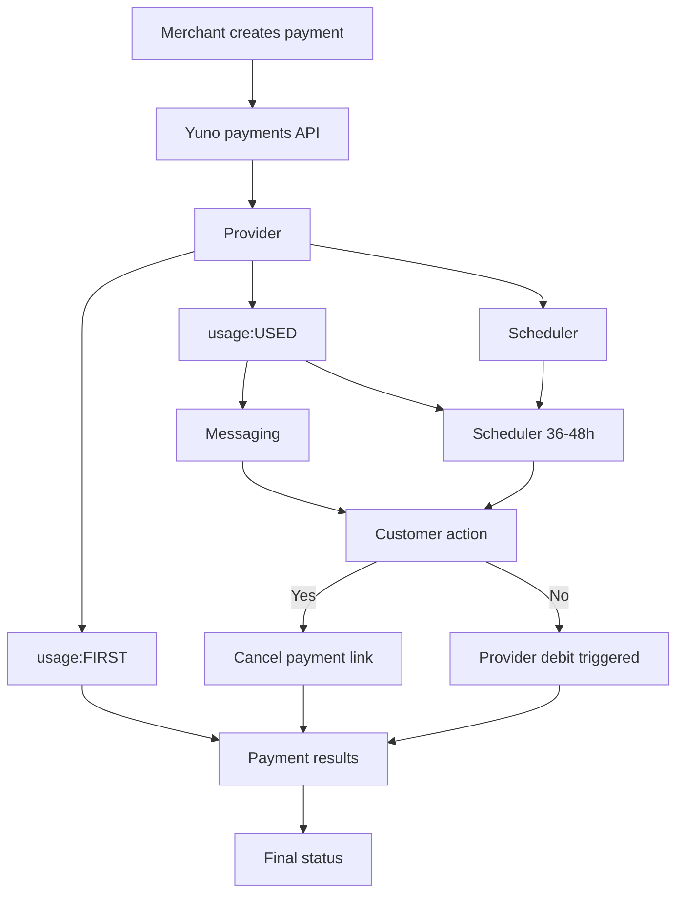

Este guia aborda o suporte da Yuno a pagamentos recorrentes UPI Autopay com Pre-Debit Notification (PDN).

O UPI Autopay usa um mandato aprovado pelo cliente, que é a autorização permanente do cliente para débitos recorrentes. Depois que o mandato está ativo, a Yuno pode iniciar débitos agendados sem exigir que o cliente realize uma ação a cada vez. Antes de cada débito recorrente, a Yuno envia uma Pre-Debit Notification (PDN) ao cliente com antecedência. Esse período de aviso dá ao cliente tempo para revisar a cobrança futura e cancelar se necessário, e o débito só é executado se o cliente não optar por sair.

Para mais informações sobre transações iniciadas pelo cliente (**CIT**), transações iniciadas pelo lojista (**MIT**) e valores de uso, consulte [Credenciais armazenadas](/pt-br/docs/payment-features/stored-credentials).

O Autopay se integra diretamente aos fluxos de pagamento existentes da Yuno por meio do campo `stored_credentials`.

## Como funciona {#how-it-works}

* **Primeira cobrança**: o pagamento inicial é uma transação iniciada pelo cliente (CIT) processada diretamente com o provedor de pagamento para criar o mandato e autorizar débitos futuros.
* **PDNs**: para débitos recorrentes, a Yuno envia uma notificação de pré-débito (PDN) que o cliente recebe por SMS ou email, aguarda o período de aviso exigido e, em seguida, executa o débito automaticamente, a menos que o cliente cancele.
* **Mensagens e cancelamento**: as PDNs incluem o nome do lojista, o valor e a data agendada, além de um link de cancelamento. As mensagens são localizadas (por exemplo, inglês, hindi, tâmil, telugu, bengali, marathi). Os modelos de email são white label, com a marca do lojista.
* **Cancelamento por webhook**: se o cliente clicar no link de cancelamento, a Yuno valida a transação, cancela o débito agendado, atualiza o status do pagamento e notifica o lojista.
* **Agendamento e novas tentativas**: os débitos são agendados para execução após o período de aviso, em janelas IST aprovadas. Se um débito falhar, a Yuno agenda novas tentativas com base no cronograma e nos limites de tentativas configurados.
* **Status assíncrono e webhooks**: as atualizações de estado do pagamento são executadas de forma assíncrona e emitem eventos ao lojista para PDN enviada, cancelamentos, sucessos, nova tentativa agendada e falha final.
* **Suporte de provedores**: o Autopay com PDN será lançado inicialmente pela Adyen e pela Billdesk.



## Fluxos de pagamento {#payment-flows}

O Autopay usa limites de valor para determinar se uma cobrança pode ser executada como MIT ou deve ser tratada como um pagamento iniciado pelo cliente (CIT). Isso mantém os débitos recorrentes em conformidade e define as expectativas sobre a ação do cliente.

* **Abaixo do limite (≤ INR 50,000)**: a Yuno envia a PDN ao cliente, aguarda o período de aviso de 36 a 48 horas e, em seguida, executa o débito MIT em uma janela IST. Se o cliente cancelar durante o período de aviso, o débito não é executado.
* **Acima do limite (> INR 50,000)**: a Yuno envia uma notificação CIT com 72 a 48 horas de antecedência, com uma forma de o cliente concluir o pagamento. O cliente precisa pagar ativamente; se não pagar, nenhum débito MIT é executado.

## Campos de `stored_credentials` {#storedcredentials-fields}

Implemente o Autopay por meio do campo `stored_credentials`, disponível em endpoints como [Criar pagamento](/reference/payments/create-payment). O caminho completo para criar pagamentos é `payment_method.detail.bank_transfer.stored_credentials`.

Use `stored_credentials.usage` para declarar a intenção:

| Campo   | Valor   | Comportamento                                                                       |
| ------- | ------- | ------------------------------------------------------------------------------ |
| `usage` | `FIRST` | Executa a cobrança direta (CIT) e armazena a referência do mandato para débitos futuros. |
| `usage` | `USED`  | Envia a PDN, aguarda o período de aviso de 24 horas e, em seguida, executa o débito MIT.          |

## Notificações de pré-débito via API {#api-driven-pre-debit-notifications}

Se você gerencia seu próprio cronograma de cobrança, dispare a notificação de pré-débito você mesmo e faça referência a ela no débito. Este é o fluxo disponível hoje pela API:

1. **Envie a notificação** com [Criar notificação de pré-débito](/pt-br/reference/pre-debit-notifications/create-pre-debit-notification), passando o `vaulted_token` do mandato, o `amount` futuro e a `billing_date`. Guarde o `id` retornado e confirme que o status é `SENT`.

```json
{
  "account_id": "<ACCOUNT_ID>",
  "merchant_reference": "subscription-2026-08-INV-00187",
  "description": "Your subscription renews soon",
  "amount": { "currency": "INR", "value": "499.00" },
  "billing_date": "2026-08-01",
  "customer_payer": { "id": "<CUSTOMER_ID>" },
  "payment_method": { "type": "UPI_AUTOPAY", "vaulted_token": "<VAULTED_TOKEN>" },
  "origin_payment_id": "<MANDATE_PAYMENT_ID>"
}
```

2. **Aguarde o período de aviso da NPCI** (pelo menos 24 horas antes do débito).

3. **Crie o débito recorrente** com [Criar pagamento](/reference/payments/create-payment), fazendo referência à notificação:

```json
{
  "amount": { "currency": "INR", "value": "499.00" },
  "customer_payer": { "id": "<CUSTOMER_ID>" },
  "payment_method": {
    "type": "UPI_AUTOPAY",
    "vaulted_token": "<VAULTED_TOKEN>",
    "detail": {
      "bank_transfer": {
        "pre_debit_notification_id": "<ID_FROM_STEP_1>"
      }
    }
  }
}
```

A Yuno valida a notificação referenciada (ela deve existir, pertencer à sua conta e estar com status `SENT`) e encaminha a referência da notificação do provedor junto com o débito. Se a validação falhar, o pagamento é rejeitado com `PRE_DEBIT_NOTIFICATION_NOT_FOUND` ou `PRE_DEBIT_NOTIFICATION_NOT_SENT` (HTTP 422) e nenhuma cobrança é tentada.

## Cobrança de inadimplência e novas tentativas {#dunning-and-retries}

Se um débito MIT falhar, a Yuno faz novas tentativas em vez de marcar o pagamento como falha final imediatamente. O cronograma de novas tentativas é configurável por conta.

| Tentativa    | Mensagem                                                                     |
| ---------- | --------------------------------------------------------------------------- |
| 1ª falha   | "O pagamento falhou. Tentaremos novamente amanhã. Nenhuma ação necessária."                   |
| 2ª falha   | "Pagamento ainda pendente. Nova tentativa em 2 dias (`link to update payment method`)." |
| 3ª falha   | "Última tentativa agendada para `date`. Verifique se há saldo disponível."      |
| Falha final | "Não foi possível processar o pagamento. Entre em contato com `merchant` para resolver."            |

## Conformidade regulatória {#regulatory-compliance}

A Yuno segue os requisitos da National Payments Corporation of India (NPCI) para o UPI Autopay.

* **Janela de aviso prévio**: as PDNs devem ser enviadas de 36 a 48 horas antes do débito. A NPCI permite um mínimo de 24 horas.
* **Cancelamento pelo cliente**: a PDN inclui um link de webhook entregue por SMS ou email. Se o cliente cancelar antes do débito agendado, a Yuno interrompe a cobrança.
* **Janelas de execução (IST)**: os débitos são executados somente em janelas de horário aprovadas: antes das 10:00, entre 13:00 e 17:00 ou depois das 21:30.
* **Limite de valor para MIT**: o autopay MIT é permitido até INR 50,000. Qualquer valor acima disso exige um pagamento iniciado pelo cliente (CIT).
* **Limites de novas tentativas**: a NPCI permite 1 tentativa de execução mais até 3 novas tentativas.

<br />