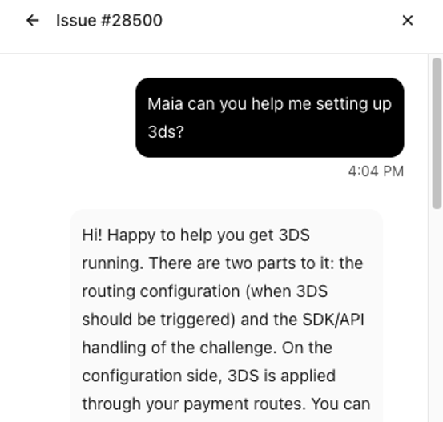
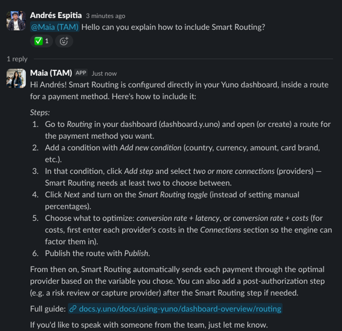

## O que a Maia faz {#what-maia-does}

A **Maia** é a Technical Account Manager com IA da Yuno. Ela trabalha junto com a sua equipe da Yuno para responder perguntas técnicas, investigar o comportamento dos pagamentos e resolver problemas de integração, usando o contexto da configuração da sua organização em vez de respostas genéricas. A Maia investiga antes de responder, lembra o contexto da sua integração de uma conversa para a outra e, quando uma pergunta precisa de uma pessoa, ela a encaminha para a sua equipe da Yuno com o diagnóstico já feito.

## Onde encontrá-la {#where-to-find-her}

A Maia está disponível em todos os canais em que você já fala com a Yuno, e é a mesma Maia em todos eles: ela conhece a sua organização, a sua integração e o seu histórico, seja qual for o canal.

* **Widget de chat**: escreva sua pergunta no chat de suporte que você já usa e inclua a palavra "Maia" em qualquer parte da mensagem. Ela entra na conversa e continua a partir dali.
* **Slack**: se a sua equipe compartilha um canal do Slack com a Yuno, marque **@Maia (TAM)** na sua mensagem e ela responde na thread.
* **Google Chat**: se a sua equipe trabalha com a Yuno em um espaço compartilhado do Google Chat, escreva sua pergunta lá e a Maia responde no espaço.
* **WhatsApp e email**: se a sua equipe fala com o suporte da Yuno por um grupo de WhatsApp ou por email, a Maia também assume essas conversas e responde na mesma thread.

  

    
<strong>Widget de chat</strong>

    <Frame>
      
    </Frame>
  

  

    
<strong>Slack</strong>

    <Frame>
      
    </Frame>
  

## Como a Maia pode ajudar {#what-maia-can-help-with}

### Investigação de pagamentos {#payment-investigation}

Pergunte sobre um pagamento específico e a Maia rastreia o que aconteceu ao longo do fluxo de pagamento, a requisição, a resposta do provedor e o status resultante, e explica em termos simples: por que um pagamento foi recusado, como um reembolso avançou ou o que um código de resposta do provedor significa para você.

<Card title="Pergunte à Maia">
  *"Fizemos um reembolso pelo GCash há dois dias e o cliente ainda não recebeu, você pode verificar o status?"*
</Card>

**Maia:** O reembolso foi aceito pelo provedor em 2 de agosto às 14:07 UTC e está marcado como liquidado do lado dele desde ontem. Os créditos do GCash podem levar até 3 dias úteis para aparecer na carteira do cliente, e este ainda está dentro desse prazo. Se não chegar até amanhã, vou escalar o caso com a referência do provedor já anexada.

**O que foi enviado ao provedor e o que ele respondeu.** Quando um provedor rejeita um pagamento com um erro genérico, a Maia lê a troca exata: a requisição que a Yuno enviou e a resposta do provedor. A partir disso, ela informa qual campo o provedor contestou e o que ele espera, por exemplo dados do navegador ausentes em um pagamento com 3-D Secure, um número de telefone em um formato que o provedor não aceita ou credenciais na conexão que o provedor não reconhece mais. Os dados de cartão e as credenciais nunca saem dos sistemas da Yuno nesse processo; a Maia explica o problema em termos simples em vez de colar payloads.

<Card title="Pergunte à Maia">
  *"Quatro pagamentos com 3DS do mesmo cliente falharam hoje de manhã, mas um posterior foi aprovado. O que o emissor rejeitou?"*
</Card>

**Maia:** O emissor rejeitou a etapa de autenticação nas quatro tentativas porque a altura da tela do navegador do cliente chegou vazia: essas requisições foram criadas sem os dados do navegador do comprador. Nada foi cobrado. Enviar `customer_payer.browser_info` em todo pagamento com 3DS resolve o problema, e a tentativa que deu certo incluía esse campo.

**Status em tempo real direto do provedor.** Na maioria das perguntas, a Maia responde com base no status que a Yuno já tem armazenado. Quando você precisa do status atual direto do provedor, ela pode consultá-lo em tempo real, nos provedores que oferecem consulta de status em tempo real, e sempre informa qual deles você está vendo: o status em tempo real do provedor ou o mais recente que a Yuno tem registrado. Ela também indica se o pagamento está em sandbox ou em produção.

<Card title="Pergunte à Maia">
  *"Qual é o status atual do pagamento 7b1a... direto do provedor?"*
</Card>

**Maia:** Para o provedor deste pagamento eu consigo consultar em tempo real, e agora mesmo ele informa o pagamento como autorizado, em produção. Alguns provedores só nos enviam notificações e não respondem a consultas de status em tempo real; para esses, eu informo o status mais recente que a Yuno tem armazenado e aviso isso. Este é em tempo real.

**Correção de um pagamento preso no status errado.** Às vezes o provedor concluiu um pagamento, mas a Yuno nunca registrou o resultado, então ele continua pendente do seu lado enquanto o cliente já foi cobrado. Quando o provedor informa um status final que a Yuno não tem, a Maia alinha a Yuno a ele: o pagamento passa para o status do provedor e o seu webhook é disparado como se a atualização tivesse chegado a tempo, para que os seus sistemas possam processar o pedido. Ela só faz isso quando o registro do provedor é final e os valores coincidem; qualquer outro caso vai para a sua equipe da Yuno.

<Card title="Pergunte à Maia">
  *"O provedor mostra este pagamento como aprovado, mas na Yuno ele ainda aparece como pendente. O que aconteceu?"*
</Card>

**Maia:** O provedor aprovou este pagamento em 14 de setembro com a autorização 247684, mas o registro da Yuno nunca saiu de pendente, então o seu webhook nunca foi disparado e o pedido não foi processado. Atualizei o pagamento para bem-sucedido, de acordo com o provedor, e disparei o seu webhook novamente. Também encontrei mais dois pagamentos da semana passada na mesma situação; quer que eu atualize esses também?

### Dúvidas sobre integração e documentação {#integration-and-documentation-questions}

A Maia responde perguntas sobre integrar e operar na Yuno, incluindo o comportamento da API, meios de pagamento, tokenização, 3-D Secure, webhooks e testes em sandbox, com base na documentação atual da Yuno e sabendo como a sua integração está configurada.

<Card title="Pergunte à Maia">
  *"Podemos exigir 3DS por transação, e como isso interage com as nossas regras de roteamento?"*
</Card>

**Maia:** Sim, o 3DS pode ser solicitado por transação quando você cria o checkout, então você pode exigi-lo apenas nos segmentos que escolher. As suas regras de roteamento são avaliadas depois da autenticação, então um desafio de 3DS exigido não muda para qual provedor o pagamento é roteado. Com a sua configuração atual, exigi-lo apenas em cartões usados pela primeira vez adicionaria fricção onde ela traz mais retorno.

### Visibilidade de webhooks e eventos {#webhook-and-event-visibility}

A Maia verifica o que a Yuno enviou para você e quando: se um webhook foi disparado para um determinado pagamento, quais tipos de evento o seu endpoint recebeu e se as entregas estão sendo repetidas, para que "nunca recebemos a notificação" deixe de ser um mistério.

<Card title="Pergunte à Maia">
  *"Recebemos um webhook para o reembolso do pedido 8842? Qual tipo de evento devemos escutar?"*
</Card>

**Maia:** O reembolso do pedido 8842 gerou uma notificação ontem às 16:32 UTC e o seu endpoint confirmou o recebimento. Para reembolsos, o tipo de evento a escutar é a atualização de status do reembolso; posso listar os tipos de evento exatos habilitados na sua conta se você quiser conferir o seu handler.

**Reenvio de um webhook.** A Maia não só verifica se um webhook foi disparado, ela também pode reenviá-lo. Se o seu endpoint perdeu uma notificação de um pagamento específico, ela consulta as tentativas de entrega desse pagamento, mostra o que aconteceu e reenvia a que você precisa para o endpoint que você já tem configurado. Sem ticket para a engenharia, sem reenvio manual.

<Card title="Pergunte à Maia">
  *"Nunca recebemos o webhook do pagamento 8842, você pode reenviá-lo?"*
</Card>

**Maia:** Encontrei 4 tentativas de entrega da notificação do pagamento 8842; a mais recente, ontem às 16:32 UTC, excedeu o tempo limite no seu endpoint. Acabei de reenviá-la para o seu endpoint configurado; você deve recebê-la em até um minuto. Se exceder o tempo limite de novo, isso indica um problema no receptor e não na entrega, e vou sinalizar o caso à sua equipe da Yuno com as tentativas anexadas.

### Análise de desempenho e padrões {#performance-and-pattern-analysis}

Além de transações individuais, a Maia analisa padrões na atividade de pagamentos dos últimos 3 meses: mudanças na taxa de aprovação, concentrações de recusas por meio de pagamento ou provedor e comportamento do roteamento, o que é útil tanto para resolver problemas quanto para identificar oportunidades de otimização.

<Card title="Pergunte à Maia">
  *"Estamos tendo mais recusas com Apple Pay do que com cartões no último mês?"*
</Card>

**Maia:** A sua taxa de aprovação no Peru passou de 89% para 81% nesta semana. A queda se concentra em pagamentos com carteiras digitais por um único provedor: os cartões estão estáveis e o seu mix de tráfego não mudou. O padrão aponta para o lado do provedor e não para a sua integração; quer que eu escale o caso para a sua equipe da Yuno confirmar com o provedor?

### Consultas em massa a partir de um arquivo {#bulk-lookups-from-a-file}

Quando a pergunta envolve muitos pagamentos, envie a lista para a Maia em vez de perguntar um por um. Compartilhe uma planilha ou um CSV com IDs de pagamento ou IDs de pedido e ela consulta todos, adiciona o status, o provedor e os detalhes de recusa que você pedir e devolve o arquivo.

<Card title="Pergunte à Maia">
  *"Aqui estão 3.000 IDs de pedido da nossa conciliação, você pode adicionar o status atual e o provedor de cada um?"*
</Card>

**Maia:** Pronto, o arquivo está anexado com o status e o provedor dos 3.000 pedidos. 2.941 foram bem-sucedidos, 47 foram recusados e 12 nunca foram encontrados na Yuno; coloquei esses no topo para que a sua equipe verifique se eles chegaram a passar pelo checkout.

### Triagem de incidentes {#incident-triage}

Quando algo quebra, a Maia verifica a atividade recente da sua integração, incluindo erros, padrões de resposta incomuns e o volume afetado, e informa onde está o problema: do lado do provedor, do lado da Yuno ou na própria integração, para que a correção comece no lugar certo. Se for o provedor, ela diz isso explicitamente e coordena o escalonamento de acordo.

<Card title="Pergunte à Maia">
  *"Estamos recebendo erros INVALID_CHECKOUT_SESSION desde hoje de manhã, o que mudou?"*
</Card>

**Maia:** Os erros INVALID_CHECKOUT_SESSION começaram às 09:14 UTC e afetam apenas sessões com mais de 60 minutos: o seu checkout está reutilizando sessões expiradas depois que a página é recarregada. Nada mudou do lado da Yuno. Criar uma nova sessão ao recarregar a página resolve o problema; anotei o volume afetado caso você queira usá-lo no seu relatório de incidente.

### Como encontrar a sua equipe de conta da Yuno {#finding-your-yuno-account-team}

Pergunte à Maia quem é a sua equipe de conta da Yuno e ela informa as pessoas designadas para a sua organização, por função, como o seu Key Account Manager e o seu Technical Account Manager. Ela só conhece a equipe da sua organização, e nem toda organização tem todas as funções designadas, então ela informa o que está registrado em vez de supor uma equipe completa.

<Card title="Pergunte à Maia">
  *"Quem é o meu gerente de conta na Yuno?"*
</Card>

**Maia:** A sua equipe de conta na Yuno: Alex Rivera é o seu Key Account Manager e Sam Delgado é o seu Technical Account Manager. Se quiser, posso trazer um deles para esta conversa.

### Solicitações de funcionalidades que chegam à sua equipe de conta {#feature-requests-that-reach-your-account-team}

Quando você pede algo que a Yuno ainda não oferece, ou que não está habilitado na sua conta, a Maia diz isso com clareza, sugere o que você pode usar hoje e encaminha a solicitação ao seu Key Account Manager com o contexto do que você precisa e por quê. Você não precisa repetir o pedido em um email separado.

<Card title="Pergunte à Maia">
  *"Vocês podem entregar os nossos relatórios de conciliação no nosso SFTP todos os dias?"*
</Card>

**Maia:** A entrega automática em um SFTP externo não está disponível hoje; os relatórios são gerados e baixados na Yuno. Você pode obter o mesmo resultado com um job diário na Reports API: crie o relatório, espere até que ele esteja pronto e baixe-o para o seu servidor. Também encaminhei a sua solicitação ao seu Key Account Manager, então ela já está no radar dele.

## Como a Maia trabalha com a sua equipe {#how-maia-works-with-your-team}

**Escalonamento com o trabalho já feito.** A Maia não substitui a sua equipe da Yuno, ela a torna mais rápida. Quando uma pergunta exige julgamento humano, uma mudança em produção ou coordenação com um provedor, ela escala o caso com um resumo estruturado: o que foi verificado, o que foi encontrado e para onde o problema aponta. Você nunca precisa se repetir, e a sua equipe começa de um diagnóstico em vez de começar do zero.

**Ela acompanha, para que você não precise.** Os tickets escalados não ficam esquecidos. A Maia continua acompanhando: se um escalonamento fica parado, ela cobra, aciona as pessoas certas e mantém você informado do andamento. Quando ela escala uma indisponibilidade de um provedor, continua verificando o provedor e o seu próprio tráfego; quando ambos mostram que o provedor se recuperou, ela informa a janela de impacto e se os pagamentos que falharam nesse período podem ser tentados novamente.

**Ela lembra o seu contexto.** A Maia guarda o contexto da sua integração e das suas conversas anteriores. Na segunda vez que você falar sobre o mesmo provedor, o mesmo erro ou o mesmo projeto, você não começa do zero, porque ela lembra.

**No seu idioma.** Pergunte em inglês, espanhol, português ou no idioma em que a sua equipe trabalha, e a Maia acompanha você.

## Dados e segurança {#data-and-security}

* **Restrita à sua organização**: tudo o que a Maia vê e usa nas respostas vem exclusivamente dos dados e da configuração da sua própria organização. O isolamento entre lojistas é aplicado no nível da plataforma; não é algo que uma conversa possa mudar.
* **Nenhuma credencial, nunca**: a Maia nunca pede senhas, chaves de API ou números de cartão, e recusa pedidos para exibi-los ou manipulá-los.
* **Apenas ações seguras**: a Maia principalmente investiga e explica. Ela executa duas ações, ambas limitadas a restaurar o que já deveria ser verdade: reenviar um webhook para o seu próprio endpoint configurado quando uma entrega foi perdida e atualizar o status de um pagamento para corresponder a um status final que o provedor já informou. Fora isso, ela nunca executa pagamentos, emite reembolsos nem altera a configuração da sua integração.
* **Uma pessoa está sempre ao alcance**: qualquer conversa pode ser escalada para a sua equipe da Yuno a qualquer momento, automaticamente quando a Maia julgar necessário ou imediatamente quando você pedir.

## Como obter acesso {#getting-access}

Se você ainda não vê a Maia no canal em que fala com a Yuno, peça à sua equipe de conta da Yuno para habilitá-la para a sua organização. Não é necessário nenhum trabalho de integração do seu lado.

<Note>
  A Maia melhora continuamente. As respostas dela se baseiam na documentação ao vivo da Yuno e na sua configuração atual, então o que ela informa reflete a plataforma como ela é hoje, e não uma foto de um momento passado.
</Note>
