A seção Payment Concierge no dashboard configura um agente de IA que trabalha como um analista de pagamentos na sua equipe, que enxerga toda a sua stack de pagamentos e trabalha de onde a sua equipe já trabalha: Slack, WhatsApp, Telegram ou Microsoft Teams. Ele está disponível 24/7, então você pode perguntar qualquer coisa, a qualquer hora, e receber uma resposta em segundos. Por exemplo:

* *"Por que a minha taxa de aprovação caiu no Reino Unido esta semana?"*
* *"Para qual PSP devo rotear as transações Mastercard no Brasil?"*
* *"O que está causando as minhas rejeições na Adyen, e como eu corrijo?"*
* *"Compare todos os meus PSPs nos últimos 7 dias: quem está com desempenho abaixo do esperado?"*
* *"Monte um relatório completo do desempenho de aprovação do mês passado, dividido por país e provedor."*

O seu Concierge não apenas responde. Ele explica a causa raiz até o nível do emissor, recomenda uma ação específica e pode transformar qualquer parte disso em um relatório completo.

O seu Concierge também pode trabalhar de forma proativa. Ele monitora a sua stack de pagamentos o tempo todo e envia resumos programados: volume e taxas de aprovação diários, um detalhamento por provedor, os principais motivos de recusa e alertas sobre qualquer anomalia, como uma queda na taxa de aprovação em vários provedores ou um colapso repentino de volume, cada um com contexto e próximos passos específicos. Você decide sobre o que ele informa, com que frequência e onde cada relatório é entregue: Slack, WhatsApp, Telegram ou Microsoft Teams.

## Configurando o Concierge {#setting-up-the-concierge}

Antes que a sua equipe possa trabalhar com o Concierge, um admin o ativa para a organização e atribui a cada pessoa um nível de acesso por meio de uma função personalizada.

<Steps>
  <Step title="Solicitar acesso">
    Abra a seção Payment Concierge e selecione **Request access**. Na caixa de diálogo, escolha o seu **primary communication channel** (Slack, WhatsApp ou Telegram), escolha uma **desired activation date**, aceite os **Terms and Conditions** e envie. A equipe da Yuno analisa a requisição e ativa o Concierge para a sua organização.

    <Frame>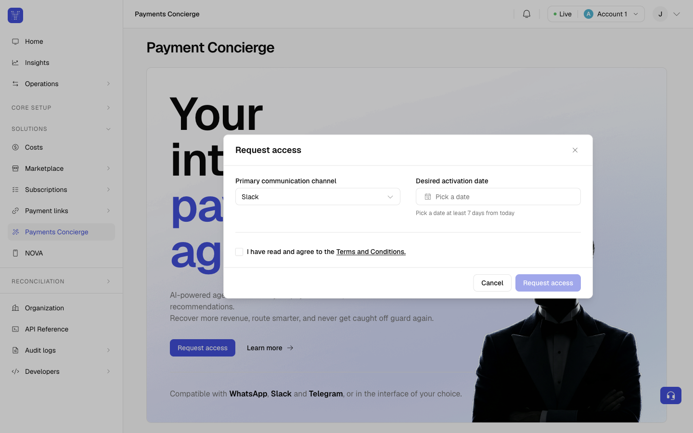</Frame>

    <Note>
    **Etapa exclusiva para admins**

    Somente um admin pode solicitar acesso. A data de ativação deve ser de pelo menos 7 dias a partir de hoje.
    </Note>
  </Step>
  <Step title="Atribuir níveis de acesso com funções">
    Depois que o Concierge estiver ativo, você decide o que cada pessoa pode fazer. Há dois níveis de acesso:

    <CardGroup cols={2}>
      <Card title="Admin">
        Configura o Concierge para toda a organização: conecta os canais de comunicação, gerencia quem tem acesso, define o conhecimento que o Concierge usa e cria tarefas programadas para a organização ou para pessoas específicas.
      </Card>
      <Card title="Membro">
        Configura o Concierge apenas para si: configura os próprios canais e as próprias tarefas programadas, sem mexer nas configurações da organização.
      </Card>
    </CardGroup>

    Você concede esses níveis por meio de funções personalizadas. Em **Organization → Roles → Create role**, crie uma função, habilite a permissão do Payment Concierge que corresponde ao nível e atribua a função à pessoa:

    * **20.1 Manage Payment Concierge**: concede a visão de Admin.
    * **20.2 Manage Member Payment Concierge**: concede a visão de Membro.

    <Frame>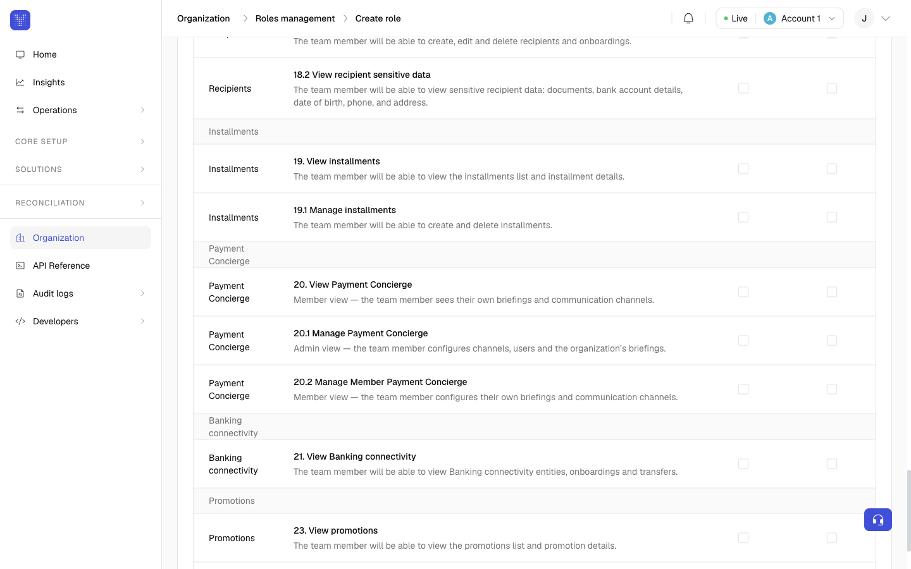</Frame>
  </Step>
</Steps>

<Note>
**As visões se adaptam à função**

A seção se ajusta automaticamente à função de cada pessoa, para que ela veja apenas o que se aplica a ela.
</Note>

## Para admins {#for-admins}

Como admin, você vê três abas: **Access**, **Scheduled tasks** e **Concierge knowledge**.

<Tabs>
  <Tab title="Acesso">
    É aqui que você decide onde o Concierge pode conversar e quem ele pode alcançar.

    **Communication channels.** Selecione os canais em que o Payments Concierge pode conversar: Slack, WhatsApp, Telegram e Microsoft Teams.

    <Frame>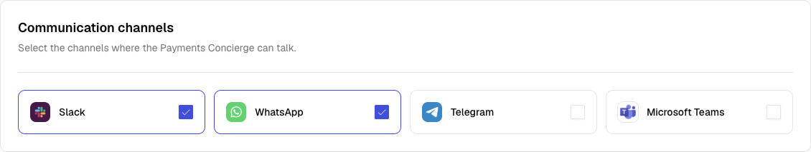</Frame>

    Conectar o Microsoft Teams exige algumas etapas a mais. Quando você o conecta, um passo a passo guiado mostra como trazer o Concierge para a sua organização:

    * Crie o bot no Azure.
    * Habilite o canal do Microsoft Teams.
    * Copie o Microsoft App ID e o App Tenant ID.
    * Gere e copie um client secret.
    * Conceda a permissão do Microsoft Graph, para que o Concierge possa identificar os seus usuários por email.
    * Faça o upload do app no Teams e selecione **Connect**.

    <Note>
    **Quem pode conectar o Microsoft Teams**

    Esta etapa mexe no registro do seu app no Azure e exige o consentimento de um admin do tenant, então você vai precisar de um admin do Teams da sua organização ou de um desenvolvedor para concluí-la.
    </Note>

    **Group chats.** Adicione os canais ou grupos compartilhados em que o Concierge pode publicar: um canal do Slack, um grupo do Telegram ou um canal do Microsoft Teams. Selecione **Add group chat**, escolha a plataforma e cole o link do canal (por exemplo `https://acme.slack.com/archives/C0BH7B56GD6`). O painel inclui um passo a passo **How to add the Concierge** (com um vídeo curto) que mostra de onde copiar o link.

    <Frame>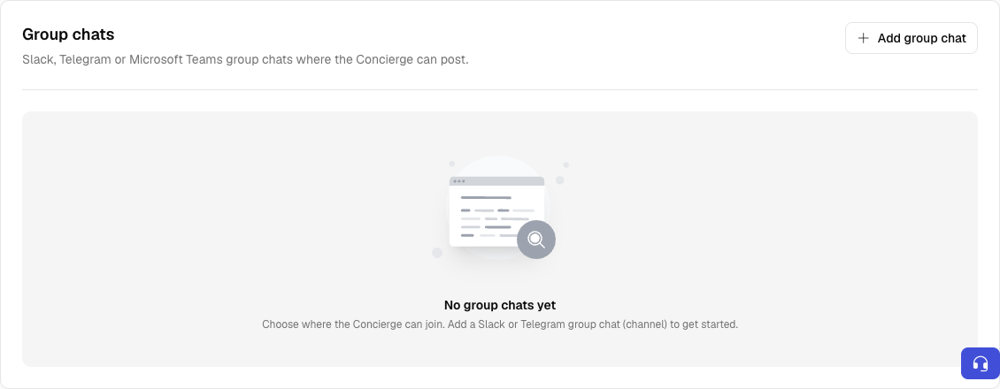</Frame>

    <Frame>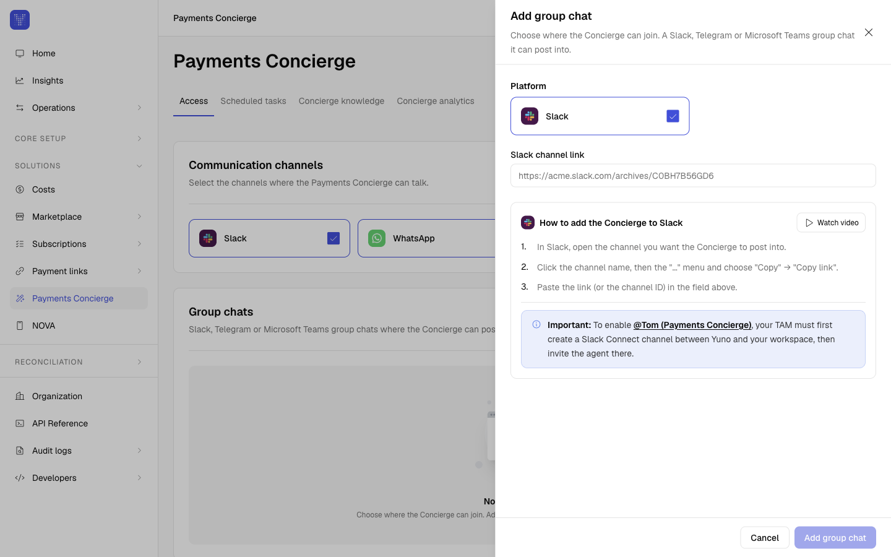</Frame>

    <Note>
    **Chats em grupo no Slack precisam de um canal do Slack Connect**

    Para habilitar o **@Tom (Payments Concierge)** no Slack, o seu TAM precisa primeiro criar um canal do Slack Connect entre a Yuno e o seu workspace e depois convidar o agente para ele.
    </Note>

    **Users with access.** Associe cada pessoa da sua organização à identidade dela no Slack, no WhatsApp ou no Telegram, para que o Concierge saiba quem está escrevendo e possa alcançá-la por DM. Você não precisa conhecer nenhum formato especial. Cada canal tem um link **How do I find it?** que orienta a pessoa a obter o próprio ID:

    * **Slack**: procure **@Tom (Payments Concierge)** no Slack e adicione o link do seu perfil do Slack para que o agente possa enviar DMs para você.
    * **WhatsApp**: abra um chat com o agente em **Open WhatsApp**, ou compartilhe o link com a sua equipe. Adicione o seu número de telefone com o código do país (por exemplo `+573000000000`).
    * **Telegram**: abra um chat com o agente em **Open Telegram** e adicione o seu ID do Telegram para que ele possa alcançar você por DM.

    Defina a identidade de cada pessoa nos canais dela diretamente na tabela de usuários. Para gerenciar quem pertence à sua organização e as funções de cada um, selecione **Manage access**.

    <Frame>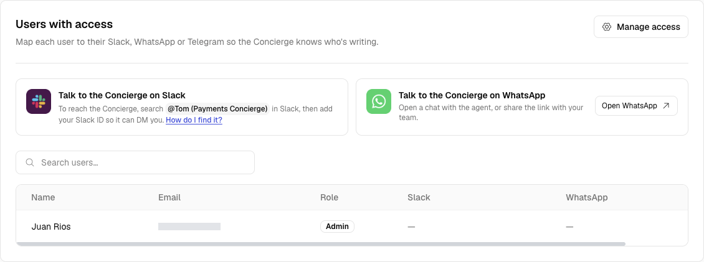</Frame>
  </Tab>
  <Tab title="Tarefas programadas">
    Tarefas recorrentes que o Concierge executa e entrega automaticamente, para toda a organização ou para uma única pessoa. Para adicionar uma, selecione **New scheduled task** e preencha o painel:

    <Steps>
      <Step title="Para quem é?">
        Escolha **Whole organization** (todos com acesso recebem) ou **Just me** (só você recebe).

        <Frame>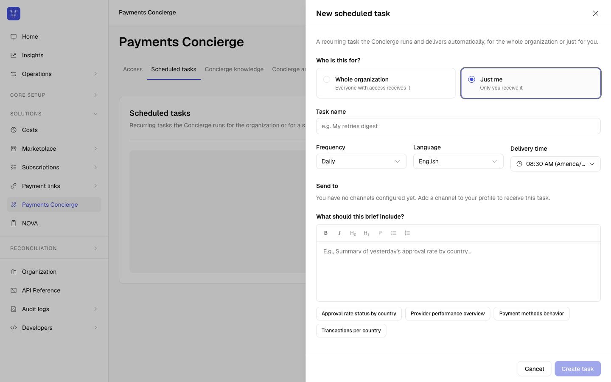</Frame>
      </Step>
      <Step title="Nome da tarefa">
        Dê um nome à tarefa, por exemplo *Daily Morning Brief*.
      </Step>
      <Step title="Frequência, idioma e horário de entrega">
        Defina com que frequência ela é executada (Daily, Weekly ou Monthly), o idioma e quando ela é entregue. O horário de entrega usa o fuso horário configurado nas configurações do seu dashboard.

        Weekly adiciona um campo **Day of the week**, e Monthly adiciona um campo **Day of the month**.

        <Frame>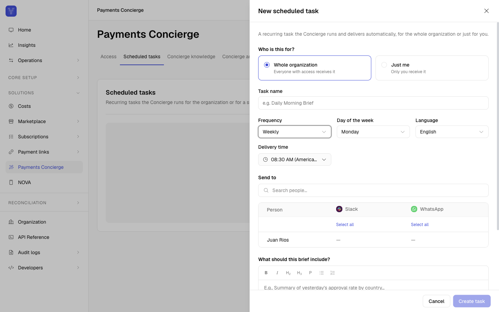</Frame>

        <Frame>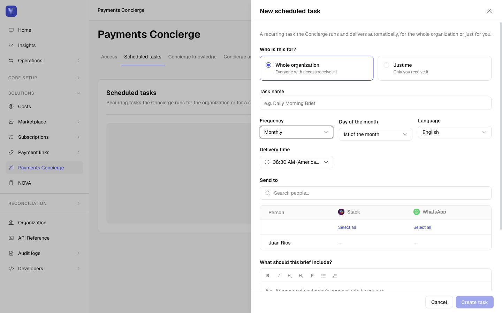</Frame>
      </Step>
      <Step title="O que este resumo deve incluir?">
        Descreva, em linguagem simples, o que o relatório deve cobrir, por exemplo: *"Resumo da taxa de aprovação de ontem por país."*

        <Frame>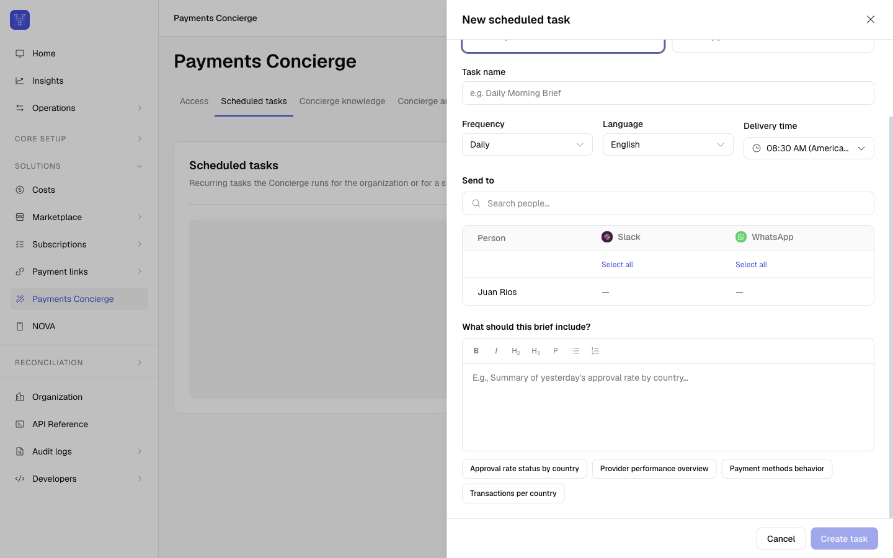</Frame>
      </Step>
      <Step title="Enviar para">
        Escolha as pessoas e os chats em grupo que recebem a tarefa, por canal (Slack, WhatsApp), ou use **Select all**.
      </Step>
      <Step title="Criar tarefa">
        Selecione **Create task**.
      </Step>
    </Steps>

    <Frame>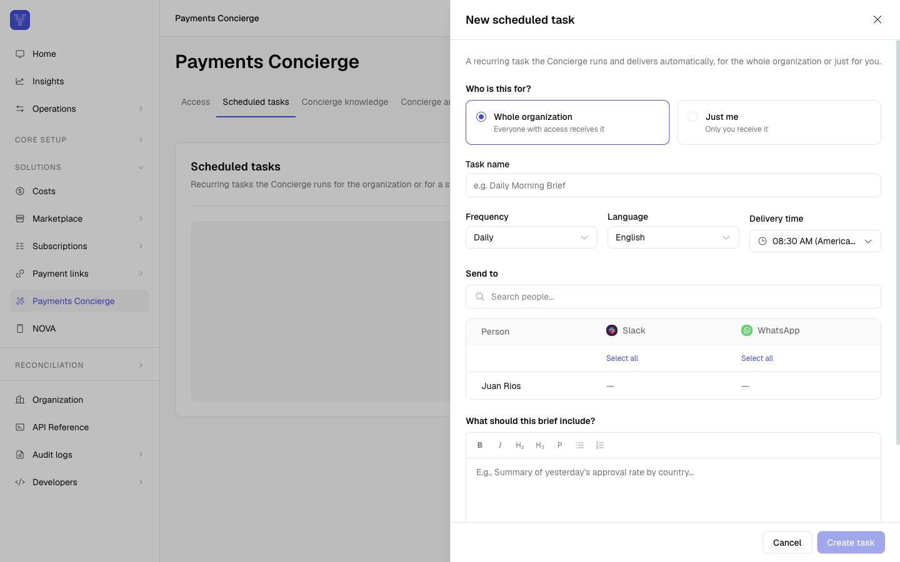</Frame>

    Você pode editar, pausar, retomar ou excluir qualquer tarefa a qualquer momento, e vê aqui todas as tarefas da sua organização.
  </Tab>
  <Tab title="Conhecimento do Concierge">
    Os produtos, o tom e as políticas que o Concierge aplica em todas as conversas. Use esta aba para dar ao Concierge contexto sobre o negócio, por exemplo os mercados em que você opera, os meios de pagamento que você prioriza e o tom que você quer que ele use. Escreva no editor e selecione **Save context**, e o Concierge passa a aplicar esse contexto em todos os lugares.

    <Frame>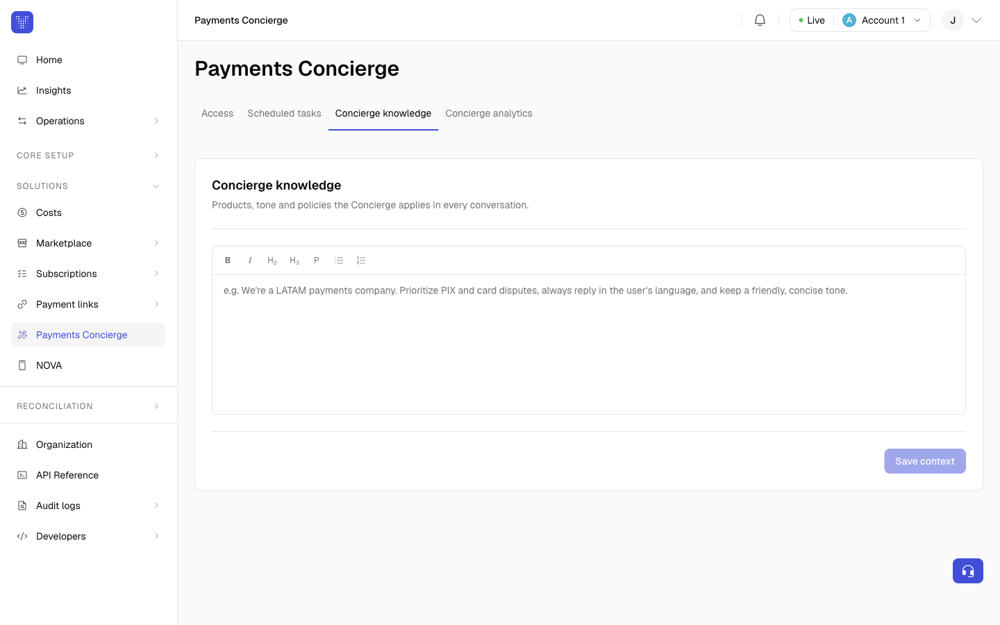</Frame>
  </Tab>
</Tabs>

## Para membros {#for-members}

Como membro, a seção Payment Concierge é uma única página focada em você: os canais em que o Concierge pode alcançar você e as suas próprias tarefas programadas. Você não vê as configurações de Access nem de Concierge knowledge da organização.

<Frame>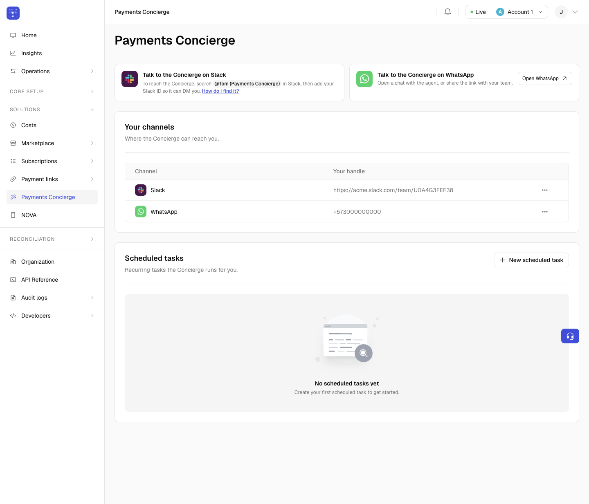</Frame>

**Your channels.** Configure a sua própria identidade para que o Concierge possa alcançar você nos canais que o seu admin habilitou. Você não precisa conhecer nenhum formato especial. Cada canal tem um link **How do I find it?** que mostra exatamente como obter o seu ID:

* **Slack**: procure **@Tom (Payments Concierge)** e adicione o link do seu perfil do Slack para que ele possa enviar DMs para você.
* **WhatsApp**: abra um chat com o agente em **Open WhatsApp** e adicione o seu número de telefone com o código do país (por exemplo `+573000000000`).
* **Telegram**: abra um chat com o agente em **Open Telegram** e adicione o seu ID do Telegram.

Estes são os seus identificadores pessoais; você não gerencia os canais da organização.

**Your scheduled tasks.** Crie tarefas recorrentes que o Concierge executa para você. Você escolhe a cadência, o horário de entrega, o idioma e sobre o que ele informa, e tudo é entregue nos seus canais. Você só vê as tarefas destinadas a você: as que você criou, as que um admin atribuiu a você, além de qualquer resumo da organização que chegue a todos. Você pode editar, pausar, retomar ou excluir as suas próprias tarefas a qualquer momento.

Você pode acessar o Payment Concierge pelo [dashboard da Yuno](https://dashboard.y.uno/).
