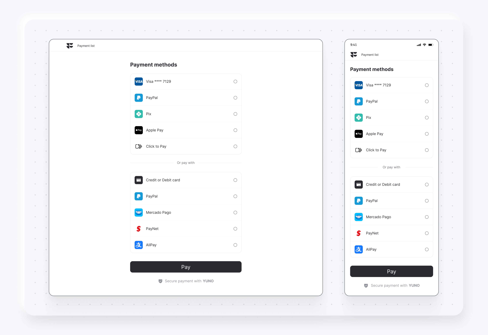

A Yuno oferece uma ampla variedade de conexões com diversos processadores e meios de pagamento, ampliando essa cobertura continuamente. Esta página explica os meios de pagamento disponíveis, os recursos de cada um e como eles estão organizados na plataforma da Yuno.

## O que é um meio de pagamento? {#what-is-a-payment-method}

Para entender melhor o processo de pagamento, é essencial diferenciar meios de pagamento e processadores.

* **Meio de pagamento**: um meio de pagamento é uma forma de coletar as informações de pagamento do cliente e enviá-las a um processador para o processamento do pagamento. Os meios de pagamento mais comuns incluem:
  * Cartões de crédito/débito
  * Carteiras digitais (Apple Pay, Google Pay)
  * Transferências bancárias (iDeal)
  * Serviços de compre agora e pague depois (Klarna)
  * Meios de pagamento regionais (UPI, Pix)
* **Processadores**: os processadores atuam como intermediários entre os bancos do lojista e do cliente: eles gerenciam reembolsos e cancelamentos e cuidam do processamento efetivo das informações obtidas pelo meio de pagamento.

## Diferenças entre os meios de pagamento {#differences-between-payment-methods}

Os meios de pagamento podem diferir bastante quanto ao processamento. Além disso, alguns aceitam cadastro e outros não. Os meios de pagamento podem ser divididos de acordo com as suas **características de cadastro** e a **interação do usuário**.

### Interação do usuário {#user-interaction}

O fluxo dos meios de pagamento pode variar de acordo com os recursos de cada processador e as ações exigidas do cliente para concluir o pagamento. Há dois tipos principais: síncrono e assíncrono.

* **Síncrono**: os meios de pagamento síncronos fornecem um resultado final instantâneo assim que o cliente clica em **Pay**, e o pagamento é criado pelo lojista em segundo plano. Nesses casos, você não precisa de webhooks para saber o resultado, pois ele virá na resposta do pagamento.
* **Assíncrono**: os meios de pagamento assíncronos, por outro lado, exigem uma etapa adicional do cliente para finalizar o pagamento. Esses pagamentos terão o status intermediário `PENDING` até que o cliente conclua o pagamento ou que o processador notifique a Yuno sobre o resultado final. Para acompanhar esses status, é importante configurar [Webhooks](/pt-br/docs/basic-concepts/webhooks-1) na sua conta da Yuno para receber atualizações instantâneas.

### Cadastro {#enrollment}

Na Yuno, **cadastro** é o processo de armazenar as informações do meio de pagamento de um cliente para compras futuras. Isso permite que o cliente ou o lojista inicie transações sem exigir nenhuma informação adicional do cliente.

* **Meios de pagamento cadastráveis**: a Yuno oferece vários meios de pagamento para cadastro, incluindo **cartões de crédito/débito** e meios alternativos, principalmente carteiras, que permitem que os clientes forneçam as informações da conta para pagamentos futuros.
* **Meios de pagamento não cadastráveis**: os meios de pagamento que não podem ser cadastrados costumam ser meios alternativos, como os que dependem de transferências bancárias ou pagamentos em dinheiro, que podem exigir que o cliente realize uma ação a cada pagamento.

<Frame></Frame>