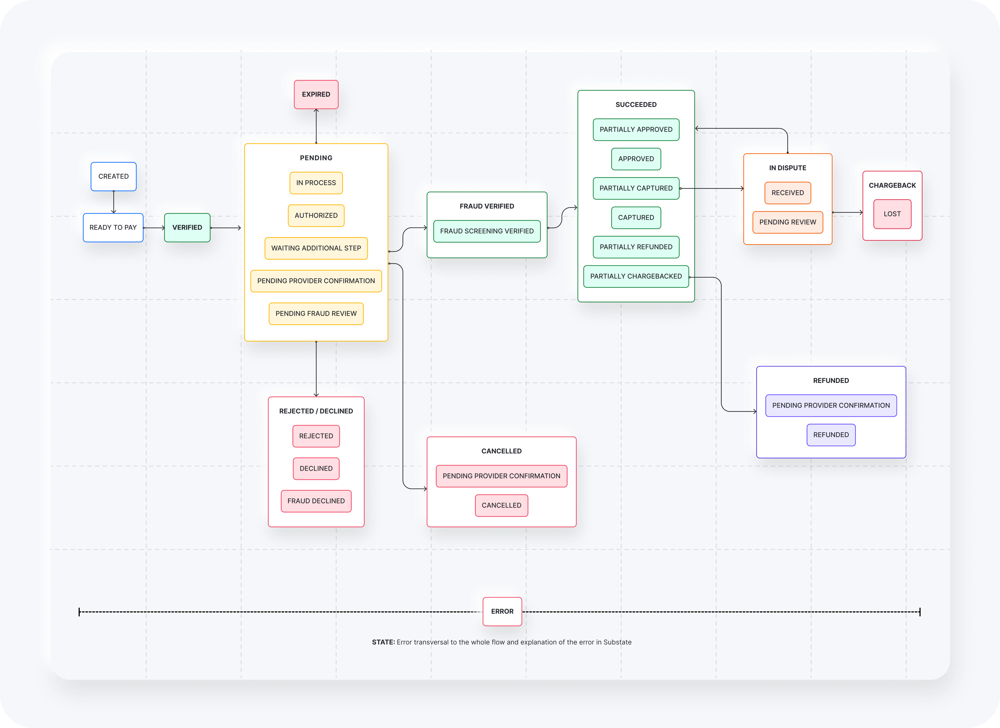

## O que é um pagamento? {#what-is-a-payment}

Um pagamento representa a transação de um usuário, independentemente dos processadores ou meios de pagamento usados.

Os pagamentos reúnem detalhes essenciais do pedido, incluindo informações do cliente, valor total, moeda, produtos, detalhes de envio e mais. Para entender melhor as interações entre pedidos e pagamentos, consulte a página [Transações](/docs/basic-concepts/transactions).

## Fluxo de pagamento {#payment-workflow}

O fluxo a seguir mostra os possíveis status de pagamento e suas conexões. Todo pagamento tem um status que segue um ciclo de vida padronizado, garantindo uma capacidade consistente em todos os meios de pagamento. Um pagamento passa por uma sequência de status até a conclusão. O diagrama abaixo explica os possíveis resultados com base nos status das transações.

<Frame></Frame>

Para mais detalhes sobre códigos e mensagens de status, consulte a [referência da API de pagamentos](/reference/payments/status-and-response-codes/payment).

## Pagamentos e transações {#payments-and-transactions}

Um pagamento é composto por várias transações que determinam seu resultado final. Se você habilitar diferentes conexões para a rota do seu meio de pagamento, como prevenção a fraude, 3D Secure ou fallbacks de provedor, a Yuno adiciona as transações correspondentes ao pagamento. Essas transações passam a fazer parte do ciclo de vida do pagamento.

Na seção [Payments](/docs/using-yuno/dashboard-overview/payments) do seu dashboard da Yuno, você pode ver e exportar todos os detalhes de pagamentos e transações.

Para mais detalhes sobre como as transações afetam os resultados dos pagamentos, consulte a seção [Transações](/docs/basic-concepts/transactions).