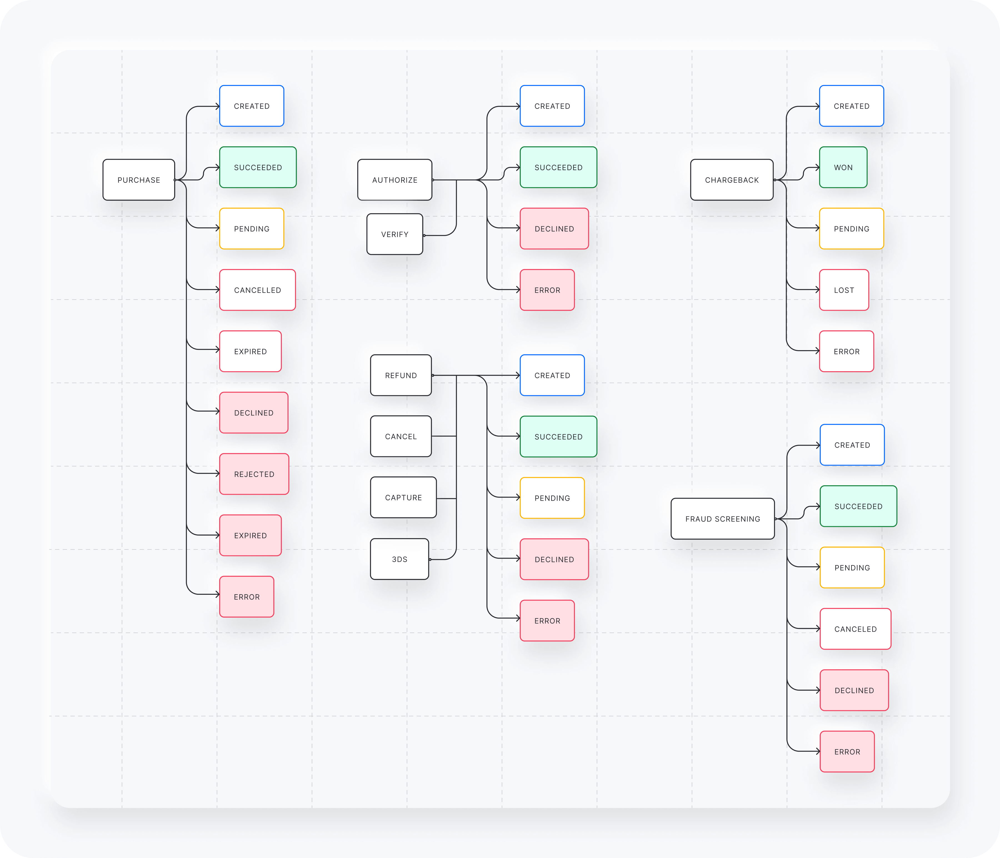

## O que é uma transação? {#what-is-a-transaction}

Cada pagamento tem uma ou mais transações associadas. Um pagamento na Yuno pode passar por vários processadores por meio de fallbacks, novas tentativas ou roteamento dividido. Cada um desses caminhos pode adicionar várias transações ao pagamento. Você pode conferir todas as transações relacionadas a um pagamento na [linha do tempo do pagamento](/pt-br/docs/using-yuno/dashboard-overview/payments) no seu dashboard da Yuno.

Na Yuno, as transações são divididas em transações **primárias** e **secundárias**. Além disso, cada transação pode ter um status diferente, dependendo da etapa de processamento.

## Tipos e status de transação {#transaction-types-and-statuses}

### Transações primárias {#primary-transactions}

As transações primárias iniciam um pagamento e podem ser de um destes três tipos:

* **Compra**: uma transação de venda padrão.
* **Autorização**: uma transação usada para autorizar um valor de pagamento a ser capturado posteriormente.
* **Verificação**: uma transação para verificar se o cliente está usando um meio de pagamento válido.

### Transações secundárias {#secondary-transactions}

As transações secundárias são transações adicionais que afetam o resultado final do pagamento e da transação primária. As transações secundárias podem ser:

* **Reembolso**: um reembolso feito sobre a transação inicial, que pode ser total ou parcial.
* **Cancelamento**: o cancelamento de uma autorização inicial.
* **Captura**: a captura de fundos de uma transação de autorização inicial, que pode ser total ou parcial.
* **Chargeback**: uma disputa iniciada pelo cliente em relação à transação inicial.
* **3DS**: uma verificação 3D Secure (3DS) de uma transação inicial.
* **Análise de fraude**: uma verificação de análise de fraude de uma transação inicial. Elas são representadas como `FRAUD_SCREENING` na resposta de pagamentos.
* **Transferências de marketplace**: transferências independentes dentro de um Marketplace, representadas como `SPLIT_TRANSFER` para transferências diretas e `SPLIT_TRANSFER_REVERSE` para estornos independentes. Transferências vinculadas a uma transação de pagamento também podem ser estornadas e são representadas como `SPLIT_TRANSFER_REVERSAL`.

Todos os status possíveis para cada tipo de transação são apresentados abaixo.

<Frame></Frame>

Consulte a [referência da API de Transactions](/reference/payments/status-and-response-codes/transaction) para informações mais detalhadas sobre os códigos e as mensagens de status de transação.

A seção [Payments](/pt-br/docs/using-yuno/dashboard-overview/payments) do seu dashboard da Yuno permite visualizar seus pagamentos e transações. A partir dela, você também pode exportar essas informações.