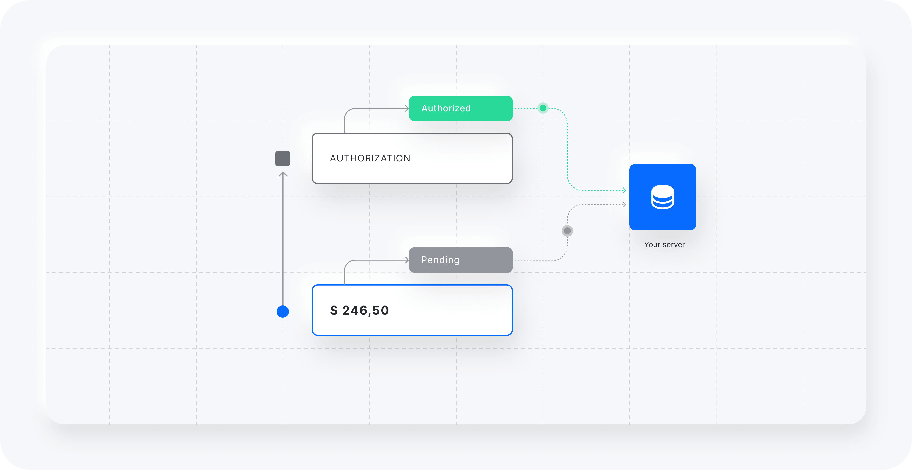

Um webhook é a forma como a Yuno notifica seu sistema sobre eventos, como um pagamento sendo autorizado ou uma assinatura sendo renovada, por meio de um `POST` HTTP para uma URL que você configura, em vez de o seu sistema precisar consultar atualizações periodicamente.

<Frame></Frame>

Consulte a [visão geral de webhooks](/docs/webhooks) para ver o comportamento de entrega, como configurar um webhook pelo dashboard ou pela API e o catálogo completo de eventos.
