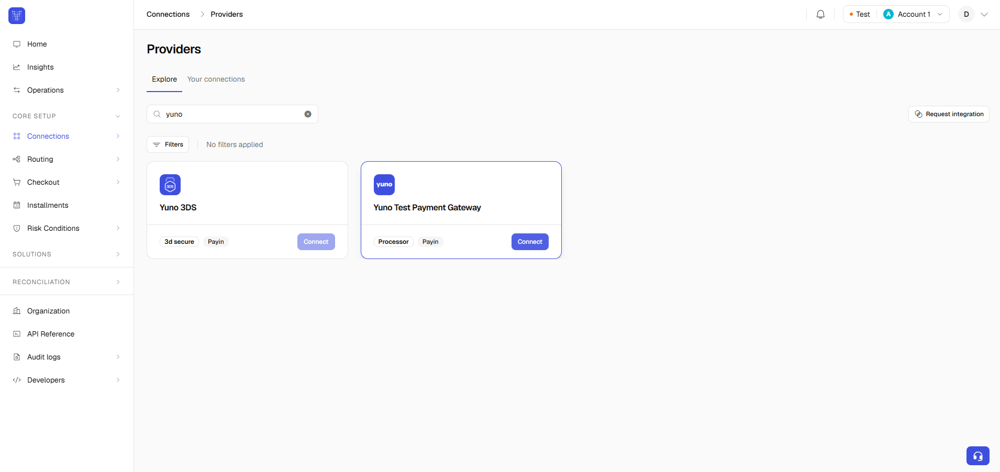
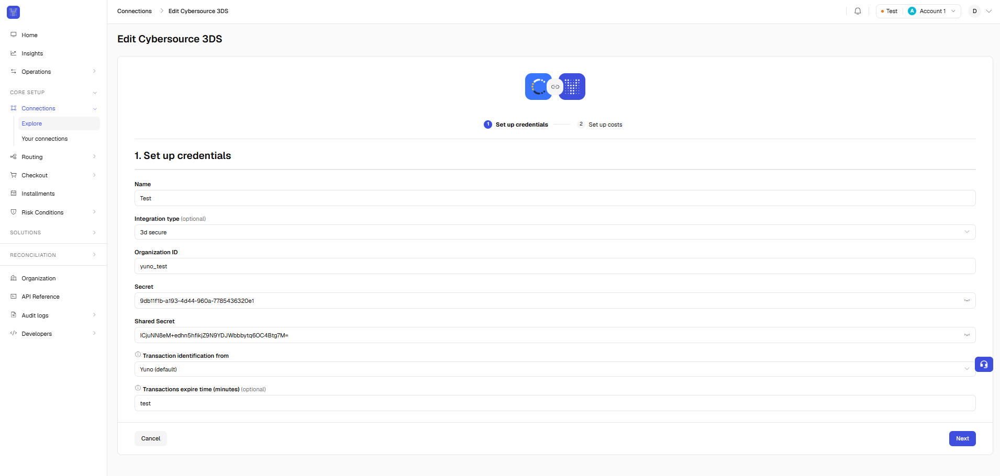
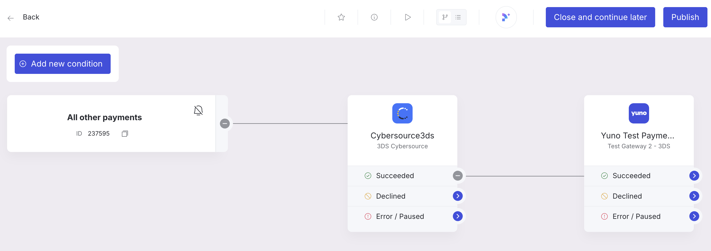
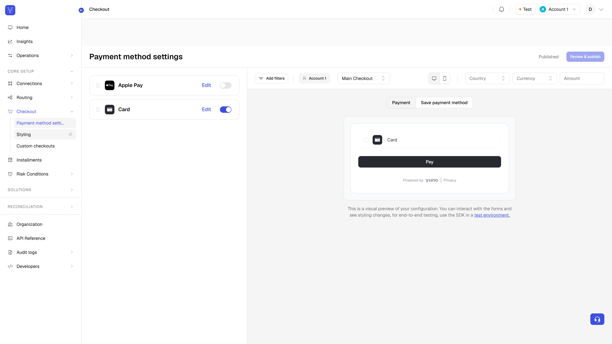

Use este guia passo a passo para configurar e testar o 3D Secure na Yuno. Você vai configurar uma conexão com 3DS habilitado e as credenciais do provedor, adicionar o 3DS ao seu roteamento, habilitar Card no Checkout Builder e validar os pagamentos usando o Yuno Testing Gateway, o Yuno SDK ou a API. Cartões de teste por bandeira, códigos OTP e notas de solução de problemas estão incluídos para verificar cenários frictionless e de desafio.

## Cartões de teste para o fluxo 3DS {#testing-cards-for-3ds-flow}

Use os cartões de cada bandeira abaixo para validar o 3DS no sandbox. No ambiente de preview, um simulador imita o Directory Server (DS) e o Access Control Server (ACS) para que você possa testar os resultados frictionless e de desafio. Cada tabela mostra o número do cartão com os resultados esperados de 3DS2 e as respostas VERes (Verification Response)/PARes (Payer Authentication Response) de 3DS1. Use os códigos de senha única (OTP) no final para concluir os cenários de desafio.

<AccordionGroup>
<Accordion title="Amex">
<table>
  <thead>
    <tr>
      <th>Número do cartão</th>
      <th>Resposta esperada 3DS 2.x</th>
      <th>Resposta esperada 3DS 1.x DS (VERes)</th>
      <th>Resposta esperada 3DS 1.x ACS (PARes)</th>
    </tr>
  </thead>
  <tbody>
    <tr><td>341502098634895</td><td>AUTHENTICATED_APPLICATION_FRICTIONLESS</td><td>ENROLLED_Y</td><td>TRANSACTION_STATUS_Y</td></tr>
    <tr><td>348638267931507</td><td>BROWSER_CHALLENGE</td><td>ENROLLED_Y</td><td>TRANSACTION_CHALLENGE_OTP</td></tr>
    <tr><td>345695399207589</td><td>NOT_AUTHENTICATED_APPLICATION_FRICTIONLESS</td><td>ENROLLED_Y</td><td>TRANSACTION_STATUS_N</td></tr>
    <tr><td>349531373081938</td><td>APPLICATION_CHALLENGE</td><td>ENROLLED_Y</td><td>TRANSACTION_STATUS_N</td></tr>
    <tr><td>342316317472410</td><td>APPLICATION_CHALLENGE_SDK_TRANS_ID_INVALID_FORMAT</td><td>ENROLLED_Y</td><td>TRANSACTION_STATUS_N</td></tr>
    <tr><td>347899129656655</td><td>AUTHENTICATED_BROWSER_FRICTIONLESS</td><td>ENROLLED_Y</td><td>TRANSACTION_STATUS_Y</td></tr>
    <tr><td>345197771649926</td><td>NOT_AUTHENTICATED_BROWSER_FRICTIONLESS</td><td>ENROLLED_Y</td><td>TRANSACTION_STATUS_N</td></tr>
    <tr><td>372021106351394</td><td>BROWSER_CHALLENGE</td><td>ENROLLED_Y</td><td>TRANSACTION_CHALLENGE_OTP</td></tr>
    <tr><td>3734123412340000</td><td>NOT_AUTHENTICATED_BROWSER_FRICTIONLESS</td><td>ENROLLED_Y</td><td>TRANSACTION_STATUS_N</td></tr>
    <tr><td>3434567891111005</td><td>BROWSER_CHALLENGE</td><td>ENROLLED_Y</td><td>TRANSACTION_CHALLENGE_OTP</td></tr>
    <tr><td>3794521996036850</td><td>BROWSER_CHALLENGE</td><td>ENROLLED_Y</td><td>TRANSACTION_CHALLENGE_OTP</td></tr>
  </tbody>
</table>
</Accordion>

<Accordion title="Mastercard">
<table>
  <thead>
    <tr>
      <th>Número do cartão</th>
      <th>Resposta esperada 3DS 2.x</th>
      <th>Resposta esperada 3DS 1.x DS (VERes)</th>
      <th>Resposta esperada 3DS 1.x ACS (PARes)</th>
    </tr>
  </thead>
  <tbody>
    <tr><td>5333259155643223</td><td>AUTHENTICATED_APPLICATION_FRICTIONLESS</td><td>ENROLLED_Y</td><td>TRANSACTION_STATUS_Y</td></tr>
    <tr><td>5306889942833340</td><td>BROWSER_CHALLENGE</td><td>ENROLLED_Y</td><td>TRANSACTION_CHALLENGE_OTP</td></tr>
    <tr><td>5328720384582224</td><td>NOT_AUTHENTICATED_APPLICATION_FRICTIONLESS</td><td>ENROLLED_Y</td><td>TRANSACTION_STATUS_N</td></tr>
    <tr><td>5267648608924299</td><td>APPLICATION_CHALLENGE</td><td>ENROLLED_Y</td><td>TRANSACTION_STATUS_N</td></tr>
    <tr><td>5187434643593002</td><td>APPLICATION_CHALLENGE_SDK_TRANS_ID_INVALID_FORMAT</td><td>ENROLLED_Y</td><td>TRANSACTION_STATUS_N</td></tr>
    <tr><td>5512459816707531</td><td>AUTHENTICATED_BROWSER_FRICTIONLESS</td><td>ENROLLED_Y</td><td>TRANSACTION_STATUS_Y</td></tr>
    <tr><td>5487971631330522</td><td>NOT_AUTHENTICATED_BROWSER_FRICTIONLESS</td><td>ENROLLED_Y</td><td>TRANSACTION_STATUS_N</td></tr>
    <tr><td>5424184049821670</td><td>BROWSER_CHALLENGE</td><td>ENROLLED_Y</td><td>TRANSACTION_CHALLENGE_OTP</td></tr>
    <tr><td>5204240438720050123</td><td>BROWSER_CHALLENGE</td><td>ENROLLED_Y</td><td>TRANSACTION_CHALLENGE_OTP</td></tr>
    <tr><td>5250548692069390</td><td>BROWSER_CHALLENGE</td><td>ENROLLED_Y</td><td>TRANSACTION_CHALLENGE_OTP</td></tr>
    <tr><td>5641523891636636</td><td>BROWSER_CHALLENGE</td><td>ENROLLED_Y</td><td>TRANSACTION_CHALLENGE_OTP</td></tr>
  </tbody>
</table>
</Accordion>

<Accordion title="Visa">

<Note>
  `N/A` significa que o caso de teste dispara um erro de protocolo ou de transporte antes de chegar à etapa do DS ou do ACS, então nenhuma resposta de DS/ACS é retornada para esse cartão.
</Note>

<table>
  <thead>
    <tr>
      <th>Número do cartão</th>
      <th>Resposta esperada 3DS 2.x</th>
      <th>Resposta esperada 3DS 1.x DS (VERes)</th>
      <th>Resposta esperada 3DS 1.x ACS (PARes)</th>
    </tr>
  </thead>
  <tbody>
    <tr><td>4556557955726624</td><td>AUTHENTICATED_APPLICATION_FRICTIONLESS</td><td>ENROLLED_Y</td><td>TRANSACTION_STATUS_Y</td></tr>
    <tr><td>4916994064252017</td><td>BROWSER_CHALLENGE</td><td>ENROLLED_Y</td><td>TRANSACTION_CHALLENGE_OTP</td></tr>
    <tr><td>4556104160382032</td><td>NOT_AUTHENTICATED_APPLICATION_FRICTIONLESS</td><td>ENROLLED_Y</td><td>TRANSACTION_STATUS_N</td></tr>
    <tr><td>4024007189449340</td><td>APPLICATION_CHALLENGE</td><td>ENROLLED_Y</td><td>TRANSACTION_STATUS_N</td></tr>
    <tr><td>4024007179872394</td><td>APPLICATION_CHALLENGE_SDK_TRANS_ID_INVALID_FORMAT</td><td>ENROLLED_Y</td><td>TRANSACTION_STATUS_N</td></tr>
    <tr><td>4929251897047956</td><td>AUTHENTICATED_BROWSER_FRICTIONLESS</td><td>ENROLLED_Y</td><td>TRANSACTION_STATUS_Y</td></tr>
    <tr><td>4716429323842524</td><td>NOT_AUTHENTICATED_BROWSER_FRICTIONLESS</td><td>ENROLLED_Y</td><td>TRANSACTION_STATUS_N</td></tr>
    <tr><td>4234123412340003</td><td>BROWSER_CHALLENGE</td><td>ENROLLED_Y</td><td>TRANSACTION_CHALLENGE_OTP</td></tr>
    <tr><td>4604633194219929</td><td>BROWSER_CHALLENGE</td><td>ENROLLED_Y</td><td>TRANSACTION_CHALLENGE_OTP</td></tr>
    <tr><td>4485436455354151</td><td>BROWSER_FRICTIONLESS_MISSING_DS_TRANS_ID</td><td>N/A</td><td>N/A</td></tr>
    <tr><td>4556962659911995</td><td>APPLICATION_FRICTIONLESS_MISSING_SDK_TRANS_ID</td><td>ENROLLED_Y</td><td>TRANSACTION_STATUS_N</td></tr>
    <tr><td>4539837572943550</td><td>BROWSER_FRICTIONLESS_MISSING_DS_TRANS_ID</td><td>ENROLLED_Y</td><td>TRANSACTION_STATUS_N</td></tr>
    <tr><td>4024007176265022</td><td>BROWSER_CHALLENGE_MISSING_ACS_URL</td><td>ENROLLED_Y</td><td>TRANSACTION_STATUS_N</td></tr>
    <tr><td>4716125059847899</td><td>THREE_RI</td><td>ENROLLED_Y</td><td>TRANSACTION_STATUS_N</td></tr>
    <tr><td>4556362626719763</td><td>PROTOCOL_ERROR</td><td>ENROLLED_Y</td><td>TRANSACTION_STATUS_N</td></tr>
    <tr><td>4234123412340000</td><td>AUTHENTICATED_BROWSER_FRICTIONLESS</td><td>ENROLLED_Y</td><td>TRANSACTION_STATUS_Y</td></tr>
    <tr><td>4234123412340006</td><td>UNAVAILABLE_BROWSER_FRICTIONLESS</td><td>ENROLLED_Y</td><td>TRANSACTION_STATUS_U</td></tr>
    <tr><td>4234123412340007</td><td>ATTEMPTED_BROWSER_FRICTIONLESS</td><td>ENROLLED_Y</td><td>TRANSACTION_STATUS_A</td></tr>
    <tr><td>4234123412340001</td><td>NOT_ENROLLED</td><td>ENROLLED_N</td><td>N/A</td></tr>
    <tr><td>4234123412340002</td><td>NOT ENROLLED (VeRes é o erro 404 "Card account number not found in card ranges from Directory Server")</td><td>ENROLLED_N (NOT APPLICABLE)</td><td>N/A</td></tr>
    <tr><td>4234123412340100</td><td>MISSING_ROOT</td><td>N/A</td><td>N/A</td></tr>
    <tr><td>4234123412340101</td><td>MISSING_MESSAGE</td><td>N/A</td><td>N/A</td></tr>
    <tr><td>4234123412340102</td><td>INVALID_MESSAGE</td><td>N/A</td><td>N/A</td></tr>
    <tr><td>4234123412340103</td><td>MISSING_VERSION</td><td>N/A</td><td>N/A</td></tr>
    <tr><td>4234123412340104</td><td>ILLEGAL_VERSION</td><td>N/A</td><td>N/A</td></tr>
    <tr><td>4234123412340105</td><td>MISSING_URL</td><td>N/A</td><td>N/A</td></tr>
    <tr><td>4234123412340106</td><td>ILLEGAL_URL</td><td>N/A</td><td>N/A</td></tr>
    <tr><td>4234123412340107</td><td>MISSING_ENROLLED</td><td>N/A</td><td>N/A</td></tr>
    <tr><td>4234123412340108</td><td>ILLEGAL_ENROLLED</td><td>N/A</td><td>N/A</td></tr>
    <tr><td>4234123412340109</td><td>ILLEGAL_EXTENSION</td><td>N/A</td><td>N/A</td></tr>
    <tr><td>4234123412340200</td><td>ERROR_CUSTOM</td><td>N/A</td><td>N/A</td></tr>
    <tr><td>4234123412340201</td><td>ERROR_1</td><td>N/A</td><td>N/A</td></tr>
    <tr><td>4234123412340202</td><td>ERROR_2</td><td>N/A</td><td>N/A</td></tr>
    <tr><td>4234123412340203</td><td>ERROR_3</td><td>N/A</td><td>N/A</td></tr>
    <tr><td>4234123412340204</td><td>ERROR_4</td><td>N/A</td><td>N/A</td></tr>
    <tr><td>4234123412340205</td><td>ERROR_5</td><td>N/A</td><td>N/A</td></tr>
    <tr><td>4234123412340206</td><td>ERROR_6</td><td>N/A</td><td>N/A</td></tr>
    <tr><td>4234123412340220</td><td>ERROR_CUSTOM_WITH_DIFFERENT_MESSAGE_ID</td><td>N/A</td><td>N/A</td></tr>
    <tr><td>4234123412340250</td><td>ERROR_50</td><td>N/A</td><td>N/A</td></tr>
    <tr><td>4234123412340251</td><td>ERROR_51</td><td>N/A</td><td>N/A</td></tr>
    <tr><td>4234123412340252</td><td>ERROR_52</td><td>N/A</td><td>N/A</td></tr>
    <tr><td>4234123412340253</td><td>ERROR_53</td><td>N/A</td><td>N/A</td></tr>
    <tr><td>4234123412340258</td><td>ERROR_58</td><td>N/A</td><td>N/A</td></tr>
    <tr><td>4234123412340298</td><td>ERROR_98</td><td>N/A</td><td>N/A</td></tr>
    <tr><td>4234123412340299</td><td>ERROR_99</td><td>N/A</td><td>N/A</td></tr>
    <tr><td>4234123412340300</td><td>IREQ_CUSTOM</td><td>N/A</td><td>N/A</td></tr>
    <tr><td>4234123412340301</td><td>IREQ_ENROLLED_Y</td><td>N/A</td><td>N/A</td></tr>
    <tr><td>4234123412340350</td><td>IREQ_50</td><td>N/A</td><td>N/A</td></tr>
    <tr><td>4234123412340351</td><td>IREQ_51</td><td>N/A</td><td>N/A</td></tr>
    <tr><td>4234123412340352</td><td>IREQ_52</td><td>N/A</td><td>N/A</td></tr>
    <tr><td>4234123412340353</td><td>IREQ_53</td><td>N/A</td><td>N/A</td></tr>
    <tr><td>4234123412340354</td><td>IREQ_54</td><td>N/A</td><td>N/A</td></tr>
    <tr><td>4234123412340355</td><td>IREQ_55</td><td>N/A</td><td>N/A</td></tr>
    <tr><td>4234123412340356</td><td>IREQ_56</td><td>N/A</td><td>N/A</td></tr>
    <tr><td>4234123412340358</td><td>IREQ_58</td><td>N/A</td><td>N/A</td></tr>
    <tr><td>4234123412340398</td><td>IREQ_98</td><td>N/A</td><td>N/A</td></tr>
    <tr><td>4234123412340399</td><td>IREQ_99</td><td>N/A</td><td>N/A</td></tr>
    <tr><td>4234123412340400</td><td>UNSUPPORTED_VERSION</td><td>N/A</td><td>N/A</td></tr>
    <tr><td>4234123412340401</td><td>UNRECOGNIZED_CRITICAL_EXTENSION</td><td>N/A</td><td>N/A</td></tr>
    <tr><td>4234123412340402</td><td>SERVER_ERROR</td><td>N/A</td><td>N/A</td></tr>
    <tr><td>4234123412340403</td><td>TIMEOUT</td><td>N/A</td><td>N/A</td></tr>
  </tbody>
</table>
</Accordion>

<Accordion title="Diners">
<table>
  <thead>
    <tr>
      <th>Número do cartão</th>
      <th>Resposta esperada 3DS 2.x</th>
      <th>Resposta esperada 3DS 1.x DS (VERes)</th>
      <th>Resposta esperada 3DS 1.x ACS (PARes)</th>
    </tr>
  </thead>
  <tbody>
    <tr><td>3095000000000000</td><td>AUTHENTICATED_APPLICATION_FRICTIONLESS</td><td>ENROLLED_Y</td><td>TRANSACTION_STATUS_Y</td></tr>
    <tr><td>3095000000000001</td><td>BROWSER_CHALLENGE</td><td>ENROLLED_Y</td><td>TRANSACTION_CHALLENGE_OTP</td></tr>
    <tr><td>3095000000000002</td><td>NOT_AUTHENTICATED_APPLICATION_FRICTIONLESS</td><td>ENROLLED_Y</td><td>TRANSACTION_STATUS_N</td></tr>
    <tr><td>3095000000000005</td><td>AUTHENTICATED_BROWSER_FRICTIONLESS</td><td>ENROLLED_Y</td><td>TRANSACTION_STATUS_Y</td></tr>
    <tr><td>3095000000000006</td><td>NOT_AUTHENTICATED_BROWSER_FRICTIONLESS</td><td>ENROLLED_Y</td><td>TRANSACTION_STATUS_N</td></tr>
  </tbody>
</table>
</Accordion>

<Accordion title="JCB">
<table>
  <thead>
    <tr>
      <th>Número do cartão</th>
      <th>Resposta esperada 3DS 2.x</th>
      <th>Resposta esperada 3DS 1.x DS (VERes)</th>
      <th>Resposta esperada 3DS 1.x ACS (PARes)</th>
    </tr>
  </thead>
  <tbody>
    <tr><td>3528000000000000</td><td>AUTHENTICATED_APPLICATION_FRICTIONLESS</td><td>ENROLLED_Y</td><td>TRANSACTION_STATUS_Y</td></tr>
    <tr><td>3528000000000001</td><td>BROWSER_CHALLENGE</td><td>ENROLLED_Y</td><td>TRANSACTION_CHALLENGE_OTP</td></tr>
    <tr><td>3528000000000002</td><td>NOT_AUTHENTICATED_APPLICATION_FRICTIONLESS</td><td>ENROLLED_Y</td><td>TRANSACTION_STATUS_N</td></tr>
    <tr><td>3528000000000005</td><td>AUTHENTICATED_BROWSER_FRICTIONLESS</td><td>ENROLLED_Y</td><td>TRANSACTION_STATUS_Y</td></tr>
    <tr><td>3528000000000006</td><td>NOT_AUTHENTICATED_BROWSER_FRICTIONLESS</td><td>ENROLLED_Y</td><td>TRANSACTION_STATUS_N</td></tr>
  </tbody>
</table>
</Accordion>

<Accordion title="Ranges">
<table>
  <thead>
    <tr>
      <th>Início do intervalo</th>
      <th>Fim do intervalo</th>
      <th>Bandeira</th>
    </tr>
  </thead>
  <tbody>
    <tr><td>340000000000000</td><td>349999999999999</td><td>Amex</td></tr>
    <tr><td>370000000000000</td><td>379999999999999</td><td>Amex</td></tr>
    <tr><td>2221000000000000</td><td>2223000000000022</td><td>Mastercard</td></tr>
    <tr><td>2223000000000024</td><td>2720999999999999</td><td>Mastercard</td></tr>
    <tr><td>5100000000000000</td><td>5111111111111117</td><td>Mastercard</td></tr>
    <tr><td>5111111111111119</td><td>5599999999999999</td><td>Mastercard</td></tr>
    <tr><td>4000000000000000</td><td>4111110000000210</td><td>Visa</td></tr>
    <tr><td>4111110000000212</td><td>4234123412339999</td><td>Visa</td></tr>
    <tr><td>4234123412340000</td><td>4234123412349999</td><td>Visa</td></tr>
    <tr><td>4234123412350000</td><td>4999999999999999</td><td>Visa</td></tr>
    <tr><td>3000000000000000</td><td>3099999999999999</td><td>Diners</td></tr>
    <tr><td>3528000000000000</td><td>3589009999999999</td><td>JCB</td></tr>
  </tbody>
</table>
</Accordion>

<Accordion title="3DS2 OTP Codes">
<table>
  <thead>
    <tr>
      <th>Código OTP</th>
      <th>Status da transação</th>
      <th>Motivo do status da transação</th>
      <th>ECI</th>
      <th>authenticationValue</th>
    </tr>
  </thead>
  <tbody>
    <tr><td>1234</td><td>Y</td><td>/</td><td>01</td><td>JAmi21makAifmwqo2120cjq1AAA=</td></tr>
    <tr><td>1111</td><td>N</td><td>01</td><td>01</td><td>/</td></tr>
    <tr><td>2222</td><td>R</td><td>01</td><td>01</td><td>/</td></tr>
    <tr><td>3333</td><td>U</td><td>01</td><td>01</td><td>/</td></tr>
    <tr><td>4444</td><td>A</td><td>01</td><td>01</td><td>Qm181okmdyqh6yQmYuq1890QAAA=</td></tr>
  </tbody>
</table>
Os mesmos códigos OTP valem para os cenários de Visa, Mastercard e Amex.
</Accordion>

<Accordion title="3DS1 OTP Codes">
<table>
  <thead>
    <tr>
      <th>Código OTP</th>
      <th>Status da transação</th>
      <th>CAVV</th>
      <th>Algoritmo CAVV</th>
      <th>ECI</th>
    </tr>
  </thead>
  <tbody>
    <tr><td>1234</td><td>Y</td><td>VGhpcyBpcyBhIHRlc3QgYmFzZTY=</td><td>7</td><td>05</td></tr>
    <tr><td>1111</td><td>N</td><td>/</td><td>/</td><td>/</td></tr>
  </tbody>
</table>
</Accordion>
</AccordionGroup>

## Configure as conexões de 3D Secure {#set-up-the-3d-secure-connections}

Primeiro, vamos configurar uma conexão com 3DS habilitado no dashboard da Yuno. Faça login no seu dashboard e acesse Connections. Neste caso, vamos usar o Yuno Test Payment Gateway como provedor, então vamos procurá-lo e clicar em **Connect**.

<Frame></Frame>

Dê um nome à conexão e marque a caixa de credenciais de 3D Secure. Informe os dados a seguir. Se precisar de credenciais de teste, entre em contato conosco e nós as forneceremos:

* Merchant Name
* Merchant URL
* Merchant Country Code
* MCC
* Brand
* Acquirer BIN
* Acquirer Merchant ID
* Merchant ID
* Processing Channel ID (opcional)
* Acquirer Country Code
* SIRET (opcional)

<Note>
O **Acquirer BIN** e o **Acquirer Merchant ID** são valores específicos de cada bandeira, registrados no Directory Server de cada bandeira de cartão: um BIN registrado para uma bandeira não funciona para outra, e identificadores de associação como o Mastercard ICA ou o Amex Seller ID não são BINs de adquirente. Consulte [Configurar o 3D Secure para seus pagamentos](/pt-br/docs/security-and-compliance/3d-secure#requirements) para saber como solicitar os valores corretos ao seu adquirente.
</Note>

Clique em **Next** para concluir todas as etapas e em **Save** para salvar sua conexão.

Em seguida, configure seu provedor de 3DS (neste exemplo, vamos usar o Cybersource 3DS). Em Connections, selecione o provedor e clique em **Connect**.

Dê um nome à conexão e selecione **3D Secure** em Integration type. Com as informações do seu provedor de 3DS, preencha:

* Organization ID
* Secret
* Shared Secret
* Transaction identification from
* Transactions expire time (minutes) (opcional)

<Frame></Frame>

## Configure o roteamento {#configure-routing}

* Acesse Routing e encontre a rota de Card na aba Published ou Not Published. Clique em **View** ou **Set Up** e depois em **Create new route**.
* Adicione uma etapa à rota: selecione **Cybersource 3DS** (ou o seu provedor) e clique em **Select**.
* Depois, no caminho "Succeeded", adicione **Yuno Test Payment Gateway** e clique em **Select**.
* Clique em **Publish** para salvar suas alterações.

<Frame></Frame>

## Configure o Checkout Builder {#configure-checkout-builder}

Acesse o Checkout Builder, habilite o meio de pagamento Card e clique em **Review & publish** para salvar suas alterações.

<Frame></Frame>

## Testes de 3DS com a Yuno {#testing-3ds-with-yuno}

Você pode testar o 3D Secure de três formas:

* Yuno Testing Gateway: use o gateway configurado acima (somente sandbox).
* Yuno SDK: crie um pagamento na sua aplicação usando o Yuno SDK.
* Yuno API: use os endpoints [Create Customer](/reference/customers/create-customer) e [Create Payment](/reference/payments/create-payment) para executar um fluxo 3DS.

Consulte [Cartões de teste para o fluxo 3DS](#testing-cards-for-3ds-flow) acima para ver os cartões de teste e os códigos OTP a usar.