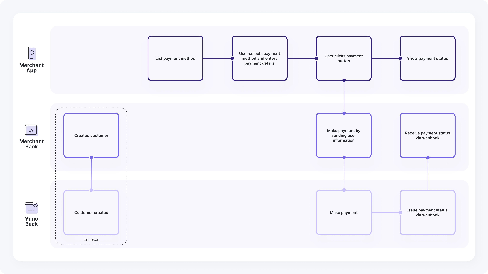
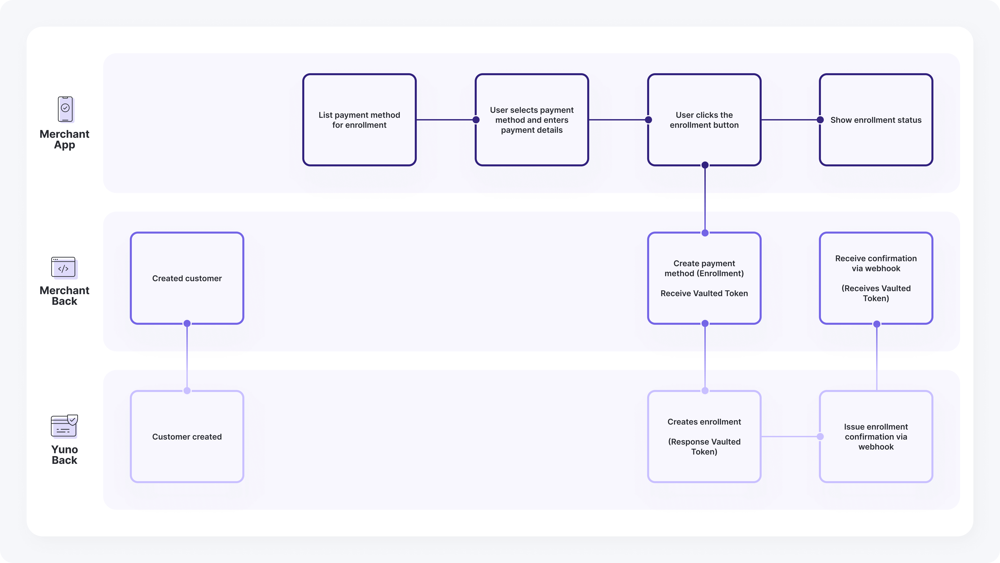

## Como funciona {#how-it-works}

Se você é desenvolvedor, pode usar nosso Direct Flow para continuar usando seu checkout e se conectar aos nossos serviços usando apenas uma conexão servidor a servidor.

Sua empresa precisa ter certificação PCI para usar nosso serviço de pagamentos com cartão servidor a servidor. Encaminhe sua certificação AOC ao seu gerente de conta antes de começar a implementação.

<Danger>
Sempre recomendamos usar os SDKs da Yuno em vez de integrações Direct Flow. Os SDKs da Yuno estão em conformidade com o PCI e simplificam o processo de pagamento ao gerenciar todas as complexidades, incluindo prevenção de fraude, 3DS e requisitos específicos de cada provedor de pagamento. O Direct Flow exige que os lojistas tratem esses aspectos manualmente, aumentando a complexidade e o risco.
</Danger>

Em toda implementação, recomendamos usar o `status` e o `sub_status` do pagamento como a principal referência para o [estado do pagamento](/reference/payments/status-and-response-codes/payment). Um pagamento pode ter diferentes [transações](/reference/payments/status-and-response-codes/transaction) associadas a ele, então, ao focar no **status/sub\_status** do pagamento, você tem o estado mais recente independentemente de quantas transações foram feitas, o que dá uma base clara para a tomada de decisões. Com esta integração, você também pode [cadastrar cartões de crédito](/pt-br/docs/direct-integration-use-cases/direct-flow#enrollment) para compras futuras (também disponível apenas para lojistas com certificação PCI).

## Pagamento {#payment}

<Frame></Frame>

<Steps>
  <Step title="Crie um cliente">
    **[Opcional]**: O primeiro passo é criar um cliente para associar meios de pagamento. Use o endpoint [Create Customer](/pt-br/reference/customers/create-customer) para receber um ID único.
    * Você pode pular este passo se o cliente já existir.
    * Você também pode enviar as informações do cliente diretamente no pagamento, sem criar um objeto.
    <Warning>
      A criação do cliente é obrigatória para gerar um `vaulted_token`.
    </Warning>
  </Step>

  <Step title="Crie o pagamento">
    Exiba os meios de pagamento habilitados na sua conta Yuno. Depois da seleção, crie um pagamento com os detalhes do pedido, as informações do cliente, o valor e mais, usando o endpoint [Create Payment](/reference/payments/create-payment).
    * Consulte a [seção de exemplos](/reference/payments/payment-examples) para ver detalhes de implementação.
    * Use um `vaulted_token` para meios cadastrados anteriormente.
    
    Durante a integração, use o **status** e o **sub_status** do pagamento como a principal referência para o estado do pagamento.
  </Step>
</Steps>

### Workflow DIRECT vs REDIRECT {#direct-vs-redirect-workflow}

Ao usar a integração Direct na Yuno, você tem duas opções de `workflow` disponíveis:

* **DIRECT**: Retornamos a resposta bruta dos provedores para que você construa a experiência como quiser, com os dados sem filtro.
* **REDIRECT**: Além de também retornarmos a resposta direta dos provedores, oferecemos aos lojistas a possibilidade de usar um link de redirecionamento fornecido pela Yuno, no qual cuidamos da experiência de pagamento apenas para aquele pagamento. Você encontra essa URL no campo `payment_method.payment_method_detail.<type>.redirect_url` da resposta do pagamento, em que `<type>` é a categoria do meio de pagamento: `ticket`, `bank_transfer`, `wallet` ou `bnpl`.

Os dois workflows aceitam cartões (incluindo cartões com 3DS) e meios de pagamento alternativos (PSE, Nequi, MercadoPago, PIX etc.). Para cartões com 3DS, os dois workflows exigem certificação PCI.

<Note>
  **Dados de pagamento PIX**

  Para PIX, a resposta do pagamento retorna os dados a mostrar ao pagador no objeto `payment_method.payment_method_detail.bank_transfer`. O [exemplo de PIX](/reference/payments/payment-examples/bank-transfer#pix) usa o workflow `REDIRECT` e retorna estes campos:

  * `provider_image`: URL fornecida pelo provedor. No exemplo, ela aponta para o QR code.
  * `beneficiary_name`, `beneficiary_document_type`, `beneficiary_document`, `bank_name`, `bank_account`: Dados do titular da conta que recebe o pagamento. Esses campos podem ser `null`, como no exemplo de PIX.
  * `payment_instruction`: Instruções de pagamento relacionadas ao pagamento.
  * `redirect_url`: Página de pagamento hospedada pela Yuno, usada com o workflow `REDIRECT`.

  Com o workflow `DIRECT`, a resposta sem filtro do provedor também é retornada em `provider_data.raw_response`. Consulte o [objeto Payment](/reference/payments/the-payment-object) para ver a descrição completa dos campos.
</Note>

### Complementos importantes {#important-add-ons}

* **Webhooks**: Recomendamos configurar [Webhooks](/docs/webhooks) no seu dashboard da Yuno. Os webhooks são a melhor forma de garantir que seu sistema fique atualizado com o andamento e o status dos pagamentos. Como as notificações de eventos são disparadas automaticamente, seu sistema não precisará fazer requisições repetidas à Yuno.

* **Device Fingerprints**: As device fingerprints do cliente são usadas para prevenção de fraude. Normalmente, elas são geradas por JavaScript de terceiros no checkout. Se você usa uma **integração Direct** e quer dar suporte a provedores de fraude no [fluxo de pagamento](/reference/payments/create-payment), pode usar este objeto para especificar as informações necessárias. Em integrações que usam o checkout da Yuno, o valor é obtido automaticamente, então não envie este campo.

  * Abaixo está um trecho parcial do corpo da requisição, com foco no objeto `device_fingerprints`:

    ```json
    [...]
    "customer_payer": {
        "merchant_customer_id": "1690161049",
        "first_name": "Giovanna",
        "last_name": "Bartell",
        "email": "Lisandro_Leannon58@hotmail.com",
         "device_fingerprints": [
            {
                "provider_id": "MERCADO_PAGO",
                "id": "20a6c463-dd0c-4323-9115-03668d178856"
            },
            {
                "provider_id": "CLEARSALE",
                "id": "92d2ea4b-4bf7-494b-aaea-c48276135941"
            }     
      }, 
    [...]
    ```
    <br />

* **three\_d\_secure\_setup\_id**: Use nosso JS apenas para obter o `three_d_secure_setup_id` e depois trate o pagamento como uma integração somente por API. O workflow Direct está disponível apenas para lojistas com certificação PCI. Ele oferece uma forma simples de criar um pagamento e validar as informações do usuário, exigindo que o lojista faça apenas uma requisição para criar o pagamento. Para implementar a integração Direct com sucesso, siga os passos descritos na seção [Pagamento](#payment) acima e forneça as informações obrigatórias conforme indicado. Este serviço não é necessário para a implementação de 3DS usando o SDK da Yuno.

## Cadastro {#enrollment}

<Frame></Frame>

<Steps>
  <Step title="Crie um cliente">
    Associe meios de pagamento criando um cliente (se ainda não existir) com o endpoint [Create Customer](/pt-br/reference/customers/create-customer).
  </Step>

  <Step title="Cadastre um meio de pagamento">
    <Note>
      **Integração Direct Flow**
      
      Este recurso está disponível apenas para cadastrar cartões de lojistas com certificação PCI.
    </Note>
    Cadastre o meio de pagamento pelo endpoint [Enroll Payment Method](/pt-br/reference/payment-methods-direct-workflow/enroll-payment-method-api). Você receberá um `vaulted_token` para compras futuras.
  </Step>
</Steps>