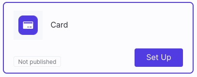
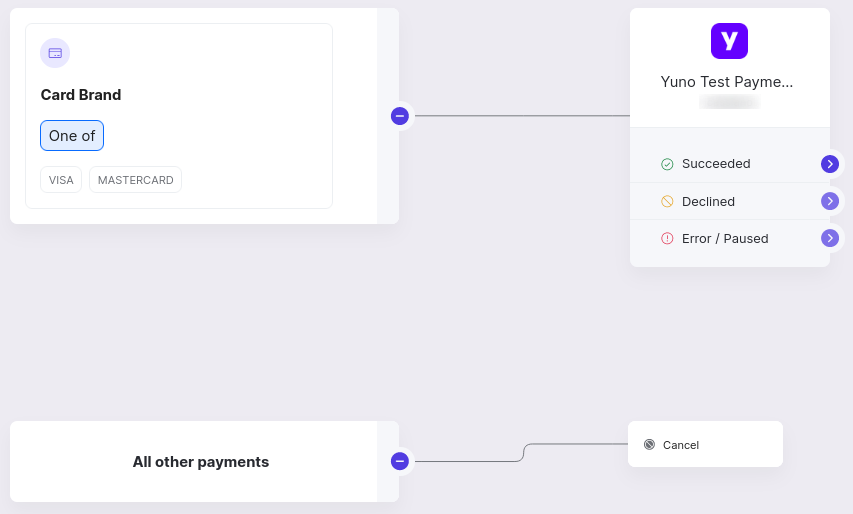
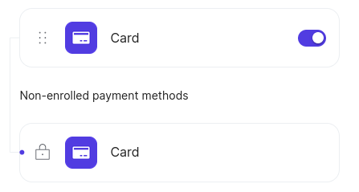

Para testar pagamentos com cartão em geral, a Yuno oferece o **Yuno Test Payment Gateway**. Ele funciona como uma conexão, porém está disponível **apenas** no ambiente de sandbox.

## Conexão com a Yuno {#connecting-with-yuno}

Nenhuma chave de API ou credencial é necessária para conectar o Yuno Test Payment Gateway.

## Informações gerais {#general-information}

| Propriedade | Detalhes |
|:---|:---|
| **Países** | Disponível para todos os países. |
| **Moedas** | Todas as moedas estão disponíveis. |
| **Tipo de cartões** | Crédito, débito e pré-pago. |
| **Dados de teste** | Consulte as [informações dos cartões](/pt-br/docs/direct-integration-use-cases/yuno-testing-gateway#test-card-payments-with-yuno-testing-gateway) para ver os números dos cartões de teste e as respostas esperadas. |

## Configuração da integração {#integration-configuration}

Para conectar o Yuno Test Payment Gateway pelo dashboard:

1. Faça login em [dashboard.y.uno](http://dashboard.y.uno/).
2. Acesse **Connections** e selecione **Yuno Test Payment Gateway**.
3. Clique em **Connect**.
4. Insira um **Name** para a conexão.
5. Clique em **Connect**.

## Ambiente de produção {#production-environment}

Esta conexão está disponível apenas para testes no sandbox e não pode ser usada em produção.

## Configure o Yuno Test Payment Gateway {#set-up-the-yuno-test-payment-gateway}

1. Conclua a [Configuração da integração](/pt-br/docs/direct-integration-use-cases/yuno-testing-gateway#integration-configuration) do Test Payment Gateway.
2. Depois de estabelecer a conexão, você deve definir o Yuno Test Payment Gateway como seu provedor de pagamentos com cartão na seção de roteamento. Acesse [Routing](https://dashboard.y.uno/routing) no Dashboard da Yuno, selecione **Not published**, encontre a opção **Card** e clique em **Set Up**.

<Frame></Frame>

3. Crie uma nova rota para **Card**. Se não tiver certeza de como criá-la, consulte [Configurar o roteamento dinâmico](/pt-br/docs/using-yuno/dashboard-overview/routing#configuring-the-dynamic-routing).
   1. No dashboard de Routing, adicione condições para acionar o pagamento com cartão. Você pode usar a bandeira do cartão ou o país como condições de acionamento, por exemplo.
   2. Para a condição criada, adicione o Yuno Test Payment Gateway.
   3. Para as opções de **All other payments**, selecione a opção **Cancel**. A imagem abaixo mostra um exemplo de configuração de roteamento em que foi usada a condição de bandeira do cartão, aceitando pagamentos com as bandeiras Visa e Mastercard.

<Frame></Frame>

4. Agora você precisa disponibilizar os cartões para teste. Acesse o [Checkout builder](https://dashboard.y.uno/checkout-builder) no Dashboard da Yuno.  Ative o botão de alternância de **Card** e publique o checkout usando o botão **Publish**.

<Frame></Frame>

Use o guia [Criar pagamento](/pt-br/docs/direct-integration-use-cases/create-payment-basic) para aprender a testar pagamentos com cartão.

## Teste pagamentos com cartão com o Yuno Testing Gateway {#test-card-payments-with-yuno-testing-gateway}

Nesta página, você encontra um guia passo a passo para criar um pagamento com cartão usando o [Yuno Testing Gateway](/pt-br/docs/direct-integration-use-cases/yuno-testing-gateway).

O [Yuno Testing Gateway](/pt-br/docs/direct-integration-use-cases/yuno-testing-gateway) é uma solução da Yuno para testar pagamentos com cartão em geral. Ele funciona como uma conexão. No entanto, está disponível apenas no ambiente de sandbox.

### Requisitos {#requirements}

Antes de começar a seguir os passos descritos neste guia, você precisa:

* Acessar suas [credenciais de API](/pt-br/docs/using-yuno/settings/developers-credentials) no Dashboard da Yuno, que são compostas por:
  * `public-api-key`
  * `private-secret-key`
  * `account_id`
* Configurar a conexão do Yuno Testing Gateway na sua conta do Dashboard da Yuno. Você encontra um guia passo a passo para conectá-lo na [seção Configuração da integração](/pt-br/docs/direct-integration-use-cases/yuno-testing-gateway#integration-configuration).
* [Criar uma rota](/pt-br/docs/using-yuno/dashboard-overview/routing#configuring-the-dynamic-routing) para o Yuno Testing Gateway para defini-lo como seu provedor de pagamentos com cartão. Você encontra um guia passo a passo de como fazer isso na seção Configure o [Yuno Testing Gateway](/pt-br/docs/direct-integration-use-cases/yuno-testing-gateway#set-up-the-yuno-test-payment-gateway).
* [Configurar o checkout builder](/pt-br/docs/using-yuno/dashboard-overview/checkout-builder) para disponibilizar o Yuno Testing Gateway.

O processo de criação de pagamento normalmente exige concluir os dois passos listados abaixo.

1. [Criar um cliente](/reference/customers/create-customer)
2. [Criar o pagamento](/reference/payments/create-payment)

### Criar um pagamento {#create-a-payment}

#### 1. Criar um cliente {#1-create-a-customer}

Use o [Create Customer](/reference/customers/create-customer) para registrar as informações do cliente. Você precisará fornecer informações pessoais do cliente. Além disso, você também precisa informar o `merchant_customer_id`, um identificador único do cliente usado no seu sistema.

<Note>
**Informações complementares do cliente**

Ao criar um **cliente**, certas informações não são obrigatórias, mas podem melhorar a experiência de pagamento do usuário se forem fornecidas. Telefone, endereço de cobrança e endereço de entrega são exemplos de dados não obrigatórios que você pode fornecer. Se você adicionar informações opcionais, fique atento aos campos obrigatórios.
</Note>

Ao final do processo de criação do cliente, você receberá um `id`, que identifica o usuário dentro do sistema da Yuno. Use o `id` para inicializar o checkout.

Se você estiver criando um pagamento para um usuário existente que já foi criado anteriormente e já tem um `id`, pode pular este passo.

#### 2. Criar um pagamento {#2-create-a-payment}

Você criará um pagamento usando o [endpoint Create Payment](/reference/payments/create-payment). Abaixo você encontra uma descrição mais detalhada de como criar um pagamento.

Forneça as informações relacionadas ao cliente, incluindo o objeto `customer_payer`, que contém o `id` do Passo 1.

Certos objetos não são obrigatórios ao criar um pagamento. No entanto, se você fornecer essas informações, a experiência de pagamento do usuário será melhorada. Fique atento aos campos obrigatórios se quiser fornecer essas informações.

#### 2.1 Escolha o tipo de captura {#21-choose-the-capture-type}

A Yuno oferece duas opções de captura de pagamento:

* Etapa única: a autorização e a captura são realizadas simultaneamente. Você só precisa criar o pagamento. A autorização e a captura são realizadas automaticamente. Para a opção de etapa única, você precisa enviar `payment_method.detail.card.capture` como `true` na requisição.
* Duas etapas: a autorização e a captura são realizadas em momentos diferentes. Se quiser processar o pagamento em duas etapas, envie `payment_method.detail.card.capture` como `false` ao [criar o pagamento](/reference/payments/create-payment) e depois use a requisição [Capture Authorization](/reference/payments/capture-authorization) para concluir o processo.

#### 2.2 Defina o fluxo do pagamento {#22-define-the-payment-workflow}

Ao criar o pagamento, você precisa informar qual integração da Yuno está usando. Ao criar um pagamento, você deve informá-la pelo atributo `workflow`, que pode ser:

* `SDK_CHECKOUT`: se você estiver usando o Yuno SDK para criar o pagamento (o padrão).
* `DIRECT`: se você estiver usando uma integração back-to-back. Para usar este fluxo, você precisa estar em conformidade com o PCI.
* `REDIRECT`: se você estiver usando uma integração back-to-back e redirecionamento do provedor.

Informe os dados do meio de pagamento pelo objeto `payment_method`. Selecione o `type` do pagamento igual a `CARD`, com base na [Lista de tipos de pagamento](/reference/payment-type-list). Além disso, você precisa adicionar as informações do cartão no objeto `detail.card`.

Você pode usar a descrição do pagamento ou dados específicos do cartão para obter o resultado desejado ao testar pagamentos com o Yuno Test Payment Gateway. As seções a seguir descrevem cada abordagem em detalhes.

<Note>
**Processo do sistema da Yuno**

O sistema da Yuno segue um processo sequencial, examinando primeiro os dados do cartão e depois avaliando a descrição fornecida. Consequentemente, se houver uma divergência entre o status indicado pelos dados do cartão e o indicado pela descrição em um pagamento de teste, a Yuno vai priorizar e refletir o status associado aos dados do cartão.
</Note>

##### 2.2.1 - Descrição do pagamento {#221---payment-description}

Para obter o resultado de pagamento desejado usando a descrição do pagamento, você precisa definir o resultado esperado como a descrição do pagamento que criar. Por exemplo, se você estiver testando um pagamento e esperar um resultado bem-sucedido, a descrição do pagamento deve ser "SUCCEEDED". Você encontra todas as opções disponíveis na seção [Códigos de transação](/reference/payments/status-and-response-codes/transaction#transaction-codes).

###### Simular um chargeback {#simulate-a-chargeback}

No sandbox, você pode simular um chargeback após uma compra bem-sucedida definindo a **descrição** do pagamento. O gatilho é o campo de descrição, não o valor nem o número do cartão.

Use este formato como `description` do pagamento:

```
SUCCEEDED+CHARGEBACK <outcome>
```

Substitua `<outcome>` por um dos valores da tabela abaixo. Primeiro, a compra é bem-sucedida. Cerca de dois minutos depois, a Yuno cria uma transação `CHARGEBACK` nesse pagamento e emite os eventos de webhook relacionados.

| Resultado na descrição | Status do CHARGEBACK | response_code do CHARGEBACK | Status do pagamento | sub_status do pagamento |
| --- | --- | --- | --- | --- |
| `action_required` | `CREATED` | `ACTION_REQUIRED` | `IN_DISPUTE` | `RECEIVED` |
| `review` | `PENDING` | `IN_REVIEW` | `IN_DISPUTE` | `PENDING_REVIEW` |
| `won` | `WON` | `REVIEW_WON` | `SUCCEEDED` | `APPROVED` |
| `lost` | `LOST` | `REVIEW_LOST` | `CHARGEBACK` | `LOST` |

Exemplos:

* `SUCCEEDED+CHARGEBACK action_required`
* `SUCCEEDED+CHARGEBACK review`
* `SUCCEEDED+CHARGEBACK won`
* `SUCCEEDED+CHARGEBACK lost`

Se o resultado após `CHARGEBACK` estiver ausente ou não for reconhecido, a Yuno usa `action_required` como padrão.

Nos testes, o `reason` do chargeback observado é `REQUESTED_BY_CUSTOMER`.

<Note>
**Os dados do cartão são avaliados primeiro**

A Yuno avalia os dados do cartão antes da descrição do pagamento, então o cartão decide o resultado inicial da autorização. O cartão não interrompe a simulação do chargeback: cerca de um minuto depois, a descrição assume, o pagamento passa para `SUCCEEDED` e o chargeback ainda chega cerca de um minuto depois disso. Combine a descrição `SUCCEEDED+CHARGEBACK <outcome>` com um [cartão de teste SUCCEEDED](/pt-br/docs/direct-integration-use-cases/yuno-testing-gateway#2-2-define-the-payment-workflow) (ou um prefixo de cartão SUCCEEDED equivalente) para que o status do pagamento fique estável durante todo o fluxo.
</Note>

<Tip>
Confirme que o endpoint de webhook do seu sandbox recebe `payment.chargeback`. Configure o endpoint na sua própria URL de sandbox e depois conclua uma simulação de chargeback de ponta a ponta. Consulte [Visão geral de webhooks](/docs/webhooks), [Configurar webhooks](/docs/webhooks/configure-webhooks) e os [exemplos de webhook de chargeback](/docs/webhooks/object-and-examples#chargeback-webhook-v2). Para os estados de disputa e as ações do lojista depois que o chargeback chega, consulte [Gestão de chargebacks](/docs/payouts-and-disputes/chargeback-management).
</Tip>

##### 2.2.2 - Dados do cartão {#222---card-detail}

Outra opção para obter os resultados de pagamento esperados é usar um dos cartões de teste fornecidos pela Yuno. Nas tabelas abaixo, você encontra uma lista de cartões e os detalhes dos dados deles para usar com o Yuno Testing Gateway. A coluna **Código de resposta da transação** define o status do pagamento retornado quando você usa o cartão correspondente.

<AccordionGroup>
<Accordion title="Visa">
<table>
  <thead>
    <tr>
      
      <th>Número</th>
      <th>Data de validade</th>
      <th>Código de segurança</th>
      <th>Nome do titular do cartão</th>
      <th>Código de resposta da transação</th>
    </tr>
  </thead>
  <tbody>
    <tr>
      
      <td>4507990000000002</td>
      <td>11/28</td>
      <td>123</td>
      <td>John Doe</td>
      <td>SUCCEEDED</td>
    </tr>
    <tr>
      
      <td>4507990000000010</td>
      <td>11/28</td>
      <td>123</td>
      <td>John Doe</td>
      <td>INSUFFICIENT_FUNDS</td>
    </tr>
    <tr>
      
      <td>4507990000000028</td>
      <td>11/28</td>
      <td>123</td>
      <td>John Doe</td>
      <td>DECLINED_BY_BANK</td>
    </tr>
    <tr>
      
      <td>4507990000000036</td>
      <td>11/28</td>
      <td>123</td>
      <td>John Doe</td>
      <td>DO_NOT_HONOR</td>
    </tr>
    <tr>
      
      <td>4507990000000044</td>
      <td>11/28</td>
      <td>123</td>
      <td>John Doe</td>
      <td>INVALID_SECURITY_CODE</td>
    </tr>
    <tr>
      
      <td>4507990000000051</td>
      <td>11/28</td>
      <td>123</td>
      <td>John Doe</td>
      <td>INVALID_CARD_DATA</td>
    </tr>
    <tr>
      
      <td>4507990000000069</td>
      <td>11/28</td>
      <td>123</td>
      <td>John Doe</td>
      <td>REPORTED_STOLEN</td>
    </tr>
    <tr>
      
      <td>4507990000000077</td>
      <td>11/28</td>
      <td>123</td>
      <td>John Doe</td>
      <td>ERROR</td>
    </tr>
  </tbody>
</table>
</Accordion>

<Accordion title="Mastercard (dados de teste)">
<table>
    <thead>
    <tr>
      
      <th>Número</th>
      <th>Data de validade</th>
      <th>Código de segurança</th>
      <th>Nome do titular do cartão</th>
      <th>Código de resposta da transação</th>
    </tr>
  </thead>
  <tbody>
    <tr>
      
      <td>5252440000000002</td>
      <td>11/28</td>
      <td>123</td>
      <td>John Doe</td>
      <td>SUCCEEDED</td>
    </tr>
    <tr>
      
      <td>5252440000000010</td>
      <td>11/28</td>
      <td>123</td>
      <td>John Doe</td>
      <td>INSUFFICIENT_FUNDS</td>
    </tr>
    <tr>
      
      <td>5252440000000028</td>
      <td>11/28</td>
      <td>123</td>
      <td>John Doe</td>
      <td>DECLINED_BY_BANK</td>
    </tr>
    <tr>
      
      <td>5252440000000036</td>
      <td>11/28</td>
      <td>123</td>
      <td>John Doe</td>
      <td>DO_NOT_HONOR</td>
    </tr>
    <tr>
      
      <td>5252440000000044</td>
      <td>11/28</td>
      <td>123</td>
      <td>John Doe</td>
      <td>INVALID_SECURITY_CODE</td>
    </tr>
    <tr>
      
      <td>5252440000000051</td>
      <td>11/28</td>
      <td>123</td>
      <td>John Doe</td>
      <td>INVALID_CARD_DATA</td>
    </tr>
    <tr>
      
      <td>5252440000000069</td>
      <td>11/28</td>
      <td>123</td>
      <td>John Doe</td>
      <td>REPORTED_STOLEN</td>
    </tr>
    <tr>
      
      <td>5252440000000077</td>
      <td>11/28</td>
      <td>123</td>
      <td>John Doe</td>
      <td>ERROR</td>
    </tr>
  </tbody>
</table>
</Accordion>

<Accordion title="American Express">
<table>
  <thead>
    <tr>
      
      <th>Número</th>
      <th>Data de validade</th>
      <th>Código de segurança</th>
      <th>Nome do titular do cartão</th>
      <th>Código de resposta da transação</th>
    </tr>
  </thead>
  <tbody>
    <tr>
      
      <td>370000000000002</td>
      <td>11/28</td>
      <td>1234</td>
      <td>John Doe</td>
      <td>SUCCEEDED</td>
    </tr>
    <tr>
      
      <td>370000000000010</td>
      <td>11/28</td>
      <td>1234</td>
      <td>John Doe</td>
      <td>INSUFFICIENT_FUNDS</td>
    </tr>
    <tr>
      
      <td>370000000000028</td>
      <td>11/28</td>
      <td>1234</td>
      <td>John Doe</td>
      <td>DECLINED_BY_BANK</td>
    </tr>
    <tr>
      
      <td>370000000000036</td>
      <td>11/28</td>
      <td>1234</td>
      <td>John Doe</td>
      <td>DO_NOT_HONOR</td>
    </tr>
    <tr>
      
      <td>370000000000044</td>
      <td>11/28</td>
      <td>1234</td>
      <td>John Doe</td>
      <td>INVALID_SECURITY_CODE</td>
    </tr>
    <tr>
      
      <td>370000000000051</td>
      <td>11/28</td>
      <td>1234</td>
      <td>John Doe</td>
      <td>INVALID_CARD_DATA</td>
    </tr>
    <tr>
      
      <td>370000000000069</td>
      <td>11/28</td>
      <td>1234</td>
      <td>John Doe</td>
      <td>REPORTED_STOLEN</td>
    </tr>
    <tr>
      
      <td>370000000000077</td>
      <td>11/28</td>
      <td>1234</td>
      <td>John Doe</td>
      <td>ERROR</td>
    </tr>
  </tbody>
</table>
</Accordion>

<Accordion title="Diners">
<table>
  <thead>
    <tr>
      <th>Número</th>
      <th>Data de validade</th>
      <th>Código de segurança</th>
      <th>Nome do titular do cartão</th>
      <th>Código de resposta da transação</th>
    </tr>
  </thead>
  <tbody>
    <tr>

      <td>3647166000000002</td>
      <td>11/28</td>
      <td>123</td>
      <td>John Doe</td>
      <td>SUCCEEDED</td>
    </tr>
    <tr>

      <td>3647166000000010</td>
      <td>11/28</td>
      <td>123</td>
      <td>John Doe</td>
      <td>INSUFFICIENT_FUNDS</td>
    </tr>
    <tr>

      <td>3647166000000028</td>
      <td>11/28</td>
      <td>123</td>
      <td>John Doe</td>
      <td>DECLINED_BY_BANK</td>
    </tr>
    <tr>

      <td>3647166000000036</td>
      <td>11/28</td>
      <td>123</td>
      <td>John Doe</td>
      <td>DO_NOT_HONOR</td>
    </tr>
    <tr>

      <td>3647166000000044</td>
      <td>11/28</td>
      <td>123</td>
      <td>John Doe</td>
      <td>INVALID_SECURITY_CODE</td>
    </tr>
    <tr>

      <td>3647166000000051</td>
      <td>11/28</td>
      <td>123</td>
      <td>John Doe</td>
      <td>INVALID_CARD_DATA</td>
    </tr>
    <tr>

      <td>3647166000000069</td>
      <td>11/28</td>
      <td>123</td>
      <td>John Doe</td>
      <td>REPORTED_STOLEN</td>
    </tr>
    <tr>

      <td>3647166000000077</td>
      <td>11/28</td>
      <td>123</td>
      <td>John Doe</td>
      <td>ERROR</td>
    </tr>
  </tbody>
  </table>
</Accordion>

<Accordion title="UATP">
<table>
  <thead>
    <tr>
      
      <th>Número</th>
      <th>Data de validade</th>
      <th>Código de segurança</th>
      <th>Nome do titular do cartão</th>
      <th>Código de resposta da transação</th>
    </tr>
  </thead>
  <tbody>
    <tr>
      
      <td>1139000000000002</td>
      <td>11/28</td>
      <td>123</td>
      <td>John Doe</td>
      <td>SUCCEEDED</td>
    </tr>
    <tr>
      
      <td>1139000000000010</td>
      <td>11/28</td>
      <td>123</td>
      <td>John Doe</td>
      <td>INSUFFICIENT_FUNDS</td>
    </tr>
    <tr>
      
      <td>1139000000000028</td>
      <td>11/28</td>
      <td>123</td>
      <td>John Doe</td>
      <td>DECLINED_BY_BANK</td>
    </tr>
    <tr>
      
      <td>1139000000000036</td>
      <td>11/28</td>
      <td>123</td>
      <td>John Doe</td>
      <td>DO_NOT_HONOR</td>
    </tr>
    <tr>
      
      <td>1139000000000044</td>
      <td>11/28</td>
      <td>123</td>
      <td>John Doe</td>
      <td>INVALID_SECURITY_CODE</td>
    </tr>
    <tr>
      
      <td>1139000000000051</td>
      <td>11/28</td>
      <td>123</td>
      <td>John Doe</td>
      <td>INVALID_CARD_DATA</td>
    </tr>
    <tr>
      
      <td>1139000000000069</td>
      <td>11/28</td>
      <td>123</td>
      <td>John Doe</td>
      <td>REPORTED_STOLEN</td>
    </tr>
    <tr>
      
      <td>1139000000000077</td>
      <td>11/28</td>
      <td>123</td>
      <td>John Doe</td>
      <td>ERROR</td>
    </tr>
  </tbody>
</table>
</Accordion>
</AccordionGroup>

<Note>
Para testar novas tentativas de assinaturas e o cancelamento por esgotamento de tentativas com esses cartões, consulte [Testar novas tentativas no sandbox](/docs/payment-features/subscriptions/retries#testing-retries-in-sandbox).
</Note>

##### 2.2.3 - Cartões de teste 3DS {#223---3ds-test-cards}

Use estes cartões e códigos OTP para testar fluxos 3DS no nosso ambiente de preview usando um Netcetera Demo Merchant (NDM) Simulator, configurado para simular um Directory Server e/ou ACS com esquemas predefinidos e números de cartão de teste. Ele não acessa DS/ACS de teste externos, apenas ajuda a concluir fluxos 3DS para fins de teste.

<AccordionGroup>
<Accordion title="Amex">
<table>
  <thead>
    <tr>
      <th>Número do cartão</th>
      <th>Resposta esperada 3DS 2.x</th>
      <th>Resposta esperada 3DS 1.x DS (VERes)</th>
      <th>Resposta esperada 3DS 1.x ACS (PARes)</th>
    </tr>
  </thead>
  <tbody>
    <tr><td>341502098634895</td><td>AUTHENTICATED_APPLICATION_FRICTIONLESS</td><td>ENROLLED_Y</td><td>TRANSACTION_STATUS_Y</td></tr>
    <tr><td>348638267931507</td><td>BROWSER_CHALLENGE</td><td>ENROLLED_Y</td><td>TRANSACTION_CHALLENGE_OTP</td></tr>
    <tr><td>345695399207589</td><td>NOT_AUTHENTICATED_APPLICATION_FRICTIONLESS</td><td>ENROLLED_Y</td><td>TRANSACTION_STATUS_N</td></tr>
    <tr><td>349531373081938</td><td>APPLICATION_CHALLENGE</td><td>ENROLLED_Y</td><td>TRANSACTION_STATUS_N</td></tr>
    <tr><td>342316317472410</td><td>APPLICATION_CHALLENGE_SDK_TRANS_ID_INVALID_FORMAT</td><td>ENROLLED_Y</td><td>TRANSACTION_STATUS_N</td></tr>
    <tr><td>347899129656655</td><td>AUTHENTICATED_BROWSER_FRICTIONLESS</td><td>ENROLLED_Y</td><td>TRANSACTION_STATUS_Y</td></tr>
    <tr><td>345197771649926</td><td>NOT_AUTHENTICATED_BROWSER_FRICTIONLESS</td><td>ENROLLED_Y</td><td>TRANSACTION_STATUS_N</td></tr>
    <tr><td>372021106351394</td><td>BROWSER_CHALLENGE</td><td>ENROLLED_Y</td><td>TRANSACTION_CHALLENGE_OTP</td></tr>
    <tr><td>3734123412340000</td><td>NOT_AUTHENTICATED_BROWSER_FRICTIONLESS</td><td>ENROLLED_Y</td><td>TRANSACTION_STATUS_N</td></tr>
    <tr><td>3434567891111005</td><td>BROWSER_CHALLENGE</td><td>ENROLLED_Y</td><td>TRANSACTION_CHALLENGE_OTP</td></tr>
    <tr><td>3794521996036850</td><td>BROWSER_CHALLENGE</td><td>ENROLLED_Y</td><td>TRANSACTION_CHALLENGE_OTP</td></tr>
  </tbody>
</table>
</Accordion>

<Accordion title="Mastercard (3DS)">
<table>
  <thead>
    <tr>
      <th>Número do cartão</th>
      <th>Resposta esperada 3DS 2.x</th>
      <th>Resposta esperada 3DS 1.x DS (VERes)</th>
      <th>Resposta esperada 3DS 1.x ACS (PARes)</th>
    </tr>
  </thead>
  <tbody>
    <tr><td>5333259155643223</td><td>AUTHENTICATED_APPLICATION_FRICTIONLESS</td><td>ENROLLED_Y</td><td>TRANSACTION_STATUS_Y</td></tr>
    <tr><td>5306889942833340</td><td>BROWSER_CHALLENGE</td><td>ENROLLED_Y</td><td>TRANSACTION_CHALLENGE_OTP</td></tr>
    <tr><td>5328720384582224</td><td>NOT_AUTHENTICATED_APPLICATION_FRICTIONLESS</td><td>ENROLLED_Y</td><td>TRANSACTION_STATUS_N</td></tr>
    <tr><td>5267648608924299</td><td>APPLICATION_CHALLENGE</td><td>ENROLLED_Y</td><td>TRANSACTION_STATUS_N</td></tr>
    <tr><td>5187434643593002</td><td>APPLICATION_CHALLENGE_SDK_TRANS_ID_INVALID_FORMAT</td><td>ENROLLED_Y</td><td>TRANSACTION_STATUS_N</td></tr>
    <tr><td>5512459816707531</td><td>AUTHENTICATED_BROWSER_FRICTIONLESS</td><td>ENROLLED_Y</td><td>TRANSACTION_STATUS_Y</td></tr>
    <tr><td>5487971631330522</td><td>NOT_AUTHENTICATED_BROWSER_FRICTIONLESS</td><td>ENROLLED_Y</td><td>TRANSACTION_STATUS_N</td></tr>
    <tr><td>5424184049821670</td><td>BROWSER_CHALLENGE</td><td>ENROLLED_Y</td><td>TRANSACTION_CHALLENGE_OTP</td></tr>
    <tr><td>5204240438720050123</td><td>BROWSER_CHALLENGE</td><td>ENROLLED_Y</td><td>TRANSACTION_CHALLENGE_OTP</td></tr>
    <tr><td>5250548692069390</td><td>BROWSER_CHALLENGE</td><td>ENROLLED_Y</td><td>TRANSACTION_CHALLENGE_OTP</td></tr>
    <tr><td>5641523891636636</td><td>BROWSER_CHALLENGE</td><td>ENROLLED_Y</td><td>TRANSACTION_CHALLENGE_OTP</td></tr>
  </tbody>
</table>
</Accordion>

<Accordion title="Visa">
<table>
  <thead>
    <tr>
      <th>Número do cartão</th>
      <th>Resposta esperada 3DS 2.x</th>
      <th>Resposta esperada 3DS 1.x DS (VERes)</th>
      <th>Resposta esperada 3DS 1.x ACS (PARes)</th>
    </tr>
  </thead>
  <tbody>
    <tr><td>4556557955726624</td><td>AUTHENTICATED_APPLICATION_FRICTIONLESS</td><td>ENROLLED_Y</td><td>TRANSACTION_STATUS_Y</td></tr>
    <tr><td>4916994064252017</td><td>BROWSER_CHALLENGE</td><td>ENROLLED_Y</td><td>TRANSACTION_CHALLENGE_OTP</td></tr>
    <tr><td>4556104160382032</td><td>NOT_AUTHENTICATED_APPLICATION_FRICTIONLESS</td><td>ENROLLED_Y</td><td>TRANSACTION_STATUS_N</td></tr>
    <tr><td>4024007189449340</td><td>APPLICATION_CHALLENGE</td><td>ENROLLED_Y</td><td>TRANSACTION_STATUS_N</td></tr>
    <tr><td>4024007179872394</td><td>APPLICATION_CHALLENGE_SDK_TRANS_ID_INVALID_FORMAT</td><td>ENROLLED_Y</td><td>TRANSACTION_STATUS_N</td></tr>
    <tr><td>4929251897047956</td><td>AUTHENTICATED_BROWSER_FRICTIONLESS</td><td>ENROLLED_Y</td><td>TRANSACTION_STATUS_Y</td></tr>
    <tr><td>4716429323842524</td><td>NOT_AUTHENTICATED_BROWSER_FRICTIONLESS</td><td>ENROLLED_Y</td><td>TRANSACTION_STATUS_N</td></tr>
    <tr><td>4234123412340003</td><td>BROWSER_CHALLENGE</td><td>ENROLLED_Y</td><td>TRANSACTION_CHALLENGE_OTP</td></tr>
    <tr><td>4604633194219929</td><td>BROWSER_CHALLENGE</td><td>ENROLLED_Y</td><td>TRANSACTION_CHALLENGE_OTP</td></tr>
    <tr><td>4485436455354151</td><td>BROWSER_FRICTIONLESS_MISSING_DS_TRANS_ID</td><td></td><td></td></tr>
    <tr><td>4556962659911995</td><td>APPLICATION_FRICTIONLESS_MISSING_SDK_TRANS_ID</td><td>ENROLLED_Y</td><td>TRANSACTION_STATUS_N</td></tr>
    <tr><td>4539837572943550</td><td>BROWSER_FRICTIONLESS_MISSING_DS_TRANS_ID</td><td>ENROLLED_Y</td><td>TRANSACTION_STATUS_N</td></tr>
    <tr><td>4024007176265022</td><td>BROWSER_CHALLENGE_MISSING_ACS_URL</td><td>ENROLLED_Y</td><td>TRANSACTION_STATUS_N</td></tr>
    <tr><td>4716125059847899</td><td>THREE_RI</td><td>ENROLLED_Y</td><td>TRANSACTION_STATUS_N</td></tr>
    <tr><td>4556362626719763</td><td>PROTOCOL_ERROR</td><td>ENROLLED_Y</td><td>TRANSACTION_STATUS_N</td></tr>
    <tr><td>4234123412340000</td><td>AUTHENTICATED_BROWSER_FRICTIONLESS</td><td>ENROLLED_Y</td><td>TRANSACTION_STATUS_Y</td></tr>
    <tr><td>4234123412340006</td><td>UNAVAILABLE_BROWSER_FRICTIONLESS</td><td>ENROLLED_Y</td><td>TRANSACTION_STATUS_U</td></tr>
    <tr><td>4234123412340007</td><td>ATTEMPTED_BROWSER_FRICTIONLESS</td><td>ENROLLED_Y</td><td>TRANSACTION_STATUS_A</td></tr>
    <tr><td>4234123412340001</td><td>NOT_ENROLLED</td><td>ENROLLED_N</td><td></td></tr>
    <tr><td>4234123412340002</td><td>NOT ENROLLED (VeRes is error 404 "Card account number not found in card ranges from Directory Server")</td><td>ENROLLED_N (NOT APPLICABLE)</td><td></td></tr>
    <tr><td>4234123412340100</td><td>MISSING_ROOT</td><td></td><td></td></tr>
    <tr><td>4234123412340101</td><td>MISSING_MESSAGE</td><td></td><td></td></tr>
    <tr><td>4234123412340102</td><td>INVALID_MESSAGE</td><td></td><td></td></tr>
    <tr><td>4234123412340103</td><td>MISSING_VERSION</td><td></td><td></td></tr>
    <tr><td>4234123412340104</td><td>ILLEGAL_VERSION</td><td></td><td></td></tr>
    <tr><td>4234123412340105</td><td>MISSING_URL</td><td></td><td></td></tr>
    <tr><td>4234123412340106</td><td>ILLEGAL_URL</td><td></td><td></td></tr>
    <tr><td>4234123412340107</td><td>MISSING_ENROLLED</td><td></td><td></td></tr>
    <tr><td>4234123412340108</td><td>ILLEGAL_ENROLLED</td><td></td><td></td></tr>
    <tr><td>4234123412340109</td><td>ILLEGAL_EXTENSION</td><td></td><td></td></tr>
    <tr><td>4234123412340200</td><td>ERROR_CUSTOM</td><td></td><td></td></tr>
    <tr><td>4234123412340201</td><td>ERROR_1</td><td></td><td></td></tr>
    <tr><td>4234123412340202</td><td>ERROR_2</td><td></td><td></td></tr>
    <tr><td>4234123412340203</td><td>ERROR_3</td><td></td><td></td></tr>
    <tr><td>4234123412340204</td><td>ERROR_4</td><td></td><td></td></tr>
    <tr><td>4234123412340205</td><td>ERROR_5</td><td></td><td></td></tr>
    <tr><td>4234123412340206</td><td>ERROR_6</td><td></td><td></td></tr>
    <tr><td>4234123412340220</td><td>ERROR_CUSTOM_WITH_DIFFERENT_MESSAGE_ID</td><td></td><td></td></tr>
    <tr><td>4234123412340250</td><td>ERROR_50</td><td></td><td></td></tr>
    <tr><td>4234123412340251</td><td>ERROR_51</td><td></td><td></td></tr>
    <tr><td>4234123412340252</td><td>ERROR_52</td><td></td><td></td></tr>
    <tr><td>4234123412340253</td><td>ERROR_53</td><td></td><td></td></tr>
    <tr><td>4234123412340258</td><td>ERROR_58</td><td></td><td></td></tr>
    <tr><td>4234123412340298</td><td>ERROR_98</td><td></td><td></td></tr>
    <tr><td>4234123412340299</td><td>ERROR_99</td><td></td><td></td></tr>
    <tr><td>4234123412340300</td><td>IREQ_CUSTOM</td><td></td><td></td></tr>
    <tr><td>4234123412340301</td><td>IREQ_ENROLLED_Y</td><td></td><td></td></tr>
    <tr><td>4234123412340350</td><td>IREQ_50</td><td></td><td></td></tr>
    <tr><td>4234123412340351</td><td>IREQ_51</td><td></td><td></td></tr>
    <tr><td>4234123412340352</td><td>IREQ_52</td><td></td><td></td></tr>
    <tr><td>4234123412340353</td><td>IREQ_53</td><td></td><td></td></tr>
    <tr><td>4234123412340354</td><td>IREQ_54</td><td></td><td></td></tr>
    <tr><td>4234123412340355</td><td>IREQ_55</td><td></td><td></td></tr>
    <tr><td>4234123412340356</td><td>IREQ_56</td><td></td><td></td></tr>
    <tr><td>4234123412340358</td><td>IREQ_58</td><td></td><td></td></tr>
    <tr><td>4234123412340398</td><td>IREQ_98</td><td></td><td></td></tr>
    <tr><td>4234123412340399</td><td>IREQ_99</td><td></td><td></td></tr>
    <tr><td>4234123412340400</td><td>UNSUPPORTED_VERSION</td><td></td><td></td></tr>
    <tr><td>4234123412340401</td><td>UNRECOGNIZED_CRITICAL_EXTENSION</td><td></td><td></td></tr>
    <tr><td>4234123412340402</td><td>SERVER_ERROR</td><td></td><td></td></tr>
    <tr><td>4234123412340403</td><td>TIMEOUT</td><td></td><td></td></tr>
  </tbody>
</table>
</Accordion>

<Accordion title="Diners">
<table>
  <thead>
    <tr>
      <th>Número do cartão</th>
      <th>Resposta esperada 3DS 2.x</th>
      <th>Resposta esperada 3DS 1.x DS (VERes)</th>
      <th>Resposta esperada 3DS 1.x ACS (PARes)</th>
    </tr>
  </thead>
  <tbody>
    <tr><td>3095000000000000</td><td>AUTHENTICATED_APPLICATION_FRICTIONLESS</td><td>ENROLLED_Y</td><td>TRANSACTION_STATUS_Y</td></tr>
    <tr><td>3095000000000001</td><td>BROWSER_CHALLENGE</td><td>ENROLLED_Y</td><td>TRANSACTION_CHALLENGE_OTP</td></tr>
    <tr><td>3095000000000002</td><td>NOT_AUTHENTICATED_APPLICATION_FRICTIONLESS</td><td>ENROLLED_Y</td><td>TRANSACTION_STATUS_N</td></tr>
    <tr><td>3095000000000005</td><td>AUTHENTICATED_BROWSER_FRICTIONLESS</td><td>ENROLLED_Y</td><td>TRANSACTION_STATUS_Y</td></tr>
    <tr><td>3095000000000006</td><td>NOT_AUTHENTICATED_BROWSER_FRICTIONLESS</td><td>ENROLLED_Y</td><td>TRANSACTION_STATUS_N</td></tr>
  </tbody>
</table>
</Accordion>

<Accordion title="JCB">
<table>
  <thead>
    <tr>
      <th>Número do cartão</th>
      <th>Resposta esperada 3DS 2.x</th>
      <th>Resposta esperada 3DS 1.x DS (VERes)</th>
      <th>Resposta esperada 3DS 1.x ACS (PARes)</th>
    </tr>
  </thead>
  <tbody>
    <tr><td>3528000000000000</td><td>AUTHENTICATED_APPLICATION_FRICTIONLESS</td><td>ENROLLED_Y</td><td>TRANSACTION_STATUS_Y</td></tr>
    <tr><td>3528000000000001</td><td>BROWSER_CHALLENGE</td><td>ENROLLED_Y</td><td>TRANSACTION_CHALLENGE_OTP</td></tr>
    <tr><td>3528000000000002</td><td>NOT_AUTHENTICATED_APPLICATION_FRICTIONLESS</td><td>ENROLLED_Y</td><td>TRANSACTION_STATUS_N</td></tr>
    <tr><td>3528000000000005</td><td>AUTHENTICATED_BROWSER_FRICTIONLESS</td><td>ENROLLED_Y</td><td>TRANSACTION_STATUS_Y</td></tr>
    <tr><td>3528000000000006</td><td>NOT_AUTHENTICATED_BROWSER_FRICTIONLESS</td><td>ENROLLED_Y</td><td>TRANSACTION_STATUS_N</td></tr>
  </tbody>
</table>
</Accordion>

<Accordion title="Ranges">
<table>
  <thead>
    <tr>
      <th>Início do intervalo</th>
      <th>Fim do intervalo</th>
      <th>Bandeira</th>
    </tr>
  </thead>
  <tbody>
    <tr><td>340000000000000</td><td>349999999999999</td><td>Amex</td></tr>
    <tr><td>370000000000000</td><td>379999999999999</td><td>Amex</td></tr>
    <tr><td>2221000000000000</td><td>2223000000000022</td><td>Mastercard</td></tr>
    <tr><td>2223000000000024</td><td>2720999999999999</td><td>Mastercard</td></tr>
    <tr><td>5100000000000000</td><td>5111111111111117</td><td>Mastercard</td></tr>
    <tr><td>5111111111111119</td><td>5599999999999999</td><td>Mastercard</td></tr>
    <tr><td>4000000000000000</td><td>4111110000000210</td><td>Visa</td></tr>
    <tr><td>4111110000000212</td><td>4234123412339999</td><td>Visa</td></tr>
    <tr><td>4234123412340000</td><td>4234123412349999</td><td>Visa</td></tr>
    <tr><td>4234123412350000</td><td>4999999999999999</td><td>Visa</td></tr>
    <tr><td>3000000000000000</td><td>3099999999999999</td><td>Diners</td></tr>
    <tr><td>3528000000000000</td><td>3589009999999999</td><td>JCB</td></tr>
  </tbody>
</table>
</Accordion>

<Accordion title="3DS2 OTP Codes">
<table>
  <thead>
    <tr>
      <th>Código OTP</th>
      <th>Status da transação</th>
      <th>Motivo do status da transação</th>
      <th>ECI</th>
      <th>authenticationValue</th>
    </tr>
  </thead>
  <tbody>
    <tr><td>1234</td><td>Y</td><td>/</td><td>01</td><td>JAmi21makAifmwqo2120cjq1AAA=</td></tr>
    <tr><td>1111</td><td>N</td><td>01</td><td>01</td><td>/</td></tr>
    <tr><td>2222</td><td>R</td><td>01</td><td>01</td><td>/</td></tr>
    <tr><td>3333</td><td>U</td><td>01</td><td>01</td><td>/</td></tr>
    <tr><td>4444</td><td>A</td><td>01</td><td>01</td><td>Qm181okmdyqh6yQmYuq1890QAAA=</td></tr>
  </tbody>
</table>

Os mesmos códigos OTP são válidos para os cenários Visa, Mastercard e Amex.
</Accordion>

<Accordion title="3DS1 OTP Codes">
<table>
  <thead>
    <tr>
      <th>Código OTP</th>
      <th>Status da transação</th>
      <th>CAVV</th>
      <th>Algoritmo CAVV</th>
      <th>ECI</th>
    </tr>
  </thead>
  <tbody>
    <tr><td>1234</td><td>Y</td><td>VGhpcyBpcyBhIHRlc3QgYmFzZTY=</td><td>7</td><td>05</td></tr>
    <tr><td>1111</td><td>N</td><td>/</td><td>/</td><td>/</td></tr>
  </tbody>
</table>
</Accordion>
</AccordionGroup>

#### 3. Verifique o status do pagamento {#3-check-the-payment-status}

Depois de fazer a requisição ao [Create Payment](/reference/payments/create-payment), você pode verificar o status do pagamento analisando o `status` e o `sub_status` da resposta. Consulte a página [Status do pagamento](/reference/payments/status-and-response-codes/payment) para ver todas as opções que você pode receber em resposta à requisição de criação do pagamento.

Dependendo do processador e do meio de pagamento, o status pode levar algum tempo para ser atualizado. Por isso, talvez você precise usar endpoints para recuperar o status do pagamento. Para isso, você pode usar os endpoints [Retrieve Payment by ID](/reference/payments/retrieve-payment-by-id) ou [Retrieve Payment by merchant_order_id](/reference/payments/retrieve-payment-by-merchant-order-id). Outra opção é usar webhooks para receber notificações após cada evento. A Yuno recomenda que você use webhooks para monitorar melhor os pagamentos assíncronos. Consulte o guia [Webhooks](/docs/webhooks/configure-webhooks) para aprender a configurar a solução de webhooks fornecida pela Yuno.