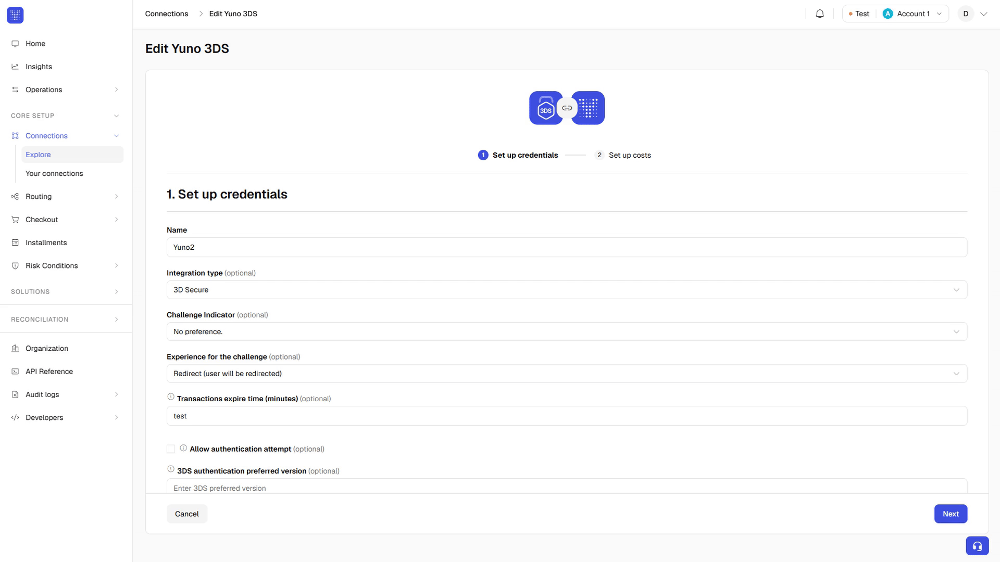
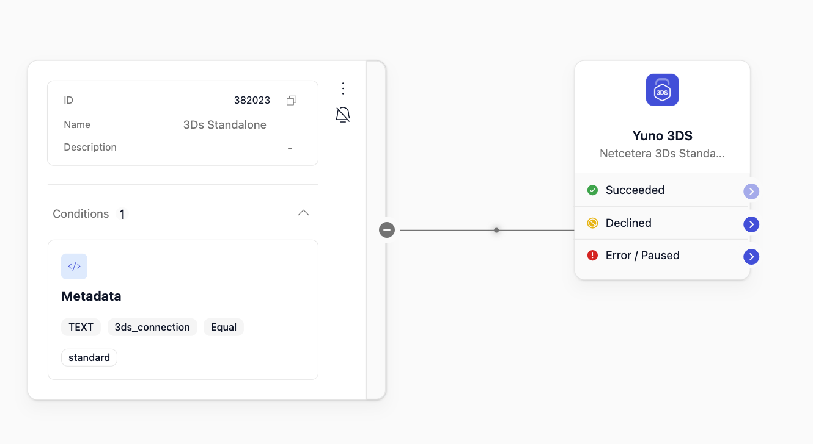

O 3DS Standalone executa somente a etapa de autenticação 3D Secure: nenhum provedor de pagamento participa e nenhuma autorização acontece. A resposta retorna o resultado da autenticação (ECI + criptograma CAVV e dados relacionados). O lojista usa esse resultado para decidir o que fazer em seguida, por exemplo, encaminhá-lo ao seu adquirente.

O fluxo usa o endpoint padrão `/payments`. O que é executado depende de como a rota está configurada. Para o standalone, a rota deve resolver **somente** para a conexão Yuno 3DS, sem provedor de pagamento associado, para que apenas a autenticação seja executada.

## Configuração no Dashboard {#dashboard-configuration}

### Passo 1: Crie a conexão Yuno 3DS {#step-1-create-the-yuno-3ds-connection}

Acesse **Dashboard → Connections → Add Connection** e selecione **Yuno 3DS**. Marque a caixa **"Yuno 3DS Standalone"**, preencha os dados do adquirente e clique em **Next**.

Os **dados do adquirente** são os dados de cadastro 3DS fornecidos pelo seu adquirente. Para o provedor padrão (Netcetera), os campos são:

- **Acquirer BIN**: o Bank Identification Number usado para compensar e liquidar a transação, junto com o país onde ele está licenciado.
- **Acquirer Merchant ID**: o número de afiliação fornecido pelo adquirente.
- **Merchant Category Code (MCC)**: o código que representa a categoria do seu negócio, fornecido pelo adquirente.
- **Merchant Name**: o nome comercial oficial de quem realiza a transação.
- **Merchant URL**: o site / plataforma online do lojista.
- **Merchant Country Code**: o país onde o pagamento é processado ([ISO 3166-1](https://en.wikipedia.org/wiki/ISO_3166-1)).

<Frame></Frame>

### Passo 2: Configure a rota {#step-2-configure-the-route}

Acesse **Dashboard → Routing** e crie uma rota **CARD** que direcione todas as transações para a conexão Yuno 3DS. O ramo que trata o tráfego standalone deve resolver **somente** para a conexão Yuno 3DS: nenhum provedor de pagamento.

<Note>
Você pode já ter uma rota CARD que aponta para um provedor de pagamento e querer que a autenticação standalone coexista com ela. Você pode isolar o tráfego standalone com um grupo de condições sobre metadata (por exemplo `3ds_connection = standard`) que aponte somente para a conexão Yuno 3DS.
</Note>

<Frame></Frame>

#### Seleção de uma conexão específica (mais de uma conexão 3DS Standalone) {#selecting-a-specific-connection-more-than-one-3ds-standalone-connection}

Você pode ter **mais de uma conexão 3DS Standalone** configurada, por exemplo, uma definida como **Data Only** e outra **sem preferência** (padrão). Nesse caso, o roteador não consegue decidir sozinho qual usar, então conduza a seleção explicitamente com **metadata**.

O mecanismo tem duas partes que devem sempre funcionar juntas:

1. **Na rota:** adicione um grupo de condições por conexão que verifique uma chave de metadata. Por exemplo, `3ds_connection = standard` para uma conexão e um valor diferente para a outra. Cada valor direciona o tráfego para a conexão desejada.
2. **Nas requisições:** adicione uma entrada `metadata` com essa mesma chave/valor. Ela deve ser enviada **tanto** na requisição do 3DS Setup quanto na requisição de `/payments`, e deve ser **idêntica nas duas**.

<Warning>
O 3DS Setup e o pagamento são roteados de forma independente. Se o `metadata` enviado no 3DS Setup não corresponder ao `metadata` enviado em `/payments`, cada chamada pode resolver para uma conexão diferente. O Setup e o pagamento seriam então executados em conexões diferentes, e a autenticação não seria concluída. Sempre envie o **mesmo** `metadata` nas duas chamadas para que elas selecionem a **mesma** conexão da rota.
</Warning>

`metadata` é um array JSON de entradas `{ "key", "value" }`. Envie a mesma entrada tanto no Setup quanto no pagamento:

```json
"metadata": [
  {
    "key": "3ds_connection",
    "value": "standard"
  }
]
```

<Note>
Isso se aplica quando você tem uma única conexão 3DS Standalone. Se **a rota não tiver outros grupos de condições além dela** (nenhuma outra conexão ou condicional), essa seleção por metadata não é necessária. A rota resolve para essa conexão automaticamente.

A rota pode, em vez disso, combinar a conexão 3DS Standalone com outras condicionais, por exemplo uma segunda conexão standalone. Nesse caso, use o mecanismo de metadata acima para isolá-la e selecioná-la.
</Note>

## Fluxo standalone (usando o 3DS Setup) {#standalone-flow-using-3ds-setup}

O fluxo standalone passa por um **3DS Setup** que gera um `three_d_secure_setup_id`, que depois é referenciado no pagamento.

### 1. Gere um 3DS Setup {#1-generate-a-3ds-setup}

O 3DS Setup tem dois valores possíveis no campo `type`. A diferença é **quem coleta os dados do navegador/dispositivo** usados na autenticação:

<div className="code-nowrap-table dense-table">

| `type` | O que faz | Quando usar |
| :--- | :--- | :--- |
| `STANDARD` (padrão) | A Yuno (por meio do provedor 3DS) cuida da coleta de dados do dispositivo. A resposta retorna uma `collect_url` e um `token`; o lojista deve concluir a coleta carregando essa `collect_url` com o `token`. | O fluxo padrão: deixe a Yuno / o provedor 3DS conduzir a coleta de dados do dispositivo. |
| `MERCHANT_PROVIDED` | O próprio lojista envia todos os dados necessários (`browser_info` e `device_fingerprints`), então nenhuma etapa de coleta de dados do dispositivo é executada. | Quando um provedor 3DS já coleta esses dados por conta própria e os entrega a você. |

</div>

<Note>
Se você tiver mais de uma conexão 3DS Standalone, inclua o `metadata` nesta requisição (como mostrado abaixo). Isso direciona o Setup para a conexão pretendida. Lembre-se de enviar o **mesmo** `metadata` depois, na requisição de `/payments`.
</Note>

#### Tipo STANDARD {#type-standard}

A Yuno executa a coleta de dados do dispositivo. O lojista deve concluí-la acessando a `collect_url` retornada na resposta e usando o `token` também fornecido ali.

`STANDARD` é o padrão, então o campo `type` pode ser omitido.

**Requisição**

```bash
curl --location 'https://api-staging.y.uno/v1/three-d-secure/setups' \
--header 'X-idempotency-key: idempotency-key' \
--header 'public-api-key: api-key' \
--header 'private-secret-key: secret-key' \
--header 'Content-Type: application/json' \
--data '{
    "account_id": "account_id",
    "type": "STANDARD",
    "card": {
        "holder_name": "TEST CUSTOMER",
        "number": "4916994064252017",
        "expiration_month": 12,
        "expiration_year": 26,
        "security_code": "123"
    },
    "metadata": [
        {
            "key": "3ds_connection",
            "value": "standard"
        }
    ]
}'
```

<CodeGroup>

```json Netcetera 3DS
{
    "three_d_secure_setup_id": "59192489-3713-4d1b-894b-ac15ac5b6f6f",
    "collect_url": "https://ndm-prev.3dss-non-prod.cloud.netcetera.com/acs/3ds-method",
    "token": "eyJ0aHJlZURTTWV0aG9kTm90aWZpY2F0aW9uVVJMIjoiaHR0cHM6Ly9zYW5kYm94LnkudW5vL25ldGNldGVyYS0zZHMtd2ViaG9vay92MS9zdGFydCIsInRocmVlRFNTZXJ2ZXJUcmFuc0lEIjoiNTkxOTI0ODktMzcxMy00ZDFiLTg5NGItYWMxNWFjNWI2ZjZmIn0",
    "provider_id": "NETCETERA_3DS",
    "timeout_value": 3000,
    "account_id": "account_id"
}
```

```json Cybersource 3DS
{
    "three_d_secure_setup_id": "06bc1782-b00d-4ef7-9b56-78f066821d2e",
    "collect_url": "https://cas.client.cardinaltrusted.com/centinelapi/V1/Cruise/Collect",
    "token": "eyJhbGciOiJIUzI1NiIsInR5cCI6IkpXVCJ9...",
    "provider_id": "CYBERSOURCE_3DS",
    "timeout_value": 3000,
    "account_id": "05327270-54f8-4189-b2fc-492864ecfc47"
}
```

```json Checkout.com 3DS
{
    "three_d_secure_setup_id": "eae7eca3-902b-475d-a2ea-a434aa57391b",
    "collect_url": "",
    "token": "",
    "provider_id": "CHECKOUT_COM_3DS",
    "timeout_value": 3000,
    "account_id": "05327270-54f8-4189-b2fc-492864ecfc47"
}
```

</CodeGroup>

**Conclusão da coleta de dados do dispositivo**

Depois de receber a `collect_url` e o `token`, conclua a coleta de dados do dispositivo (o 3DS Method) **antes** de criar o pagamento.

<Note>
**Implementação sugerida (apenas referência, não é um contrato fixo).** O nome exato do campo e a mecânica podem variar conforme o provedor 3DS. Valide com o provedor que você usa. A ideia geral: renderize um iframe oculto e envie automaticamente um formulário que faça POST do token para a `collect_url`. Aguarde o período indicado por `timeout_value` e depois prossiga com a criação do pagamento.

```html
<!-- Hidden iframe that receives the collection POST -->
<iframe name="ddc-iframe" style="display:none"></iframe>

<!-- Auto-submitting form: POST the token to the collect_url -->
<form id="ddc-form" target="ddc-iframe" method="POST" action="COLLECT_URL">
  <input type="hidden" name="threeDSMethodData" value="TOKEN">
</form>

<script>
  document.getElementById('ddc-form').submit();
  // wait up to timeout_value (e.g. 3000) before continuing to create the payment
</script>
```
</Note>

<Note>
Se o provedor retornar `collect_url` e `token` **vazios** (por exemplo `CHECKOUT_COM_3DS` acima), não há etapa de coleta. Pule essa etapa e vá direto para a criação do pagamento.
</Note>

#### Tipo MERCHANT_PROVIDED {#type-merchantprovided}

O próprio lojista envia todos os dados necessários (`browser_info` e `device_fingerprints`), então nenhuma etapa de coleta de dados do dispositivo é executada.

<Note>
Use `device_fingerprints` somente quando um provedor 3DS que coleta esses dados por conta própria (ou seja, que não usa a `collect_url`) entregar a você o `id` do fingerprint. Encaminhe esse `id` aqui. O `provider_id` deve corresponder ao provedor 3DS configurado na conexão.
</Note>

**Requisição**

```bash
curl --location 'https://api-staging.y.uno/v1/three-d-secure/setups' \
--header 'X-idempotency-key: idempotency-key' \
--header 'public-api-key: api-key' \
--header 'private-secret-key: secret-key' \
--header 'Content-Type: application/json' \
--data '{
    "account_id": "account_id",
    "type": "MERCHANT_PROVIDED",
    "card": {
        "holder_name": "TEST CUSTOMER",
        "number": "4556557955726624",
        "expiration_month": 12,
        "expiration_year": 26,
        "security_code": "123"
    },
    "browser_info": {
        "user_agent": "Mozilla/5.0 (Windows NT 10.0; Win64; x64) AppleWebKit/537.36",
        "accept_header": "text/html,application/xhtml+xml,application/xml;q=0.9,*/*;q=0.8",
        "color_depth": "24",
        "screen_height": "1080",
        "screen_width": "1920",
        "language": "es-CO",
        "java_enabled": false,
        "javascript_enabled": true,
        "browser_time_difference": "300",
        "platform": "WEB"
    },
    "device_fingerprints": [
        {
            "id": "3dae048e-b95e-47c6-8064-ea7f1aa16e90",
            "provider_id": "NETCETERA_3DS"
        }
    ],
    "metadata": [
        {
            "key": "3ds_connection",
            "value": "standard"
        }
    ]
}'
```

**Resposta**

```json
{
    "three_d_secure_setup_id": "59192489-3713-4d1b-894b-ac15ac5b6f6f",
    "account_id": "account_id",
    "type": "MERCHANT_PROVIDED",
    "browser_info": {
        "user_agent": "Mozilla/5.0 (Windows NT 10.0; Win64; x64) AppleWebKit/537.36",
        "accept_header": "text/html,application/xhtml+xml,application/xml;q=0.9,*/*;q=0.8",
        "color_depth": "24",
        "screen_height": "1080",
        "screen_width": "1920",
        "language": "es-CO",
        "javascript_enabled": true,
        "java_enabled": false,
        "browser_time_difference": "300",
        "platform": "WEB"
    },
    "device_fingerprints": [
        {
            "provider_id": "NETCETERA_3DS",
            "id": "3dae048e-b95e-47c6-8064-ea7f1aa16e90"
        }
    ]
}
```

### 2. Crie o pagamento {#2-create-the-payment}

Crie o pagamento usando o `three_d_secure_setup_id` gerado na etapa anterior. Como a rota resolve somente para a conexão Yuno 3DS (sem provedor de pagamento), apenas a autenticação é executada e o resultado 3DS é retornado. Nenhuma autorização acontece.

<Warning>
**Meio de pagamento:** como este é um fluxo de autenticação 3DS standalone, o cartão já deve estar disponível para ele. Envie os `card_data` na requisição ou referencie um meio de pagamento que tenha sido **cadastrado (armazenado no vault) previamente**. **Não** envie `vault_on_success: true`: este fluxo não oferece suporte a isso.
</Warning>

<Warning>
Se você usou `metadata` no 3DS Setup para selecionar uma conexão específica, você **deve** enviar o **mesmo** `metadata` aqui. Caso contrário, o pagamento pode ser roteado para uma conexão 3DS Standalone diferente da do Setup.
</Warning>

**Requisição**

```bash
curl --location 'https://api-staging.y.uno/v1/payments' \
--header 'X-idempotency-key: idempotency-key' \
--header 'public-api-key: api-key' \
--header 'private-secret-key: secret-key' \
--header 'Content-Type: application/json' \
--data '{
    "account_id": "account-code",
    "description": "3DS",
    "country": "CO",
    "merchant_order_id": "order_id",
    "merchant_reference": "merchant_reference",
    "workflow": "DIRECT",
    "callback_url": "https://www.example.com",
    "amount": {
        "currency": "COP",
        "value": "27500"
    },
    "metadata": [
        {
            "key": "3ds_connection",
            "value": "standard"
        }
    ],
    "customer_payer": {
        "id": "customer_id"
    },
    "payment_method": {
        "type": "CARD",
        "detail": {
            "card": {
                "three_d_secure": {
                    "three_d_secure_setup_id": "59192489-3713-4d1b-894b-ac15ac5b6f6f"
                },
                "card_data": {
                    "holder_name": "TEST CUSTOMER",
                    "number": "4916994064252017",
                    "expiration_month": 12,
                    "expiration_year": 26,
                    "security_code": "123"
                }
            }
        }
    }
}'
```

<Note>
**Workflow:** uma autenticação **frictionless** / **data-only** é resolvida na hora (os exemplos foram executados com `workflow: DIRECT`) e o resultado volta na resposta do pagamento. Um **challenge** exige uma ação do titular do cartão, então o pagamento retorna `PENDING` com uma `redirect_url` e `checkout.sdk_action_required: true`. Trate-o com um workflow que suporte redirecionamento (`REDIRECT`) ou com o Yuno SDK (veja [Resultados da autenticação → Challenge](#challenge)).
</Note>

Os campos `status` / `sub_status` do nível superior do pagamento informam o resultado, e o resultado 3DS fica em `payment_method.payment_method_detail.card.three_d_secure`:

- **Frictionless / Data Only** → `status: SUCCEEDED`, `sub_status: THREE_D_SECURE_VERIFIED`.
- **Challenge** → `status: PENDING`, `sub_status: WAITING_ADDITIONAL_STEP`, com `checkout.sdk_action_required: true` e uma `redirect_url` (é resolvido depois; veja [Notificação por webhook](#webhook-notification)).
- **Autenticação com falha / rejeitada** → `status: DECLINED`.

Um pagamento standalone acaba resolvendo para `SUCCEEDED` / `THREE_D_SECURE_VERIFIED` (autenticação concluída) ou `DECLINED` (autenticação com falha ou rejeitada). O status no nível da transação e os códigos de resposta 3DS seguem a referência padrão da Yuno: [Status de transação e códigos de resposta](/reference/payments/status-and-response-codes/transaction). Exemplos de códigos incluem `SUCCEEDED_THREE_D_SECURE`, `CHALLENGE_REQUIRED`, `AUTHENTICATION_FAILED_THREE_D_SECURE` e `REJECTED_THREE_D_SECURE_REQUIRED`.

## Resultados da autenticação {#authentication-outcomes}

### Frictionless {#frictionless}

Objeto `three_d_secure` (dentro do detalhe do cartão):

```json
"three_d_secure": {
    "version": "2.3.1",
    "electronic_commerce_indicator": "05",
    "cryptogram": "MTIzNDU2Nzg5MDA5ODc2NTQzMjE=",
    "transaction_id": "7f5e8c1a-5c98-411e-b54b-dbff770ea045",
    "directory_server_transaction_id": "fbaa20f0-09c4-48bd-b0fd-01fdbf9188cf",
    "pares_status": "Y",
    "acs_id": "ab4a9485-afdb-4003-a619-3aaeea0670d7"
}
```

<Accordion title="Ver a resposta completa do pagamento">
```json
{
    "id": "7f524e10-534c-4a3f-aad8-14128156a958",
    "account_id": "5d8960b3-ca3c-4b8b-9891-0c190d4dae1c",
    "description": "3DS",
    "country": "CO",
    "status": "SUCCEEDED",
    "sub_status": "THREE_D_SECURE_VERIFIED",
    "merchant_order_id": "order-833aaade-323d-40c2-9f2c-49f5964bd055",
    "created_at": "2026-06-26T23:43:09.385435Z",
    "updated_at": "2026-06-26T23:43:10.424600Z",
    "amount": {
        "captured": 0.00,
        "currency": "COP",
        "refunded": 0.00,
        "value": 27500.00
    },
    "checkout": {
        "session": "",
        "sdk_action_required": false
    },
    "payment_method": {
        "type": "CARD",
        "payment_method_detail": {
            "card": {
                "verify": false,
                "capture": true,
                "installments": 1,
                "card_data": {
                    "holder_name": "TEST CUSTOMER",
                    "iin": "45565579",
                    "lfd": "6624",
                    "number_length": 16,
                    "brand": "VISA",
                    "scheme": "VISA",
                    "issuer_name": "BANCO BILBAO VIZCAYA ARGENTARIA BBVA",
                    "country_code": "ES",
                    "category": "GOLD",
                    "type": "CREDIT",
                    "three_d_secure": {
                        "version": "2.3.1",
                        "electronic_commerce_indicator": "05",
                        "cryptogram": "MTIzNDU2Nzg5MDA5ODc2NTQzMjE=",
                        "transaction_id": "7f5e8c1a-5c98-411e-b54b-dbff770ea045",
                        "directory_server_transaction_id": "fbaa20f0-09c4-48bd-b0fd-01fdbf9188cf",
                        "pares_status": "Y",
                        "acs_id": "ab4a9485-afdb-4003-a619-3aaeea0670d7"
                    },
                    "fingerprint": "85749aa9-c233-4e72-99b9-cbc1065500b6",
                    "expiration_month": 12,
                    "expiration_year": 26
                }
            }
        }
    },
    "transactions": {
        "id": "6036a7d1-c3f2-4817-a73a-4402c24ea070",
        "type": "THREE_D_SECURE",
        "status": "SUCCEEDED",
        "category": "CARD",
        "amount": 27500.00,
        "provider_id": "NETCETERA_3DS",
        "response_code": "SUCCEEDED_THREE_D_SECURE",
        "response_message": "3DS validation successful",
        "merchant_reference": "merchant-17912e48-74b9-4435-996a-2fc1f44e1468"
    },
    "callback_url": "https://www.example.com",
    "workflow": "DIRECT",
    "metadata": [
        {
            "key": "3ds_connection",
            "value": "standard"
        }
    ],
    "simplified_mode": false
}
```
</Accordion>

**Resumo do fluxo:**
1. A requisição de autenticação é enviada ao ACS.
2. O ACS autentica por análise de risco, sem interação do usuário.
3. Retorna os dados completos (criptograma, ECI, dsTransID, versão) com `pares_status = Y`; o pagamento fica `SUCCEEDED` / `THREE_D_SECURE_VERIFIED`.
4. O resultado fica disponível na resposta do pagamento. Liability shift = **sim**.

### Data Only {#data-only}

Objeto `three_d_secure` (dentro do detalhe do cartão):

```json
"three_d_secure": {
    "version": "2.3.1",
    "electronic_commerce_indicator": "04",
    "cryptogram": "MTIzNDU2Nzg5MDA5ODc2NTQzMjE=",
    "transaction_id": "a6f1faa7-2690-4d57-a589-311a3a62dedf",
    "directory_server_transaction_id": "fcf62fd5-4ff7-429c-9882-2dadf92f7ee3",
    "pares_status": "I",
    "acs_id": "9caec967-14e2-4eed-bc35-3fa231c60c14"
}
```

<Accordion title="Ver a resposta completa do pagamento">
```json
{
    "id": "37372cdc-415d-46ad-95af-96b9de106ef1",
    "account_id": "5d8960b3-ca3c-4b8b-9891-0c190d4dae1c",
    "description": "3DS",
    "country": "CO",
    "status": "SUCCEEDED",
    "sub_status": "THREE_D_SECURE_VERIFIED",
    "merchant_order_id": "order-b3cb9c62-4c9c-4e48-89fa-f6bb09725c9d",
    "created_at": "2026-06-26T23:45:21.558465Z",
    "updated_at": "2026-06-26T23:45:22.373691Z",
    "amount": {
        "captured": 0.00,
        "currency": "COP",
        "refunded": 0.00,
        "value": 27500.00
    },
    "checkout": {
        "session": "",
        "sdk_action_required": false
    },
    "payment_method": {
        "type": "CARD",
        "payment_method_detail": {
            "card": {
                "verify": false,
                "capture": true,
                "installments": 1,
                "card_data": {
                    "holder_name": "TEST CUSTOMER",
                    "iin": "49169940",
                    "lfd": "2017",
                    "number_length": 16,
                    "brand": "VISA",
                    "scheme": "VISA",
                    "issuer_name": "PRIVATE OJSC BANK ASIA ALLIANCE BANK",
                    "country_code": "UZ",
                    "category": "CLASSIC",
                    "type": "DEBIT",
                    "three_d_secure": {
                        "version": "2.3.1",
                        "electronic_commerce_indicator": "04",
                        "cryptogram": "MTIzNDU2Nzg5MDA5ODc2NTQzMjE=",
                        "transaction_id": "a6f1faa7-2690-4d57-a589-311a3a62dedf",
                        "directory_server_transaction_id": "fcf62fd5-4ff7-429c-9882-2dadf92f7ee3",
                        "pares_status": "I",
                        "acs_id": "9caec967-14e2-4eed-bc35-3fa231c60c14"
                    },
                    "fingerprint": "b966eb1f-aea6-4d66-8532-0b76cdf9dc72",
                    "expiration_month": 12,
                    "expiration_year": 26
                }
            }
        }
    },
    "transactions": {
        "id": "85d030b5-3d34-4fdb-bb4f-a6dfcad243bb",
        "type": "THREE_D_SECURE",
        "status": "SUCCEEDED",
        "category": "CARD",
        "amount": 27500.00,
        "provider_id": "NETCETERA_3DS",
        "response_code": "SUCCEEDED_THREE_D_SECURE",
        "response_message": "3DS validation successful",
        "merchant_reference": "merchant-d2d686aa-d441-49f1-9b66-2608473b848d"
    },
    "callback_url": "https://www.example.com",
    "workflow": "DIRECT",
    "metadata": [
        {
            "key": "3ds_connection",
            "value": "standard"
        }
    ],
    "simplified_mode": false
}
```
</Accordion>

**Resumo do fluxo:**
1. Apenas os dados do navegador/dispositivo são compartilhados com o emissor para alimentar os modelos de risco dele: nenhuma autenticação real acontece.
2. O fluxo continua como no frictionless e retorna um resultado (`SUCCEEDED` / `THREE_D_SECURE_VERIFIED`, `pares_status = I`).
3. Liability shift = **NÃO**: o lojista mantém a responsabilidade por fraude. Normalmente ECI 04.

### Challenge {#challenge}

O pagamento volta como `PENDING` com uma `redirect_url` e `checkout.sdk_action_required: true`. Nesse momento, o objeto `three_d_secure` traz os dados do challenge (`pares_status: C`, ECI vazio e um `cryptogram` que contém a requisição de challenge codificada):

```json
"three_d_secure": {
    "version": "2.3.1",
    "electronic_commerce_indicator": "",
    "cryptogram": "eyJhY3NUcmFuc0lEIjoiZTVmMDIzZDItMjlhNy00ODRlLWFhODgtMDlmYjdlOTRhODFmIiwiY2hhbGxlbmdlV2luZG93U2l6ZSI6IjA1IiwibWVzc2FnZVR5cGUiOiJDUmVxIiwibWVzc2FnZVZlcnNpb24iOiIyLjMuMSIsInRocmVlRFNTZXJ2ZXJUcmFuc0lEIjoiNDk5NGZmNGUtZWFkZC00MzFmLWJiMjEtY2MwMjY5YWZiMTJlIn0",
    "transaction_id": "4994ff4e-eadd-431f-bb21-cc0269afb12e",
    "directory_server_transaction_id": "d0a1890a-1e38-4c1c-9e05-e2019a04e772",
    "pares_status": "C",
    "acs_id": "e5f023d2-29a7-484e-aa88-09fb7e94a81f"
}
```

<Accordion title="Ver a resposta completa do pagamento">
```json
{
    "id": "1b5de250-2e52-4622-9c21-a30c70804d9a",
    "account_id": "5d8960b3-ca3c-4b8b-9891-0c190d4dae1c",
    "description": "3DS",
    "country": "CO",
    "status": "PENDING",
    "sub_status": "WAITING_ADDITIONAL_STEP",
    "merchant_order_id": "order-87af5f63-6679-4a3b-b436-3a1c9b72c823",
    "created_at": "2026-06-26T23:47:51.448941Z",
    "updated_at": "2026-06-26T23:47:52.397292Z",
    "amount": {
        "captured": 0.00,
        "currency": "COP",
        "refunded": 0.00,
        "value": 27500.00
    },
    "checkout": {
        "session": "39d9a15c-0ef0-4b10-b0bb-b64090b82f53",
        "sdk_action_required": true
    },
    "payment_method": {
        "type": "CARD",
        "payment_method_detail": {
            "card": {
                "verify": false,
                "capture": true,
                "installments": 1,
                "redirect_url": "https://checkout.sandbox.y.uno/payment?session=2e42a863-54e7-4607-8391-e504a2166b3e&3ds=true",
                "card_data": {
                    "holder_name": "TEST CUSTOMER",
                    "iin": "49169940",
                    "lfd": "2017",
                    "number_length": 16,
                    "brand": "VISA",
                    "scheme": "VISA",
                    "issuer_name": "PRIVATE OJSC BANK ASIA ALLIANCE BANK",
                    "country_code": "UZ",
                    "category": "CLASSIC",
                    "type": "DEBIT",
                    "three_d_secure": {
                        "version": "2.3.1",
                        "electronic_commerce_indicator": "",
                        "cryptogram": "eyJhY3NUcmFuc0lEIjoiZTVmMDIzZDItMjlhNy00ODRlLWFhODgtMDlmYjdlOTRhODFmIiwiY2hhbGxlbmdlV2luZG93U2l6ZSI6IjA1IiwibWVzc2FnZVR5cGUiOiJDUmVxIiwibWVzc2FnZVZlcnNpb24iOiIyLjMuMSIsInRocmVlRFNTZXJ2ZXJUcmFuc0lEIjoiNDk5NGZmNGUtZWFkZC00MzFmLWJiMjEtY2MwMjY5YWZiMTJlIn0",
                        "transaction_id": "4994ff4e-eadd-431f-bb21-cc0269afb12e",
                        "directory_server_transaction_id": "d0a1890a-1e38-4c1c-9e05-e2019a04e772",
                        "pares_status": "C",
                        "acs_id": "e5f023d2-29a7-484e-aa88-09fb7e94a81f"
                    },
                    "fingerprint": "b966eb1f-aea6-4d66-8532-0b76cdf9dc72",
                    "expiration_month": 12,
                    "expiration_year": 26
                }
            }
        }
    },
    "transactions": {
        "id": "01aa5d77-1c91-4d95-9b5d-fbf1c7e863e2",
        "type": "THREE_D_SECURE",
        "status": "PENDING",
        "category": "CARD",
        "amount": 27500.00,
        "provider_id": "NETCETERA_3DS",
        "response_code": "CHALLENGE_REQUIRED",
        "response_message": "Transaction waiting for the challenge completion",
        "merchant_reference": "merchant-b2ceeae3-b3bb-4de5-b7d3-51ba87179781"
    },
    "callback_url": "https://www.example.com",
    "workflow": "REDIRECT",
    "metadata": [
        {
            "key": "3ds_connection",
            "value": "standard"
        }
    ],
    "simplified_mode": false
}
```
</Accordion>

<Note>
Depois que o titular do cartão conclui o challenge, o resultado **final** é entregue pelo webhook de pagamento (veja [Notificação por webhook](#webhook-notification) abaixo). Em caso de sucesso, o pagamento mostra `status: SUCCEEDED` / `THREE_D_SECURE_VERIFIED`, com `electronic_commerce_indicator` e `cryptogram` / CAVV preenchidos, `pares_status: Y` e `has_challenge: true`. Se o challenge falhar, o pagamento mostra `status: DECLINED`.
</Note>

**Resumo do fluxo:**
1. A resposta do pagamento volta como `PENDING` / `WAITING_ADDITIONAL_STEP` (`response_code: CHALLENGE_REQUIRED`), com `checkout.sdk_action_required: true` e uma `redirect_url`.
2. O titular do cartão deve concluir o challenge do emissor:
   - **Com o Yuno SDK:** o SDK renderiza o challenge automaticamente.
   - **Com um workflow que suporte redirecionamento (`REDIRECT`):** redirecione o titular do cartão para a `redirect_url` retornada na resposta do pagamento para que ele possa concluir o challenge.
3. O titular do cartão conclui o challenge (OTP, biometria, Out-of-Band, Decoupled, Passkeys/FIDO-SPC). Isso é assíncrono.
4. Ao terminar, o titular do cartão volta para a sua `callback_url`. O resultado final da autenticação é entregue pelo webhook de pagamento (`payment.purchase`), ou você pode consultá-lo via `GET /v1/payments/{id}`.
5. Em caso de sucesso (`pares_status = Y`), o pagamento fica `SUCCEEDED` / `THREE_D_SECURE_VERIFIED` e liability shift = **sim**. Se o challenge falhar, o pagamento fica `DECLINED`. Até o resultado chegar, o lojista vê o pagamento como `PENDING`.

### Com falha / rejeitada {#failed--rejected}

1. O ACS retorna um resultado não autenticado (`pares_status N` / `R`) ou a autenticação é rejeitada.
2. O pagamento resolve para `DECLINED`; a transação traz um código de resposta de falha, como `AUTHENTICATION_FAILED_THREE_D_SECURE` ou `REJECTED_THREE_D_SECURE_REQUIRED`.
3. Sem liability shift: não há autenticação bem-sucedida.

## Recebimento do resultado {#receiving-the-result}

Para **frictionless** e **data-only**, o resultado `three_d_secure` fica disponível na resposta do pagamento imediatamente (`status: SUCCEEDED`). Para um **challenge**, o resultado é entregue de forma assíncrona quando o titular do cartão termina (veja [Notificação por webhook](#webhook-notification)). Como alternativa, consulte `GET /v1/payments/{id}` periodicamente para ler o resultado final de `three_d_secure`.

## Notificação por webhook {#webhook-notification}

O resultado da autenticação é entregue pela notificação de pagamento padrão da Yuno: o **mesmo webhook que você já usa para atualizações de status de pagamento**. Não existe um webhook separado específico para 3DS. O evento é uma notificação `payment` com `type_event: "payment.purchase"`. O pagamento fica em `data.payment`, e o resultado 3DS fica em `data.payment.transactions.payment_method.payment_method_detail.card.three_d_secure`.

<Note>
Para uma autenticação **recusada**, o mesmo webhook (`payment.purchase`) é entregue; só o status muda. O pagamento fica `DECLINED` e a transação traz um código de resposta de falha, como `AUTHENTICATION_FAILED_THREE_D_SECURE` ou `REJECTED_THREE_D_SECURE_REQUIRED`.
</Note>

**Exemplo: autenticação bem-sucedida (após um challenge concluído)**

<Accordion title="Ver o payload do webhook">
```json
{
    "type": "payment",
    "type_event": "payment.purchase",
    "account_id": "5d8960b3-ca3c-4b8b-9891-0c190d4dae1c",
    "retry": 0,
    "version": 2,
    "data": {
        "payment": {
            "id": "b5f22a56-285f-4ea5-a26c-0651a53c0771",
            "account_id": "5d8960b3-ca3c-4b8b-9891-0c190d4dae1c",
            "description": "3DS",
            "country": "CO",
            "status": "SUCCEEDED",
            "sub_status": "THREE_D_SECURE_VERIFIED",
            "merchant_order_id": "order-781223d2-4ade-436b-9ac1-a7f675ae0339",
            "created_at": "2026-06-26T23:50:39.456437Z",
            "updated_at": "2026-06-26T23:50:59.882628Z",
            "amount": {
                "currency": "COP",
                "value": 27500,
                "refunded": 0,
                "captured": 0
            },
            "checkout": {
                "session": "1ae63f1a-d587-4ee3-8fe1-7871e4dbd39f",
                "sdk_action_required": true
            },
            "transactions": {
                "id": "4aaad7e2-95c9-4499-af1d-7d8147c29a61",
                "type": "THREE_D_SECURE",
                "status": "SUCCEEDED",
                "category": "CARD",
                "amount": 27500,
                "provider_id": "NETCETERA_3DS",
                "response_code": "SUCCEEDED_THREE_D_SECURE",
                "response_message": "3DS validation successful",
                "merchant_reference": "merchant-14b2aa13-ee69-41d5-9d6c-48a2e0bde1ee",
                "payment_method": {
                    "type": "CARD",
                    "payment_method_detail": {
                        "card": {
                            "verify": false,
                            "capture": true,
                            "installments": 1,
                            "card_data": {
                                "holder_name": "TEST CUSTOMER",
                                "iin": "49169940",
                                "lfd": "2017",
                                "number_length": 16,
                                "brand": "VISA",
                                "scheme": "VISA",
                                "issuer_name": "PRIVATE OJSC BANK ASIA ALLIANCE BANK",
                                "country_code": "UZ",
                                "category": "CLASSIC",
                                "type": "DEBIT",
                                "three_d_secure": {
                                    "version": "2.3.1",
                                    "electronic_commerce_indicator": "02",
                                    "cryptogram": "JAmi21makAifmwqo2120cjq1AAA=",
                                    "transaction_id": "6cf8f7dd-0d15-40f1-a520-55e89e048942",
                                    "directory_server_transaction_id": "b24df687-0a2d-43be-b555-82aef699dfbc",
                                    "liability_shift": null,
                                    "authentication_created_at": null,
                                    "has_challenge": true,
                                    "authentication_id": null,
                                    "pares_status": "Y",
                                    "acs_id": "afa24c2f-fb84-4d33-8399-74e60a1e0380",
                                    "strong_customer_authentication_exemptions": null,
                                    "cavv_algorithm": null,
                                    "ds_risk_score": null
                                },
                                "fingerprint": "b966eb1f-aea6-4d66-8532-0b76cdf9dc72",
                                "expiration_month": 12,
                                "expiration_year": 26
                            }
                        }
                    }
                },
                "connection_data": {
                    "id": "636226c6-a02b-4ef1-8925-9ec4a499fd59",
                    "name": "Yuno 3DS Standalone"
                }
            },
            "callback_url": "https://www.example.com",
            "workflow": "REDIRECT",
            "metadata": [
                {
                    "key": "3ds_connection",
                    "value": "standard"
                }
            ]
        }
    }
}
```
</Accordion>

## Campos da resposta {#response-fields}

| Campo | Significado |
| :--- | :--- |
| `version` | A versão do protocolo 3D Secure usada na autenticação (por exemplo, 2.1.0 / 2.2.0 / 2.3.1). Versões mais novas habilitam métodos de challenge adicionais (OOB, Passkeys/FIDO etc.). |
| `electronic_commerce_indicator` (ECI) | Indica o resultado da autenticação e quem arca com a responsabilidade por fraude. Visa: 05 autenticado / 06 tentativa / 07 não autenticado. Mastercard: 02 autenticado / 01 tentativa / 00 não autenticado. Fica vazio enquanto um challenge ainda está pendente. |
| `cryptogram` | O CAVV/AAV: prova criptográfica gerada pelo emissor de que a autenticação aconteceu. Único por transação; enviado ao adquirente na autorização para validar o 3DS. Enquanto um challenge está pendente, este campo traz, em vez disso, a requisição de challenge codificada. |
| `transaction_id` | O 3DS Server Transaction ID (`threeDSServerTransID`): identificador da transação 3DS atribuído pelo 3DS Server no 3DS2. Correlaciona as mensagens AReq/ARes. (Este é o valor do 3DS2; o "XID" legado do 3DS1 é um campo diferente.) |
| `directory_server_transaction_id` (dsTransID) | Identificador único da transação atribuído pelo Directory Server (Visa/Mastercard) no 3DS2. Um valor obrigatório que deve seguir na autorização junto com o criptograma. |
| `pares_status` | Resultado da autenticação (transStatus da EMVCo): Y autenticado, N falhou, A tentativa, U indisponível, R rejeitado, C challenge necessário, I somente dados. |
| `acs_id` | Identificador do ACS (Access Control Server) do emissor que processou a autenticação. Usado para referência/rastreabilidade do ACS que respondeu. |
| `has_challenge` | Indica se a autenticação passou por um challenge (`true`) ou foi frictionless / data-only (`false`). Presente no payload do webhook. |
| `liability_shift` | Resumo Boolean dos resultados de responsabilidade descritos acima: `true` quando a responsabilidade por fraude foi transferida para o emissor, `false` quando o lojista a mantém. Também pode ser `null`, inclusive em alguns casos de autenticação bem-sucedida; se você vir `null` inesperadamente e depender deste campo para tratar chargebacks, entre em contato com o suporte da Yuno. |

## Testes (sandbox) {#testing-sandbox}

O sandbox do 3DS usa cartões de teste específicos para forçar cada resultado, e os cartões dependem do provedor 3DS configurado na conexão.

### Netcetera (padrão) {#netcetera-default}

Titular `TEST CUSTOMER`, validade `12/26`, CVV `123`:

| Número do cartão | Resultado |
| :--- | :--- |
| `4556557955726624` | Frictionless |
| `4916994064252017` | Challenge / Data Only |

### Cybersource {#cybersource}

Titular `John Doe`, validade `01/26`, CVV `123`:

| Número do cartão | Resultado |
| :--- | :--- |
| `4000000000001000` | Frictionless |
| `4000000000001091` | Challenge |

### Checkout.com {#checkoutcom}

| Número do cartão | Resultado |
| :--- | :--- |
| `4485040371536584` | Frictionless |
| `4242424242424242` | Challenge |

Para um challenge no sandbox, conclua-o com a senha `Checkout1!`. Consulte a documentação de cartões de teste 3DS da Checkout.com para validade/CVV e cartões adicionais.
