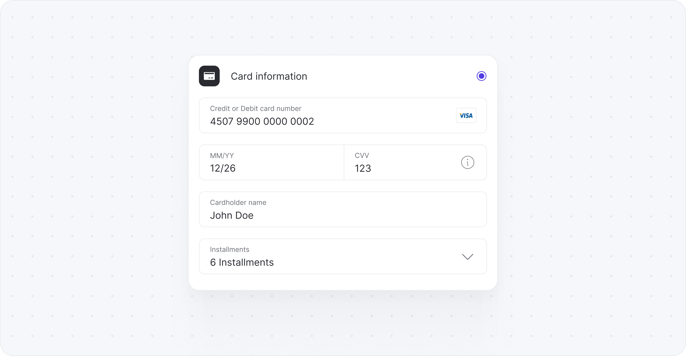

Nesta seção, você vai descobrir como a Yuno oferece suporte a pagamentos em parcelas, dando a você e aos seus clientes a flexibilidade de tornar grandes compras mais acessíveis. Conheça os benefícios desse recurso e entenda a diferença entre as parcelas de "Lojista" e de "Provedor" para uma solução de pagamento sob medida.

## Aceite pagamentos com cartão em parcelas {#accept-card-payments-in-installments}

A Yuno oferece suporte a pagamentos em parcelas, o que permite distribuir o custo de uma compra por um período mais longo. Essa é uma ótima forma de tornar uma compra grande mais acessível ou de liberar fluxo de caixa para outras despesas. Em um pagamento com uma [promoção da Yuno](/docs/payment-features/promotions), o plano de parcelas é calculado sobre o valor que o cliente paga, `amount.value` menos `discount_amount`.

<Frame></Frame>

### Parcelas de lojista vs. de provedor {#merchant-vs-provider-installments}

A implementação das parcelas varia conforme a origem e os seus acordos comerciais. Há duas opções que os lojistas podem usar, uma definida por eles mesmos e outra de acordo com a definição dos provedores:

* **[Lojista](/pt-br/docs/payment-features/installments/merchant-installments)**: nesse caso, o lojista gerencia suas próprias opções de parcelas por meio de processadores de pagamento individuais, determinando as opções de parcelas disponíveis para os clientes dentro da Yuno.
* **[Provedor](/pt-br/docs/payment-features/installments/provider-installments)**: quando o lojista não tem acordos de parcelas predefinidos, ele depende das opções de parcelas do processador de pagamento. Trabalhamos com o provedor escolhido por você para acessar as parcelas disponíveis a oferecer aos seus clientes em cada transação.

Para obter mais informações sobre como configurar cada opção, você pode acessar as páginas [Parcelas do lojista](/pt-br/docs/payment-features/installments/merchant-installments) ou [Parcelas do provedor](/pt-br/docs/payment-features/installments/provider-installments).