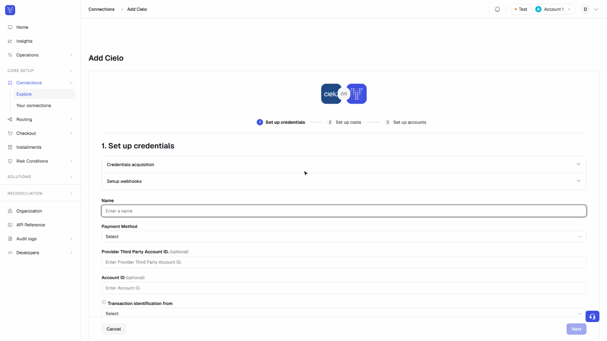
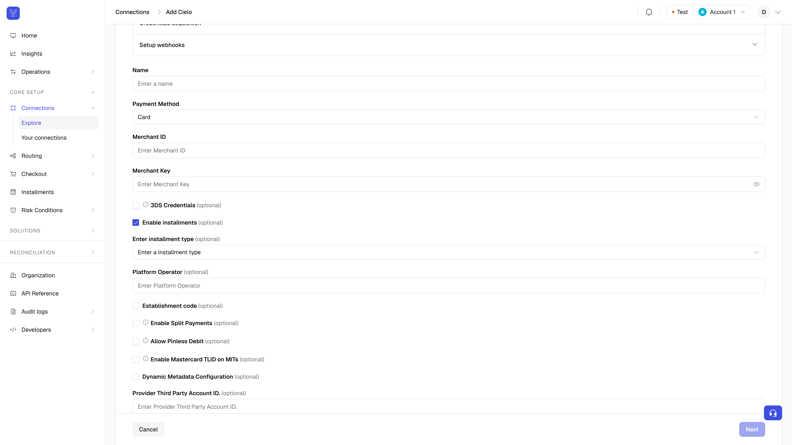

Você pode usar as opções de parcelas do lojista quando você, o lojista, tem seus próprios acordos comerciais e capacidades de parcelamento definidos com seus processadores de pagamento. Nesse caso, você é responsável por cuidar da lógica por trás das opções de parcelas disponíveis para cada transação. Ao criar o pagamento, você informará à Yuno o número de parcelas disponíveis que os clientes podem escolher.

<Frame></Frame>

## Como usar as parcelas do lojista? {#how-to-use-merchant-installments}

Dependendo da forma como você está conectado à Yuno, o processo de configuração das parcelas pode variar. A seguir, mostramos como você pode informar à Yuno a opção de parcelas para o fluxo Direct e para a integração com SDK.

### Fluxo Direct {#direct-workflow}

Ao usar uma [integração Direct](/pt-br/docs/direct-integration-use-cases/direct-flow), você gerencia a experiência de checkout no front-end. Nesse caso, você informará à Yuno o número de parcelas ao criar o pagamento com o endpoint [Create Payment](/reference/payments/create-payment). O número de parcelas é definido pelo parâmetro `payment_method.detail.card.installments`.

### Integração com SDK {#sdk-integration}

Quando você usa o SDK da Yuno, a Yuno é responsável por apresentar ao cliente as opções de parcelas disponíveis para cada pagamento. Por isso, você precisa informar à Yuno quais parcelas estarão disponíveis para sua conta. Nesse caso, as configurações de parcelas são feitas pelo [Dashboard da Yuno](https://auth.y.uno/u/login?). Para fazer essa configuração, execute as duas etapas descritas abaixo.

1. Primeiro, ao configurar a [conexão](/pt-br/docs/using-yuno/dashboard-overview/connections) do seu provedor no Dashboard da Yuno, você precisa habilitar a opção de parcelas. Assim, a Yuno mostrará a opção de parcelas quando o cliente escolher a opção de cartão de crédito no formulário do checkout do SDK.

<Frame></Frame>

2. Depois de habilitar as parcelas, você precisa criar um plano de parcelas com o endpoint [Create Installments Plan](/reference/installments/create-installments-plan). Ao criar um plano, você especifica a moeda aceita, os valores, as bandeiras de cartão, as datas etc. Quando o plano está ativo, a Yuno o aplica automaticamente aos pagamentos correspondentes e apresenta ao cliente as opções de parcelas correspondentes.

<Warning>
**Integração com o Secure Fields SDK**

Ao usar a integração com o Secure Fields SDK, você precisará [habilitar a opção de parcelas](/docs/sdks/customization/secure-fields/payment-secure-fields) ao iniciar o processo de checkout.
</Warning>

Para parcelas criadas pelo lojista, você também pode especificar o plano de cada sessão usando:

* o `plan_id` ao [criar a sessão](/reference/checkout-sessions/create-checkout-session).
* uma `plan structure` ao [criar a sessão de checkout](/reference/checkout-sessions/create-checkout-session).

<Danger>
**Roteamento com provedores de fallback**

Ao configurar sua [rota](/pt-br/docs/using-yuno/dashboard-overview/routing) para o meio de pagamento cartão, é importante lembrar que, se você tiver um provedor de fallback enquanto usa parcelas, tentaremos fazer um pagamento de fallback caso a primeira transação seja rejeitada. Por isso, é fundamental garantir que os dois provedores aceitem a quantidade de parcelas definida para sua conta. Se não aceitarem, você pode configurar rotas diferentes para cada cenário e evitar problemas.
</Danger>