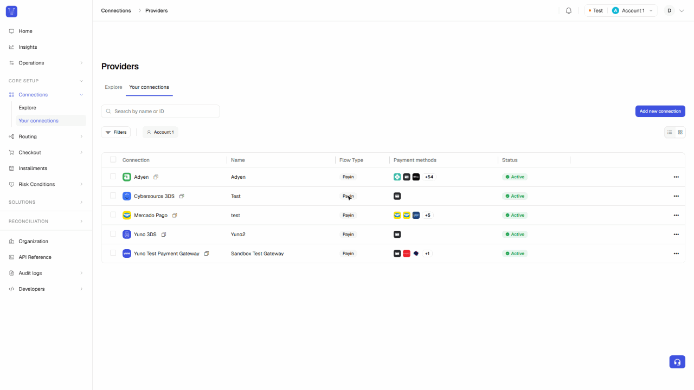
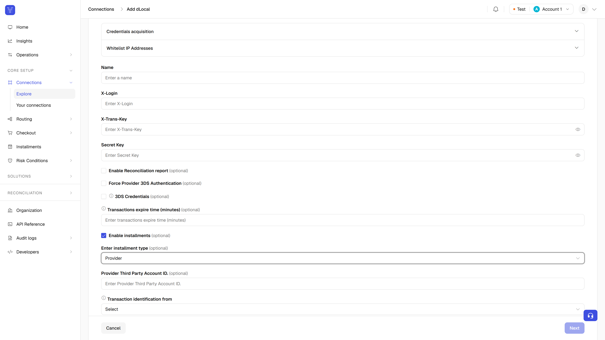

As parcelas **do provedor** são usadas quando o lojista não tem um acordo comercial para um conjunto definido de parcelas e, por isso, usa as parcelas definidas pelo processador de pagamento. A Yuno consulta o provedor de sua escolha para obter as parcelas disponíveis para oferecer aos seus clientes em cada transação.

<Frame></Frame>

### Como usar as parcelas do provedor? {#how-to-use-provider-installments}

Ao configurar a [conexão](/pt-br/docs/using-yuno/dashboard-overview/connections) do seu provedor no Dashboard da Yuno, você pode habilitar as parcelas disponíveis para o provedor, para que possamos usá-las no formulário de cartão de crédito do SDK e o cliente possa escolher entre elas. Nesse cenário, não é preciso criar um plano, pois a Yuno usará o plano definido pelo seu processador de pagamento.

<Warning>
**Secure Fields SDK**

Ao usar a integração com o Secure Fields SDK, você precisará [habilitar a opção de parcelas](/docs/sdks/customization/secure-fields/payment-secure-fields) ao iniciar o processo de checkout.
</Warning>

Esta opção não está habilitada para todos os provedores, somente para os que têm serviços de parcelamento que a Yuno consegue acessar para obter as informações. Se você considera que um provedor deveria ter este recurso habilitado, fale com o seu gerente de conta.

<Frame></Frame>

<Danger>
**Aviso sobre a configuração de roteamento**

Ao definir a sua [rota](/pt-br/docs/using-yuno/dashboard-overview/routing) para o meio de pagamento Card, lembre-se de que ter um fallback para um provedor que usa "Parcelas do provedor" não é suportado, pois provedores diferentes lidam com tipos diferentes de planos de parcelas. Isso pode causar um erro de processamento no fallback.
</Danger>