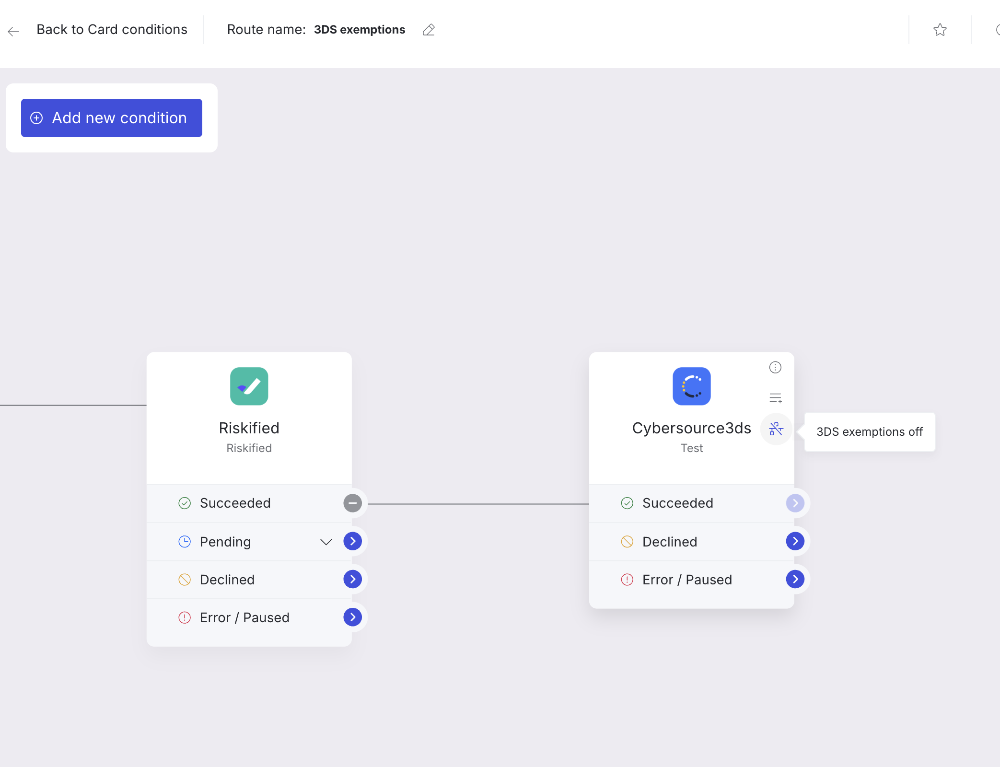

## Entendendo as isenções de SCA {#understanding-sca-exemptions}

De acordo com a Payment Services Directive 2 (PSD2) da União Europeia, a Strong Customer Authentication (SCA) é obrigatória para pagamentos eletrônicos, para aumentar a segurança e reduzir a fraude. No entanto, a PSD2 prevê cenários específicos (conhecidos como isenções de SCA) em que as transações podem dispensar os requisitos de autenticação padrão. Essas isenções foram criadas para simplificar o processo de pagamento em transações de baixo risco, melhorando a experiência do usuário sem comprometer a segurança.

## Indicador de requisição de desafio {#challenge-request-indicator}

O array `strong_customer_authentication_exemptions` permite que os lojistas indiquem sua preferência quanto à aplicação de isenções da Strong Customer Authentication (SCA) durante uma transação. Com esse campo, os lojistas podem solicitar que determinadas transações fiquem isentas dos desafios de autenticação padrão, melhorando a experiência do cliente e reduzindo o atrito durante o processo de pagamento.

## Valores permitidos {#allowed-values}

O array `strong_customer_authentication_exemptions` aceita os valores a seguir, cada um correspondente a uma isenção de SCA específica:

* **`LOW_VALUE`**: indica que o valor da transação está abaixo do limite de baixo valor definido pela PSD2 (normalmente abaixo de €30).
* **`TRANSACTION_RISK_ANALYSIS`**: significa que uma Transaction Risk Analysis (TRA) foi realizada e que a transação é considerada de baixo risco.
* **`STRONG_CUSTOMER_AUTHENTICATION`**: significa que a responsabilidade pela autenticação foi delegada a um terceiro confiável que já realizou a SCA.
* **`OUT_OF_SCOPE`**: significa que a responsabilidade pela autenticação não deve ser levada em conta.
* **`SECURE_CORPORATE`**: indica que o pagamento é feito com um cartão corporativo seguro que não está atribuído a uma pessoa física.
* **`TRUSTED_BENEFICIARY`**: indica que o lojista foi adicionado à lista de beneficiários confiáveis do cliente após uma SCA inicial.
* **`RECURRING_PAYMENT`**: indica que a transação é um pagamento recorrente de valor fixo para o mesmo beneficiário.

<Note>
**Cartes Bancaires Safe'R (França)**

O Safe'R é um programa da Cartes Bancaires (CB) construído sobre o EMV 3DS 2.x e a TRA. Não existe uma flag `SAFER` dedicada na API da Yuno. Para solicitar fluxos elegíveis ao Safe'R, use a isenção `TRANSACTION_RISK_ANALYSIS` e inclua os campos de dados de risco da CB na sua requisição de pagamento.

Informe o máximo possível dos campos a seguir para aumentar a elegibilidade:

* `customer_payer.ip_address`
* `customer_payer.email`
* `customer_payer.phone`
* `customer_payer.billing_address.*`
* `customer_payer.shipping_address.*`
* `customer_payer.browser_info.*` (para fluxos web)
</Note>

## Exemplo de implementação {#implementation-example}

As isenções da Strong Customer Authentication vêm de uma destas opções:

* **\[Recomendado]** - A análise prévia de um provedor de fraude na sua rota de pagamento:
  * <Frame></Frame>
* A definição na criação das requisições de pagamento via API. Garanta que o valor selecionado reflita com precisão a natureza da transação. Por exemplo:

```json
{
  [...],
  "payment_method": {
        "type": "CARD",
        "detail": {
            "card": {
                "card_data": {
                    "holder_name": "Paco",
                    "number": "4871049999999910",
                    "expiration_month": 3,
                    "expiration_year": 30,
                    "security_code": "737"
                },
               "three_d_secure": {
                        "strong_customer_authentication_exemptions": ["LOW_VALUE"]
                    }
            }
        }
    }
[...]
}
```

Neste exemplo, `strong_customer_authentication_exemptions` está definido como LOW\_VALUE, indicando que a transação se qualifica para a isenção de pagamento de baixo valor.

### Considerações {#considerations}

* *Decisão final do emissor*: embora os lojistas possam solicitar uma isenção com o campo `strong_customer_authentication_exemptions`, o emissor do cartão tem a autoridade final para aceitar ou recusar a isenção, com base na avaliação de risco e nas políticas de conformidade dele.
* *Implicações de responsabilidade*: solicitar uma isenção pode afetar a responsabilidade em casos de transações fraudulentas. É essencial entender que, se uma isenção for concedida, o liability shift associado à SCA pode não se aplicar. A resposta do pagamento reflete isso no campo `three_d_secure.liability_shift` (veja [3DS Standalone: campos da resposta](/pt-br/docs/payment-features/3ds-standalone#response-fields)).
* *Conformidade regulatória*: garanta que o uso deste campo esteja de acordo com as regulamentações regionais, como a PSD2 na Europa, e que sua implementação siga os requisitos e limites específicos definidos para cada tipo de isenção.