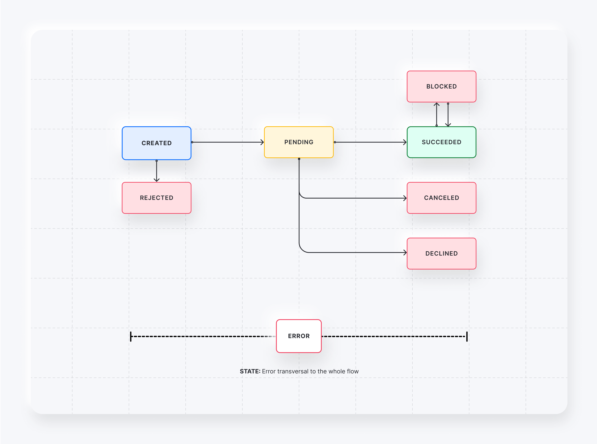

Este recurso permite que **os lojistas dividam pagamentos entre vários destinatários**, o que é especialmente útil para modelos de marketplace em que as transações precisam ser divididas entre diferentes vendedores ou partes interessadas. Os lojistas podem especificar como o pagamento é dividido, incluindo os valores, os destinatários e as taxas aplicáveis.

A funcionalidade de split de pagamento depende do suporte do provedor de pagamento selecionado. A Yuno atua apenas como orquestradora do pagamento, não como processadora. Confirme que o seu provedor oferece suporte a split de pagamento antes de usar essa funcionalidade.

## Principais recursos {#key-features}

Os principais recursos do split de pagamento para marketplace incluem:

* **Split de pagamento**: defina como o valor total do pagamento é distribuído entre diferentes destinatários.
* **Configuração flexível**: oferece suporte tanto a splits com valores absolutos quanto a splits com cálculo automático.
* **Configuração de split automático**: defina regras no nível do destinatário (percentual, fixo ou misto) para automatizar os cálculos de split sem especificar valores em cada requisição de pagamento.
* **Integração com provedores**: os splits podem ser executados por provedores de pagamento que oferecem suporte a essa funcionalidade.
* **Tratamento detalhado de taxas**: o sistema permite ajustar com precisão como as taxas de transação e os chargebacks são gerenciados. Em cada entrada do split, o objeto `liability` define quem paga a taxa de transação (`processing_fee`: `MERCHANT`, `RECIPIENT` ou `SHARED`) e se o destinatário é responsável pelos chargebacks (`chargebacks`). Veja [Integração do split de pagamento](#3-payment-split-integration).
* **Transferência de onboarding**: permite transferir onboardings entre diferentes destinatários.

Para usar este recurso, você precisa **primeiro fazer o onboarding dos seus destinatários** para o split de pagamento e **depois criar o pagamento** especificando as informações necessárias.

## 1. Onboarding {#1-onboarding}

O modelo de onboarding da Yuno foi criado para ajudar marketplaces a conectar e gerenciar de forma simples os seus **sublojistas** em **vários provedores de pagamento**. O elemento central desse sistema é o **objeto de destinatário**, que representa cada sublojista dentro do ecossistema do marketplace.

* Cada **dono de marketplace** é representado na **Yuno como uma organização**.
* Dentro de uma organização, é possível criar uma ou mais contas, cada uma configurada com o seu próprio conjunto de **conexões** com provedores de pagamento (por exemplo, Stripe, Adyen, dLocal).
* Para cada conta, o marketplace pode registrar um ou mais **destinatários**: esses são os sublojistas que passarão pelo onboarding.
* Cada **destinatário** é então vinculado individualmente a uma ou mais **conexões**, de acordo com os processadores de pagamento que ele vai usar.

Essa **arquitetura** permite:

* Um processo de onboarding único e unificado.
* Acompanhamento independente do status por provedor.
* Escalabilidade simples das operações dos sublojistas entre provedores.

Esse design garante flexibilidade, transparência e rastreabilidade completa ao longo de todo o ciclo de vida do onboarding. O [endpoint de destinatários](/reference/recipients-for-marketplace/create-recipient-1) é usado para criar e gerenciar o perfil de cada sublojista e para disparar os fluxos de onboarding específicos de cada provedor.

<Note>
  **Destinatários, Sellers e Payouts.** Os destinatários são o modelo de sublojista: você faz o onboarding deles por provedor e os referencia em `split_marketplace` e em [Transferências avulsas](#4-standalone-transfers). [Sellers (franquia)](/reference/sellers/manage-sellers) são um recurso diferente: um lojista de franquia registra identidades de seller por provedor para que a Yuno resolva o `merchant_id` correto da conexão no momento do pagamento. [Payouts](/pt-br/docs/payouts-and-disputes/payouts) é uma API separada que envia fundos a beneficiários por meio de métodos de saque em conta bancária, cartão ou carteira.
</Note>

### Fluxos de onboarding {#onboarding-flows}

A Yuno oferece dois fluxos de onboarding para sublojistas, com flexibilidade de acordo com a situação atual do sublojista junto aos provedores de pagamento.

1. **Contas com onboarding prévio**: se um sublojista já concluiu o processo de onboarding com um provedor específico (por exemplo, por meio de um dashboard ou plataforma externa), o marketplace pode informar o `recipient_id` correspondente durante a criação. Nesse cenário, nenhum onboarding adicional é necessário, e o status é definido imediatamente como `SUCCEEDED` (`onboardings.type`=`PREVIOUSLY_ONBOARDED`).

2. **Onboarding dinâmico**: se nenhuma credencial for informada, a Yuno inicia o processo de onboarding para o provedor escolhido (`onboardings.type`=`ONE_STEP_ONBOARDING` ou `TWO_STEP_ONBOARDING`). Esse processo pode incluir:
   1. Envio de formulário ou redirecionamento para uma página de onboarding hospedada.
   2. Envio de documentação legal ou financeira.
   3. Conclusão das etapas de validação KYC/KYB.

Ao longo do ciclo de vida do onboarding, um destinatário pode passar por vários status que refletem o estado atual do processo:

<div className="code-nowrap-table dense-table">

| Status      | Descrição                                                                    |
| ----------- | ---------------------------------------------------------------------------- |
| `CREATED`   | Estado inicial após a criação; o processo de onboarding ainda não começou.   |
| `PENDING`   | Aguardando a análise do provedor após o envio dos dados.                     |
| `SUCCEEDED` | O destinatário concluiu o onboarding e está ativo.                           |
| `DECLINED`  | O onboarding foi recusado pelo provedor e não pode ser tentado novamente.    |
| `BLOCKED`   | O provedor bloqueou explicitamente o onboarding por questões de compliance.  |
| `CANCELED`  | O processo de onboarding foi cancelado voluntariamente antes da conclusão.   |
| `REJECTED`  | O onboarding falhou por dados incorretos ou validações malsucedidas.         |
| `ERROR`     | Ocorreu um erro técnico durante o fluxo de onboarding.                       |

</div>

Esses status ajudam o marketplace a entender o ciclo de vida do onboarding e a implementar mecanismos adequados de nova tentativa, alerta ou contingência quando necessário.

Essa abordagem flexível permite que os marketplaces adaptem o processo de onboarding às suas necessidades operacionais, mantendo o controle e a visibilidade.

### Fluxo de trabalho {#workflow}

O fluxo de trabalho de onboarding segue um processo estruturado que garante que os sublojistas sejam integrados corretamente ao ecossistema do marketplace. O diagrama abaixo ilustra o fluxo completo, da configuração inicial até o processamento do pagamento.

<Frame></Frame>

**Etapas do fluxo de trabalho:**

1. **Configuração da organização e da conta**: o dono do marketplace cria uma organização na Yuno e configura contas com conexões a provedores de pagamento.

2. **Criação do destinatário**: para cada sublojista, o marketplace cria um destinatário usando o endpoint da [API de criação de destinatários](/reference/recipients-for-marketplace/create-recipient-1), especificando uma destas opções:

   * `provider_recipient_id` para sublojistas com onboarding prévio
   * Detalhes da conexão com o provedor para um novo onboarding

3. **Execução do onboarding**:

   * **Onboarding prévio**: o status passa imediatamente para `SUCCEEDED`
   * **Novo onboarding**: a Yuno inicia o fluxo específico do provedor, com o status progredindo de `CREATED` → `PENDING` → `SUCCEEDED`

4. **Criação do pagamento**: depois que os destinatários concluem o onboarding com sucesso (status `SUCCEEDED`), o marketplace pode criar pagamentos com o objeto `split_marketplace`.

5. **Processamento do split**: o provedor de pagamento executa o split de acordo com a distribuição definida, transferindo os fundos para a parte designada de cada destinatário.

## 2. Configuração de split automático {#2-auto-split-configuration}

A Yuno permite definir **regras de split automático** no nível do destinatário. Quando um pagamento é criado sem um `amount` explícito para um destinatário no array `split_marketplace`, a Yuno usa essas regras para calcular o split automaticamente.

### Tipos de cálculo {#calculation-types}

O objeto `split_configuration` oferece suporte a três métodos de cálculo:

<div className="nowrap-col1-table dense-table">

| Tipo | Descrição | Fórmula |
| :--- | :--- | :--- |
| `PERCENTAGE` | Um percentual do valor total do pagamento. | `Split = Total * (Percentage / 100)` |
| `FIXED` | Um valor fixo constante em uma moeda específica. | `Split = fixed_amount` |
| `MIXED` | Combina um percentual e um valor fixo. | `Split = (Total * (Percentage / 100)) + fixed_amount` |

</div>

### Modo de arredondamento {#rounding-mode}

Para garantir a precisão em diferentes moedas, a Yuno oferece suporte a três estratégias de arredondamento para os cálculos automáticos:

<div className="code-nowrap-table dense-table">

| Modo | Descrição | Estratégia |
| :--- | :--- | :--- |
| `STANDARD` | Arredonda para o número par mais próximo (arredondamento bancário). | `HALF_EVEN` |
| `ROUND_UP` | Sempre arredonda para longe do zero. | `CEILING` |
| `ROUND_DOWN` | Sempre arredonda em direção ao zero. | `FLOOR` |

</div>

### Implementação {#implementation}
 
 Você pode definir o `split_configuration` ao [criar](/reference/recipients-for-marketplace/create-recipient-1) ou [atualizar](/reference/recipients-for-marketplace/update-recipient-1) um destinatário.
 
 <div className="nowrap-col1-table dense-table">

 | Campo | Tipo | Descrição | Obrigatório |
 | :--- | :--- | :--- | :--- |
 | `calculation_type` | `string` (enum) | O método usado para calcular o split: `PERCENTAGE`, `FIXED`, `MIXED`. | **Sim** |
 | `currency` | `string` | Código de moeda ISO 4217. Deve corresponder à moeda do pagamento. | **Sim** |
 | `percentage` | `number` | Percentual do valor total do pagamento. | Opcional* |
 | `fixed_amount` | `number` | Valor fixo a ser dividido. | Opcional* |
 | `rounding_mode` | `string` (enum) | Estratégia de arredondamento: `STANDARD`, `ROUND_UP`, `ROUND_DOWN`. | Opcional* |

 </div>
 
 <Note>
   *A obrigatoriedade depende de `calculation_type`:
   - **PERCENTAGE**: `percentage` e `rounding_mode` são obrigatórios.
   - **FIXED**: `fixed_amount` é obrigatório.
   - **MIXED**: `percentage`, `fixed_amount` e `rounding_mode` são obrigatórios.
 </Note>
 
 ```json Example Recipient with Auto Split
 {
   "merchant_recipient_id": "seller-123",
   "split_configuration": {
     "calculation_type": "PERCENTAGE",
     "percentage": 10.5,
     "rounding_mode": "STANDARD",
     "currency": "USD"
   }
 }
 ```

## 3. Integração do split de pagamento {#3-payment-split-integration}

Nesta seção, vamos ver como o objeto `split_marketplace` é usado para dividir um [pagamento](/reference/payments/create-payment) entre vários destinatários. Esse objeto é um array em que cada entrada especifica um destinatário e a parte do pagamento correspondente a ele.

<Note>
  **Pagamentos com uma promoção da Yuno.** O split é calculado sobre o valor que o cliente paga, `amount.value` menos `discount_amount`, e as partes não podem somar mais do que esse valor: caso contrário, o pagamento é rejeitado com `400`. Veja [Promoções](/docs/payment-features/promotions).
</Note>

<Note>
  Nesta etapa, referencie os destinatários criados na Etapa 1 (Onboarding).

  Para `type` = `PURCHASE` ou `MARKETPLACE`, inclua o `recipient_id` desse destinatário.

  Para `PAYMENTFEE`, `VAT` e `COMMISSION`, o `recipient_id` é opcional.
</Note>

<table class="code-nowrap-table dense-table">
  <thead>
    <tr>
      <th>
        Campo
      </th>

      <th>
        Tipo
      </th>

      <th>
        Descrição
      </th>

      <th>
        Obrigatório
      </th>

      <th>
        Valor de exemplo
      </th>
    </tr>
  </thead>

  <tbody>
    <tr>
      <td>
        `recipient_id`
      </td>

      <td>
        `string`
      </td>

      <td>
        O identificador único do destinatário dentro do marketplace.

        Use o ID de um destinatário criado na Etapa 1 (Onboarding) quando `type` for `PURCHASE` ou `MARKETPLACE`.
      </td>

      <td>
        Condicional
      </td>

      <td>
        `rec_test123`
      </td>
    </tr>

    <tr>
      <td>
        `provider_recipient_id`
      </td>

      <td>
        `string`
      </td>

      <td>
        O ID do destinatário fornecido pelo provedor de pagamento, se aplicável.
      </td>

      <td>
        Condicional
      </td>

      <td>
        `prov_rec_abc`
      </td>
    </tr>

    <tr>
      <td>
        **Observação:**
      </td>

      <td />

      <td>
        Você deve informar `recipient_id` ou `provider_recipient_id`.

        Para donos de marketplace (`type`=`COMMISSION`), `provider_recipient_id` é opcional se o provedor não o exigir.
      </td>

      <td />

      <td />
    </tr>

    <tr>
      <td>
        `type`\*
      </td>

      <td>
        `enum`
      </td>

      <td>
        O tipo do item de detalhe da transação. As opções incluem `PURCHASE`, `PAYMENTFEE`, `VAT`, `COMMISSION`, `MARKETPLACE`.

        `recipient_id` é obrigatório para `PURCHASE` e `MARKETPLACE`.
      </td>

      <td>
        Condicional
      </td>

      <td>
        `PURCHASE`
      </td>
    </tr>

    <tr>
      <td>
        **Observação:**
      </td>

      <td />

      <td>
        **Considerações sobre propagação**

        * Os itens são enviados ao provedor somente se ele oferecer suporte à transmissão de detalhes

        * Esses tipos não afetam o repasse de fundos; são apenas informativos quando o provedor permite

        <br />
      </td>

      <td />

      <td />
    </tr>

    <tr>
      <td>
        `merchant_reference`
      </td>

      <td>
        `string`
      </td>

      <td>
        Um identificador da transação de pagamento. É opcional. Se não for especificado, a referência do lojista do pagamento principal será usada para todas as transações do split. (MÁX. 255; MÍN. 3 caracteres).
      </td>

      <td>
        Não
      </td>

      <td>
        `AAB01-432245`
      </td>
    </tr>

    <tr>
      <td>
        `amount`
      </td>

      <td>
        `struct`
      </td>

      <td>
        Especifica o valor do split. **Opcional** se o destinatário tiver um `split_configuration` definido.
      </td>

      <td>
        Condicional
      </td>

      <td />
    </tr>

    <tr>
      <td>
            `value`
      </td>

      <td>
        `number`
      </td>

      <td>
        O valor monetário do split (por exemplo, 7500 para 75.00). Obrigatório se `amount` for informado.
      </td>

      <td>
        Condicional
      </td>

      <td>
        `7500`
      </td>
    </tr>

    <tr>
      <td>
            `currency`
      </td>

      <td>
        `enum`
      </td>

      <td>
        A moeda em que o pagamento é feito (ISO 4217, 3 caracteres). Obrigatório se `amount` for informado.
      </td>

      <td>
        Condicional
      </td>

      <td>
        `COP`
      </td>
    </tr>

    <tr>
      <td>
        `liability`
      </td>

      <td>
        `struct`
      </td>

      <td>
        Informações sobre a responsabilidade do destinatário por taxas e chargebacks, se aplicável.
      </td>

      <td>
        Não
      </td>

      <td />
    </tr>

    <tr>
      <td>
            `processing_fee`
      </td>

      <td>
        `enum`
      </td>

      <td>
        Especifica quem é responsável pela taxa de transação: `MERCHANT`, `RECIPIENT`, `SHARED`.
      </td>

      <td>
        Não
      </td>

      <td>
        `MERCHANT`
      </td>
    </tr>

    <tr>
      <td>
            `chargebacks`
      </td>

      <td>
        `boolean`
      </td>

      <td>
        Indica se o destinatário é responsável pelos chargebacks (`true` se ele for responsável).
      </td>

      <td>
        Não
      </td>

      <td>
        `false`
      </td>
    </tr>
    <tr>
      <td>
        **Observação:**
      </td>
 
      <td />
 
      <td>
        **Cálculo de split automático**
 
        Se `amount` for omitido, a Yuno usa o `split_configuration` do destinatário para calcular a parte. Se ambos estiverem presentes, o `amount` da requisição tem precedência.
      </td>
 
      <td />
 
      <td />
    </tr>
  </tbody>
</table>

<br />

```json Example using provider recipients directly
{
  "split_marketplace": [
    {
      "provider_recipient_id": "recipient_123",
      "type": "PURCHASE",
      "amount": {
        "value": 750,
        "currency": "EUR"
      }
    },
    {
      "type": "COMMISSION",
      "amount": {
        "value": 30,
        "currency": "EUR"
      }
    }
  ]
}
```

```json Example using Yuno recipients
{
  "split_marketplace": [
    {
      "recipient_id": "4b31a9b8-4cd2-4e47-93cf-03729241bd68",
      "type": "PURCHASE",
      "amount": {
        "value": 750,
        "currency": "EUR"
      }
    },
    {
      "recipient_id": "9104911d-5df9-429e-8488-ad41abea1a4b",
      "type": "COMMISSION",
      "amount": {
        "value": 30,
        "currency": "EUR"
      }
    }
  ]
}
```

```json Example with Implicit Auto-calculation
{
  "split_marketplace": [
    {
      "recipient_id": "4b31a9b8-4cd2-4e47-93cf-03729241bd68",
      "type": "PURCHASE"
      // The amount is omitted, Yuno uses the recipient's split_configuration
    },
    {
      "recipient_id": "9104911d-5df9-429e-8488-ad41abea1a4b",
      "type": "COMMISSION",
      "amount": {
        "value": 50,
        "currency": "USD"
      }
    }
  ]
}
```

### Fallback de destinatário para CARD e PIX {#recipient-fallback-for-card-and-pix}

Para pagamentos CARD e PIX criados por meio de `POST /v1/payments`, incluindo a continuação desses pagamentos, uma tentativa que a Yuno recusa com `RECIPIENT_NOT_FOUND` pode continuar por uma conexão elegível. A Yuno recusa uma tentativa dessa forma, sem enviá-la ao provedor, quando um destinatário do split não tem um onboarding que possa usar com o provedor roteado (por exemplo, o único onboarding está `BLOCKED` ou `CANCELLED`). Não conte com esse fallback para recusas retornadas pelo provedor. Toda entrada do split deve referenciar um `recipient_id` da Yuno, incluindo as entradas `PAYMENTFEE`, `VAT` e `COMMISSION`, em que ele é opcional nos demais casos.

Uma conexão de fallback só é elegível quando **todos os destinatários do split** têm exatamente um onboarding ativo nessa conexão, e esse onboarding tem status `SUCCEEDED` e um ID de destinatário do provedor não vazio. Onboardings em estado final, como `BLOCKED`, `CANCELLED` ou `DECLINED`, não são contados. Um onboarding em outra conexão com o mesmo provedor não se qualifica. Se você especificar `recipient_type`, o onboarding deve corresponder a esse tipo; caso contrário, o onboarding correspondente não pode ser ambíguo.

A rota configurada por você tem precedência:

- Uma próxima etapa configurada é seguida antes que outro provedor inicial seja considerado. Depois que o fallback de destinatário começa, uma etapa de pagamento que não consegue resolver todos os destinatários na sua conexão é recusada localmente; a rota configurada dela pode continuar para a próxima etapa.
- Uma parada correspondente por grupo de recusa ou por merchant advice code continua sendo uma parada.
- Para rotas com percentuais de alocação configurados, quando a rota de um provedor inicial terminaria, a Yuno pode selecionar um provedor elegível e ainda não tentado entre as conexões da primeira etapa da rota, dentro do mesmo conjunto de condições. Se a rota começar com uma etapa de fraude ou de 3DS, a Yuno não procura outro provedor por meio desse fallback. Ela não pesquisa rotas aninhadas nem ramificações alcançadas apenas por erros. Conexões pausadas, conexões sinalizadas por um monitor de roteamento e conexões com alocação de zero por cento são excluídas. Se várias conexões se qualificarem, a Yuno tenta primeiro a que tiver a maior alocação.

O fallback preserva a ordem, os IDs de destinatário da Yuno e as alocações do split. A Yuno resolve os IDs de destinatário do provedor para a conexão selecionada. Por exemplo, um pagamento de BRL 100 dividido em BRL 60/40 continua BRL 60/40 quando passa para outro provedor elegível.

A tentativa recusada permanece nas transações do pagamento com status `DECLINED`, código de resposta `RECIPIENT_NOT_FOUND` e sem ID de transação do provedor; nenhuma requisição é enviada a esse provedor. Quando o fallback é bem-sucedido, a próxima transação usa a conexão selecionada com o mesmo split, e um reembolso se aplica à transação aprovada. Se não houver alternativa elegível nem continuação configurada, o pagamento termina sem outra cobrança no provedor. Um pagamento PIX já aceito e aguardando pagamento não aciona esse fallback.

Esse comportamento não se aplica a splits que contêm entradas sem um `recipient_id` da Yuno, incluindo entradas que usam apenas `provider_recipient_id`, nem a verificação, captura, reembolso, cancelamento ou cadastro. Ele não transfere um pagamento aceito para outro provedor. Um token de provedor que altera a conexão selecionada também impede o fallback por meio dessa seleção.

### Atualizar o split de uma transação paga {#update-the-split-of-a-paid-transaction}

Quando um pedido muda após o pagamento (por exemplo, outro vendedor faz a entrega), você pode substituir o split da transação paga com [Atualizar o split de uma transação paga](/reference/recipients-for-marketplace/update-split-marketplace) em vez de reembolsar e cobrar novamente. As partes que você envia substituem todo o split anterior.

<Note>
  O prazo para alterar um split é definido pelo provedor, não pela Yuno. Com a Zoop, o split pode ser alterado até o fim do dia corrido do pagamento. Depois que o prazo termina, a atualização é recusada com `409` `SPLIT_UPDATE_WINDOW_CLOSED` e o split não é alterado. A atualização é habilitada por conexão de provedor; entre em contato com a Yuno para habilitá-la na sua.
</Note>

## 3. Transferência de onboarding {#3-onboarding-transfer}

O objetivo deste fluxo é permitir a transferência de onboardings entre destinatários de forma controlada e reversível.

O processo tem várias etapas. Primeiro, o destinatário inicial é criado com o seu onboarding (uma etapa prévia). Depois, quando uma transferência for necessária, siga as etapas para criar o novo destinatário, usar o serviço de transferência e, se necessário, reverter a operação.

1. **Destinatário e onboarding (antes de qualquer transferência)**: [crie o destinatário](/reference/recipients-for-marketplace/create-recipient-1) e depois [crie o onboarding](/reference/recipients-for-marketplace/create-onboarding).

<Note>
  Esta etapa acontece com antecedência, quando um novo destinatário é criado e o seu onboarding é atribuído. Ela não faz parte da transferência em si.
</Note>

Se você decidir transferir o onboarding para outro destinatário, continue o fluxo:

2. **Crie o novo destinatário e o onboarding**: use os endpoints [criar destinatário](/reference/recipients-for-marketplace/create-recipient-1) e [criar onboarding](/reference/recipients-for-marketplace/create-onboarding) para configurar o destinatário e o onboarding que vão receber a transferência.

3. **Transfira o onboarding**: use [transferir onboarding](/reference/recipients-for-marketplace/transfer-onboarding) e inclua:

   * `recipient_id`: o ID do destinatário de destino
   * `onboarding_id`: o onboarding a ser transferido

   O onboarding será transferido para o novo destinatário.

4. **Reverta a transferência (opcional)**: use [reverter onboarding](/reference/recipients-for-marketplace/reverse-onboarding) para desfazer a transferência anterior, informando os mesmos `recipient_id` e `onboarding_id`.

O objeto `onboarding` inclui um elemento `history` que armazena a rastreabilidade completa do onboarding. Esse histórico inclui não apenas as atualizações do objeto, mas também os eventos relacionados a transferências entre destinatários, garantindo visibilidade de todo o ciclo de vida.

## 4. Transferências avulsas {#4-standalone-transfers}

Os lojistas frequentemente precisam enviar fundos a destinatários (vendedores, fornecedores, prestadores de serviço) de forma independente do ciclo de vida de um pagamento, diretamente do saldo da sua organização. Isso é conhecido como **transferência avulsa** ou **transferência direta**.

Este recurso permite:
- Distribuir o resultado das vendas aos vendedores de um marketplace.
- Pagar prestadores de serviço após a conclusão de trabalhos (gig economy).
- Gerenciar a divisão de receita de assinaturas ou o pagamento de comissões a afiliados.
- Executar payouts em lote para vários destinatários.

### Status de transferência {#transfer-statuses}

Um fluxo de transferência avulsa passa por vários estados, de acordo com a resposta do provedor e com eventuais reversões posteriores:

<div className="code-nowrap-table dense-table">

| Status      | Descrição                                                 | Final?    |
| ----------- | --------------------------------------------------------- | --------- |
| `CREATED`   | Fluxo de transferência criado, ainda não enviado ao provedor. | Não       |
| `PENDING`   | Enviado ao provedor, aguardando confirmação.              | Não       |
| `SUCCEEDED` | Transferência direta concluída com sucesso.               | Não       |
| `DECLINED`  | O provedor recusou a transferência.                       | Sim       |
| `ERROR`     | Erro do provedor durante o processamento.                 | Sim       |
| `REVERSED`  | Transação de reversão concluída com sucesso.              | Sim       |

</div>

### Transações e reversões {#transactions-and-reversals}

No fluxo de transferência avulsa, as operações diretas e de reversão são tratadas como transações independentes idênticas para manter uma trilha de auditoria explícita. Isso significa que:

1. **Transferência direta (`SPLIT_TRANSFER`):** você cria uma transferência que move fundos do seu saldo para a conexão do destinatário.
2. **Transferência de reversão (`SPLIT_TRANSFER_REVERSE`):** você pode reverter total ou parcialmente a `SPLIT_TRANSFER` para devolver os fundos ao seu saldo. A transferência direta original _precisa estar_ com status `SUCCEEDED` para que a reversão aconteça.

### Idempotência {#idempotency}

Tanto a criação quanto a reversão de transferências avulsas exigem uma **chave de idempotência** no cabeçalho `X-Idempotency-Key`. Isso permite repetir requisições com segurança, sem duplicar acidentalmente a distribuição de fundos. Essas chaves ficam retidas por 24 horas. Requisições duplicadas com a mesma combinação de `account_id` e chave de idempotência retornam o objeto de transferência original.

 
 ## Validações
 
 Para garantir splits de pagamento bem-sucedidos, as seguintes validações são aplicadas:
 
- **Correspondência do total do split**: a soma de todos os splits deve corresponder ao valor total do pagamento.
- **Existência do destinatário**: todo `recipient_id` incluído no split deve corresponder a um destinatário com onboarding concluído com sucesso.
- **Moeda do split automático**: se um destinatário tiver um `split_configuration`, a `currency` dele deve corresponder exatamente ao `amount.currency` do pagamento.
- **Consistência do valor**: se você informar um `amount.value` para um destinatário com `split_configuration`, ele deve corresponder ao resultado do cálculo automático.
- **Limites de cada split**: o valor resolvido de cada split deve ser maior que zero e menor ou igual ao valor total do pagamento.
- **Precisão mínima**: para splits `PERCENTAGE`, o valor calculado deve ser de pelo menos `0.0001` (mínimo da plataforma).
- **Campos obrigatórios**:
    - Para splits manuais (sem `split_configuration`): `amount.value` e `amount.currency` são obrigatórios.
    - Se `split_configuration` for informado na criação do destinatário: `calculation_type` e `currency` são sempre obrigatórios.
- **Regra de exclusão**: você deve incluir `recipient_id` ou `provider_recipient_id` em cada item do split, mas nunca os dois.
- **Vários provedores**: para destinatários vinculados a vários provedores de pagamento, use o [objeto de destinatários](/reference/recipients-for-marketplace/create-recipient-1) para gerenciar a lógica do split entre as conexões.

## Endpoints da API envolvidos {#api-endpoints-involved}

Esta seção lista os endpoints da API envolvidos no gerenciamento de splits de pagamento.

* **[Criar destinatários](/reference/recipients-for-marketplace/create-recipient-1)**: **POST**: `https://api-sandbox.y.uno/v1/recipients`
* **[Criar onboarding](/reference/recipients-for-marketplace/create-onboarding)**: **POST**: `https://api-sandbox.y.uno/v1/recipients/{recipient_id}/onboardings`
* **[Continuar onboarding](/reference/recipients-for-marketplace/continue-onboarding)**: **POST**: `https://api-sandbox.y.uno/v1/recipients/{recipient_id}/onboardings/{onboarding_id}/continue`
* **[Criar pagamento](/reference/payments/create-payment)**: **POST**: `https://api-sandbox.y.uno/v1/payments`
* **[Capturar autorização](/reference/payments/capture-authorization)**: **POST**: `https://api-sandbox.y.uno/v1/payments/{id}/transactions/{transaction_id}/capture`
* **[Atualizar o split de uma transação paga](/reference/recipients-for-marketplace/update-split-marketplace)**: **PUT**: `https://api-sandbox.y.uno/v1/payments/{payment_id}/transactions/{transaction_id}/split-marketplace`
* **[Reembolsar pagamento](/reference/payments/refund-payment)**: **POST**: `https://api-sandbox.y.uno/v1/payments/{id}/transactions/{transaction_id}/refund`
* **[Cancelar ou reembolsar um pagamento](/reference/payments/cancel-or-refund-a-payment)**: **POST**: `https://api-sandbox.y.uno/v1/payments/{id}/cancel-or-refund`
* **[Cancelar ou reembolsar um pagamento com transação](/reference/payments/cancel-or-refund-payment-with-transaction)**: **POST**: `https://api-sandbox.y.uno/v1/payments/{id}/transactions/{transaction_id}/cancel-or-refund`
* **[Transferir onboarding](/reference/recipients-for-marketplace/transfer-onboarding)**: **POST**: `https://api-sandbox.y.uno/v1/recipients/{recipient_id}/onboardings/{onboarding_id}/transfer`
* **[Reverter transferência de onboarding](/reference/recipients-for-marketplace/reverse-onboarding)**: **POST**: `https://api-sandbox.y.uno/v1/recipients/{recipient_id}/onboardings/{onboarding_id}/reverse-transfer`
* **[Criar transferência avulsa](/reference/transfers/create-standalone-transfer)**: **POST**: `https://api-sandbox.y.uno/v1/split-marketplace/transfers`
* **[Consultar transferência avulsa](/reference/transfers/get-standalone-transfer)**: **GET**: `https://api-sandbox.y.uno/v1/split-marketplace/transfers/{transfer_id}`
* **[Reverter transferência avulsa](/reference/transfers/reverse-standalone-transfer)**: **POST**: `https://api-sandbox.y.uno/v1/split-marketplace/transfers/{transfer_id}/reverse`
