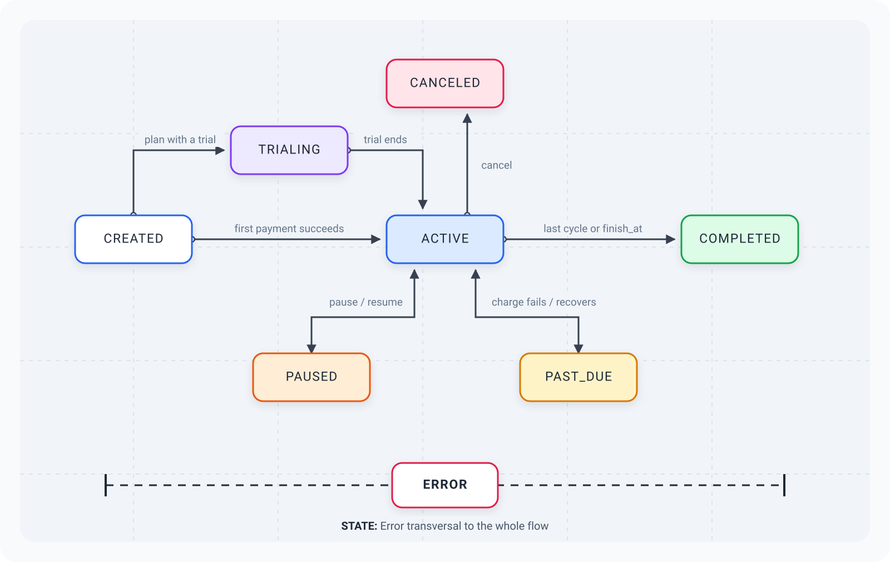

O serviço de assinaturas da Yuno permite que você gerencie pagamentos recorrentes e automatize a cobrança de assinaturas dos seus clientes.

<Note>
**Assinaturas vs Stored Credentials**

* **Assinaturas** (esta página): o motor de recorrência da Yuno. Você fornece as instruções e a frequência uma vez e, depois, a Yuno envia as transações automaticamente em seu nome.
* **Stored Credentials**: você controla a recorrência. Você é responsável por enviar cada transação de acordo com o seu próprio agendamento. Veja [Stored Credentials](/pt-br/docs/payment-features/stored-credentials).
</Note>

## Assinaturas da Yuno {#yuno-subscriptions}

Uma assinatura no ambiente da Yuno pode passar por várias etapas, começando pelo status de criação. Quando uma assinatura é criada, ela recebe automaticamente o status **CREATED**. No entanto, esse é um status transitório, ativo enquanto o pagamento não é processado. Depois disso, a assinatura fica **ACTIVE** ou **CANCELED**, dependendo da confirmação do pagamento.

Quando o pagamento relacionado à assinatura é confirmado, o status da assinatura muda para **ACTIVE** (ou para **TRIALING**, se ela começar dentro da fase de teste de um plano, que passa a **ACTIVE** sozinha quando o teste termina). Ela permanece ativa enquanto a assinatura estiver dentro do seu intervalo de datas de disponibilidade e o cliente pagar as cobranças. A partir daí, ela pode mudar para quatro status diferentes:

* **COMPLETED**: a data de término da assinatura foi atingida. Nesse caso, a assinatura atual é encerrada e não é possível reativá-la. Se o seu cliente quiser continuar usando o seu produto/serviço com pagamentos recorrentes, você precisa criar uma nova assinatura.
* **PAUSED**: a qualquer momento, você pode pausar a assinatura. Use essa opção caso o seu cliente tenha atrasado um pagamento, por exemplo. Você sempre pode ativar uma assinatura pausada.
* **PAST_DUE**: uma cobrança recorrente falhou e a assinatura está aguardando recuperação. Ela continua cobrando, e a próxima cobrança bem-sucedida a devolve ao status de onde veio. Esse status é habilitado por conta; onde ele não está habilitado, uma cobrança com falha mantém a assinatura ativa enquanto as novas tentativas são executadas.
* **CANCELED**: se o seu cliente decidir cancelar o pagamento recorrente, você pode cancelar a assinatura. Depois do cancelamento, a assinatura é encerrada e não é possível reativá-la.

<Frame>
  
</Frame>

Uma assinatura na fase de teste se comporta como uma ativa: ela pode ser pausada, entra em `PAST_DUE` quando uma cobrança falha e volta para `TRIALING` quando uma cobrança posterior é bem-sucedida. Qualquer status não terminal pode ser cancelado, e uma assinatura criada com `initial_payment_validation: true` vai direto de `CREATED` para `CANCELED` se o primeiro pagamento falhar.

Saiba mais sobre o status da assinatura na página [Status da assinatura](/reference/subscriptions/status-subscriptions).

## Integração de assinaturas {#subscription-integration}

Para começar a usar o recurso de assinaturas, você precisa de uma conta na Yuno e de uma integração com a API da Yuno. A API da Yuno oferece as seguintes operações para gerenciar suas assinaturas:

* **Criar**: use o [endpoint Create a Subscription](/reference/subscriptions/create-subscription) para inscrever um cliente em uma assinatura.
* **Criar com o primeiro pagamento**: envie um bloco `subscription` em [Create Payment](/reference/payments/create-payment) para cobrar o cliente e criar a assinatura em uma única chamada. Veja [Iniciar uma assinatura com o primeiro pagamento](/pt-br/docs/payment-features/subscriptions/start-with-payment).
* **Pausar**: pause uma assinatura ativa com o [endpoint Pause Subscription](/reference/subscriptions/pause-subscription).
* **Retomar**: retome uma assinatura pausada anteriormente com o [endpoint Resume Subscription](/reference/subscriptions/resume-subscription).
* **Cancelar**: cancele uma assinatura ativa com o [endpoint Cancel Subscription](/reference/subscriptions/cancel-subscription).
* **Consultar**: use o [endpoint Retrieve Subscription](/reference/subscriptions/retrieve-subscription) para obter os detalhes de uma assinatura.
* **Listar**: use o [endpoint List Subscriptions](/reference/subscriptions/list-subscriptions) para percorrer as assinaturas de uma conta página a página, filtrando por cliente, status, plano, data de criação ou tipo de meio de pagamento.
* **Manter um motor de cobrança externo**: se o Stripe Billing já gerencia seus planos, faturas e dunning, a Yuno pode processar cada cobrança enquanto o Stripe continua sendo o motor de assinaturas. Veja [Processar assinaturas do Stripe Billing com a Yuno](/pt-br/docs/payment-features/subscriptions/stripe-billing).

## Novos conceitos {#new-concepts}

* **Assinaturas**: uma assinatura envolve cobranças recorrentes vinculadas diretamente a um cliente e a um meio de pagamento específico. Ao interromper ou atualizar, o impacto recai somente sobre eles.
* **Meios de pagamento disponíveis**
  * **Cadastrados**: os clientes podem pagar com um meio de pagamento cadastrado anteriormente. Apenas o vaulted token é necessário ao criar a assinatura para associá-lo às cobranças.
* **Funcionalidades**:
  * **Frequência**: defina a frequência com que as cobranças da assinatura vão ocorrer (diária, semanal, mensal ou anual; veja [Create Subscription](/reference/subscriptions/create-subscription) para os valores que cada endpoint aceita), especificando o valor que precisa ser cobrado no próximo ciclo de cobrança.
  * **Ciclos de cobrança**: o número de ciclos de cobrança (seguindo o critério de frequência) que serão concluídos para cumprir a assinatura. Se nenhum `end_date` for enviado nem definido, continuaremos tentando as cobranças até que ela seja interrompida.
  * **Data de cobrança**: ao especificar o objeto `billing_date`, o lojista pode definir a lógica da data exata de cobrança da assinatura. Isso é mutuamente exclusivo com o objeto de frequência.
  * **Disponibilidade**: as datas de início e término da assinatura. Se elas não forem definidas, nem os ciclos de cobrança, as cobranças continuarão até que ela seja interrompida.
    * Os campos `billing_cycles` e `availability.finish_at` influenciam um ao outro. Se ambos forem preenchidos na criação da assinatura, ela passará para o estado COMPLETED ao atingir o evento mais próximo definido nesses campos, seja o ciclo de cobrança ou o `finish_at` correspondente.
  * **Períodos de teste**: esse recurso permite definir um período em que seus clientes podem se beneficiar de um valor reduzido. Ele pode ser parcial ou total (por exemplo, um teste gratuito). Você precisa determinar o valor a ser reduzido do valor total de cada cobrança da assinatura e os ciclos de cobrança aos quais ele deve se aplicar.
  * **Validação do pagamento inicial**: uma flag para identificar se a assinatura deve aguardar o primeiro pagamento para continuar. O padrão é false. Se o campo for definido como true, a assinatura deve permanecer no status CREATED enquanto aguarda o primeiro pagamento da assinatura.
    * Se o primeiro pagamento for bem-sucedido (SUCCEEDED), a assinatura passa para ACTIVE.
    * Se o primeiro pagamento falhar (DECLINED/REJECTED), a assinatura passa para CANCELED.

## Uso da solução de assinaturas da Yuno {#using-yuno-subscription-solution}

A Yuno oferece funcionalidades de gerenciamento de assinaturas por meio da sua API. Você pode usar essa API para criar, atualizar e gerenciar assinaturas, além de consultar os detalhes e o uso das assinaturas.

Para usar a solução de assinaturas, normalmente você seguirá os passos descritos abaixo:

1. Para começar, [crie um cliente](/pt-br/reference/customers/create-customer). Você precisará fornecer os dados pessoais do cliente e o `merchant_customer_id`, um identificador único do cliente usado no seu sistema. Ao concluir o processo de criação do cliente, você receberá um `id` que identifica o usuário dentro do sistema da Yuno. Esse `id` será usado para criar a assinatura.
2. Depois de criar o cliente, você precisará [cadastrar um cartão de crédito](/pt-br/docs/payment-features/enrollment/enroll-payment-methods) para gerar um `vaulted_token` a ser usado na criação da assinatura.
3. [Crie uma assinatura](/reference/subscriptions/create-subscription) para o seu cliente e o cartão cadastrado. Nesta etapa, você vai configurar a assinatura e definir o meio de pagamento. Ao criar a assinatura, você pode personalizar:
   * O valor que a assinatura cobra.
   * A frequência de cobrança: diária, semanal, mensal ou anual (veja [Create Subscription](/reference/subscriptions/create-subscription) para os valores que cada endpoint aceita).
   * O número total de ciclos de cobrança.
   * A disponibilidade da assinatura, para definir as datas de início e término.

<Note>
**Você também pode fazer isso em uma única chamada**

Os passos acima levam o cliente pelo cadastro e pela criação da assinatura separadamente. Se o cliente está se inscrevendo e pagando agora, você pode, em vez disso, enviar as instruções de recorrência no próprio pagamento: a Yuno cobra o cartão e cria a assinatura a partir dessa mesma cobrança, e nada começa a ser cobrado se o pagamento falhar. Essa rota está documentada somente para pagamentos com cartão frictionless. Veja [Iniciar uma assinatura com o primeiro pagamento](/pt-br/docs/payment-features/subscriptions/start-with-payment).
</Note>

<Note>
**Meios de pagamento disponíveis**

As assinaturas aceitam `CARD`, `PAYPAL_ENROLLMENT` e `PIX_AUTOMATIC` como meios de pagamento, os três por meio de instrumentos cadastrados (armazenados no vault) previamente.

`PIX_AUTOMATIC` cobra uma autorização do Pix Automático brasileiro. O arranjo o restringe a cobranças semanais, mensais, trimestrais, semestrais ou anuais com valor de frequência `1`, e a Yuno entrega cada instrução de débito ao arranjo quatro dias antes da data do débito, então ele não cobra como um cartão. Veja [Pix Automático](/pt-br/docs/payment-features/subscriptions/pix-automatico).
</Note>

<Danger>
**Pagamentos recusados**

Se um pagamento de uma assinatura criada com [Create Subscription](/reference/subscriptions/create-subscription) for recusado (incluindo a primeira tentativa de pagamento), a assinatura continuará seu agendamento para as próximas tentativas de pagamento, dando ao lojista a possibilidade de cobrar do cliente o valor pendente por outro processo e continuar com a assinatura em andamento. Se você quiser cancelar uma assinatura, fique à vontade para usar o [endpoint de cancelamento de assinatura](/reference/subscriptions/cancel-subscription).

Na rota de chamada única, uma primeira cobrança recusada não cria nenhuma assinatura; veja [Iniciar uma assinatura com o primeiro pagamento](/pt-br/docs/payment-features/subscriptions/start-with-payment).
</Danger>

Na resposta do endpoint [Create Subscription](/reference/subscriptions/create-subscription), você recebe um `id` que é usado para identificar a assinatura criada. Você usará o `id` se decidir pausar, retomar ou cancelar a assinatura. Se você criou a assinatura com o primeiro pagamento, o mesmo identificador volta como `subscription_code` na resposta do pagamento.

## Eventos de renovação {#renewal-events}

`subscription.active` é enviado quando a assinatura fica ativa pela primeira vez (em `billing_cycles.current` = 2); ele não é reenviado nas renovações seguintes. Acompanhe cada renovação pelo webhook `payment.purchase` de cada ciclo (resultado em `status`/`sub_status`). Ciclos de `$0`/teste não geram webhook de pagamento por definição; em assinaturas baseadas em plano, eles são informados como `subscription.cycle_executed`.

Uma cobrança de renovação com falha também emite `subscription.past_due` onde esse status está habilitado para a conta, e `subscription.active` (ou `subscription.trialing`) novamente quando uma cobrança posterior recupera a assinatura. Veja [Webhooks](/docs/webhooks#subscription-events) para a lista completa de eventos.

<Note>
**Mapeamento entre `code` e `id`**

Os payloads de webhook de assinatura usam `code`, enquanto a API usa `id`, e eles têm os mesmos valores: `subscription.code` é igual ao `id` retornado por `POST /v1/subscriptions`, e `customer_payer.code` é igual ao `id` do cliente.
</Note>