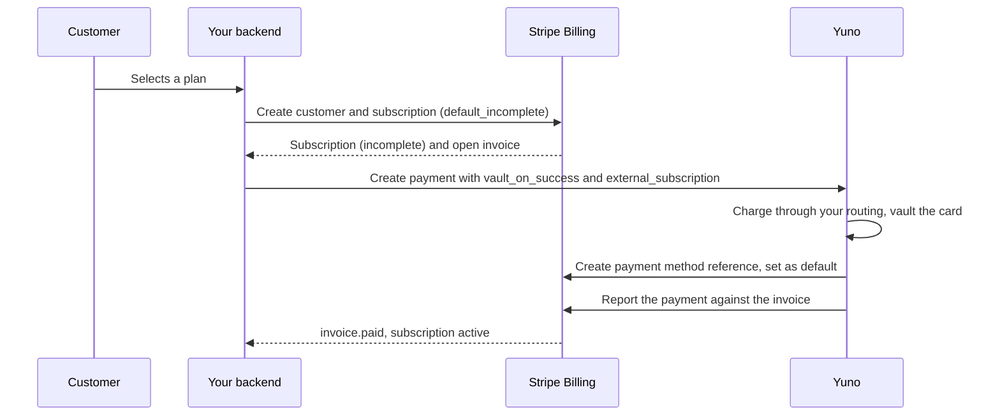
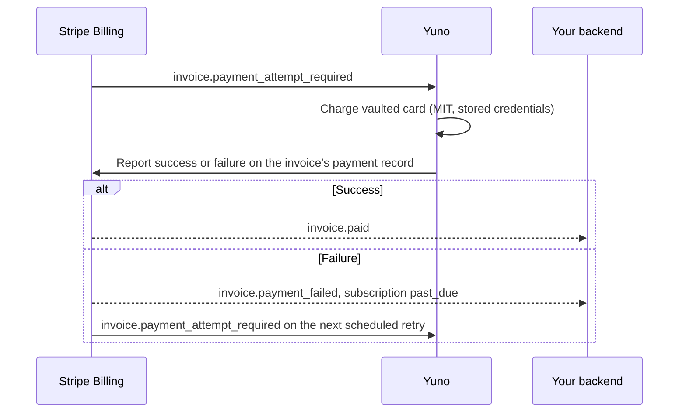

O Stripe Billing continua sendo o seu sistema de registro para planos, assinaturas, faturas, impostos e proporcionalidade. A Yuno executa cada pagamento de assinatura: a primeira cobrança, cada renovação, cada nova tentativa e cada reembolso. A Yuno também faz as chamadas à API do Stripe que informam cada resultado de volta, então o seu backend não chama as APIs de registro de pagamento do Stripe.

## Antes de começar {#before-you-start}

Confira estes pontos em relação ao seu caso de uso antes de integrar:

* **Conta Stripe.** O Billing precisa estar com o **processamento de pagamentos por terceiros** ativado. Solicite isso à sua equipe de conta no Stripe.
* **Países.** A sua empresa e os seus provedores de pagamento precisam estar em países que o Stripe suporta para esse modo. Consulte os [países suportados](https://docs.stripe.com/billing/subscriptions/third-party-payment-processing#supported-countries) do Stripe.
* **Checkout.** Os clientes pagam pelo seu checkout da Yuno. O Stripe Checkout, a página de fatura hospedada pelo Stripe e as tabelas de preços incorporadas do Stripe não funcionam nesse modo.
* **Emails para clientes.** O Stripe não envia os emails de recuperação de receita para esses pagamentos. Você envia os emails de pagamento com falha e de atualização de cartão pelos seus próprios sistemas.
* **Novas tentativas.** As Smart Retries do Stripe não estão disponíveis. Em vez disso, você configura um cronograma personalizado de novas tentativas ou automações do Billing.
* **Disputas e reembolsos.** Você trata os dois na Yuno. O Stripe não pode iniciar um reembolso nem gerenciar uma disputa de um pagamento que ele não processou.
* **Tarifas.** O Stripe cobra tarifas do Billing sobre o volume que a Yuno processa. Consulte [Tarifas do Billing](#billing-fees).
* **Faturas.** A Yuno cobra as faturas de assinaturas do Stripe Billing. Se o Stripe pedir à Yuno para cobrar uma fatura que não tem assinatura, a Yuno não a cobra e não informa nada ao Stripe. Para cobrar uma fatura avulsa com a Yuno, crie você mesmo o pagamento com o objeto `external_invoice`. Consulte [Pagar uma fatura do Stripe (recargas)](/pt-br/docs/payment-features/subscriptions/stripe-billing-top-ups).

## Quem faz o quê {#who-does-what}

| Área | Stripe Billing | Seu backend | Yuno |
| --- | --- | --- | --- |
| Planos, preços, impostos, proporcionalidade | É o responsável | Configura | Nada |
| Ciclo de vida de assinaturas e faturas | É o responsável | Lê os webhooks para liberar acessos | Nada |
| Cronograma de novas tentativas | Executa | Configura | Executa cada tentativa |
| Primeiro pagamento | Aguarda o informe | Cria o pagamento na Yuno com `external_subscription` | Cobra, salva o cartão, informa ao Stripe |
| Renovações | Envia `invoice.payment_attempt_required` | Nada | Cobra como transação iniciada pelo lojista, informa ao Stripe |
| Referência do meio de pagamento no Stripe | Armazena | Nada | Cria e define como padrão |
| Reembolsos | Registra o reembolso e a nota de crédito | Inicia o reembolso na Yuno | Reembolsa, informa ao Stripe, cria a nota de crédito |
| Disputas | Nada | Trata na Yuno | Recebe do provedor |
| Emails de cobrança e fluxo de atualização de cartão | Nada | É o responsável | Salva o novo cartão e atualiza o Stripe |

Para cobrar o pagamento de uma fatura específica do Stripe, como uma recarga de saldo, consulte [Pagar uma fatura do Stripe (recargas)](/pt-br/docs/payment-features/subscriptions/stripe-billing-top-ups).

Para cobrar o primeiro pagamento na moeda local do cliente e com os impostos do endereço dele, consulte [Preço local e impostos](/pt-br/docs/payment-features/subscriptions/local-price-and-taxes).

## Como funciona {#how-it-works}

O modo de [processamento de pagamentos por terceiros](https://docs.stripe.com/billing/subscriptions/third-party-payment-processing) do Stripe permite que um processador externo execute as cobranças das assinaturas do Billing. A Yuno é esse processador.

### Cadastro do cliente e primeiro pagamento {#signup-and-first-payment}



### Renovações e novas tentativas {#renewals-and-retries}



O seu backend continua escutando os webhooks do Stripe que usa hoje (`invoice.paid`, `customer.subscription.updated` e outros) para liberar acessos.

Do lado da Yuno, todo pagamento criado dessa forma traz o objeto `external_subscription` no webhook de pagamento, para que você possa relacionar um pagamento da Yuno a uma assinatura do Stripe. Consulte [Objeto e exemplos](/pt-br/docs/webhooks/object-and-examples). Os cadastros com período de teste são a exceção: o webhook de cadastro não inclui o objeto, então faça a correlação pelo pagamento de verificação (`verify.payment.id` na resposta do cadastro).

## Pré-requisitos {#prerequisites}

* Uma conta Yuno com os seus provedores conectados e o roteamento publicado.
* Uma conta Stripe com o Billing e o processamento de pagamentos por terceiros ativados.
* Uma **chave de API restrita** da sua conta Stripe, compartilhada com o seu contato na Yuno durante o onboarding. A Yuno a usa para registrar o endpoint de webhook e informar os pagamentos. A Yuno a armazena criptografada e a usa somente para a sua conta.
* Um **meio de pagamento personalizado** que você cria no Dashboard do Stripe, em **Settings → Payment methods → Custom payment methods**. Envie o ID dele (começa com `cpmt_`) ao seu contato na Yuno junto com a chave restrita. A Yuno o verifica no onboarding e o usa nos pagamentos de assinatura de todo meio de pagamento que não tem um meio de pagamento personalizado próprio. Para PayPal, consulte [PayPal](#paypal).

### Permissões da chave restrita {#restricted-key-permissions}

Dê à chave restrita estas permissões para pagamentos de assinatura, renovações, reembolsos e trocas de cartão. **Write** inclui **Read**. Os nomes das permissões do Stripe vêm da [referência de permissões da API](https://docs.stripe.com/keys/permissions-reference) do Stripe.

| Permissão | Nível | Permissão do Stripe | O que a Yuno faz com ela |
| --- | --- | --- | --- |
| Webhook Endpoints | Write | `webhook_write` | Registra o endpoint de webhook no onboarding. |
| Accounts | Read | `connected_account_read` | Lê a sua conta no onboarding. |
| Payment Methods | Write | `payment_method_write` | Verifica o seu meio de pagamento personalizado no onboarding e depois cria a referência do meio de pagamento e a vincula ao cliente. |
| Subscriptions | Write | `subscription_write` | Lê a assinatura e define o meio de pagamento padrão dela. |
| Invoices | Write | `invoice_write` | Lê a fatura e vincula cada pagamento a ela. |
| Payment Records | Write | `payment_records_write` | Informa pagamentos, novas tentativas e reembolsos. |
| Credit Notes | Write | `credit_note_write` | Cria a nota de crédito de cada reembolso. |

O onboarding usa só as três primeiras. As outras são usadas pela primeira vez quando a Yuno informa um pagamento ou um reembolso, então uma permissão que falta só aparece nesse momento, como um informe que falha. Defina todas antes de compartilhar a chave.

### Eventos de webhook {#webhook-events}

No onboarding, a Yuno registra um endpoint de webhook na sua conta Stripe. Ele recebe dois eventos:

* `invoice.payment_attempt_required`: o Stripe pede à Yuno para cobrar uma fatura.
* `customer.subscription.deleted`: a assinatura terminou, então a Yuno para de cobrá-la.

A Yuno ignora qualquer outro evento. Não exclua o endpoint nem remova esses eventos: a Yuno só fica sabendo das renovações e novas tentativas por meio deles.

## Passo 1: Crie a assinatura no Stripe {#step-1-create-the-subscription-in-stripe}

Crie o cliente e a assinatura no Stripe como você faz hoje, com `payment_behavior: default_incomplete`. Expanda `latest_invoice` na mesma chamada: você precisa de `amount_due` e `currency` dela no passo 2. Guarde os IDs de `customer` e `subscription`.

<Warning>
  Crie a assinatura no momento do checkout e cobre o pagamento na mesma sessão. O Stripe exige que o primeiro pagamento seja informado em até **23 horas** após a criação da assinatura. Passado esse prazo, o Stripe move a assinatura para `incomplete_expired`, e você precisa criá-la de novo.
</Warning>

## Passo 2: Cobre o primeiro pagamento com a Yuno {#step-2-collect-the-first-payment-with-yuno}

Execute o seu checkout normal da Yuno e crie o pagamento pelo seu backend com dois acréscimos: `vault_on_success` e o objeto `external_subscription`, que vincula o pagamento à sua assinatura do Stripe. Consulte [Criar pagamento](/reference/payments/create-payment).

```json
{
  "account_id": "<your_account_id>",
  "merchant_order_id": "<your_order_id>",
  "description": "Pro plan, first month",
  "country": "US",
  "amount": { "currency": "USD", "value": 99.00 },
  "customer_payer": { "id": "<yuno_customer_id>" },
  "payment_method": {
    "type": "CARD",
    "token": "<one_time_token_from_sdk>",
    "vault_on_success": true
  },
  "external_subscription": {
    "id": "sub_1QwZzz",
    "customer_id": "cus_RplXYZ"
  }
}
```

### Faça o valor corresponder à fatura {#match-the-amount-to-the-invoice}

Cobre o `amount_due` da fatura, na moeda da fatura. O `amount_due` já inclui impostos, descontos e proporcionalidade. Se o valor ou a moeda do pagamento for diferente da fatura, a Yuno não informa o pagamento: o cliente é cobrado e a fatura continua em aberto.

O Stripe e a Yuno formatam valores de maneira diferente, então converta os dois campos:

| Campo | Fatura do Stripe | Pagamento da Yuno |
| --- | --- | --- |
| Valor | Unidades menores: `9900` | Valor decimal: `99.00` |
| Moeda sem casas decimais (por exemplo, JPY) | `1000` | `1000` |
| Moeda | Minúsculas: `usd` | ISO 4217 em maiúsculas: `USD` |

### Campos da requisição {#request-fields}

| Campo | Obrigatório | Observações |
| --- | --- | --- |
| `external_subscription.id` | Sim | O ID da assinatura no Stripe (`sub_...`). De 3 a 255 caracteres. |
| `external_subscription.customer_id` | Não | O cliente do Stripe dono da assinatura (`cus_...`). |
| `payment_method.vault_on_success` | Para renovações | A Yuno assume as cobranças recorrentes somente quando o pagamento é aprovado **e** o cartão é salvo. |

<Warning>
  `external_subscription` e o objeto `subscription` são mutuamente exclusivos: enviar os dois retorna `INVALID_REQUEST`. Use `subscription` quando a Yuno for o mecanismo de recorrência, e `external_subscription` quando for o Stripe.
</Warning>

Quando o pagamento é aprovado, a Yuno cria uma referência de meio de pagamento na sua conta Stripe (sem dados do cartão), a vincula à assinatura como meio de pagamento padrão e informa o pagamento. Então o Stripe marca a primeira fatura como paga e ativa a assinatura.

### Se o informe ao Stripe falhar {#if-the-report-to-stripe-fails}

A Yuno cobra primeiro e informa ao Stripe depois. Um informe que falha nunca desfaz o pagamento: ele continua aprovado na Yuno, e a Yuno não o cancela nem o reembolsa.

* **Novas tentativas.** Quando o Stripe não pode ser alcançado ou retorna um erro, a Yuno tenta enviar o informe de novo por conta própria, com esperas crescentes, por um tempo limitado, e depois para. A Yuno não tenta de novo o informe de um primeiro pagamento que o Stripe recusa como inválido, ou cujo valor não é o `amount_due` da fatura. Até que um informe seja entregue, a fatura continua em aberto no Stripe. Em um primeiro pagamento, a assinatura também continua `incomplete`, e o Stripe a expira 23 horas depois que você a criou.
* **Antes do informe.** Em um primeiro pagamento, a Yuno primeiro cria a referência do meio de pagamento no Stripe e a define como padrão da assinatura. Se isso falhar, a Yuno tenta de novo por alguns segundos e depois para: não informa nada e não vincula o cartão à assinatura.
* **Sem notificação.** A Yuno não avisa você quando um informe falha. O sinal é uma fatura que continua em aberto no Stripe depois que o pagamento da Yuno foi aprovado. Se você encontrar uma, fale com o seu contato na Yuno.

Uma chave restrita revogada, ou sem alguma permissão de que a Yuno precisa, faz os informes falharem enquanto os pagamentos continuam sendo cobrados. Para trocar a chave, envie primeiro a nova ao seu contato na Yuno e revogue a antiga somente depois que a Yuno confirmar a troca.

### Pagamentos pendentes {#pending-payments}

A Yuno informa um primeiro pagamento ao Stripe somente quando ele é aprovado. Enquanto ele está pendente, e se terminar recusado, expirado ou cancelado, a Yuno não informa nada ao Stripe e a fatura continua em aberto.

Uma renovação que volta pendente é informada ao Stripe na hora, como uma tentativa sem resultado. Quando o pagamento é aprovado, a Yuno o informa como pago. Se, em vez disso, a renovação pendente terminar recusada, expirada ou cancelada, a Yuno não informa esse resultado e não cobra as requisições seguintes que o Stripe enviar para essa fatura. Se uma fatura continuar em aberto com uma tentativa pendente, fale com o seu contato na Yuno.

### Se a assinatura não puder ser criada {#if-the-subscription-cannot-be-created}

Um primeiro pagamento pode terminar `SUCCEEDED` sem uma assinatura do Stripe por trás. A Yuno capturou o dinheiro, mas não conseguiu criar ou ativar a assinatura no Stripe. Isso acontece, por exemplo, quando faltam no pagamento dados de que a assinatura precisa, quando a cotação de impostos expirou ou os impostos não foram calculados, ou quando um objeto do Stripe de que a assinatura precisa não existe mais. A Yuno não reembolsa o pagamento por conta própria.

A Yuno informa cada um desses casos uma vez, com o webhook [`subscription.creation_failed`](/pt-br/docs/webhooks/object-and-examples#subscription-creation_failed). O `data` dele traz o `payment_id`, o `external_subscription` que você enviou, um `dead_letter_kind` que indica a causa, um `reason` legível e `occurred_at`. Para recebê-lo, adicione `CREATION_FAILED` aos `subscription_triggers` do seu webhook. Consulte [Eventos de webhook](/pt-br/docs/webhooks/events#subscription).

Quando o evento chegar, faça uma destas opções:

* **Corrija a causa e tente de novo.** Use `dead_letter_kind` para descobrir o que falhou, corrija (por exemplo, solicite uma nova cotação de impostos ou recrie o objeto do Stripe que falta) e execute o cadastro de novo com um novo pagamento. Reembolse o pagamento original para que o cliente não seja cobrado duas vezes.
* **Reembolse.** Se você não for tentar de novo, [reembolse](/reference/payments/refund-payment) o pagamento para que o cliente não seja cobrado por uma assinatura que não tem.

## Períodos de teste gratuitos {#free-trials}

Quando o cadastro do cliente inicia um **período de teste**, não há primeira cobrança. O gatilho passa a ser a **verificação do cartão de $0** do fluxo de cadastro. Crie a assinatura do Stripe com `trial_end` como de costume e depois cadastre o cartão pelo endpoint [Cadastrar meio de pagamento](/pt-br/reference/payment-methods-direct-workflow/enroll-payment-method-api) com o objeto `external_subscription` aninhado dentro de `verify`:

```json
{
  "account_id": "<your_account_id>",
  "country": "US",
  "type": "CARD",
  "workflow": "DIRECT",
  "card_data": { "...": "..." },
  "verify": {
    "vault_on_success": true,
    "currency": "USD",
    "external_subscription": {
      "id": "sub_1QwZzz",
      "customer_id": "cus_RplXYZ"
    }
  }
}
```

<Info>
  Use a moeda da assinatura na verificação. As renovações são cobradas na moeda da assinatura.
</Info>

<Warning>
  `verify.vault_on_success` precisa ser `true`. Enviar `verify.external_subscription` sem ele retorna `INVALID_PARAMETERS`.
</Warning>

Em uma verificação bem-sucedida, a Yuno vincula o cartão salvo à assinatura em período de teste: o `default_payment_method` dela no Stripe passa a ser a referência da Yuno. Nada é cobrado nem informado, porque nenhuma fatura está vencida. No fim do período de teste, o Stripe emite a primeira fatura real e a Yuno a cobra com credenciais armazenadas em conformidade com as bandeiras, como qualquer renovação.

## Renovações {#renewals}

As renovações não exigem código do seu lado. O Stripe finaliza a fatura e envia `invoice.payment_attempt_required`. A Yuno cobra o cartão salvo como uma transação iniciada pelo lojista, pelo seu roteamento e pela cascata de provedores, e informa o resultado. Cada cobrança aparece como um pagamento normal no seu dashboard e nos relatórios da Yuno.

A Yuno cobra cada requisição do Stripe uma vez. Se o Stripe enviar o mesmo evento de novo, a Yuno o ignora. Se o Stripe enviar uma nova requisição para uma fatura que já está paga, ou cuja cobrança ainda está em andamento, a Yuno também não a cobra de novo. Uma nova requisição para uma fatura cuja última cobrança foi recusada é a próxima tentativa, e a Yuno a cobra.

## Pagamentos com falha e novas tentativas {#failed-payments-and-retries}

Quando a Yuno informa uma renovação com falha, a fatura continua em aberto e o Stripe move a assinatura para `past_due`. Então o Stripe envia um novo evento `invoice.payment_attempt_required` em cada nova tentativa agendada, e a Yuno executa cada nova tentativa pelo seu roteamento e pela cascata de provedores. A Yuno informa cada nova tentativa no registro de pagamento já existente da fatura.

Configure as novas tentativas no Stripe com um [cronograma personalizado de novas tentativas](https://dashboard.stripe.com/revenue-recovery/retries) ou com [automações do Billing](https://docs.stripe.com/billing/automations). As Smart Retries e os emails de recuperação do Stripe não funcionam no modo de processamento por terceiros. As duas coisas são limitações do Stripe, sem relação com as [Smart Retries](/pt-br/docs/payment-features/subscriptions/retries) da Yuno, que se aplicam a assinaturas gerenciadas pela Yuno.

### Recusas definitivas e temporárias {#hard-and-soft-declines}

Um cronograma personalizado de novas tentativas funciona da mesma forma para toda fatura com falha. O Stripe não vê o motivo da recusa, então um cartão roubado ou uma conta encerrada recebe as mesmas novas tentativas que um saldo insuficiente. As bandeiras de cartão limitam novas tentativas em recusas que não podem dar certo, e tentativas repetidas nesses casos podem gerar tarifas das bandeiras.

Mantenha o cronograma de novas tentativas curto e cancele a assinatura ou marque a fatura como `uncollectible` quando o motivo da recusa na Yuno mostrar que uma nova tentativa não pode dar certo.

A Yuno não classifica as recusas como definitivas ou temporárias, e uma tentativa com falha chega ao Stripe sem motivo nem código: só que falhou, e quando. A Yuno também não pula uma nova tentativa depois de uma recusa: ela cobra toda nova tentativa que o Stripe pedir. Interromper as novas tentativas cabe a você, a partir do motivo da recusa na Yuno.

### Detecte a última tentativa {#detect-the-final-attempt}

O Stripe não tem um evento específico de "novas tentativas esgotadas". Considere uma falha como definitiva quando:

1. O seu backend recebe `invoice.payment_failed`, ou `invoice.updated` quando você usa automações, e
2. O `next_payment_attempt` da fatura é `null`.

Então a assinatura passa para o estado definido nas suas configurações de novas tentativas do Stripe (cancelada, não paga ou vencida). Inicie o seu próprio fluxo de cobrança a partir desse ponto.

<Warning>
  O Stripe não envia `invoice.payment_attempt_required` enquanto uma fatura tem `auto_advance` definido como `false`. Uma fatura assim nunca chega à Yuno: nada é cobrado e nenhum erro aparece. Defina `auto_advance` de novo como `true` para retomar a cobrança.
</Warning>

## Troque o cartão do cliente {#change-the-customers-card}

Use este fluxo para trocar o cartão de uma assinatura, inclusive de uma `past_due`:

<Steps>
  <Step title="Traga o cliente de volta ao seu checkout da Yuno">
    Envie o cliente para a sua própria página de atualização de cartão. O Stripe não envia esse email por você.
  </Step>
  <Step title="Colete um novo pagamento ou uma verificação">
    Crie uma verificação, como em um [período de teste gratuito](#free-trials), ou um pagamento, com o mesmo `external_subscription.id` e `vault_on_success: true`. Uma verificação troca o cartão sem cobrar o cliente.
  </Step>
  <Step title="A Yuno troca o padrão no Stripe">
    A Yuno salva o novo cartão e o define como o meio de pagamento padrão da assinatura no Stripe. As renovações continuam no novo cartão.
  </Step>
</Steps>

<Warning>
  Um pagamento neste fluxo só troca o cartão. A Yuno não o aplica à fatura em aberto, mesmo quando a assinatura está `past_due`, e não o informa ao Stripe. O Stripe tenta cobrar a fatura de novo no próprio cronograma, e a Yuno cobra o novo cartão nessa nova tentativa. Não cobre o valor devido neste pagamento: o cliente pagaria duas vezes. Para cobrar a fatura em aberto na hora, pague-a com `external_invoice`. Consulte [Pagar uma fatura do Stripe (recargas)](/pt-br/docs/payment-features/subscriptions/stripe-billing-top-ups).
</Warning>

### Troque para um meio de pagamento que o cliente já cadastrou {#switch-to-a-payment-method-the-customer-already-enrolled}

Se o cliente já tem outro meio de pagamento salvo na Yuno, você pode mover a assinatura para ele sem trazer o cliente de volta ao checkout. Chame [Change External Subscription Payment Method](/reference/subscriptions/change-external-subscription-payment-method) com o ID da assinatura do Stripe no path e envie o ID do cliente na Yuno em `customer_payer.id` (não o ID `cus_` do Stripe) e o novo `vaulted_token`.

Nenhum pagamento é feito: a Yuno não cobra o cliente e não executa uma verificação de $0 nem 3DS. A Yuno define o novo meio de pagamento como padrão da assinatura no Stripe, e as próximas renovações o cobram. Se o Stripe não confirmar a troca, a assinatura mantém o meio de pagamento anterior e a API retorna `502` `BILLING_PLATFORM_ERROR`: tente de novo com um novo `X-Idempotency-Key`.

Essa API é ativada por conta. Fale com o seu Key Account Manager para solicitar acesso.

## Portal do cliente {#customer-portal}

O portal do cliente do Stripe funciona com essas assinaturas. Os clientes podem atualizar a assinatura, trocar o meio de pagamento, definir um meio de pagamento padrão e cancelar.

<Warning>
  O portal permite que os clientes troquem para um **meio de pagamento suportado pelo Stripe**. O próprio Stripe processa esse meio de pagamento, então as renovações da assinatura deixam de passar pela Yuno. Para manter todas as renovações na Yuno, desative as atualizações de meio de pagamento na [configuração do portal](https://dashboard.stripe.com/settings/billing/portal) e envie os clientes para a sua página de atualização de cartão da Yuno.
</Warning>

O portal também não consegue adicionar um desconto a uma assinatura com meio de pagamento personalizado quando o comportamento de proporcionalidade da sessão do portal é `always_invoice`.

## O que você vê no Stripe {#what-you-see-in-stripe}

Duas coisas no dashboard do Stripe parecem erradas, mas não são:

* **Um pagamento cancelado em cada fatura.** O Stripe cria o próprio PaymentIntent para cada fatura `charge_automatically` e o cancela quando a Yuno informa o pagamento. Cada fatura traz uma entrada `Canceled` ao lado da entrada da Yuno. O Stripe documenta isso como comportamento esperado. Isso não muda o status da fatura nem o da assinatura.
* **Uma entrada de pagamento por fatura, não uma por tentativa.** A Yuno informa cada nova tentativa no registro de pagamento já existente. Uma fatura recuperada mostra um pagamento com o histórico das tentativas, não uma entrada com falha mais uma entrada bem-sucedida.

Se isso estiver ativado para a sua organização, o `metadata` que você envia também é copiado para os registros de pagamento do Stripe. Consulte [Os metadados do seu pagamento no registro de pagamento do Stripe](/pt-br/docs/payment-features/subscriptions/stripe-billing-top-ups#your-payment-metadata-on-the-stripe-payment-record).

## Reembolsos {#refunds}

Faça o reembolso pela API ou pelo dashboard da Yuno, como em qualquer pagamento. A Yuno informa o reembolso ao Stripe e cria a **nota de crédito** correspondente, para que os seus registros no Stripe continuem consistentes. Reembolsos totais e parciais são suportados. Para pagamentos feitos com `external_invoice` (recargas), consulte [Reembolsos](/pt-br/docs/payment-features/subscriptions/stripe-billing-top-ups#refunds).

## Disputas {#disputes}

O Stripe não pode gerenciar disputas de pagamentos que ele não processou. Um chargeback em um desses pagamentos chega até você pelo provedor da Yuno que processou a cobrança, e você o trata na Yuno. Consulte [Gestão de chargebacks](/pt-br/docs/payouts-and-disputes/chargeback-management).

## Tarifas do Billing {#billing-fees}

O Stripe conta o volume que a Yuno processa no seu volume total do Stripe Billing e cobra por ele de acordo com o seu contrato do Billing. Faturas avulsas pagas por um processador terceiro também são cobradas pela tabela de preços do Invoicing do Stripe.

## Teste no sandbox {#test-in-sandbox}

* **Vincule o seu sandbox.** Faça o onboarding da sua conta sandbox da Yuno com uma chave restrita e um ID de meio de pagamento personalizado do modo de teste do Stripe. A Yuno os trata, assim como as faturas dos test clocks do Stripe, da mesma forma que os de produção.
* **Cadastro do cliente e renovações.** Crie a assinatura em um [test clock](https://docs.stripe.com/billing/testing/test-clocks) do Stripe, pague a primeira fatura pelo checkout do seu sandbox da Yuno e depois avance o relógio para além da data de renovação. Confira se um novo pagamento aparece na Yuno e se a fatura está paga no Stripe.
* **Novas tentativas.** Use um cartão de teste da Yuno que seja recusado e depois avance o relógio para além de `next_payment_attempt`. Se o evento de nova tentativa não chegar, avance o relógio de novo em cerca de um minuto.
* **Cobrança em tempo real.** Para validar a cobrança como ela funciona em produção, crie uma assinatura sem test clock em um cronograma personalizado curto de novas tentativas e deixe rodar.

## Checklist de integração {#integration-checklist}

<Steps>
  <Step title="Stripe: ative o processamento de pagamentos por terceiros">
    Peça à sua equipe de conta no Stripe e confirme que o país da sua empresa é suportado.
  </Step>
  <Step title="Onboarding na Yuno: compartilhe uma chave de API restrita do Stripe e um ID de meio de pagamento personalizado">
    Dê à chave as [permissões de que a Yuno precisa](#restricted-key-permissions) e envie as duas informações ao seu contato na Yuno. A Yuno registra o endpoint de webhook.
  </Step>
  <Step title="Stripe: configure as novas tentativas">
    Defina um cronograma personalizado curto de novas tentativas ou automações do Billing, e o estado final depois da última tentativa.
  </Step>
  <Step title="Stripe: restrinja o portal do cliente">
    Desative as atualizações de meio de pagamento para que as renovações continuem na Yuno.
  </Step>
  <Step title="Backend: crie a assinatura">
    Use `payment_behavior: default_incomplete` e expanda `latest_invoice`.
  </Step>
  <Step title="Backend: crie o primeiro pagamento na Yuno">
    Envie `vault_on_success: true`, `external_subscription` e o `amount_due` convertido em até 23 horas.
  </Step>
  <Step title="Backend: trate os períodos de teste">
    Cadastre o cartão com `verify.external_subscription` nas assinaturas com `trial_end`.
  </Step>
  <Step title="Backend: trate a última tentativa com falha">
    Detecte `next_payment_attempt: null` e inicie os seus emails de cobrança e o fluxo de atualização de cartão.
  </Step>
  <Step title="Teste no sandbox">
    Cubra o cadastro do cliente, uma renovação, uma renovação com falha e nova tentativa, um reembolso e uma atualização de cartão.
  </Step>
</Steps>

## Solução de problemas {#troubleshooting}

| Sintoma | Causa | Solução |
| --- | --- | --- |
| `INVALID_REQUEST` em Criar pagamento | `external_subscription` e `subscription` enviados na mesma requisição | Envie só um deles |
| `INVALID_PARAMETERS` em Cadastrar meio de pagamento | `verify.external_subscription` enviado sem `verify.vault_on_success: true` | Defina a flag como `true` |
| A assinatura continua `incomplete` e depois passa para `incomplete_expired` | Nenhum pagamento foi informado em até 23 horas após a criação da assinatura | Crie a assinatura e cobre o pagamento na mesma sessão, depois recrie a que expirou |
| As renovações param e nenhum erro aparece em lugar nenhum | A fatura tem `auto_advance: false`, então o Stripe nunca envia `invoice.payment_attempt_required` | Defina `auto_advance` de novo como `true` |
| As renovações aparecem no Stripe, mas não na Yuno | O cliente trocou para um meio de pagamento suportado pelo Stripe no portal do cliente | Desative as atualizações de meio de pagamento no portal e colete um novo cartão pela Yuno |
| Um pagamento `Canceled` aparece ao lado de cada pagamento informado | O Stripe cancela o próprio PaymentIntent quando a Yuno informa o pagamento | Comportamento esperado, nenhuma ação necessária |
| Pagamento aprovado na Yuno, fatura ainda em aberto no Stripe | A Yuno não conseguiu informar o pagamento: a chave restrita foi revogada ou não tem uma permissão, o Stripe estava indisponível, ou o valor do primeiro pagamento não é o `amount_due` da fatura | Fale com o seu contato na Yuno. Consulte [Se o informe ao Stripe falhar](#if-the-report-to-stripe-fails) |
| Um webhook `subscription.creation_failed` chega para um pagamento aprovado | A Yuno capturou o pagamento, mas não conseguiu criar a assinatura no Stripe; `dead_letter_kind` indica a causa | Corrija a causa e tente de novo com um novo pagamento, reembolsando o original, ou reembolse-o. Consulte [Se a assinatura não puder ser criada](#if-the-subscription-cannot-be-created) |

## PayPal {#paypal}

Você pode cobrar pagamentos de assinatura com PayPal pela integração com o Stripe Billing. O primeiro pagamento salva a conta PayPal do cliente, e cada renovação cobra essa conta salva.

O PayPal é ativado por organização: o seu Technical Account Manager o ativa depois dos passos abaixo.

### Antes de começar {#before-you-start-1}

Conclua estes passos com o seu Technical Account Manager (TAM):

1. **Compartilhe os dados da sua conta PayPal.** Para sandbox e produção: o seu PayPal Merchant ID (o payer ID exibido no seu dashboard do PayPal), o segmento de negócio que o PayPal atribuiu à sua conta e se o PayPal marca a sua conta como de alto risco. O seu TAM os configura na sua conexão PayPal na Yuno. Os pagamentos de assinatura com PayPal não podem ser processados sem eles.
2. **Ative o Vault no PayPal.** Nos apps PayPal conectados à Yuno, de sandbox e de produção, ative o Vault (salvar meios de pagamento). As renovações cobram a conta PayPal salva, então o Vault é obrigatório.
3. **Crie um meio de pagamento personalizado "PayPal" no Stripe.** No Dashboard do Stripe, acesse **Settings → Payment methods → Custom payment methods** e crie um com o nome **PayPal**. Se você quiser que os pagamentos com cartão apareçam como **Card**, crie também um "Card". Faça isso no modo de produção e no modo de teste, e envie os IDs (começam com `cpmt_`) ao seu TAM.

A Yuno registra esses IDs e executa um teste no seu sandbox antes de o PayPal ser ativado em produção.

### O que esperar {#what-to-expect}

- Os pagamentos de assinatura e as renovações feitos com PayPal aparecem no Stripe com o nome de meio de pagamento **PayPal**. Os pagamentos de recarga aparecem como **Yuno**.
- O PayPal não consegue verificar uma conta com um pagamento de 0.00, como os cartões fazem. Quando uma assinatura começar com período de teste, envie um pagamento de 1.00 na moeda da assinatura, com o objeto `external_subscription` da assinatura. A Yuno o reembolsa automaticamente e não o informa ao Stripe como pagamento. Isso é ativado por organização; até que seja, o 1.00 não é reembolsado automaticamente.

## Não suportado neste modo {#not-supported-in-this-mode}

De acordo com o modo de processamento por terceiros do Stripe: Stripe Checkout, a página de fatura hospedada pelo Stripe, as Smart Retries e os emails de recuperação do Stripe, disputas gerenciadas pelo Stripe e reembolsos iniciados pelo Stripe. As tabelas de preços incorporadas do Stripe não são compatíveis, porque o checkout é o da Yuno.
