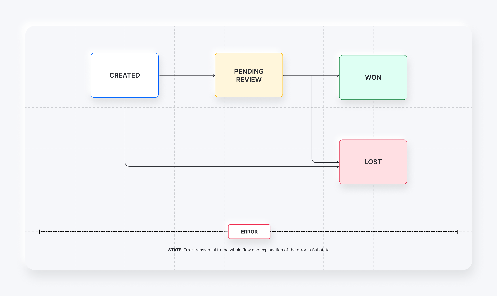

A Yuno oferece uma solução unificada e automatizada para lidar com disputas, permitindo que você gerencie chargebacks de todos os provedores em um único painel. A plataforma da Yuno automatiza fluxos de trabalho, ajuda você a recuperar receita e mantém você pronto para auditorias.

## O que é um chargeback? {#what-is-a-chargeback}

Um chargeback é uma reclamação iniciada por um cliente junto ao seu banco emissor por causa de uma transação que ele considera problemática. Motivos comuns incluem pagamentos não autorizados, valores incorretos ou disputas com o lojista.

Na Yuno, um **chargeback** e uma **disputa** são tecnicamente a mesma coisa: ambos representam uma transação contestada.\
A diferença conceitual está na resposta do lojista: quando um lojista fornece documentação para contestar o chargeback, ele se torna uma **disputa ativa**. No entanto, a transação continua a mesma, e apenas o seu estado evolui com base nas ações tomadas.

## Fluxo do chargeback {#chargeback-workflow}

<iframe
  src="https://yuno-diagrams-public.pages.dev/diagrams/payouts-and-disputes/chargeback-management/chargeback-workflow.html"
  style={{ width: "100%", aspectRatio: "1540 / 874" }}
  frameBorder="0"
  allow="fullscreen"
  allowFullScreen
/>

1. **Criação do chargeback**
   * O cliente abre uma reclamação junto ao seu banco emissor
   * O banco notifica o provedor de pagamento
   * O provedor informa a Yuno sobre a reclamação
   * A Yuno registra o chargeback, e o estado inicial da transação é `CREATED`

2. **Notificação ao lojista**
   * A Yuno notifica o lojista sobre o chargeback e atualiza o status do pagamento

3. **Ações do lojista**
   * O lojista pode:
     * **Enviar evidências**: fornecer documentação que comprove a validade da transação, transformando o chargeback em uma disputa ativa
     * **Aceitar o chargeback**: reconhecer a reclamação sem contestá-la e perder os fundos (`LOST`)

4. **Análise das evidências**
   * Se as evidências forem enviadas, o banco emissor analisa a documentação e emite uma decisão final (`PENDING_REVIEW`)

5. **Resolução do chargeback/disputa**
   * **Disputa ganha** (`WON`): a reclamação do cliente é rejeitada, e a transação continua válida
   * **Disputa perdida** (`LOST`): a reclamação do cliente é aceita, resultando em um reembolso ao cliente

## Estados do chargeback {#chargeback-states}

Os estados dos chargebacks na Yuno representam as diversas etapas do processo:

<Frame></Frame>

| **Estado**        | **Descrição**                                                                                              |
| ---------------- | ------------------------------------------------------------------------------------------------------------ |
| `CREATED`        | Um chargeback foi recebido; o lojista pode tomar uma ação ou enviar evidências, se o provedor permitir. |
| `PENDING_REVIEW` | As evidências foram enviadas e estão em análise pelo banco emissor.                                         |
| `WON`            | A disputa foi resolvida a favor do lojista.                                                           |
| `LOST`           | A reclamação foi aceita, resultando em um reembolso ao cliente.                                               |

<br />

<div className="code-nowrap-table dense-table">

| **Status do pagamento** | **Substatus do pagamento** | **Tipo de transação** | **Status da transação** | **Descrição**                                                                                            |
| ------------------ | --------------------- | -------------------- | ---------------------- | ---------------------------------------------------------------------------------------------------------- |
| `SUCCEEDED`        | APPROVED              | Chargeback           | Won                    | Disputa do chargeback ganha                                                                                     |
| `IN_DISPUTE`       | RECEIVED              | Chargeback           | Created                | Chargeback ou consulta recebida. É preciso fornecer uma decisão ou documentação para iniciar uma disputa. |
|                    | PENDING\_REVIEW       | Chargeback           | Pending\_review        | Disputa em análise pelo provedor                                                                          |
| `CHARGEBACK`       | LOST                  | Chargeback           | Lost                   | Expired/Closed/Review\_lost                                                                                |

</div>

## Pré-disputas (deflexões) {#predisputes-deflections}

Quando um provedor/rede informa explicitamente uma deflexão de pré-disputa, a Yuno:

* Cria uma transação `CHARGEBACK` com `status = PREVENTED` para que você possa auditar que um chargeback foi evitado
* Define o pagamento com `status = CHARGEBACK` e `sub_status = LOST` para refletir o resultado financeiro
* Emite apenas o webhook de chargeback para a transação `CHARGEBACK / PREVENTED` (sem um webhook de reembolso separado)
* Aplica idempotência para evitar transações e notificações duplicadas

Detalhes adicionais:

* Nenhuma evidência necessária: as deflexões de pré-disputa não exigem o envio de evidências
* Mapeamento do ID da disputa: o ID da disputa é igual ao ID da transação de chargeback
* Campos opcionais: os webhooks de chargeback podem incluir `provider_dispute_id` e `is_pre_dispute` para indicar casos originados de pré-disputa

`PREVENTED` é usado apenas em transações do tipo `CHARGEBACK`. Não é um estado final: se o emissor reverter o resultado depois e o provedor informar a disputa como ganha, a transação passa para `WON` e o pagamento volta para `status = SUCCEEDED`.

### Exemplo de pré-disputa {#example-predispute}

```json
{
  "transaction": {
    "id": "tx_cb_001",
    "type": "CHARGEBACK",
    "status": "PREVENTED",
    "category": "CARD",
    "amount": 19700,
    "provider_id": "STRIPE",
    "provider_dispute_id": "du_1S2umUCXdfp1jQhWSW3lALH2"
  },
  "payment": {
    "id": "pay_123",
    "status": "CHARGEBACK",
    "sub_status": "LOST",
    "amount": { "currency": "USD", "value": 19700, "refunded": 0, "captured": 19700 }
  }
}
```

## Principais benefícios de gerenciar chargebacks com a Yuno {#key-benefits-of-managing-chargebacks-with-yuno}

A Yuno simplifica e otimiza a gestão de chargebacks com várias vantagens importantes:

### Todas as suas disputas em um único fluxo integrado {#all-your-disputes-in-one-integrated-workflow}

Consolide os dados de chargebacks de todos os seus provedores de pagamento em um único painel. Seja Visa, Mastercard ou um adquirente local, você pode acompanhar, responder e gerenciar as disputas de forma centralizada.

### Resposta a chargebacks simplificada {#streamlined-chargeback-response}

Automatize as respostas a chargebacks com a documentação de suporte certa para garantir que cada disputa seja tratada de forma rápida e eficiente.

### Garanta a conformidade {#ensure-compliance}

Cada chargeback, cada resposta e cada atualização ficam registrados e acessíveis. Com trilhas de auditoria integradas e registros exportáveis, a conformidade e as revisões internas ficam mais rápidas e fáceis.

## Entenda o código de motivo {#understand-the-reason-code}

Entender o código de motivo de cada chargeback é fundamental, pois ele explica por que o cliente iniciou a disputa. Conhecer esses códigos permite que você adapte sua resposta de forma mais eficaz e reúna as informações necessárias para cada caso. Na [seção Códigos de resposta de chargeback](/pt-br/docs/payouts-and-disputes/reason-codes), você encontra uma lista completa de todos os códigos possíveis fornecidos pelos adquirentes. Em cada transação de chargeback, você encontra o código de motivo no campo `response_code`.

## Gestão de evidências {#evidence-management}

Para contestar um chargeback, o lojista deve enviar evidências que apoiem o seu caso. No contexto dos serviços de resolução de disputas, evidência é qualquer informação ou documentação que comprove a sua posição em um desacordo ou reclamação. Fornecer evidências convincentes é fundamental para obter um resultado favorável. Exemplos dessas evidências incluem:

* *Comprovante de entrega*: documentos que confirmam que um produto foi enviado e recebido pelo cliente, como códigos de rastreamento ou confirmações de entrega
* *Comunicações com o cliente*: registros de e-mails, mensagens de texto ou qualquer troca que demonstre acordos ou esclarecimentos feitos com o cliente
* *Políticas de reembolso e devolução*: cópias das políticas que o cliente aceitou no momento da compra, descrevendo as condições para devoluções ou reembolsos
* *Comprovante de autenticidade*: documentação que verifica a legitimidade de uma transação, como recibos assinados ou registros de autenticação

É essencial que as evidências apresentadas sejam claras, relevantes e diretamente relacionadas à questão em análise. Além disso, organizar e apresentar as evidências de forma profissional e concisa ajudará na avaliação pelas partes envolvidas na resolução da disputa.

<Note>
**Requisitos das evidências**

Os arquivos enviados devem atender aos seguintes critérios:

* *Formato*: o arquivo deve estar em formato PDF, codificado em base64
* *Tamanho*: o arquivo não deve ter mais de 1 MB
* *Idioma*: a disputa deve estar escrita em inglês ou no idioma local do país
</Note>

### Exemplo de requisição para enviar evidências {#example-request-to-submit-evidence}

```json
POST https://api-sandbox.y.uno/v1/payments/:payment_id/transactions/:transaction_id/dispute

Headers:
  X-Idempotency-Key: <unique-key>
  X-Public-Api-Key: <api-key>
  X-Private-Secret-Key: <secret-key>

Body:
{
  "account_id":"<Your Yuno account_id>",
  "evidence": [
    {
      "file_name": "signed_receipt.pdf",
      "content_type": "application/pdf",
      "content_category": "RECEIPT",
      "content": "JVBERi0xLjMKJcTl8uXrp/Og0MT..."
    }
  ]
}
```

O endpoint retorna uma estrutura de resposta de pagamento padrão com as informações atualizadas do pagamento, incluindo o status do chargeback/disputa.

### Atualizar as evidências da disputa {#updating-dispute-evidence}

Se você precisar adicionar mais evidências a uma disputa existente, pode usar o endpoint [Update Dispute](/reference/payments/update-dispute). Isso permite fornecer documentação complementar depois que a disputa inicial foi enviada.

<Info>
**Observações importantes**

* **Status inalterado**: adicionar mais evidências não altera o status do chargeback. O status continua o mesmo, independentemente das atualizações.
* **Suporte do provedor**: nem todos os provedores permitem atualizar disputas. Se um provedor não permitir atualizações, você receberá uma resposta de erro controlada, e o status do chargeback continuará inalterado.
* **Consultar informações da disputa**: use o endpoint [Retrieve Payment by ID](/reference/payments/retrieve-payment-by-id) para verificar o status atual de um chargeback/disputa. A resposta inclui os detalhes da transação com as informações do chargeback.
</Info>

Consulte as seções de referência [Disputes API](/reference/payments/disputes) e [Update Dispute API](/reference/payments/update-dispute) para mais informações.