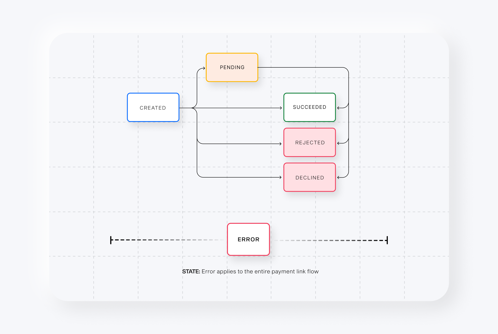

Yuno Payouts é uma solução de API criada para simplificar o envio de payouts seguros a diversos beneficiários, como usuários, lojistas, provedores e clientes. Com o Yuno Payouts, você pode distribuir fundos para vários destinatários de forma eficiente, garantindo a segurança deles e tendo controle total das suas operações de payout.

A solução Yuno Payout permite criar requisições de payout sem restrições quanto ao número de registros. Você pode fazer payouts para qualquer banco, cartão ou carteira. As opções de payout são limitadas apenas pelo provedor que você escolher usar.

## Benefícios de usar o Yuno Payouts {#benefits-of-using-yuno-payouts}

* **Centralização**: o serviço de Payout economiza tempo e custos ao centralizar todas as suas operações de pagamento em um só lugar. Você não precisa mais gerenciar pagamentos em vários sistemas ou interfaces.
* **Informação**: fique por dentro do status dos pagamentos com as notificações personalizáveis da Yuno. Você pode receber atualizações em tempo real sobre qualquer mudança no status da ordem de pagamento, de acordo com as suas preferências.
* **Localização**: ao depositar fundos diretamente nas contas bancárias locais dos seus parceiros, você pode pagá-los na moeda de preferência deles, eliminando a necessidade de conversões de moeda estrangeira e poupando-os de tarifas e impostos extras.

## Como os Payouts funcionam {#how-payouts-work}

Um payout na Yuno pode passar por alguns estados diferentes, começando pela sua criação. Quando você cria um payout, ele recebe automaticamente o status **CREATED**. No entanto, o status **CREATED** é temporário. À medida que a Yuno verifica e transfere as informações ao provedor, o status do payout muda para **PENDING**.

<Frame></Frame>

Quando o payout muda para o status **PENDING**, uma série de ações é executada, definindo se o payout será bem-sucedido e transferirá os fundos ou se será bloqueado. Abaixo, você encontra a descrição de cada um dos possíveis estados finais:

* **SUCCEEDED**: o provedor valida a transação, e os fundos são transferidos com sucesso para a conta do beneficiário. Você receberá uma notificação de confirmação.
* **REJECTED**: o payout não foi processado devido a problemas que a Yuno identificou antes de tentar a transferência. Os possíveis motivos de um payout rejeitado incluem fundos insuficientes ou dados de payout incorretos, como um número de conta errado. Você precisará criar um novo payout para fazer a transação.
* **DECLINED**: o payout foi tentado, mas o provedor se recusou a aceitá-lo. Os motivos de um payout recusado incluem uma conta do beneficiário bloqueada ou encerrada, ou a transação ter sido sinalizada como possível fraude. Você precisará criar um novo payout para fazer a transação.

Saiba mais sobre o status do payout na página [Status de Payouts](/reference/payouts/payout-workflow).

## Novos conceitos {#new-concepts}

* **Beneficiário**: equivale ao cliente nos payins. É o objeto que recebe as informações do beneficiário do payout. Exemplo: se o payout for de pagamento de salários, o beneficiário seria o funcionário que recebe o salário.
* **Método de saque**: a contraparte do meio de pagamento nos payouts. Assim como os payins exigem informações do meio de pagamento, os payouts exigem informações do método de saque. Envie os campos da categoria que você está usando: cartões, transferências bancárias ou carteiras.

## Usando o Yuno Payouts {#using-yuno-payouts}

O recurso Yuno Payouts está disponível pela API da Yuno. Você pode usar a API para criar e consultar informações de payouts. Para usar a solução Payouts, você precisa cumprir os seguintes requisitos:

* Você precisa de uma conta na Yuno.
* Você precisa se integrar à [API da Yuno](/reference/payouts/create-payout).
* Ter uma conta em um provedor externo que aceite payouts.

Para usar a solução Payouts, siga os passos abaixo:

1. Configure as credenciais do provedor na [seção Connections](/pt-br/docs/using-yuno/dashboard-overview/connections) do seu Dashboard da Yuno.
   * (Opcional) Adicione uma [URL de webhook](/pt-br/docs/webhooks/configure-webhooks) para receber notificações sobre atualizações nas transações de payout.
2. Crie o payout usando o endpoint [Create Payout](/reference/payouts/create-payout). Você precisa informar os dados do beneficiário, o valor e o método de saque para fazer o payout.
3. A Yuno verificará as informações e então enviará a requisição de payout ao provedor. O provedor analisará os fundos disponíveis para autorizar o pagamento.
4. Para verificar o status atual dos payouts, você pode usar uma das seguintes opções:
   * O endpoint [Retrieve Payout by ID](/reference/payouts/retrieve-payout-by-id), informando o `id` recebido após a criação do payout.
   * O endpoint [Retrieve Payout by Merchant Reference](/reference/payouts/retrieve-payout-by-merchant-reference), informando o `merchant_reference` fornecido ao criar o payout.

<Warning>
**Disponibilidade do Yuno Payouts**

O Yuno Payouts exige uma análise de segurança e de risco. Para saber mais sobre o Yuno Payouts, consultar o suporte do provedor ou solicitar a ativação, entre em contato com a [equipe de suporte da Yuno](mailto:support@y.uno).
</Warning>

## Payouts referenciados {#referenced-payouts}

Os Payouts podem ser feitos para diferentes meios de pagamento, como contas bancárias e até cartão, dependendo do provedor. Para Payouts a um meio de pagamento de cartão em que o lojista não tem as informações do cartão de crédito (por não estar em conformidade com o PCI), a Yuno permite enviar o Payout se o cartão já tiver sido usado em um pagamento. Isso se chama "Payout referenciado".

Para usar esse recurso, você precisa primeiro cobrar o cliente usando uma das soluções da Yuno em conformidade com o PCI (qualquer [Yuno SDK](/docs/sdks/overview/quickstart)) e depois fazer um Payout indicando a transação original em que a Yuno pode encontrar as informações do cartão de crédito.

```json
"withdrawal_method": {
    "type": "STP_PAYOUT",
    "provider_id": "STP",
    "original_transaction_id":"9104911d-5df9-429e-8488-ad41abea1a4b"
  }
```
