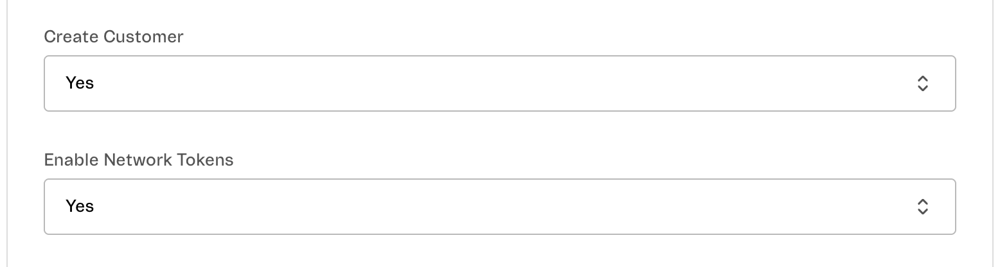
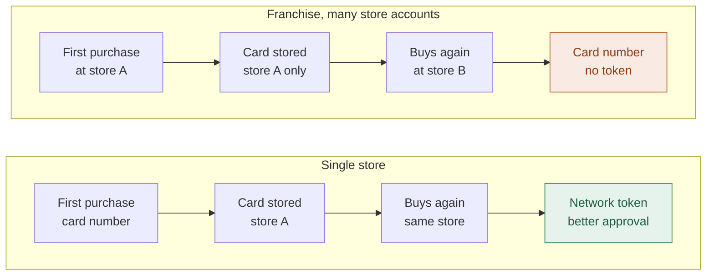

## Multiafiliação {#multi-affiliation}

Uma única conta VTEX pode ser conectada a **mais de uma integração da Yuno** quando você precisa processar diferentes meios de pagamento por diferentes contas da Yuno. Por exemplo, você pode atribuir uma conta da Yuno a cartões de crédito e outra a carteiras digitais.

Para configurar isso, repita o Passo 1 uma vez por integração, dando a cada uma um **Affiliation Name** diferente. Depois, ao ativar os meios de pagamento, use o campo **Process with affiliation** para escolher qual conta deve processar cada um.

## Multiconta {#multi-account}

Se o seu negócio opera **várias contas VTEX** (um modelo de franquia, um marketplace com afiliados ou lojas virtuais separadas que compartilham um checkout), o plugin da Yuno precisa saber qual conta é dona dos pedidos. Os campos **Main Account** na configuração do provedor indicam onde procurar. A regra que vale para todas as linhas abaixo: *Main Account Name é a conta cujo OMS é dono do pedido.* Não é necessariamente a conta onde o Payment App roda nem a conta que cria o pagamento.

### Quando você precisa dos campos {#when-you-need-the-fields}

| Sua configuração | Campos Main Account |
| :--- | :--- |
| **Conta única**: uma loja, um admin | Não são obrigatórios. Deixe os três campos vazios. |
| **Franquias convergentes (fan-in)**: várias contas de loja (franqueados) sob uma conta mãe que é dona do catálogo e dos pedidos | Obrigatórios em **cada afiliação de franquia**. Defina Main Account Name como a conta mãe. |
| **Afiliado de marketplace**: uma loja virtual cujos pedidos são pagos pelo checkout de outra conta, em que os sellers processam o pagamento | Obrigatórios na afiliação da **conta do seller** (a conta que autoriza e processa o pagamento). Main Account Name é a conta do marketplace, que é dona do pedido. Ela deve ser uma **afiliação dedicada à política comercial do marketplace**, e não a afiliação regular da loja virtual do seller: a consulta de pedido único, a consulta por payment id e o cancelamento de pedido sempre têm como alvo a conta principal. Compartilhar os campos em uma afiliação regular quebra o tráfego da própria loja virtual do seller. |
| **Satélite 1 para 1**: duas contas em que uma autoriza e a outra conclui o pagamento (por exemplo, uma loja virtual B2B com uma conta de pagamento separada) | Obrigatórios na afiliação da conta que autoriza. Main Account Name é a conta cujo OMS é dono do pedido. |

### O que cada campo faz {#what-each-field-does}

**Main Account Name:** a conta VTEX que é dona dos dados do pedido no OMS. O plugin lê pedidos e grupos de pedidos dessa conta e envia as credenciais da Yuno para ela, para que os eventos de fulfillment sejam emitidos pelo OMS correto. A resolução da política comercial usa as credenciais da conta atual.

**Main Account App key** e **Main Account App token:** credenciais de aplicação dessa conta principal. O plugin as usa para chamar as APIs da VTEX em nome da conta principal.

<Warning>
  **Os três campos devem ser definidos juntos.** Se você definir o Main Account Name, mas deixar o App key ou o App token vazio, o plugin trata a afiliação como se nenhum campo Main Account estivesse configurado: ele lê os dados de catálogo e de pedidos da conta atual, como em uma configuração de conta única. Um valor `NA` (uma convenção legada em algumas afiliações) também é tratado como vazio. Os três campos estão todos ativos ou todos ausentes; não existe estado intermediário.
</Warning>

### Como obter as credenciais da conta principal {#how-to-obtain-the-main-account-credentials}

No **VTEX License Manager** da conta principal, crie uma chave de aplicação. A chave é usada nestas chamadas de API na conta principal:

*   **OMS**: ler pedidos e grupos de pedidos (incluindo a consulta por payment id); cancelar pedidos negados (`POST /api/oms/pvt/orders/{id}/cancel`).
*   **Catálogo**: ler o registro do seller (`GET /api/catalog_system/pvt/seller/{sellerId}`).
*   **Assinaturas**: ler os ciclos de assinatura (`GET /api/rns/pub/cycles`), para lojas que usam VTEX Subscriptions.

A chave deve ser criada na conta principal, e não na conta da franquia ou do satélite. Uma chave criada na conta errada não consegue ler os dados de que o plugin precisa. Para detalhes sobre como criar chaves e atribuir permissões, veja [VTEX License Manager](https://help.vtex.com/en/tutorial/license-manager-resources--3q6ztrC8YynQf6rdc6euk3).

### Sintomas de uma multiconta mal configurada {#symptoms-of-a-misconfigured-multi-account}

Quando os campos Main Account estão **ausentes ou apontam para a conta errada**, a falha pode ser silenciosa: nenhum erro aparece no dashboard da VTEX nem no checkout. Já credenciais erradas ou um nome de conta errado produzem erros de API visíveis nos logs do plugin (respostas 401, 403 ou 404 nas chamadas ao OMS).

| Sintoma | O que está acontecendo |
| :--- | :--- |
| Pedidos nunca marcados como atendidos (fulfilled) | As credenciais da Yuno foram armazenadas em uma conta diferente daquela que emite os eventos de status do pedido, então o handler de eventos não encontra nada e para. |
| O fulfillment funciona, mas as novas tentativas de autorização ou os cancelamentos de pedido falham após o pagamento | As credenciais da conta principal são inválidas ou o nome da conta não corresponde. Verifique se há erros de API da VTEX nas chamadas ao OMS nos logs do plugin. |
| A política comercial ou o nome do canal de vendas enviado à Yuno está errado | A política comercial é resolvida com as credenciais da conta atual, mas os dados do pedido são lidos da conta principal. Uma divergência entre as duas produz dados de roteamento e de relatórios errados do lado da Yuno. |
| Pedidos divididos não são detectados | O plugin consulta o OMS errado em busca dos subpedidos relacionados. A sessão antifraude não é compartilhada; cada subpedido recebe a sua. |
| Pagamento rejeitado ou criado sem dados da loja (canal de vendas ou site do seller vazio) | O pedido não existe na conta que o plugin consultou no momento da autorização. Verifique os dados adicionais do pagamento no dashboard da Yuno. |

### Como verificar a configuração {#how-to-verify-the-setup}

**Para o lojista:**

Faça um pedido de teste na loja e depois verifique o dashboard da Yuno:

*   O pagamento traz o **canal de vendas** esperado nos dados adicionais.
*   Uma **atualização de fulfillment** aparece assim que o pedido é enviado na VTEX (isso confirma que as credenciais foram parar na conta cujo OMS emite os eventos de status).

<Accordion title="Verificando a configuração (para TAMs da Yuno)">
  Pegue o order id da VTEX do pedido de teste (é o atributo `application_session` nos logs de auditoria do plugin) e procure por ele no Datadog (`service:sdk-event-log-audit-ms`):

  1.  Confirme que `organization_name` nas etapas de autorização corresponde à **conta de origem** (a franquia ou o satélite) e que o salto `saveYunoKeys` tem como alvo a conta principal.
  2.  Se `saveYunoKeys` tiver como alvo a própria conta de origem, ou uma conta diferente da principal esperada, os campos Main Account estão mal configurados: verifique se os três campos estão preenchidos e se o Main Account Name corresponde à conta pretendida.
  3.  Confirme que nenhum log `sendFulfillment` aparece para um pedido que foi enviado: a ausência dele significa que as credenciais foram parar na conta errada e o handler de eventos de fulfillment não encontrou nada.
</Accordion>

<Note>
  Os recursos que dependem do estado de cada conta (vault de cartões para network tokens, modificações de pedido e dados de comprador corporativo) devem ser habilitados em **cada** afiliação de franquia individualmente. Habilitá-los só na conta mãe não basta, porque o plugin lê essas configurações da afiliação que autoriza cada pedido. Veja [Network tokens](#network-tokens-repeat-card-purchases), [Modificações de pedido](#order-modifications-changed-order-totals) e [Compras corporativas](#corporate-purchases-brazil) para as instruções de configuração de cada recurso.
</Note>

## Pedidos divididos (vários sellers) {#split-orders-multiple-sellers}

Quando o carrinho de um comprador contém produtos de **diferentes sellers ou franquias**, a VTEX divide a compra em vários subpedidos e autoriza cada um de forma independente. A integração da Yuno detecta isso e processa **todos** os subpedidos, para que o pedido inteiro seja pago, e não só a primeira parte. Uma única sessão antifraude é compartilhada entre todos eles.

Isso funciona automaticamente; nenhuma configuração extra é necessária. Se você quiser controlar quais provedores antifraude recebem a sessão compartilhada, use o campo **Antifraud Providers for Split Orders** na configuração do provedor (veja a referência de campos no Passo 1). Os valores válidos são `RISKIFIED`, `CYBERSOURCE`, `SIGNIFYD` e `CIELO_CYBERSOURCE_FRAUD`. No plugin **4.2.362 ou posterior**, os quatro provedores recebem a sessão compartilhada quando o campo fica vazio; nas versões anteriores, o padrão é `RISKIFIED` + `CYBERSOURCE`. Se você preencher o campo, só os provedores listados a recebem, então garanta que a lista inclua todos os provedores antifraude que a sua loja usa. Um provedor que não estiver na lista não recebe sessão para o segundo subpedido e os seguintes, então a análise desses pagamentos por ele pode falhar e deixá-los pendentes. Por exemplo, se você usa Cielo CyberSource, inclua `CIELO_CYBERSOURCE_FRAUD`.

## Sessão antifraude (device fingerprints) {#antifraud-session-device-fingerprints}

Os provedores antifraude (Riskified, Signifyd, CyberSource, Cielo CyberSource) pontuam um pagamento comparando os dados do dispositivo coletados no navegador do comprador com o ID de sessão que a Yuno envia no pagamento. Para que essa correspondência funcione, o navegador e o servidor precisam usar o **mesmo** ID de sessão.

O Yuno Payment App cuida disso para você: na página de checkout, ele lê o ID do carrinho da VTEX (`window.vtexjs.checkout.orderFormId`) e o informa como ID de sessão antifraude para `RISKIFIED`, `SIGNIFYD`, `CYBERSOURCE` e `CIELO_CYBERSOURCE_FRAUD`. O Yuno Payment Connector envia o mesmo `orderFormId` no lado do servidor, então a sessão é consistente no navegador, em cada subpedido de um pedido dividido e no próprio pagamento. Nenhuma configuração é necessária; se o ID do carrinho não estiver disponível, cada provedor usa o seu próprio ID de sessão gerado e o pagamento não é bloqueado.

<Accordion title="Cielo CyberSource: prefixo do ID de lojista">
  A Cielo CyberSource exige que o ID de sessão antifraude comece com o prefixo do seu ID de lojista (MID) na Cielo. Até que esse prefixo seja configurável no dashboard da Yuno, defina-o no JavaScript personalizado do checkout da VTEX **antes** de o checkout carregar:

  ```javascript
  window.yunoFingerprintPrefix = 'YOUR_MID_PREFIX_'
  ```

  O Payment App adiciona o prefixo apenas ao ID de sessão de `CIELO_CYBERSOURCE_FRAUD` (`YOUR_MID_PREFIX_<orderFormId>`); os outros provedores não são afetados. Quando a variável não está definida, nenhum prefixo é aplicado.

  <Note>
    Essa variável global é um mecanismo provisório. Quando o prefixo do fingerprint puder ser configurado no dashboard da Yuno, ela não será mais necessária.
  </Note>
</Accordion>

Se você integrar o SDK diretamente em vez de usar o Payment App, passe os IDs de sessão você mesmo pela opção de mount `deviceFingerprints`. Veja [Integração direta do SDK](/pt-br/docs/plugins/vtex/direct-sdk-integration).

## Modificações de pedido (totais de pedido alterados) {#order-modifications-changed-order-totals}

A VTEX permite **alterar um pedido após o checkout** quando o total final é diferente do valor autorizado. Isso se aplica, por exemplo, se você vende produtos **por peso**, em que o total exato só é conhecido depois que o pedido é separado e embalado.

*   Se o total final for **igual ou menor**, a VTEX captura apenas o valor final. Nenhuma configuração extra é necessária.
*   Se o total final for **maior**, a VTEX cobra a diferença como uma **cobrança separada e automática**. Como o comprador não está mais presente e não digita o cartão de novo, a Yuno cobra a diferença no cartão que ele já usou no pedido original.

Para habilitar cobranças automáticas quando o total de um pedido **aumenta**, configure o seguinte nas configurações do provedor **antes** de serem feitos os pedidos que você espera modificar:

| Campo | Valor |
| :--- | :--- |
| **Vault Card for Order Modification** | **Yes**: armazena o cartão no pedido original para que ele possa ser cobrado de novo pela diferença. |
| **Create Customer** | **Yes**: obrigatório, para que o cartão seja armazenado vinculado a um cliente da Yuno. Os dois campos devem ser habilitados juntos. |
| **Automatic Settlement** | **Disabled** (recomendado). O pagamento original é autorizado no checkout e capturado no faturamento. Se o total final for **menor** que o valor autorizado, só esse valor menor é capturado (uma captura parcial). Se for maior, a diferença é cobrada como uma cobrança adicional separada. |

<Note>
  Os **aumentos** do total do pedido são aceitos **apenas para cartões de crédito** (uma restrição da VTEX). O cartão é armazenado no momento do pagamento original, então **Vault Card for Order Modification** e **Create Customer** devem estar habilitados **antes** de o pedido ser feito. Ativá-los depois não vale para pedidos que já existem.
</Note>

<Note>
  **Franquias / várias contas:** habilite **Vault Card for Order Modification** e **Create Customer** em **cada** afiliação que você usa (cada franquia ou subconta) e defina os campos **Main Account** como descrito em [Multiconta](#multi-account).
</Note>

## Network tokens (compras repetidas com cartão) {#network-tokens-repeat-card-purchases}

[Network tokens](/pt-br/docs/security-and-compliance/network-tokens) substituem o número do cartão por um token emitido pela bandeira do cartão (Visa, Mastercard, American Express). Pagar com um network token em vez do número do cartão melhora as taxas de aprovação para compradores recorrentes e continua funcionando quando o cartão é reemitido, porque a bandeira atualiza o token automaticamente.

A Yuno só consegue vincular um network token a um cartão que ela armazenou com segurança. Quando **Enable Network Tokens** está ativado, o plugin armazena cada cartão na primeira vez que um cliente paga com ele e reutiliza essa referência armazenada em todas as compras seguintes do mesmo cartão pelo mesmo cliente. Nenhuma alteração na loja virtual ou no Payment App é necessária; tudo acontece no lado da Yuno da integração.

### O que precisa estar ativado {#what-has-to-be-switched-on}

| Requisito | Onde |
| :--- | :--- |
| **Enable Network Tokens** | Configuração do provedor na VTEX (Passo 1), definido como **Yes**. Não tem efeito sozinho. |
| **Create Customer** | No mesmo lugar, definido como **Yes**. O cartão armazenado fica vinculado a um cliente da Yuno, então os dois campos são obrigatórios juntos. |
| **Plugin 4.2.347+** | Toda conta VTEX que roda o plugin, incluindo a conta que autoriza em vez de pagar (veja [Várias contas](#multiple-accounts-and-franchises)). |
| **Ativação da rota** | Feita pela Yuno nas rotas que a sua loja usa. Não é algo que você mesmo possa configurar: entre em contato com o seu KAM da Yuno ou com o [suporte](/pt-br/docs/security-and-compliance/network-tokens#1-let-yuno-provision-and-collect-network-tokens). A ativação é por rota, e as rotas pertencem a um Yuno Account ID, então cada conta com que você processa precisa da sua própria ativação. |

<Warning>
  **Os dois lados são obrigatórios.** Até que a Yuno ative network tokens nas suas rotas, o plugin armazena os cartões, mas todo pagamento continua sendo processado com o número do cartão e nenhum network token é emitido. O inverso também vale: se os network tokens estiverem ativos nas suas rotas, mas **Enable Network Tokens** e **Create Customer** não estiverem definidos na VTEX, nenhum cartão é armazenado e todo pagamento continua sendo uma transação comum com número de cartão. Confirme a ativação com o seu KAM ou com o suporte antes de esperar qualquer mudança nas taxas de aprovação.
</Warning>

### Habilite o recurso {#enable-it}

Na configuração do provedor (Passo 1), defina os dois campos a seguir e salve:

| Campo | Valor |
| :--- | :--- |
| **Create Customer** | **Yes**: obrigatório, porque o cartão armazenado fica vinculado a um cliente da Yuno. Os dois campos devem ser habilitados juntos; **Enable Network Tokens** não tem efeito sozinho. |
| **Enable Network Tokens** | **Yes**. Não tem efeito até que a Yuno ative network tokens nas suas rotas (veja acima). |

<Frame>
  
</Frame>

### O que esperar {#what-to-expect}

*   **Primeira compra com um cartão**: processada com o número do cartão, como hoje. O cartão é armazenado ao final dessa compra.
*   **Compras seguintes do mesmo cartão pelo mesmo cliente**: processadas com o network token.
*   **Aumento gradual**: como a primeira compra de cada cartão ainda usa o número do cartão, você não verá quase nenhum network token no primeiro dia. O benefício cresce à medida que os clientes voltam com um cartão que já usaram na sua loja.
*   **Cartões reemitidos** (por exemplo, com uma nova data de validade após uma renovação) continuam sendo reconhecidos, então o network token continua sendo usado.
*   **Fallback**: se a referência armazenada não estiver disponível por qualquer motivo, o pagamento segue com o número do cartão exatamente como hoje. Habilitar este recurso nunca faz um pagamento falhar.
*   As **assinaturas da VTEX** não são afetadas. As cobranças recorrentes têm o seu próprio fluxo de credencial armazenada, que continua funcionando como descrito nas [Perguntas frequentes](/pt-br/docs/plugins/vtex/faqs).
*   Vale para todos os pagamentos com cartão processados pelo plugin, incluindo os pagamentos com defesa contra fraude e os [pedidos divididos](#split-orders-multiple-sellers).

<Note>
  **As modificações de pedido não são afetadas.** Armazenar um cartão para network tokens não permite, por si só, que o plugin o cobre de novo. As [cobranças adicionais quando o total de um pedido aumenta](#order-modifications-changed-order-totals) continuam controladas apenas por **Vault Card for Order Modification**: com esse campo definido como **No**, um aumento do total do pedido é recusado mesmo que o cartão esteja armazenado.
</Note>



A Loja B não tem registro do cartão, então a compra é tratada como uma primeira compra. O pagamento ainda é bem-sucedido; ele volta a usar o número do cartão.

### Várias contas e franquias {#multiple-accounts-and-franchises}

O cartão é armazenado na conta VTEX que **autoriza** o pagamento e fica restrito ao **Account ID** da Yuno dessa conta. Tenha isso em mente nas seguintes configurações:

*   **Autorização e pagamento em contas VTEX diferentes** (por exemplo, uma loja virtual B2B que conclui o pagamento em uma segunda conta): habilite os dois campos na afiliação da conta que **autoriza** o pedido, e não só na conta que conclui o pagamento. As duas contas devem rodar o plugin na versão **4.2.347 ou posterior**.
*   **Franquias / várias contas de loja** (muitas contas de loja compartilhando uma conta principal): habilite os dois campos em **cada** afiliação de franquia. Um cartão armazenado por uma conta de loja não é compartilhado com outra, e um cartão armazenado em um Yuno Account ID não é visível para outro, então cada loja constrói o seu próprio histórico de cartões. **Por isso, o benefício se acumula por loja**: uma rede cujos clientes compram em várias lojas obtém bem menos pagamentos tokenizados do que um lojista de loja única, porque cada loja só reconhece os cartões usados pela primeira vez nela mesma. A ativação de rota também é por Yuno Account ID, então a Yuno precisa ativar network tokens nas rotas de **cada** conta de franquia, e não só na principal.

<Accordion title="Verificando a configuração (para TAMs da Yuno)">
  Faça dois pedidos com o mesmo cartão e o mesmo cliente na loja, depois procure os logs do plugin de cada pedido no Datadog e filtre pelo atributo `step_function`:

  | Pedido | Step functions esperadas |
  | :--- | :--- |
  | Primeira compra | `cardVaultLookup` informando que não há cartão armazenado, seguido de `cardVaultWrite` assim que o pagamento é criado (o cartão é armazenado). |
  | Compra repetida | `cardVaultLookup` informando uma correspondência, seguido de `cardVaultTokenPassed` (a referência armazenada foi enviada com o pagamento). |

  Uma compra repetida que mostra `cardVaultLookup` sem correspondência geralmente significa que os dois pedidos não compartilharam o mesmo cliente da Yuno (verifique **Create Customer**), foram feitos em contas de loja diferentes ou usaram um cartão diferente. Se a referência armazenada é passada, mas o pagamento ainda mostra um número de cartão no lado da Yuno, os network tokens ainda não estão habilitados na rota.
</Accordion>

## Compras corporativas (Brasil) {#corporate-purchases-brazil}

No Brasil, as compras feitas em nome de uma empresa devem ser pagas e faturadas no **CNPJ** da empresa, e não no CPF pessoal de quem faz o pedido. Quando um comprador finaliza a compra como empresa (*pessoa jurídica*), a VTEX envia as duas identidades ao plugin: o nome e o CPF do comprador, e a *razão social*, o *nome fantasia* e o CNPJ da empresa.

Por padrão, o plugin usa a identidade pessoal do comprador. Com **Use Corporate Buyer Data** definido como **Yes**, os pedidos corporativos passam a ser pagos em nome da empresa: o boleto é emitido para o CNPJ, e todos os outros meios de pagamento (cartões, PIX, carteiras digitais) levam a empresa como pagador na Yuno.

### Habilite o recurso {#enable-it-1}

Na configuração do provedor (Passo 1), defina **Use Corporate Buyer Data** como **Yes** e salve. Nenhuma alteração na loja virtual ou no Payment App é necessária.

| Campo | Valor |
| :--- | :--- |
| **Use Corporate Buyer Data** | **Yes**. Requer o plugin **4.2.350 ou posterior**; o campo só aparece na configuração do provedor quando a loja roda essa versão. |

### O que esperar {#what-to-expect-1}

| Pedido | Pagador enviado à Yuno |
| :--- | :--- |
| Comprador finaliza a compra como empresa, com endereço de cobrança no Brasil | Razão social, nome fantasia e CNPJ da empresa (tipo de documento `CNPJ`). |
| Comprador finaliza a compra como pessoa física | Nome e CPF do comprador, exatamente como hoje. |
| Checkout corporativo com endereço de cobrança fora do Brasil | Identidade pessoal do comprador. O mapeamento corporativo é limitado ao Brasil, onde se sabe que o tipo de documento é um CNPJ. |

*   **Mesmo comprador, papéis diferentes.** Um comprador pode fazer um pedido como empresa e o seguinte como pessoa física; cada pedido leva a identidade usada no checkout, independentemente do que os pedidos anteriores enviaram.
*   **À prova de falhas.** Se os dados da empresa estiverem incompletos (por exemplo, sem CNPJ), o pedido volta a usar a identidade pessoal do comprador e o pagamento segue.
*   **Carteiras digitais criadas antes do pedido.** Os pagamentos com Apple Pay, Google Pay e Click to Pay criados durante o carregamento da página, antes de o pedido existir, mantêm a identidade coletada pela loja virtual.

<Note>
  **Franquias / várias contas:** habilite o campo em **cada** afiliação cujos pedidos devem usar a identidade da empresa e, nas configurações em que uma conta autoriza e outra conclui o pagamento, na afiliação da conta que **autoriza**.
</Note>

<Accordion title="Verificando a configuração (para TAMs da Yuno)">
  Faça um pedido corporativo na loja e abra o pagamento criado no dashboard da Yuno, ou procure os logs do plugin no Datadog (`step_name:"After get payment"`) e verifique a requisição de pagamento:

  | Campo | Esperado |
  | :--- | :--- |
  | `customer_payer.first_name` / `last_name` | Razão social / nome fantasia (o nome fantasia é omitido quando é igual à razão social). |
  | `customer_payer.document` | `{ "document_number": "<CNPJ>", "document_type": "CNPJ" }` |
  | `metadata.customer_document` | O CNPJ. |

  Se a requisição ainda trouxer o CPF, confirme que **Use Corporate Buyer Data** aparece nas configurações salvas da afiliação (a afiliação deve ser salva novamente depois que o plugin é atualizado para a 4.2.350) e que o endereço de cobrança do pedido está no Brasil.
</Accordion>
