A experiência aprimorada de wallets é um complemento opcional para lojas que já usam o plugin VTEX da Yuno. Ela melhora a experiência de checkout dos compradores ao remover uma tela intermediária entre o checkout da VTEX e a tela nativa da wallet do dispositivo, que comprovadamente reduz a conversão nos pagamentos com wallets.

<div className="grid grid-cols-2 gap-4">
  <Frame caption="Experiência padrão (com tela intermediária)">
    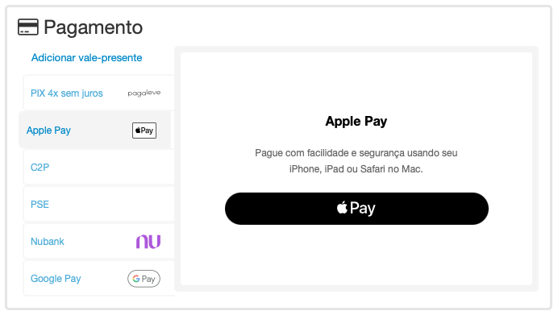
  </Frame>
  <Frame caption="Experiência aprimorada (tela nativa direta)">
    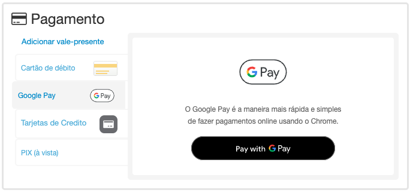
  </Frame>
</div>

## O que é {#what-it-is}

Por padrão, quando um comprador seleciona um pagamento com wallet (Apple Pay, Google Pay ou Samsung Pay), o Payment App da Yuno abre uma tela intermediária dentro do checkout da VTEX antes que a tela de confirmação nativa do dispositivo (Face ID, fingerprint ou PIN) apareça.

A **experiência aprimorada** remove essa tela intermediária: os botões das wallets aparecem **diretamente dentro da etapa de pagamento do checkout da VTEX**, e tocar em um botão abre a tela nativa do dispositivo imediatamente.

Essa integração também libera, de forma opcional, **parcelas no Apple Pay, no Google Pay e no Samsung Pay**.

## Como funciona {#how-it-works}

Quando um comprador chega ao checkout, o SDK da Yuno prepara discretamente uma sessão de pagamento em segundo plano. Quando ele chega à etapa de pagamento, os botões das wallets aparecem instantaneamente.

*   **Confirmação rápida**: tocar em um botão abre a tela nativa da wallet imediatamente.
*   **Recálculo automático**: se o comprador alterar o carrinho (adicionar um item, aplicar um cupom, mudar o frete), o SDK recalcula a sessão automaticamente.
*   **Tratamento de erros**: se um pagamento falhar, o comprador pode tentar de novo sem recarregar a página.

---

## Guia de integração {#integration-guide}

Configurar a experiência aprimorada envolve adicionar um pequeno snippet de JavaScript ao seu checkout da VTEX e encontrar os valores para preenchê-lo.

<Steps>
  <Step title="Adicione o snippet ao seu checkout da VTEX">
    O snippet é adicionado ao arquivo `checkout6-custom.js` da sua loja a partir do Dashboard da VTEX.

    1.  No **Dashboard da VTEX**, pesquise por **Checkout** na barra superior.

    <Frame>
      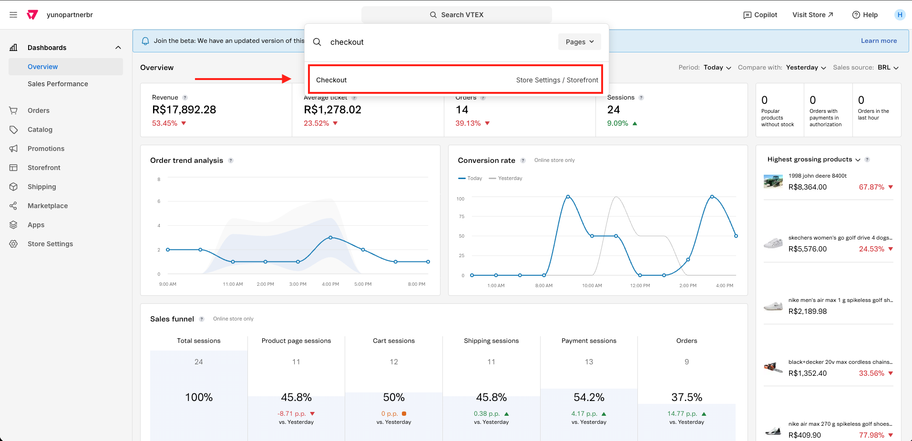
    </Frame>

    2.  Selecione o site que sua loja usa (geralmente **Default**).

    <Frame>
      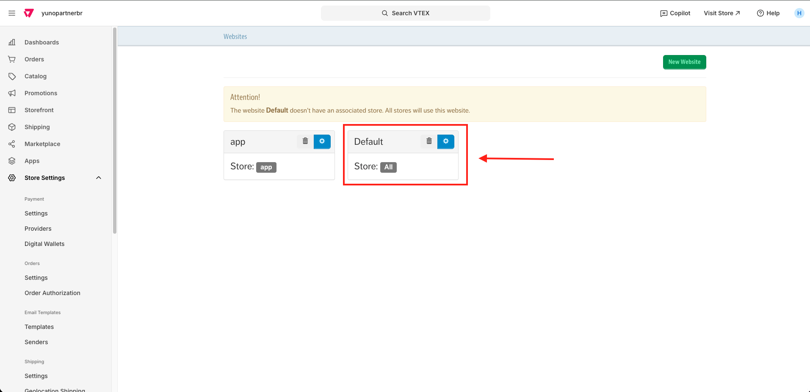
    </Frame>

    3.  Abra a aba **Code** e selecione `checkout6-custom.js` na lista de arquivos à direita.

    <Frame>
      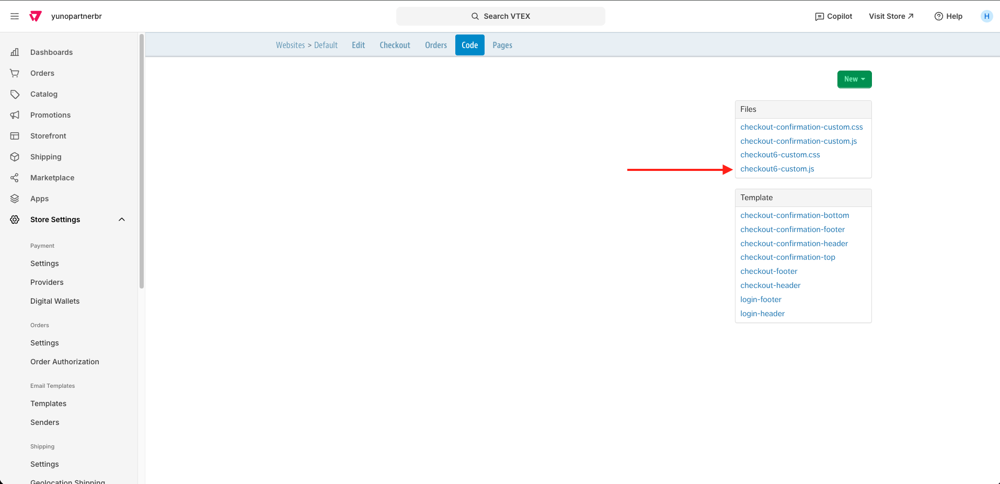
    </Frame>

    4.  Adicione o snippet abaixo no final do arquivo e clique em **Save**.

    <Frame>
      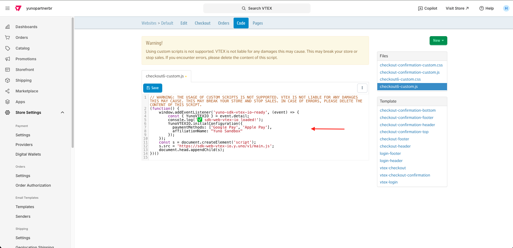
    </Frame>

    ```javascript
    (function () {
      window.addEventListener('yuno-sdk-vtex-io-ready', function (event) {
        var YunoVTEXIO = event.detail.YunoVTEXIO;
        YunoVTEXIO.initialConfiguration({
          paymentMethods: ['Apple Pay', 'Google Pay', 'Samsung Pay'],
          affiliationName: 'YOUR_AFFILIATION_NAME'
        });
      });

      var script = document.createElement('script');
      script.src = 'https://sdk-web-vtex-io.y.uno/v1/main.js';
      document.head.appendChild(script);
    })();
    ```

    <Note>
      Substitua `YOUR_AFFILIATION_NAME` pelo nome da afiliação da configuração do provedor Yuno. Em `paymentMethods`, liste as wallets que você quer habilitar: `'Apple Pay'`, `'Google Pay'`, `'Samsung Pay'` ou qualquer combinação.
    </Note>
  </Step>

  <Step title="Encontre o nome da afiliação">
    O valor de `affiliationName` é o mesmo que você definiu ao configurar a Yuno como provedor de pagamento.

    1.  Na barra de pesquisa do **Dashboard da VTEX**, digite `providers` e selecione o resultado **Providers**.

    <Frame>
      
    </Frame>

    2.  Encontre o provedor Yuno configurado para esta loja e abra-o.

    <Frame>
      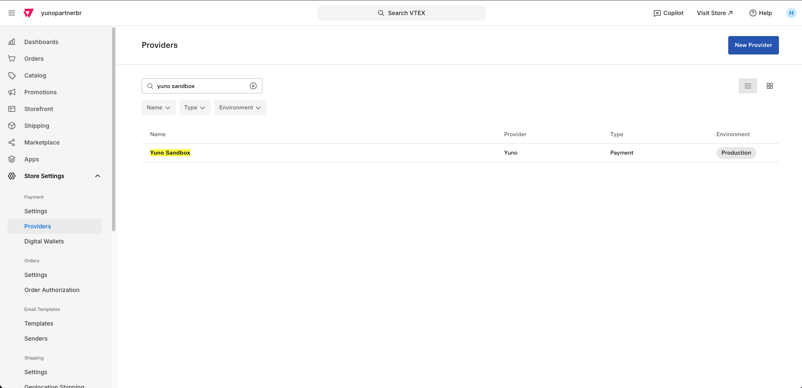
    </Frame>

    3.  Na visualização de detalhes do provedor, copie o valor do campo **Affiliation Name** e use-o no snippet.

    <Frame>
      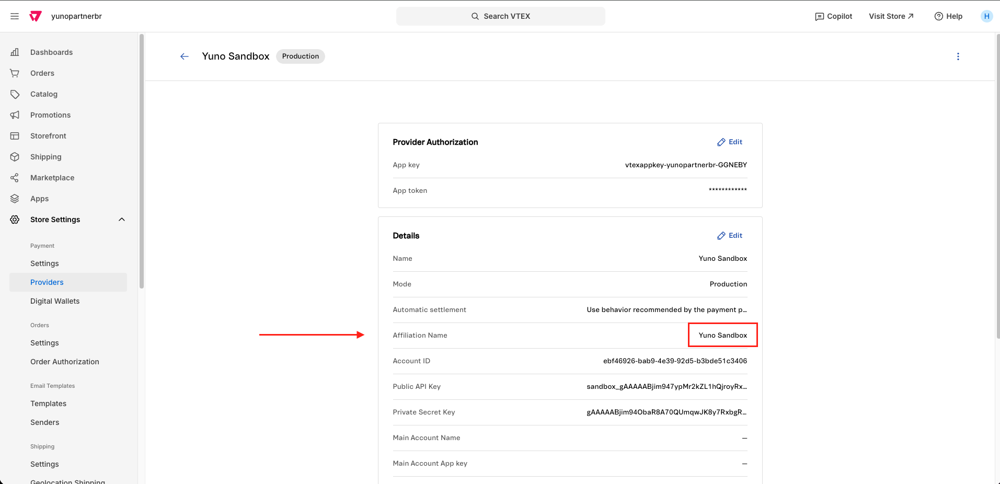
    </Frame>
  </Step>
</Steps>

Depois de salvar o snippet, a experiência aprimorada já está ativa. Os botões das wallets que você configurou vão
aparecer diretamente dentro da etapa de pagamento do checkout da VTEX.

---

## Parcelas no Apple Pay {#apple-pay-installments}

As parcelas no Apple Pay são um recurso opcional da experiência aprimorada que permite aos compradores dividir a compra em parcelas.

### O que os compradores veem {#what-shoppers-see}

Depois de habilitado, um seletor de **Installments** aparece acima do botão do Apple Pay. Tocar nele abre um painel que lista todas as opções de parcelamento.

<div className="grid grid-cols-2 gap-4">
  <Frame caption="Seletor de parcelas">
    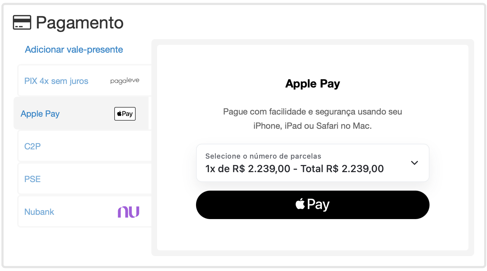
  </Frame>
  <Frame caption="Painel de opções de parcelamento">
    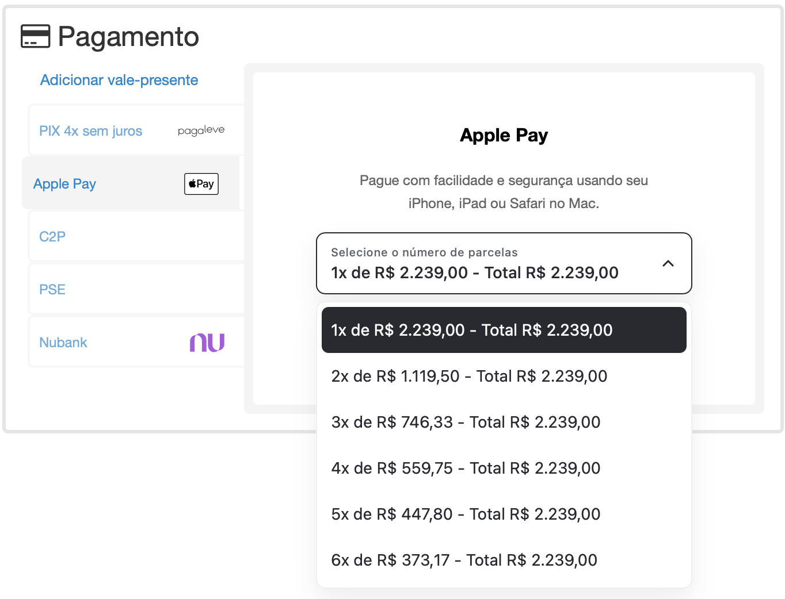
  </Frame>
</div>

Se o plano incluir juros, um painel **Payment details** aparece abaixo mostrando o detalhamento (número de parcelas, custo do financiamento etc.).

<Frame width="300">
  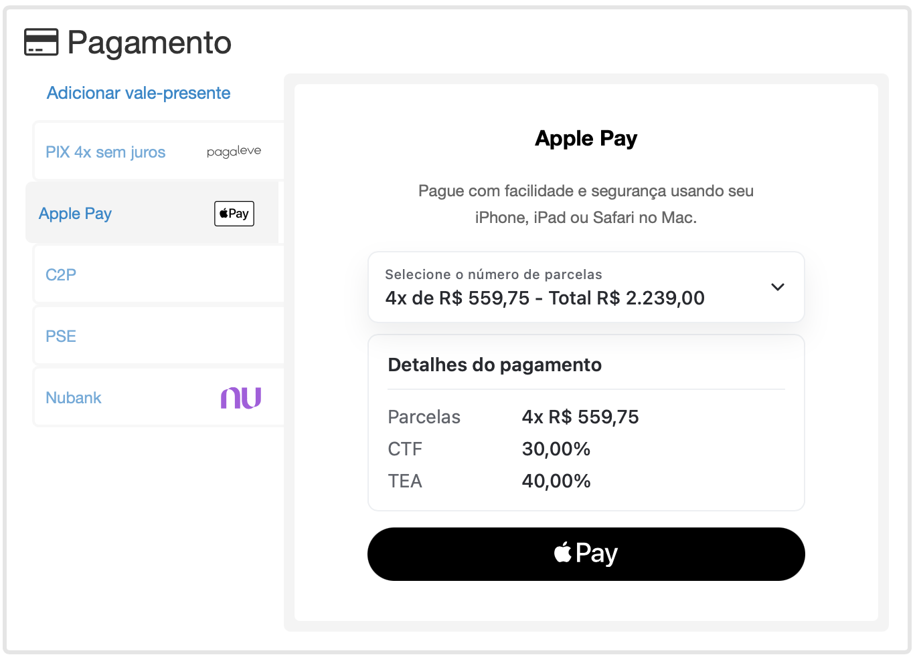
</Frame>

### Como habilitar {#how-to-enable}

As parcelas no Apple Pay são habilitadas no Dashboard da Yuno, criando planos de parcelamento para o
meio de pagamento Apple Pay. **O snippet não muda**: uma loja que roda a experiência aprimorada com
`'Apple Pay'` em `paymentMethods` já pede à Yuno os planos disponíveis em cada pedido.

<Steps>
  <Step title="Crie um plano de parcelamento para o Apple Pay">
    1.  No **Dashboard da Yuno**, vá para **Installments** e clique em **Create installment**.
    2.  Em **Payment method type**, selecione **Apple Pay**.
    3.  Defina o número de parcelas, a taxa, a faixa de valores e a janela de disponibilidade.

    <Frame>
      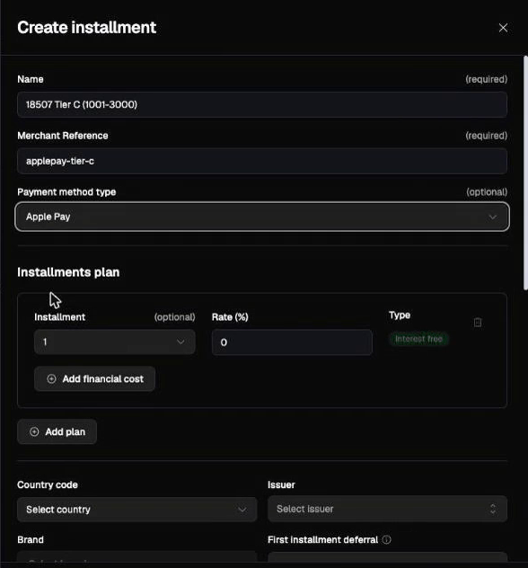
    </Frame>

    <Warning>
      Os planos de cartão não são reutilizados. O Apple Pay só vê os planos criados para o meio de pagamento Apple Pay, então
      uma loja que já tem planos de parcelamento configurados para cartões ainda precisa de planos próprios para o Apple Pay.
    </Warning>
  </Step>
  <Step title="Confira o plano na lista">
    O plano aparece com **Apple Pay** na coluna **Payment method**. Crie um plano por faixa
    de valor se você quiser opções diferentes para tamanhos de carrinho diferentes.

    <Frame>
      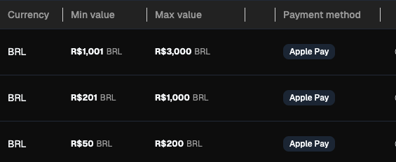
    </Frame>
  </Step>
  <Step title="Confirme no seu checkout">
    Abra a etapa de pagamento com um carrinho dentro da faixa de valores do plano e selecione Apple Pay. O
    seletor de **Installments** aparece acima do botão.
  </Step>
</Steps>

Você também pode criar planos com o endpoint [Create Installments Plan](/pt-br/reference/installments/create-installments-plan),
enviando `payment_method_type: APPLE_PAY`.

### Regras de elegibilidade {#eligibility-rules}

A Yuno resolve o plano de cada pedido a partir do total do carrinho, então o comprador sempre vê as opções que
se aplicam ao que está no carrinho. Se o carrinho mudar, as opções são recalculadas.

Cada plano que você cria define:

*   **Payment method type**: deve ser Apple Pay.
*   **Moeda e país**: devem corresponder ao pedido.
*   **Faixa de valores**: total mínimo e máximo do pedido que o plano cobre.
*   **Janela de disponibilidade**: data de início e de término do plano.

O seletor mostra uma entrada por número de parcelas. Se dois planos cobrirem o mesmo pedido e ambos
oferecerem o mesmo número, apenas um deles é usado, então mantenha as faixas de valores separadas se quiser um
resultado previsível.

Se nenhum plano cobrir o pedido, o seletor fica oculto e o Apple Pay é exibido como um botão simples; o
pagamento ainda é concluído, em uma parcela.

<Warning>
  Compare o valor mínimo do seu plano mais baixo com o total típico dos seus pedidos. Se o plano começar
  acima dele, a maioria dos compradores nunca vê o seletor, e o recurso parece quebrado quando apenas está fora
  da faixa.
</Warning>

---

## Parcelas no Google Pay {#google-pay-installments}

As parcelas no Google Pay funcionam da mesma forma que as parcelas no Apple Pay: os compradores dividem a compra
em parcelas diretamente na opção de pagamento Google Pay. Cada wallet resolve seus próprios planos,
então você pode oferecer parcelas em uma wallet, na outra ou em ambas.

### O que os compradores veem {#what-shoppers-see-1}

Depois de habilitado, um seletor de **Installments** aparece acima do botão do Google Pay. Tocar nele abre um
painel que lista todas as opções de parcelamento.

<div className="grid grid-cols-2 gap-4">
  <Frame caption="Seletor de parcelas">
    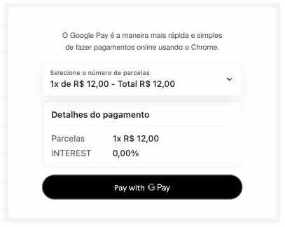
  </Frame>
  <Frame caption="Painel de opções de parcelamento">
    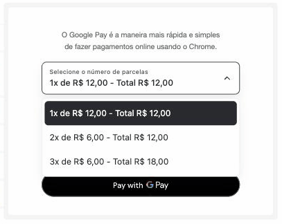
  </Frame>
</div>

Se o plano incluir juros, um painel **Payment details** aparece abaixo mostrando o detalhamento
(número de parcelas, custo do financiamento etc.), exatamente como no Apple Pay.

### Como habilitar {#how-to-enable-1}

As parcelas no Google Pay são habilitadas no Dashboard da Yuno, criando planos de parcelamento para o
meio de pagamento Google Pay. **O snippet não muda**: uma loja que roda a experiência aprimorada
com `'Google Pay'` em `paymentMethods` já pede à Yuno os planos disponíveis em cada pedido.

<Steps>
  <Step title="Crie um plano de parcelamento para o Google Pay">
    1.  No **Dashboard da Yuno**, vá para **Installments** e clique em **Create installment**.
    2.  Em **Payment method type**, selecione **Google Pay**.
    3.  Defina o número de parcelas, a taxa, a faixa de valores e a janela de disponibilidade.

    <Frame>
      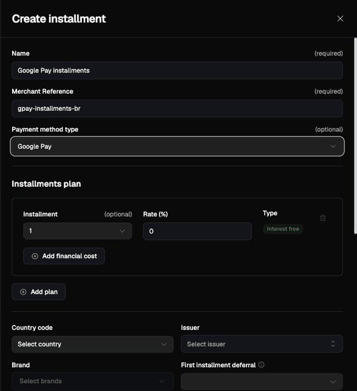
    </Frame>

    <Warning>
      Os planos são estritamente por meio de pagamento. O Google Pay só vê os planos criados para o meio de pagamento
      Google Pay: nem os planos de cartão nem os planos do Apple Pay são reutilizados. Uma loja que oferece
      parcelas em duas ou mais wallets precisa de um conjunto de planos por wallet.
    </Warning>
  </Step>
  <Step title="Confira o plano na lista">
    O plano aparece com **Google Pay** na coluna **Payment method**. Crie um plano por faixa
    de valor se você quiser opções diferentes para tamanhos de carrinho diferentes.

    <Frame>
      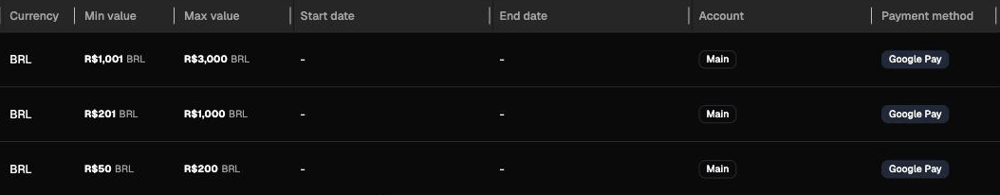
    </Frame>
  </Step>
  <Step title="Confirme no seu checkout">
    Abra a etapa de pagamento com um carrinho dentro da faixa de valores do plano e selecione Google Pay. O
    seletor de **Installments** aparece acima do botão.
  </Step>
</Steps>

Você também pode criar planos com o endpoint [Create Installments Plan](/pt-br/reference/installments/create-installments-plan),
enviando `payment_method_type: GOOGLE_PAY`.

### Regras de elegibilidade {#eligibility-rules-1}

O Google Pay segue as mesmas [regras de elegibilidade do Apple Pay](#eligibility-rules): a Yuno resolve o
plano de cada pedido a partir do total do carrinho, recalcula quando o carrinho muda e associa os planos por
moeda, país, faixa de valores e janela de disponibilidade. A única diferença é o tipo de meio de
pagamento: um plano só se aplica ao Google Pay quando o **Payment method type** dele é **Google Pay**.

Se nenhum plano cobrir o pedido, o seletor fica oculto e o Google Pay é exibido como um botão simples; o
pagamento ainda é concluído, em uma parcela.

---

## Parcelas no Samsung Pay {#samsung-pay-installments}

As parcelas no Samsung Pay funcionam da mesma forma que as parcelas no Apple Pay e no Google Pay: os compradores dividem
a compra em parcelas diretamente na opção de pagamento Samsung Pay.

### O que os compradores veem {#what-shoppers-see-2}

Depois de habilitado, um seletor de **Installments** aparece acima do botão do Samsung Pay. Tocar nele abre um painel que lista todas as opções de parcelamento, com o detalhamento completo do financiamento abaixo.

<Frame caption="Checkout do Samsung Pay com parcelas">
  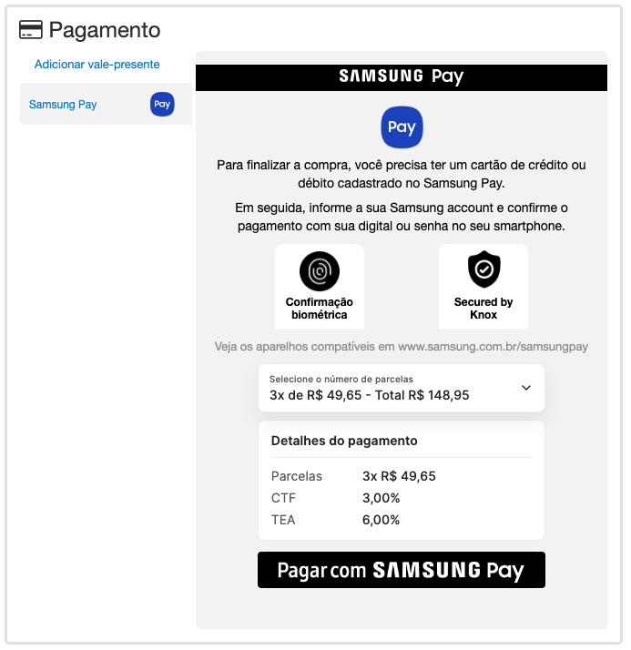
</Frame>

### Como habilitar {#how-to-enable-2}

As parcelas no Samsung Pay são habilitadas no Dashboard da Yuno, criando planos de parcelamento para o
meio de pagamento Samsung Pay. **O snippet não muda**: uma loja que roda a experiência aprimorada
com `'Samsung Pay'` em `paymentMethods` já pede à Yuno os planos disponíveis em cada pedido.

<Steps>
  <Step title="Crie um plano de parcelamento para o Samsung Pay">
    1.  No **Dashboard da Yuno**, vá para **Installments** e clique em **Create installment**.
    2.  Em **Payment method type**, selecione **Samsung Pay**.
    3.  Defina o número de parcelas, a taxa, a faixa de valores e a janela de disponibilidade.

    <Frame>
      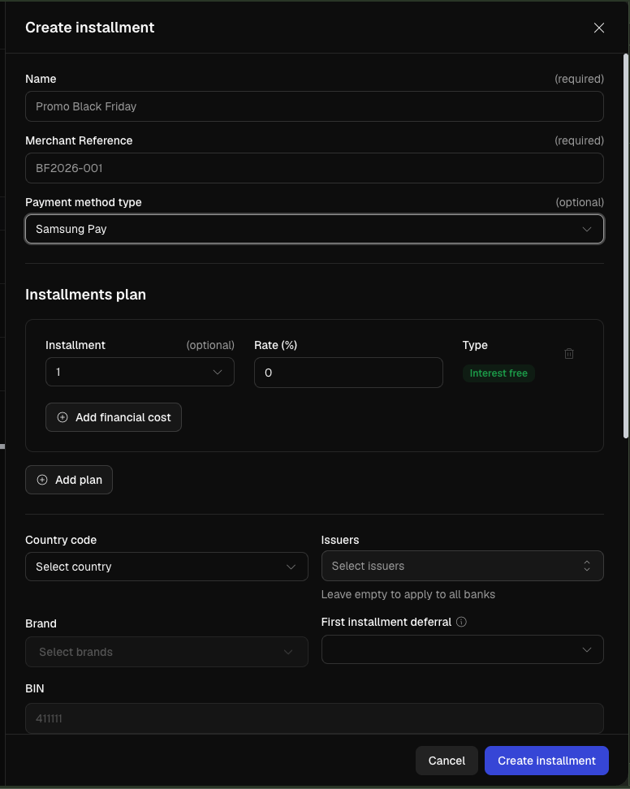
    </Frame>

    <Warning>
      Os planos são estritamente por meio de pagamento. O Samsung Pay só vê os planos criados para o meio de pagamento
      Samsung Pay: nem os planos de cartão nem os planos do Apple Pay ou do Google Pay são reutilizados. Uma loja que oferece
      parcelas em várias wallets precisa de um conjunto de planos por wallet.
    </Warning>
  </Step>
  <Step title="Confira o plano na lista">
    O plano aparece com **Samsung Pay** na coluna **Payment method**. Crie um plano por faixa
    de valor se você quiser opções diferentes para tamanhos de carrinho diferentes.

    <Frame>
      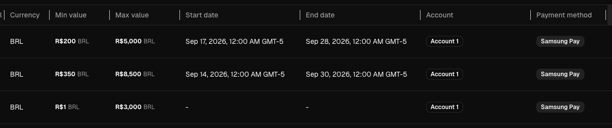
    </Frame>
  </Step>
  <Step title="Confirme no seu checkout">
    Abra a etapa de pagamento com um carrinho dentro da faixa de valores do plano e selecione Samsung Pay. O
    seletor de **Installments** aparece acima do botão.
  </Step>
</Steps>

Você também pode criar planos com o endpoint [Create Installments Plan](/pt-br/reference/installments/create-installments-plan),
enviando `payment_method_type: SAMSUNG_PAY`.

### Regras de elegibilidade {#eligibility-rules-2}

O Samsung Pay segue as mesmas [regras de elegibilidade do Apple Pay](#eligibility-rules): a Yuno resolve o
plano de cada pedido a partir do total do carrinho, recalcula quando o carrinho muda e associa os planos por
moeda, país, faixa de valores e janela de disponibilidade. A única diferença é o tipo de meio de
pagamento: um plano só se aplica ao Samsung Pay quando o **Payment method type** dele é **Samsung Pay**.

Se nenhum plano cobrir o pedido, o seletor fica oculto e o Samsung Pay é exibido como um botão simples; o
pagamento ainda é concluído, em uma parcela.

### Exibição do pedido na VTEX {#vtex-order-display}

<Warning>
  Atualmente, a VTEX mostra os pedidos do Samsung Pay como um **pagamento único integral** no resumo do pedido e nos painéis
  administrativos. Ainda não existe uma configuração nativa de parcelas do Samsung Pay na VTEX; o ticket 1453437 da VTEX
  acompanha isso como uma melhoria futura.

  *A Yuno é a fonte da verdade* para o detalhamento das parcelas: o número correto de parcelas,
  o valor de cada parcela e eventuais juros ficam visíveis no Dashboard da Yuno e nos
  detalhes da transação. A exibição na VTEX é apenas visual e não afeta como o pagamento é processado
  ou liquidado.
</Warning>