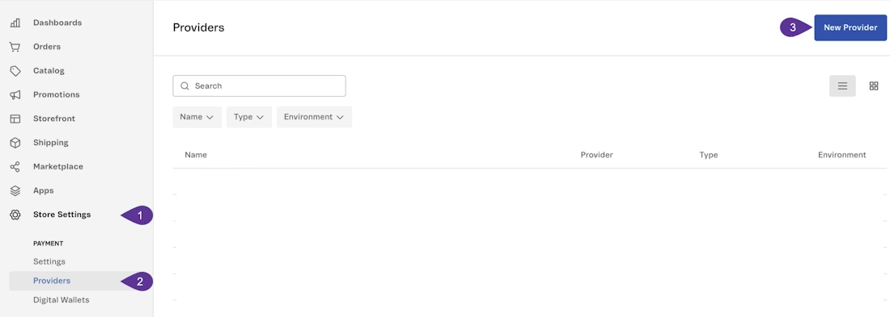
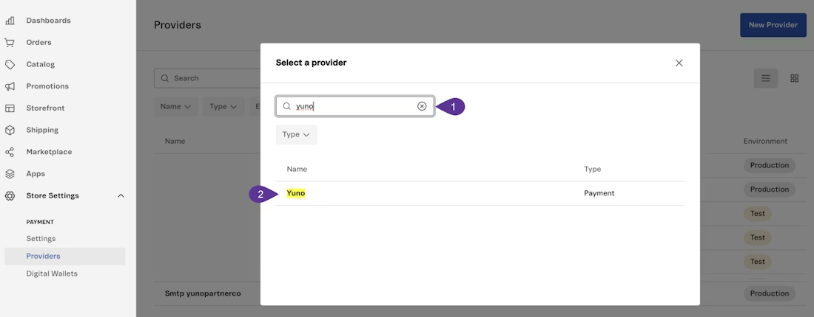
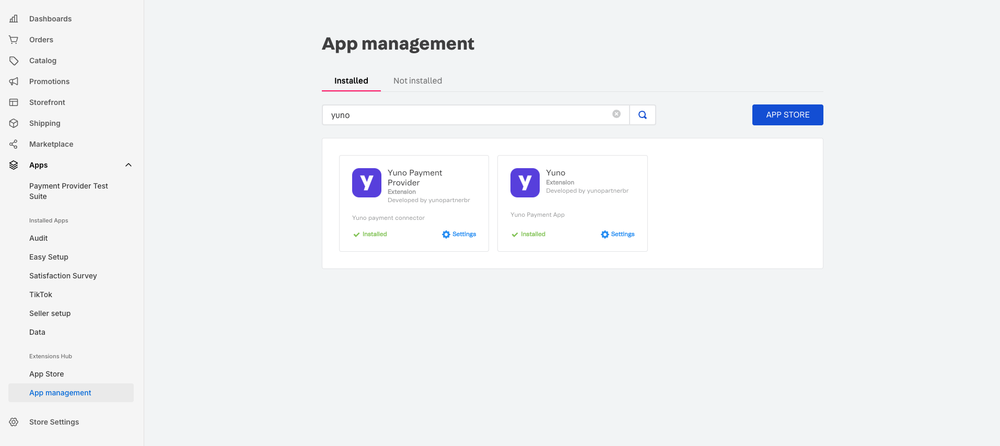
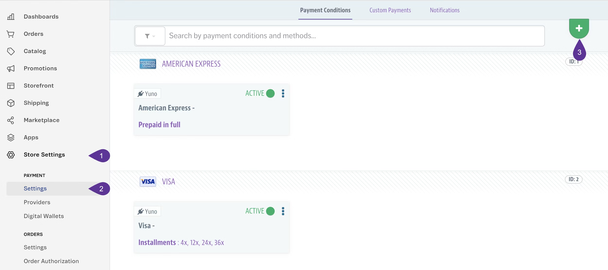
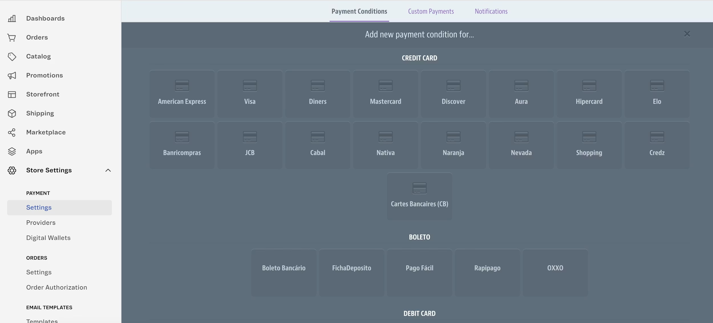
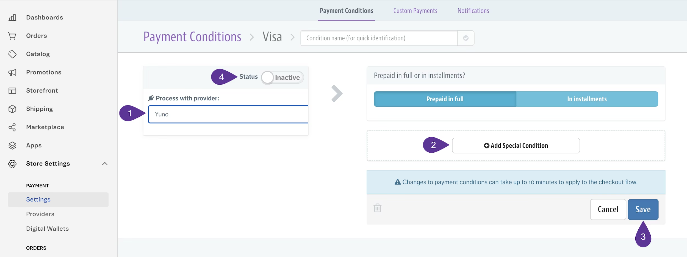

Esta página mostra cada etapa necessária para começar a aceitar pagamentos com a Yuno na sua loja VTEX. A configuração acontece em dois lugares. O seu **painel da VTEX** é onde você registra a Yuno como provedor de pagamento, instala o Payment App e ativa os meios de pagamento. O seu **painel da Yuno** é onde você configura o webhook que mantém o status dos pedidos sincronizado.

### Antes de começar {#before-you-start}

Tenha em mãos:
*   Um usuário com acesso de administrador ao seu painel da VTEX.
*   Suas credenciais da Yuno, que você encontra no painel da Yuno em **Developers → API Credentials**: **Account ID**, **Public API Key** e **Private Secret Key**.

---

<Steps>
  <Step title="Configure a Yuno como provedor de pagamento">
    1.  No **painel da VTEX**, abra o menu à esquerda e vá para **Store Settings → Payment → Providers**. Depois, clique em **New Provider** no canto superior direito.

    <Frame>
      
    </Frame>

    2.  Na caixa de diálogo **Select a provider**, digite `Yuno` no campo de busca e selecione **Yuno** nos resultados.

    <Frame>
      
    </Frame>

    3.  Preencha o formulário de configuração do provedor e salve. Depois de salvo, o provedor fica registrado, mas nenhum meio de pagamento está ativo ainda.

    <Accordion title="Referência dos campos">
      Cada campo é explicado por completo, com exemplos, na [Referência dos campos de afiliação](/pt-br/docs/plugins/vtex/affiliation-fields).

      | Campo | Obrigatório | O que faz |
      | :--- | :--- | :--- |
      | **Application Key / Application Token** | Sim | Credenciais de admin da VTEX que o plugin usa para agir em seu nome. Veja o guia da VTEX sobre [como gerar Application Keys](https://help.vtex.com/docs/tutorials/api-keys#generating-internal-application-keys). |
      | **Automatic Settlement** | Sim | Quando os pagamentos com cartão e carteira são capturados. Veja **Opções de liquidação** abaixo. |
      | **Affiliation Name** | Sim | Um nome para esta integração da Yuno. [Detalhes](/pt-br/docs/plugins/vtex/affiliation-fields#affiliation-name) |
      | **Account ID** | Sim | O seu Account ID da Yuno. [Detalhes](/pt-br/docs/plugins/vtex/affiliation-fields#account-id) |
      | **Public API Key** | Sim | A sua Public API Key da Yuno; o prefixo dela define o ambiente. [Detalhes](/pt-br/docs/plugins/vtex/affiliation-fields#public-api-key) |
      | **Private Secret Key** | Sim | A sua Private Secret Key da Yuno. [Detalhes](/pt-br/docs/plugins/vtex/affiliation-fields#private-secret-key) |
      | **Main Account Name** | Opcional | A conta VTEX dona dos pedidos em configurações com várias contas. [Detalhes](/pt-br/docs/plugins/vtex/affiliation-fields#main-account-name) |
      | **Main Account App key** | Opcional | Application Key da conta VTEX principal. [Detalhes](/pt-br/docs/plugins/vtex/affiliation-fields#main-account-app-key) |
      | **Main Account App token** | Opcional | Application Token da conta VTEX principal. [Detalhes](/pt-br/docs/plugins/vtex/affiliation-fields#main-account-app-token) |
      | **Soft Descriptor** | Opcional | Texto exibido na fatura do cartão do comprador. [Detalhes](/pt-br/docs/plugins/vtex/affiliation-fields#soft-descriptor) |
      | **Create Customer** | Opcional | Cria um registro de cliente na Yuno para cada comprador. [Detalhes](/pt-br/docs/plugins/vtex/affiliation-fields#create-customer) |
      | **VTEX IO orderPlaced page URL** | Opcional | Para onde os compradores são redirecionados depois do pagamento. [Detalhes](/pt-br/docs/plugins/vtex/affiliation-fields#vtex-io-orderplaced-page-url) |
      | **Payment Mode** | Opcional | Payment App dentro do checkout ou redirecionamento Legacy. [Detalhes](/pt-br/docs/plugins/vtex/affiliation-fields#payment-mode) |
      | **Transaction Identification From** | Opcional | Mostra o ID da transação da Yuno ou do provedor. [Detalhes](/pt-br/docs/plugins/vtex/affiliation-fields#transaction-identification-from) |
      | **Antifraud Providers for Split Orders** | Opcional | Provedores antifraude que recebem a sessão compartilhada em pedidos divididos. [Detalhes](/pt-br/docs/plugins/vtex/affiliation-fields#antifraud-providers-for-split-orders) |
      | **Vault Card for Order Modification** | Opcional | Cobra a diferença quando o total de um pedido aumenta. [Detalhes](/pt-br/docs/plugins/vtex/affiliation-fields#vault-card-for-order-modification) |
      | **Enable Network Tokens** | Opcional | Armazena cartões para que compras recorrentes possam usar um network token. [Detalhes](/pt-br/docs/plugins/vtex/affiliation-fields#enable-network-tokens) |
      | **Use Corporate Buyer Data** | Opcional | Paga pedidos de empresas no nome e com o CNPJ da empresa (Brasil). [Detalhes](/pt-br/docs/plugins/vtex/affiliation-fields#use-corporate-buyer-data) |
      | **Headless Payment Handoff** | Opcional | Para marketplaces cujo próprio checkout headless cria o pagamento. [Detalhes](/pt-br/docs/plugins/vtex/affiliation-fields#headless-payment-handoff) |
      | **Store Base Path** | Opcional | Prefixo de caminho da URL de uma loja que não é servida a partir da raiz do domínio. [Detalhes](/pt-br/docs/plugins/vtex/affiliation-fields#store-base-path) |
      | **Send Order Sequence as Merchant Reference** | Opcional | Envia a sequência do pedido VTEX como referência do pagamento. [Detalhes](/pt-br/docs/plugins/vtex/affiliation-fields#send-order-sequence-as-merchant-reference) |
      | **Sales Channel Domains** | Opcional | Associa cada canal de vendas ao domínio da sua loja virtual. [Detalhes](/pt-br/docs/plugins/vtex/affiliation-fields#sales-channel-domains) |
      | **Delay To Cancel** | Opcional | Quanto tempo a VTEX espera por um pagamento pendente, por meio de pagamento. [Detalhes](/pt-br/docs/plugins/vtex/affiliation-fields#delay-to-cancel) |
    </Accordion>

    <Accordion title="Opções de liquidação">
      O campo **Automatic Settlement** define o momento da captura dos pagamentos com cartão e carteira. 

      | Opção | Comportamento na prática |
      | :--- | :--- |
      | **Use behavior recommended by payment processor** | **Captura imediata**: a transação é capturada logo após a autorização. (Padrão) |
      | **Automatic capture immediately after payment authorization** | **Captura imediata**: a transação é capturada logo após a autorização. Igual ao padrão. |
      | **Automatic capture immediately after anti-fraud analysis** | **Captura imediata**: a transação é capturada logo após a autorização. |
      | **Disabled** | **Somente autorização**: a transação é apenas autorizada. A captura acontece depois, quando o pedido é **faturado**. |
    </Accordion>

    <Note>
      **Ambientes**: o ambiente da Yuno é definido pelo prefixo da sua **Public API Key**: `dev_`, `staging_`, `sandbox_` ou `prod_`.
    </Note>

    <Tip>
      Recomendamos usar **Use behavior recommended by payment processor**, a menos que o seu negócio exija especificamente a captura após o faturamento.
    </Tip>
  </Step>

  <Step title="Instale o Yuno Payment App">
    Depois de salvar a configuração do provedor, instale o Yuno Payment App pelo seu painel da VTEX.

    1.  No **painel da VTEX**, vá para **Apps → App Management**.
    2.  Busque por **Yuno**, selecione o **Yuno Payment App** na lista de apps disponíveis e abra as **Settings** dele.

    <Frame>
      
    </Frame>

    3.  Clique em **Install** para concluir a configuração.

    Depois de instalado, o Payment App se encarrega de renderizar a experiência de checkout da Yuno dentro do seu checkout VTEX.
  </Step>

  <Step title="Ative os meios de pagamento">
    Agora escolha quais meios de pagamento você quer oferecer aos seus compradores e roteie-os pela Yuno.

    1.  No **painel da VTEX**, vá para **Store Settings → Payment → Settings → Payment Conditions**. Clique no botão **+** para adicionar uma condição de pagamento.

    <Frame>
      
    </Frame>

    2.  Selecione o meio de pagamento que você quer ativar (por exemplo, Visa, Mastercard, Pix, Apple Pay, Samsung Pay ou qualquer um dos meios genéricos da **Yuno**, como Yuno Card ou Yuno Wallet).

    <Frame>
      
    </Frame>

    3.  No campo **Process with provider**, selecione a afiliação da Yuno que você configurou na Etapa 1. Defina o **Status** como **Active** e salve.

    <Frame>
      
    </Frame>

    <Note>
      Repita para cada meio que você quer oferecer. Você pode conferir a lista completa de meios disponíveis na página [Visão geral](/pt-br/docs/plugins/vtex).
    </Note>
  </Step>

  <Step title="Configure o webhook no seu painel da Yuno">
    O webhook mantém os seus pedidos da VTEX sincronizados com as atualizações de status de pagamento da Yuno. 

    1.  No **painel da Yuno**, abra **Developers → Webhooks** e clique em **Add webhook**.
    2.  Preencha o formulário:
        *   **Name**: por exemplo, `VTEX webhook`.
        *   **Endpoint URL**: `https://{store_name}.myvtex.com/_v/yunopartnerbr.yuno/v4/webhook`, substituindo `{store_name}` pelo nome da sua conta VTEX.
        *   **x-api-key** e **x-secret**: informe qualquer valor de exemplo (por exemplo, `VTEX`).
    3.  Selecione todos os eventos e clique em **Add**.
  </Step>
</Steps>

---

## Cenários avançados {#advanced-scenarios}

Os cenários que vão além da configuração básica (várias afiliações, várias contas, pedidos divididos, sessões antifraude, modificações de pedidos, network tokens e compras corporativas) são tratados em uma página própria.

<CardGroup cols={1}>
  <Card title="Recursos avançados" icon="list" href="/pt-br/docs/plugins/vtex/advanced-features">
    Várias afiliações, várias contas, pedidos divididos, sessões antifraude, modificações de pedidos, network tokens e compras corporativas.
  </Card>
</CardGroup>
