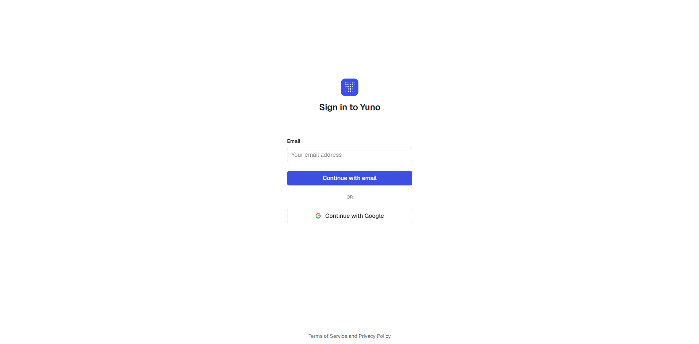

import { ExplainerVideo } from "/snippets/pt-br/ExplainerVideo.jsx";

<div className="yd-page"><div className="yd-qs">

<div className="yd-eyebrow">
  <span className="yd-eyebrow-accent">Primeiros passos</span>
  <span className="yd-eyebrow-rule" />
  <span className="yd-eyebrow-muted">Tutorial · cerca de 10 minutos</span>
</div>

<p className="yd-lead" style={{marginTop: '18px', maxWidth: 'none'}}>A Yuno é o sistema operacional de IA para pagamentos, e um pagamento é a primeira coisa que você executa nela. Você envia seu primeiro pagamento em sandbox em cerca de 10 minutos depois de ter as credenciais de sandbox.</p>

<div className="yd-chips" style={{margin: '20px 0 8px'}}>
  <span className="yd-chip">Crie uma conexão</span>
  <span className="yd-chip">Envie um pagamento com um cartão de teste</span>
  <span className="yd-chip">Veja-o no dashboard</span>
</div>

<ExplainerVideo src="/videos/explainers/first-payment.mp4" poster="/videos/explainers/first-payment.jpg" title="Seu primeiro pagamento" duration="66 s" />

## Antes de começar {#before-you-start}

Você precisa destes dados para todas as chamadas desta página.

| Dado | Valor |
|---|---|
| Código da conta | `account_id` no dashboard, em **Developers** |
| Chaves | `public-api-key` e `private-secret-key`, ambas começando com `sandbox_` |
| URL base | `https://api-sandbox.y.uno/v1` (mantenha o `/v1`) |
| Valores | `amount.value` é um número ao lado de uma `currency`. Esta página envia `25` com `USD` |
| Ferramentas | Node 18 ou superior, ou `curl` |

<Steps>

<Step titleSize="h3" title="Obtenha suas credenciais de sandbox">

Faça login no [dashboard da Yuno](https://dashboard.y.uno/) e abra **Developers** para encontrar três valores:

* **Código da conta**, exibido como `account_id` no dashboard
* **`public-api-key`**
* **`private-secret-key`**

As chaves de sandbox começam com `sandbox_`. As chaves de produção são diferentes e começam com `prod_`.

<Frame></Frame>

Se você ainda não tem uma conta, fale com seu contato na Yuno ou escreva para [sales@y.uno](mailto:sales@y.uno). Hoje não é possível criar uma conta por conta própria.

Defina suas credenciais como variáveis de ambiente:

```bash Shell
export YUNO_PUBLIC_API_KEY="sandbox_..."
export YUNO_PRIVATE_SECRET_KEY="sandbox_..."
export YUNO_ACCOUNT_ID="your-account-code"
```

Comprove as chaves criando um cliente. A URL base é `https://api-sandbox.y.uno/v1`.

<CodeGroup>

```bash cURL
curl --request POST \
  --url https://api-sandbox.y.uno/v1/customers \
  --header "public-api-key: $YUNO_PUBLIC_API_KEY" \
  --header "private-secret-key: $YUNO_PRIVATE_SECRET_KEY" \
  --header "content-type: application/json" \
  --data '{
    "merchant_customer_id": "customer-0001",
    "first_name": "John",
    "last_name": "Doe",
    "email": "john.doe@example.com"
  }'
```

```javascript Node.js
const res = await fetch("https://api-sandbox.y.uno/v1/customers", {
  method: "POST",
  headers: {
    "public-api-key": process.env.YUNO_PUBLIC_API_KEY,
    "private-secret-key": process.env.YUNO_PRIVATE_SECRET_KEY,
    "content-type": "application/json",
  },
  body: JSON.stringify({
    merchant_customer_id: "customer-0001",
    first_name: "John",
    last_name: "Doe",
    email: "john.doe@example.com",
  }),
});
const customer = await res.json();
console.log(customer.id);
```

```python Python
import os
import requests

res = requests.post(
    "https://api-sandbox.y.uno/v1/customers",
    headers={
        "public-api-key": os.environ["YUNO_PUBLIC_API_KEY"],
        "private-secret-key": os.environ["YUNO_PRIVATE_SECRET_KEY"],
    },
    json={
        "merchant_customer_id": "customer-0001",
        "first_name": "John",
        "last_name": "Doe",
        "email": "john.doe@example.com",
    },
)
print(res.json()["id"])
```

</CodeGroup>

A resposta inclui um `id`. Salve-o como `YUNO_CUSTOMER_ID`, pois as etapas de pagamento o usam.

<Check>
**Etapa concluída quando** `POST /v1/customers` responde `201`.

* `401` significa que o par de chaves está errado. Copie de novo as duas chaves de sandbox em **Developers**.
* `404` com o corpo vazio significa que falta `/v1` na URL base.
</Check>

</Step>

<Step titleSize="h3" title="Conecte o Yuno Test Payment Gateway e publique uma rota">

O Yuno Test Payment Gateway simula um provedor de cartão. Ele funciona apenas em sandbox e não precisa de credenciais.

1. Abra [Connections](https://dashboard.y.uno/connections), pesquise **Yuno Test Payment Gateway**, clique em **Connect**, dê um nome à conexão e clique em **Save**.
2. Abra [Routing](https://dashboard.y.uno/routing), abra a aba **Not published**, encontre **Card** e clique em **Set Up**.
3. Clique em **+ Create new route**, dê um nome à rota e clique em **Save**.
4. Clique na seta, escolha **Add step**, selecione **Yuno Test Payment Gateway** e clique em **Publish**.
5. Abra o [Checkout builder](https://dashboard.y.uno/checkout-builder), ative **Card** e publique as configurações.

<Check>
**Etapa concluída quando** uma nova sessão de checkout lista `CARD`. Crie uma sessão como na etapa 4 e salve o `checkout_session` dela como `YUNO_CHECKOUT_SESSION`. Depois chame [`GET /v1/checkout/sessions/{checkout_session}/payment-methods`](/reference/checkout-sessions/retrieve-payment-methods-for-checkout) e procure `"type": "CARD"` na lista.

Se `CARD` não aparecer, verifique as três configurações: o Test Payment Gateway está conectado, a rota de Card está em **Published** e Card está ativado no Checkout builder.
</Check>

</Step>

<Step titleSize="h3" title="Escolha como o pagamento é criado">

O campo `workflow` informa à Yuno quem cria o pagamento. Escolha um e use a aba correspondente na etapa 4.

| Workflow | Quem cria o pagamento | Quando usar |
|---|---|---|
| `SDK_SEAMLESS` | O SDK cria o pagamento | Você quer o menor número de partes envolvidas. Recomendado |
| `SDK_CHECKOUT` com um callback `createPayment` | Seu backend cria o pagamento, a partir do token de uso único que o SDK entrega a você | Você adiciona dados do pedido, verificações de fraude ou idempotência no seu servidor |
| `DIRECT` | Seu backend envia os dados brutos do cartão | Você tem escopo PCI DSS. Caso contrário, use-o apenas para testes em sandbox |

Uma sessão e uma integração que não coincidem terminam em `INTERNAL_ERROR`. Consulte [Primeiros passos com o Yuno SDK](/docs/yuno-sdk/get-started) e [Fluxo direto](/docs/direct-integration-use-cases/direct-flow) para ver cada caminho completo.

<Check>
**Etapa concluída quando** você souber dizer qual workflow vai enviar: `SDK_SEAMLESS`, `SDK_CHECKOUT` ou `DIRECT`. A sessão de checkout (caminhos com SDK) ou o pagamento (`DIRECT`) o leva no campo `workflow`.
</Check>

</Step>

<Step titleSize="h3" title="Envie o pagamento">

<Tabs>
<Tab title="DIRECT">

<Warning>
Enviar números de cartão brutos a partir do seu servidor serve para testes em sandbox. Em produção, isso exige escopo PCI DSS. Caso contrário, use o Yuno SDK ou o Secure Fields para coletar os dados do cartão.
</Warning>

O workflow `DIRECT` é um pagamento back-to-back em que seu servidor envia os dados do cartão. Use o `id` do cliente que você salvou como `YUNO_CUSTOMER_ID` na etapa 1.

Crie o pagamento com um cartão de teste. Envie um novo `X-Idempotency-Key` em cada pagamento.

<CodeGroup>

```bash cURL
curl --request POST \
  --url https://api-sandbox.y.uno/v1/payments \
  --header "public-api-key: $YUNO_PUBLIC_API_KEY" \
  --header "private-secret-key: $YUNO_PRIVATE_SECRET_KEY" \
  --header "X-Idempotency-Key: $(uuidgen)" \
  --header "content-type: application/json" \
  --data '{
    "account_id": "'"$YUNO_ACCOUNT_ID"'",
    "merchant_order_id": "order-0001",
    "description": "First test payment",
    "country": "US",
    "amount": { "currency": "USD", "value": 25 },
    "workflow": "DIRECT",
    "customer_payer": { "id": "'"$YUNO_CUSTOMER_ID"'" },
    "payment_method": {
      "type": "CARD",
      "detail": { "card": { "card_data": {
        "number": "4507990000000002",
        "expiration_month": 11,
        "expiration_year": 28,
        "security_code": "123",
        "holder_name": "John Doe"
      } } }
    }
  }'
```

```javascript Node.js
const res = await fetch("https://api-sandbox.y.uno/v1/payments", {
  method: "POST",
  headers: {
    "public-api-key": process.env.YUNO_PUBLIC_API_KEY,
    "private-secret-key": process.env.YUNO_PRIVATE_SECRET_KEY,
    "X-Idempotency-Key": crypto.randomUUID(),
    "content-type": "application/json",
  },
  body: JSON.stringify({
    account_id: process.env.YUNO_ACCOUNT_ID,
    merchant_order_id: "order-0001",
    description: "First test payment",
    country: "US",
    amount: { currency: "USD", value: 25 },
    workflow: "DIRECT",
    customer_payer: { id: process.env.YUNO_CUSTOMER_ID },
    payment_method: {
      type: "CARD",
      detail: { card: { card_data: {
        number: "4507990000000002",
        expiration_month: 11,
        expiration_year: 28,
        security_code: "123",
        holder_name: "John Doe",
      } } },
    },
  }),
});
const payment = await res.json();
console.log(payment.status, payment.sub_status);
```

```python Python
import os
import uuid
import requests

res = requests.post(
    "https://api-sandbox.y.uno/v1/payments",
    headers={
        "public-api-key": os.environ["YUNO_PUBLIC_API_KEY"],
        "private-secret-key": os.environ["YUNO_PRIVATE_SECRET_KEY"],
        "X-Idempotency-Key": str(uuid.uuid4()),
    },
    json={
        "account_id": os.environ["YUNO_ACCOUNT_ID"],
        "merchant_order_id": "order-0001",
        "description": "First test payment",
        "country": "US",
        "amount": {"currency": "USD", "value": 25},
        "workflow": "DIRECT",
        "customer_payer": {"id": os.environ["YUNO_CUSTOMER_ID"]},
        "payment_method": {
            "type": "CARD",
            "detail": {"card": {"card_data": {
                "number": "4507990000000002",
                "expiration_month": 11,
                "expiration_year": 28,
                "security_code": "123",
                "holder_name": "John Doe",
            }}},
        },
    },
)
payment = res.json()
print(payment["status"], payment["sub_status"])
```

</CodeGroup>

O pagamento é bem-sucedido quando a resposta se parece com esta:

```json Response (trimmed)
{
  "id": "6c44ed29-cc51-4479-a5eb-108afdaadd50",
  "status": "SUCCEEDED",
  "sub_status": "APPROVED",
  "amount": { "currency": "USD", "value": 25 }
}
```


</Tab>
<Tab title="SDK_SEAMLESS">

A aba `SDK_SEAMLESS` divide o trabalho. Seu servidor cria uma sessão de checkout, e o navegador carrega o SDK e inicia a transação.

**No seu servidor**, crie a sessão de checkout. Use `workflow: "SDK_SEAMLESS"` para que o SDK crie o pagamento para você. Sem isso, a transação termina em `INTERNAL_ERROR`.

<CodeGroup>

```bash cURL
curl --request POST \
  --url https://api-sandbox.y.uno/v1/checkout/sessions \
  --header "public-api-key: $YUNO_PUBLIC_API_KEY" \
  --header "private-secret-key: $YUNO_PRIVATE_SECRET_KEY" \
  --header "content-type: application/json" \
  --data '{
    "account_id": "'"$YUNO_ACCOUNT_ID"'",
    "merchant_order_id": "order-0001",
    "payment_description": "First test payment",
    "country": "US",
    "amount": { "currency": "USD", "value": 25 },
    "workflow": "SDK_SEAMLESS"
  }'
```

```javascript Node.js
const res = await fetch("https://api-sandbox.y.uno/v1/checkout/sessions", {
  method: "POST",
  headers: {
    "public-api-key": process.env.YUNO_PUBLIC_API_KEY,
    "private-secret-key": process.env.YUNO_PRIVATE_SECRET_KEY,
    "content-type": "application/json",
  },
  body: JSON.stringify({
    account_id: process.env.YUNO_ACCOUNT_ID,
    merchant_order_id: "order-0001",
    payment_description: "First test payment",
    country: "US",
    amount: { currency: "USD", value: 25 },
    workflow: "SDK_SEAMLESS",
  }),
});
const session = await res.json();
console.log(session.checkout_session);
```

```python Python
import os
import requests

res = requests.post(
    "https://api-sandbox.y.uno/v1/checkout/sessions",
    headers={
        "public-api-key": os.environ["YUNO_PUBLIC_API_KEY"],
        "private-secret-key": os.environ["YUNO_PRIVATE_SECRET_KEY"],
    },
    json={
        "account_id": os.environ["YUNO_ACCOUNT_ID"],
        "merchant_order_id": "order-0001",
        "payment_description": "First test payment",
        "country": "US",
        "amount": {"currency": "USD", "value": 25},
        "workflow": "SDK_SEAMLESS",
    },
)
print(res.json()["checkout_session"])
```

</CodeGroup>

**No navegador**, carregue o SDK a partir da CDN e inicie uma transação com o valor de `checkout_session` vindo do seu servidor.

```html Browser
<div id="payment-form"></div>
<script src="https://sdk-web.y.uno/v2.5.1/main.js"></script>
<script>
  async function startYuno() {
    const sdkPayments = await SdkPayments.initialize("your-public-api-key");
    const transaction = sdkPayments.transaction({
      checkoutSession: "checkout-session-from-your-server",
      countryCode: "US",
      elementSelector: "#payment-form",
      onStatus: (result) => console.log("Final status:", result.status),
    });
    await transaction.start({ paymentMethod: { type: "CARD" } });
  }

  if (window.SdkPayments) {
    startYuno();
  } else {
    window.addEventListener("sdk-payments-ready", startYuno);
  }
</script>
```

O formulário é renderizado em `#payment-form`. Insira o cartão de teste **4507 9900 0000 0002**, validade **11/28**, CVV **123**, nome **John Doe** e clique em Pay. O resultado chega em `onStatus` com o status `SUCCEEDED`.

Para iOS, Android e todas as opções, consulte [Primeiros passos com o SDK](/docs/yuno-sdk/get-started).

</Tab>
<Tab title="SDK_CHECKOUT">

Seu servidor cria a sessão de checkout com `workflow: "SDK_CHECKOUT"`. O navegador inicia a transação e passa um callback `createPayment`. O SDK entrega ao callback um token de uso único, e seu backend cria o pagamento a partir dele.

**No seu servidor**, crie a sessão de checkout com o cliente da etapa 1:

```bash cURL
curl --request POST \
  --url https://api-sandbox.y.uno/v1/checkout/sessions \
  --header "public-api-key: $YUNO_PUBLIC_API_KEY" \
  --header "private-secret-key: $YUNO_PRIVATE_SECRET_KEY" \
  --header "content-type: application/json" \
  --data '{
    "account_id": "'"$YUNO_ACCOUNT_ID"'",
    "merchant_order_id": "order-0001",
    "payment_description": "First test payment",
    "country": "US",
    "customer_id": "'"$YUNO_CUSTOMER_ID"'",
    "amount": { "currency": "USD", "value": 25 },
    "workflow": "SDK_CHECKOUT"
  }'
```

**No navegador**, inicie a transação e sobrescreva `createPayment`. Envie `token.token` e `token.checkout_session` para o seu backend:

```html Browser
<div id="payment-form"></div>
<script src="https://sdk-web.y.uno/v2.5.1/main.js"></script>
<script>
  async function startYuno() {
    const sdkPayments = await SdkPayments.initialize("your-public-api-key");
    const transaction = sdkPayments.transaction({
      checkoutSession: "checkout-session-from-your-server",
      countryCode: "US",
      elementSelector: "#payment-form",
      createPayment: async (token) => {
        await fetch("/api/pay", {
          method: "POST",
          headers: { "content-type": "application/json" },
          body: JSON.stringify({
            token: token.token,
            checkout_session: token.checkout_session,
          }),
        });
      },
      onStatus: (result) => console.log("Final status:", result.status),
    });
    await transaction.start({ paymentMethod: { type: "CARD" } });
  }

  if (window.SdkPayments) {
    startYuno();
  } else {
    window.addEventListener("sdk-payments-ready", startYuno);
  }
</script>
```

Resolva a promise em todos os caminhos, inclusive em uma falha de rede, ou a transação fica em andamento. Consulte [`createPayment`](/docs/yuno-sdk/controllers/create-payment).

**De novo no seu servidor**, o seu handler `/api/pay` cria o pagamento com `POST /v1/payments`. Envie o token em `payment_method.token` e a sessão em `checkout.session`:

```javascript Node.js
// token and checkoutSession come from the browser request body
async function createPayment({ token, checkoutSession }) {
  const res = await fetch("https://api-sandbox.y.uno/v1/payments", {
    method: "POST",
    headers: {
      "public-api-key": process.env.YUNO_PUBLIC_API_KEY,
      "private-secret-key": process.env.YUNO_PRIVATE_SECRET_KEY,
      "X-Idempotency-Key": crypto.randomUUID(),
      "content-type": "application/json",
    },
    body: JSON.stringify({
      account_id: process.env.YUNO_ACCOUNT_ID,
      merchant_order_id: "order-0001",
      description: "First test payment",
      country: "US",
      amount: { currency: "USD", value: 25 },
      customer_payer: { id: process.env.YUNO_CUSTOMER_ID },
      payment_method: { token },
      checkout: { session: checkoutSession },
    }),
  });
  return res.json();
}
```

Insira o cartão de teste **4507 9900 0000 0002**, validade **11/28**, CVV **123**, nome **John Doe** e clique em Pay. A resposta tem o mesmo formato da resposta `DIRECT` acima.

</Tab>
</Tabs>

<Check>
**Etapa concluída quando** o `status` do pagamento é `SUCCEEDED` com o cartão de teste **4507 9900 0000 0002** (11/28, CVV 123, John Doe).
</Check>

</Step>

<Step titleSize="h3" title="Veja o resultado">

* Verifique `status` e `sub_status` na resposta. `SUCCEEDED` com `APPROVED` significa que o gateway aprovou o pagamento.
* Abra [Payments](https://dashboard.y.uno/payments) no dashboard, encontre seu pagamento e abra-o para ver os detalhes.
* Para receber o resultado no seu servidor, [configure um webhook](/docs/webhooks/configure-webhooks) e [verifique a assinatura dele](/docs/webhooks/verify-webhook-signatures-hmac) (HMAC).

Os status de pagamento estão listados em [Status de pagamento](/reference/payments/status-and-response-codes/payment).

<Check>
**Etapa concluída quando** o pagamento aparece como `SUCCEEDED` na lista **Payments** do dashboard e no campo `status` da sua resposta.
</Check>

</Step>
</Steps>

## Próximos passos {#next}

<Columns cols={1}>
  <Card title="Entre em produção" href="/pt-br/docs/go-live" icon="rocket">
    <span className="yd-kind">Guia</span>
    <span className="yd-card-body">Chaves de produção, uma rota publicada, webhooks verificados e um primeiro pagamento real.</span>
  </Card>
</Columns>

## Solução de problemas {#troubleshooting}

<AccordionGroup>
<Accordion title="A API retorna 401">
O cabeçalho `public-api-key` ou `private-secret-key` está ausente ou incorreto. Sandbox e produção usam chaves diferentes, então verifique se você copiou as chaves de sandbox do dashboard em Test Mode. Consulte [Autenticação](/reference/getting-started/authentication).
</Accordion>
<Accordion title="O pagamento termina em INTERNAL_ERROR">
O `workflow` não corresponde à sua integração. Use `DIRECT` quando seu servidor envia o cartão, e `SDK_SEAMLESS` na sessão de checkout quando o Web SDK cria o pagamento.
</Accordion>
<Accordion title="Nenhum provedor processa o pagamento">
Card não tem rota publicada. Abra [Routing](https://dashboard.y.uno/routing) e verifique se a rota de Card com o Yuno Test Payment Gateway está na aba **Published** e se Card está ativado no [Checkout builder](https://dashboard.y.uno/checkout-builder).
</Accordion>
<Accordion title="O cartão é recusado">
Os cartões de teste são específicos de cada provedor. Os cartões deste guia rápido só funcionam quando seu sandbox roteia Card para o Yuno Test Payment Gateway. Outros resultados estão listados na página [Yuno Test Payment Gateway](/docs/direct-integration-use-cases/yuno-testing-gateway).
</Accordion>
</AccordionGroup>

<p className="yd-foot">Tem dúvida sobre um termo? Consulte o <a href="/docs/glossary">Glossário</a>. Para URLs, chaves e especificações, consulte <a href="/docs/developers">Developers</a>.</p>

</div></div>
