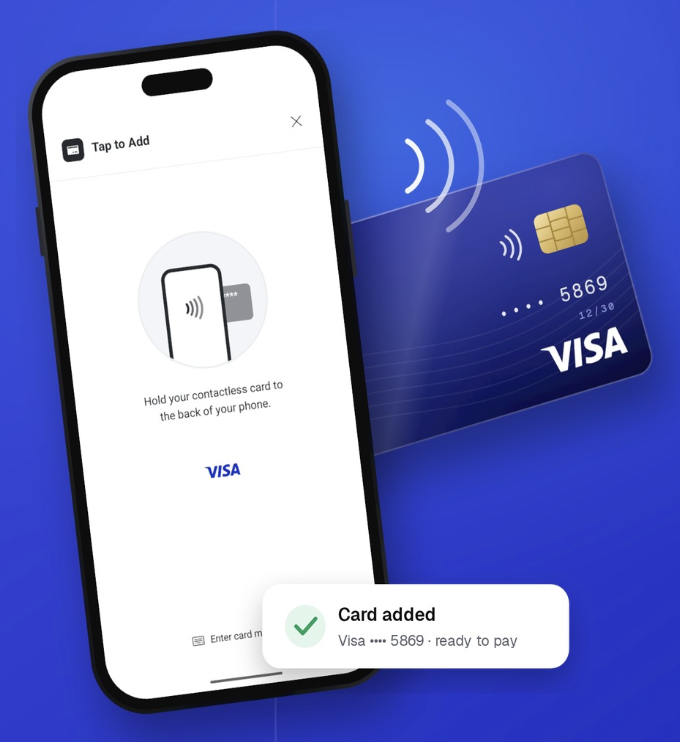
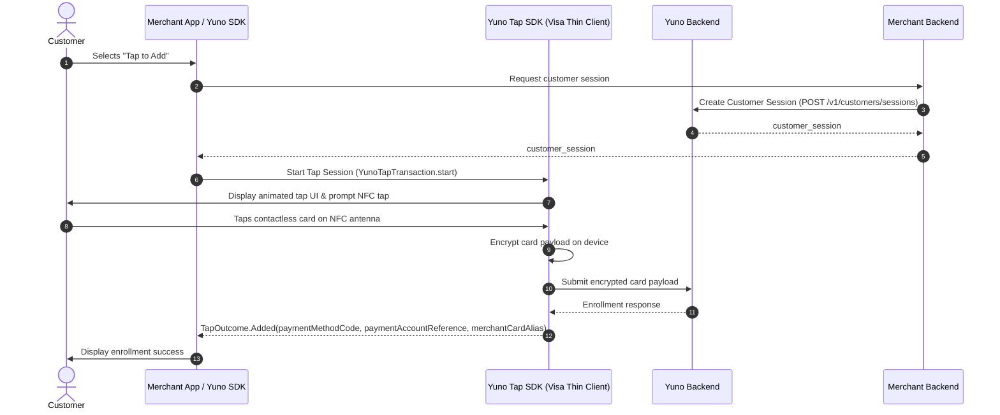
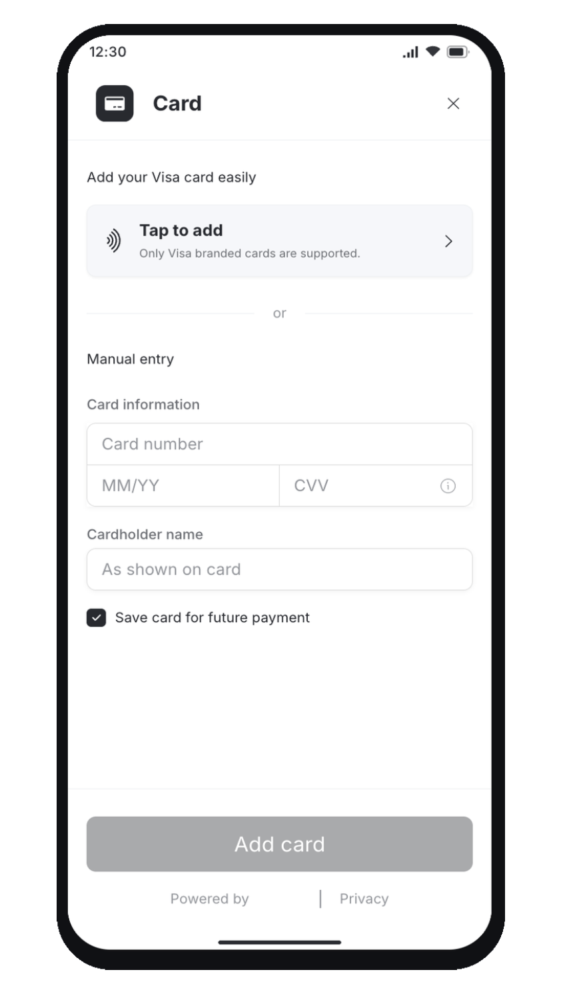
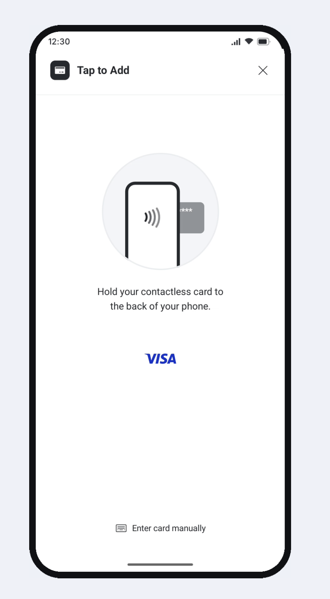
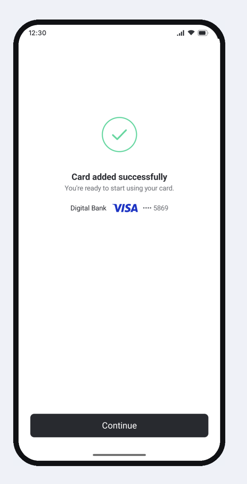

import LegacySdkNotice from '/snippets/pt-br/LegacySdkNotice.mdx'

<LegacySdkNotice />

O *Visa Tap to Add* permite que os clientes cadastrem seus cartões por aproximação encostando-os na antena NFC do dispositivo Android.

<p align="center">
  
</p>

A interação por aproximação usa internamente o Thin Client Tap SDK da Visa: os dados do cartão são lidos diretamente via NFC, criptografados no dispositivo e enviados com segurança para a Yuno. O aplicativo do lojista nunca acessa nem manipula Primary Account Numbers (PANs) em texto claro.



---

## Pré-requisitos e requisitos {#prerequisites--requirements}

Seu projeto Android deve atender aos seguintes requisitos de hardware, sistema e toolchain:

* **Hardware e sistema operacional**: Android 11.0 (API level 30) ou superior, com antena NFC ativa e suporte a Host Card Emulation (HCE).
* **Serviços**: o Google Play Services deve estar disponível no dispositivo.
* **Arquitetura**: arquitetura ARM de 64 bits (`arm64-v8a`) ou 32 bits (`armeabi-v7a`). (Emuladores x86 / x86_64 não são compatíveis com operações NFC por aproximação).
* **Requisitos de toolchain**:
  * **Compile SDK**: `compileSdk 35`
  * **Java**: Java 17
  * **Kotlin**: 2.1.0 ou superior
  * **Android Gradle Plugin (AGP)**: 8.6.0 ou superior
  * **Gradle**: 8.7 ou superior
  * **Hilt**: 2.56 ou superior (se usar injeção de dependência)
  * **Room**: 2.7.0-alpha13 ou superior (se usar Room no seu projeto)

<Note>
**Bandeiras compatíveis**: atualmente, o *Tap to Add* funciona com o Tap SDK da Visa. O suporte a Mastercard e a outras bandeiras de cartão será introduzido em versões futuras.
</Note>

---

## Caminhos de integração {#integration-paths}

Você pode integrar o Tap to Add de duas formas:

1. **Caminho A: cadastro automático via Yuno Android SDK 3.x (recomendado)**: se você já usa o Full Checkout SDK da Yuno para Android, adicionar a dependência `yuno-tap` habilita automaticamente o ponto de entrada do Tap to Add no formulário de cadastro, sem nenhum código de UI.
2. **Caminho B: Yuno Tap SDK independente**: se você cria telas de cadastro personalizadas ou uma UI headless, integre `com.yuno.payments:yuno-tap` diretamente, com o `YunoTapToAddButton` pronto ou com seu próprio botão chamando `YunoTapTransaction.start`.

---

## Caminho A: cadastro automático com o Full Checkout {#path-a-automatic-full-checkout-enrollment}

Ao integrar com o Yuno Android Universal SDK (`3.0.0` ou posterior), o SDK verifica automaticamente se `yuno-tap` está presente no classpath em tempo de execução. Se estiver e o dispositivo for compatível com NFC, o SDK exibe a opção **Tap to Add** diretamente no formulário de cadastro de cartão.

<Warning>
**Somente cadastro**: o Tap to Add é compatível exclusivamente com o cadastro de cartões e o salvamento de meios de pagamento na conta de um cliente. Ele **nunca** é apresentado durante o checkout, em fluxos de pagamento avulso ou em telas de compra direta.
</Warning>

### 1. Adicione as dependências {#1-add-dependencies}

Adicione o Yuno Android SDK e o artefato do Yuno Tap ao `build.gradle.kts` do seu módulo:

```kotlin
dependencies {
    // Yuno Android SDK
    implementation("com.yuno.payments:android-sdk:3.0.0")

    // Yuno Tap SDK for Tap to Add
    implementation("com.yuno.payments:yuno-tap:0.4.0")
}
```

### 2. Configure o manifest para dispositivos abaixo da API 30 {#2-configure-manifest-for-devices-below-api-30}

O Yuno Tap SDK exige `minSdk = 30`. Se o seu aplicativo principal usa um `minSdkVersion` menor (por exemplo, `minSdk = 24`), permita que o merge do manifest prossiga adicionando uma declaração `tools:overrideLibrary` no seu `AndroidManifest.xml`:

```xml
<manifest xmlns:android="http://schemas.android.com/apk/res/android"
    xmlns:tools="http://schemas.android.com/tools">

    <uses-sdk tools:overrideLibrary="com.yuno.payments.tap" />

    <application>
        <!-- Application components -->
    </application>
</manifest>
```

Em dispositivos com Android 10 (API 29) ou inferior, o Yuno SDK detecta a versão da plataforma de forma transparente e oculta a opção Tap to Add, recorrendo à digitação manual do cartão.

### Fluxo visual {#visual-flow}

<Steps>
  <Step title="Ponto de entrada no formulário de cadastro">
    Quando `yuno-tap` está incluído no projeto, o formulário de cadastro de cartão exibe o ponto de entrada **Tap to add** acima da digitação manual do cartão.

    <p align="center">
      
    </p>
  </Step>

  <Step title="Solicitação de aproximação NFC">
    Selecionar **Tap to add** abre a interface animada de aproximação NFC, que pede ao cliente para encostar o cartão por aproximação na parte de trás do dispositivo.

    <p align="center">
      
    </p>
  </Step>

  <Step title="Confirmação de sucesso">
    Depois que os dados do cartão são lidos e criptografados no dispositivo, a Yuno conclui o cadastro com segurança e retorna uma confirmação de sucesso.

    <p align="center">
      
    </p>
  </Step>
</Steps>

---

## Caminho B: Yuno Tap SDK independente {#path-b-standalone-yuno-tap-sdk}

Se você gerencia sua própria UI de captura de cartão ou quer posicionar a ação Tap to Add de forma personalizada, use a biblioteca independente `yuno-tap`.

### 1. Adicione a dependência {#1-add-dependency}

Adicione `yuno-tap` ao seu `build.gradle.kts`:

```kotlin
dependencies {
    implementation("com.yuno.payments:yuno-tap:0.4.0")
}
```

### 2. Obtenha a sessão do cliente {#2-obtain-customer-session}

Antes de iniciar o fluxo de aproximação, seu backend deve criar uma sessão do cliente usando a API server-to-server da Yuno:

```bash
curl -X POST https://api-sandbox.y.uno/v1/customers/sessions \
  -H "public-api-key: YOUR_PUBLIC_API_KEY" \
  -H "private-secret-key: YOUR_PRIVATE_SECRET_KEY" \
  -H "Content-Type: application/json" \
  -d '{
    "country": "US",
    "customer_id": "cust_12345"
  }'
```

A resposta retorna um ID `customer_session`. Passe-o para o seu aplicativo Android. O SDK não cria sessões do cliente; ele apenas consome uma.

### 3. Implemente um YunoTapController e crie um YunoTapConfig {#3-implement-a-yunotapcontroller-and-build-a-yunotapconfig}

`YunoTapController` é a interface que o SDK usa para se comunicar com o seu app. `onStatus` recebe o único `TapStatus` final de cada transação. `showLoading` é opcional e reflete o aquecimento único do SDK:

```kotlin
import com.yuno.payments.tap.YunoTapConfig
import com.yuno.payments.tap.YunoTapController
import com.yuno.payments.tap.YunoTapTransaction
import com.yuno.payments.tap.model.TapStatus

val controller =
    object : YunoTapController {
        override fun onStatus(status: TapStatus) {
            handleTapStatus(status)
        }

        override fun showLoading(loading: Boolean) {
            addCardButton.isEnabled = !loading
        }
    }

val transaction =
    YunoTapTransaction(
        YunoTapConfig(
            customerSession = customerSession,
            controller = controller,
            publicApiKey = "SANDBOX_us_your_public_api_key",
        ),
    )
```

O SDK escolhe o ambiente e a região pelo prefixo da chave de API pública, por isso não há parâmetro de ambiente: `PROD_…` é produção e `SANDBOX_…` é sandbox, e o segmento após o prefixo é a região (por exemplo, `PROD_us_…`).

`publicApiKey` é opcional se o seu app já chamou `YunoTap.initialize(context, publicApiKey)` antes no processo. Se ela estiver ausente e o SDK nunca tiver sido inicializado, a transação informa `ERROR` com `NOT_INITIALIZED`.

### 4. Opção 1: YunoTapToAddButton pronto para uso {#4-option-1-drop-in-yunotaptoaddbutton}

A integração de UI independente mais simples usa `YunoTapToAddButton`, um composable do Jetpack Compose que renderiza a entrada do Visa Tap to Add e inicia o fluxo ao ser pressionado:

```kotlin
import com.yuno.payments.tap.ui.YunoTapToAddButton

YunoTapToAddButton(
    transaction = transaction,
    activity = this,
    requestCvv = false, // true only if Yuno enabled CVV2 capture for your account
    modifier = Modifier.padding(horizontal = 16.dp),
)
```

O resultado chega no mesmo `YunoTapController`. Por padrão, o botão não renderiza nada em dispositivos que não aceitam aproximação (`hideWhenNotEligible = true`). Ele funciona apenas com Compose: em uma tela baseada em View, hospede-o em um `ComposeView` ou use a Opção 2.

### 4. Opção 2: inicie o fluxo pelo seu próprio botão {#4-option-2-start-the-flow-from-your-own-button}

Para um gatilho personalizado, chame `start` na transação. `activity` deve ser uma `ComponentActivity`:

```kotlin
import com.yuno.payments.tap.model.TapFlow

findViewById<Button>(R.id.btnCustomTap).setOnClickListener {
    transaction.start(activity = this, flow = TapFlow.Add())
}
```

`start` verifica a elegibilidade do dispositivo, inicializa o SDK da Visa no primeiro uso, exibe sua própria UI segura, lê o cartão via NFC e informa o resultado por meio de `onStatus`. Apenas uma transação pode ser executada por vez. Para encerrar uma transação em andamento, chame `transaction.cancel()`; `onStatus` então recebe `CANCELED`.

---

## Tratamento de resultados e desfechos {#result-handling--outcomes}

`onStatus` é chamado exatamente uma vez por `start()`, na thread principal, com um `TapStatus`. Seu `status` é um `TapStatusCode` e, dependendo do código, ele traz um `outcome` (`TapOutcome`) e/ou um `error` (`YunoTapError`):

```kotlin
import com.yuno.payments.tap.model.TapOutcome
import com.yuno.payments.tap.model.TapStatus
import com.yuno.payments.tap.model.TapStatusCode

fun handleTapStatus(status: TapStatus) {
    when (status.status) {
        TapStatusCode.SUCCEEDED -> {
            val added = status.outcome as TapOutcome.Added
            val paymentMethodCode = added.paymentMethodCode
            val par = added.paymentAccountReference // May be null depending on issuer support
            val alias = added.merchantCardAlias // From yuno-tap 0.4.0; pass it to your fraud engine with paymentMethodCode
        }
        TapStatusCode.CANCELED -> {
            if (status.outcome is TapOutcome.ManualEntryRequested) openManualCardForm()
        }
        TapStatusCode.NOT_ELIGIBLE -> showManualCardEntryOnly()
        TapStatusCode.FAILED -> showMessage(status.error?.message)
        TapStatusCode.ERROR -> logTapError(status.error?.code)
    }
}
```

| `TapStatusCode` | `outcome` / `error` | Significado | O que fazer |
| :--- | :--- | :--- | :--- |
| `SUCCEEDED` | `outcome` é `TapOutcome.Added` | O cartão foi adicionado. | Armazene o `paymentMethodCode` e atualize os cartões salvos do cliente. |
| `FAILED` | `error` com um código da Visa ou do backend | Uma falha de negócio do cartão, da Visa ou do backend, por exemplo, um cartão recusado. | Exiba `error.message` e deixe o cliente tentar novamente com o mesmo cartão ou com outro. |
| `CANCELED` | `outcome` é `null` ou `TapOutcome.ManualEntryRequested` | O cliente fechou o fluxo, seu app chamou `cancel()` ou o cliente escolheu **Enter card manually**. | Volte para a tela anterior; em `ManualEntryRequested`, abra seu formulário manual de cartão. Não é um erro. |
| `NOT_ELIGIBLE` | `outcome` é `TapOutcome.NotEligible(reasons)` | O dispositivo ou o app não aceita aproximação. Nenhuma UI foi exibida. | Oculte a opção Tap to Add e use a digitação manual do cartão. |
| `ERROR` | `error.code` de `YunoTapErrorCodes` | Um erro do SDK ou da integração, não uma falha do cartão. | Registre `error.code` no log; consulte [Códigos de erro](#error-codes). |

`TapOutcome.Added` traz estas propriedades:

| Propriedade | Descrição |
| :--- | :--- |
| `paymentMethodCode: String` | O meio de pagamento cadastrado. |
| `paymentAccountReference: String?` | A Visa Payment Account Reference (PAR). Ela identifica a conta subjacente entre tokens e pode ser `null` dependendo do banco emissor. |
| `last4: String?` | Últimos quatro dígitos do cartão aproximado, conforme informado pela Yuno. `null` quando desconhecido. |
| `issuerName: String?` | Banco emissor do cartão aproximado, conforme informado pela Yuno. `null` quando desconhecido. |
| `merchantCardAlias: String?` | O alias que o seu próprio endpoint retornou para este cartão quando a Yuno o chamou durante o cadastro. Este desfecho é o único lugar em que ele chega junto com o `paymentMethodCode`, porque o código ainda não existe quando o seu endpoint é chamado, então envie os dois para o seu mecanismo antifraude aqui. `null` quando a Yuno não conseguiu obter um alias, o que ainda é um cadastro bem-sucedido. |

`last4`, `issuerName` e `merchantCardAlias` estão disponíveis a partir do yuno-tap 0.4.0. `TapOutcome.Confirmed` é reservado para o Tap to Confirm e nunca é produzido por `TapFlow.Add`.

---

## Códigos de erro {#error-codes}

Com `ERROR`, `error.code` é um dos `YunoTapErrorCodes`:

| Código de erro | Significado |
| :--- | :--- |
| `NOT_INITIALIZED` | Não há `publicApiKey` no `YunoTapConfig` e `YunoTap.initialize` nunca foi chamado. |
| `TAP_IN_PROGRESS` | Outra transação já está em execução. Aguarde ela terminar ou chame `cancel()` nela. |
| `INIT_TIMEOUT` | O SDK da Visa não concluiu a inicialização em 30 segundos. |
| `SDK_ERROR` | O SDK da Visa gerou uma exceção. |
| `NETWORK_ERROR` | Uma chamada ao backend da Yuno falhou. |
| `TRANSACTION_INTERRUPTED` | A aproximação foi interrompida, por exemplo, o app foi para segundo plano ou o NFC foi perdido no meio da leitura. |
| `UNEXPECTED_RESULT` | O SDK da Visa retornou um resultado inesperado. |
| `NOT_AVAILABLE` | O fluxo solicitado ainda não está disponível. |

Um padrão razoável: deixe o cliente tentar novamente em `NETWORK_ERROR`, `INIT_TIMEOUT` e `TRANSACTION_INTERRUPTED`, e recorra à digitação manual do cartão nos demais.

Com `FAILED`, `error.code` traz o código do backend ou da Visa sem alteração:

| Código de erro | Ocorre quando | O que fazer |
| :--- | :--- | :--- |
| `TAP_TO_ADD_CARD_VERIFICATION_FAILED` | A Visa não conseguiu verificar os dados do chip lidos do cartão. | Peça ao cliente para aproximar o cartão novamente. |
| `TAP_TO_ADD_CARD_DECLINED` | O emissor ou a Visa recusou o provisionamento do cartão. | Peça outro cartão ou use a digitação manual. |
| `TAP_TO_ADD_CARD_NOT_SUPPORTED` | O cartão não é elegível para o provisionamento de network token. | Peça outro cartão ou use a digitação manual. |
| `TAP_TO_ADD_SESSION_EXPIRED` | A sessão de aproximação expirou antes de o provisionamento ser concluído. | Inicie uma nova aproximação. |
| `TAP_TO_ADD_PROVISIONING_FAILED` | Qualquer outra falha do provedor, como um erro ou timeout do provedor. | Tente novamente uma vez e depois peça outro cartão. |
| `TAP_TO_ADD_CONFIGURATION_INCOMPLETE` | O Tap to Add não está habilitado para esta conta ou país. | Entre em contato com o suporte da Yuno; novas tentativas falham da mesma forma. |
| `3009` | O NFC está desativado nas configurações do Android. | Peça ao cliente para ativar o NFC. |
| `3010` | O cartão não é compatível, por exemplo, um cartão que não é Visa. | Peça um cartão Visa por aproximação ou use a digitação manual. |

---

## Configuração do ProGuard e R8 {#proguard--r8-configuration}

As regras de keep do ProGuard e do R8 vêm dentro do artefato `yuno-tap` e são aplicadas automaticamente ao seu build de release, então você não precisa adicionar nenhuma. O Tap SDK da Visa está embutido no `yuno-tap`: não adicione o AAR da Visa separadamente.

---

## Próximos recursos {#upcoming-features}

* **Tap to Confirm**: o suporte à autenticação de cartões por aproximação durante transações de checkout está planejado para versões futuras do SDK. Atualmente, apenas o **Tap to Add** (`TapFlow.Add`) para cadastro de cartão está ativo.
