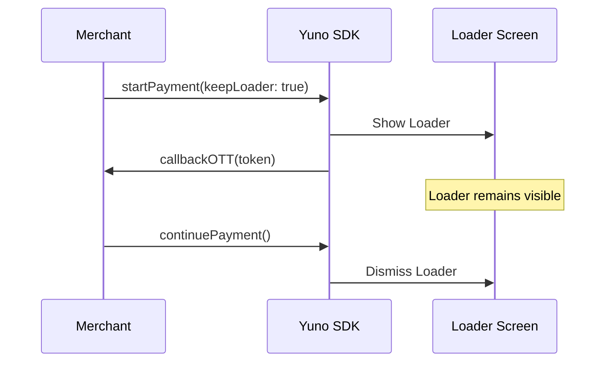

import LegacySdkNotice from '/snippets/pt-br/LegacySdkNotice.mdx'

<LegacySdkNotice />

Parâmetros, personalizações e recursos avançados de todos os fluxos do SDK Android. Configuração: [Fluxos de pagamento (Android)](/docs/sdks/full-checkout/android-payments), [Fluxos de cadastro (Android)](/pt-br/docs/sdks/card-enrollment/android-enrollment), [modos de integração](/pt-br/docs/sdks/overview/choose-integration).

## Parâmetros principais (criação da sessão de checkout) {#key-parameters-checkout-session-creation}

Ao criar uma sessão de checkout no seu backend para fluxos de pagamento, os seguintes parâmetros são usados com frequência nos SDKs Android:

<div className="nowrap-col1-table dense-table">

| Parâmetro            | Obrigatório | Descrição                                                                                                                                                                                                                                                                                                        |
| -------------------- | -------- | ------------------------------------------------------------------------------------------------------------------------------------------------------------------------------------------------------------------------------------------------------------------------------------------------------------------ |
| `amount`             | Sim      | O objeto do valor principal da transação, com `currency` (código ISO 4217) e `value` (valor numérico nessa moeda).                                                                                                                                                                                         |
| `alternative_amount` | Não       | Uma representação do valor da transação em uma moeda alternativa, com a mesma estrutura de `amount` (`currency` e `value`). Útil em cenários com várias moedas. Por exemplo, você pode exibir preços aos clientes na moeda de preferência deles (por exemplo, USD) enquanto processa o pagamento na moeda local (por exemplo, COP). |

</div>

## Parâmetros de pagamento (referência completa) {#payment-parameters-full-reference}

Parâmetros dos fluxos de pagamento. Todos os parâmetros usados em [Fluxos de pagamento (Android)](/docs/sdks/full-checkout/android-payments) estão listados aqui com todos os detalhes.

<div className="nowrap-col1-table dense-table">

| Parâmetro               | Tipo     | Obrigatório | Descrição                                                                                                                                                                                                                                                                 |
| ----------------------- | -------- | -------- | --------------------------------------------------------------------------------------------------------------------------------------------------------------------------------------------------------------------------------------------------------------------------- |
| `checkoutSession`       | string   | Sim      | ID da sessão de checkout gerado no seu backend (API Create checkout session). Obrigatório em todos os fluxos de pagamento.                                                                                                                                                                         |
| `countryCode`           | string   | Sim      | Código ISO do país onde o pagamento é processado (por exemplo, `US`, `BR`). Determina os meios de pagamento disponíveis e a conformidade.                                                                                                                                                            |
| `callbackPaymentState`| function | Não       | `((String?, String?, StatusMessage?) -> Unit)?`. Chamado com o estado do pagamento (`SUCCEEDED`, `FAIL`, `PROCESSING`, `REJECT`, `INTERNAL_ERROR`, `CANCELED_BY_USER`), o subestado e, em resultados de erro, um [`StatusMessage?`](#statusmessage-error-details). Terceiro parâmetro adicionado no SDK `2.22.0`. Use para atualizações de UI, analytics ou navegação. |
| `merchantSessionId`     | string   | Não       | Identificador opcional da sessão do lojista. Use para correlacionar a sessão do SDK com seu próprio ID de sessão ou de pedido.                                                                                                                                                                   |
| `onInstallmentSelected` | function | Não       | Callback chamado quando o comprador seleciona uma opção de parcelas no formulário do cartão (payload `InstallmentSelected?` com `installment`, `label` e `amount`). É disparado na pré-seleção padrão, em cada seleção, nos recálculos do plano e uma vez com `null` quando as parcelas deixam de estar disponíveis. Disponível a partir do SDK `2.20.0`. Veja [Full (Android)](/docs/sdks/full-checkout/android-payments#installment-selection-callback-oninstallmentselected).      |

</div>

## Opções de YunoConfig (initialize) {#yunoconfig-options-initialize}

O comportamento em tempo de execução e a aparência são configurados pela data class `YunoConfig` ao chamar `Yuno.initialize(context, apiKey, config)`. Todos os parâmetros usados nos fluxos de pagamento e de cadastro do Android estão listados abaixo. Para o estilo visual (fontes, cores, botões), veja [Personalizações do SDK (Android)](/pt-br/docs/sdks/customization/android).

<div className="nowrap-col1-table dense-table">

| Parâmetro          | Tipo    | Obrigatório | Descrição                                                                                                                                                                                                                                                                 |
| ------------------ | ------- | -------- | --------------------------------------------------------------------------------------------------------------------------------------------------------------------------------------------------------------------------------------------------------------------------- |
| `saveCardEnabled`  | boolean | Não       | Quando `true`, permite que o usuário salve ou cadastre o cartão durante o pagamento. Exige suporte a vaulting no backend (por exemplo, `payment_method.vault_on_success` na sessão de checkout).                                                                                               |
| `keepLoader`       | boolean | Não       | Se `true`, o loader do SDK permanece visível desde a geração do OTT até que `continuePayment()` seja chamado. Isso evita que a UI pisque. Se a criação do pagamento falhar, chame `hideLoader()` para fechá-lo manualmente. |
| `language`         | `YunoLanguage` | Não       | Idioma da UI do SDK, como um valor do enum `YunoLanguage` (por exemplo, `YunoLanguage.ENGLISH`, `YunoLanguage.SPANISH`). Veja [Idiomas suportados](/pt-br/docs/sdks/resources/languages-supported).                                                                                                                     |
| `styles`           | object  | Não       | Estilos personalizados aplicados aos elementos de UI do SDK. Defina os estilos no seu app e faça referência a eles aqui, ou use substituições de tema. Veja [Personalizações do SDK (Android)](/pt-br/docs/sdks/customization/android) para opções de fonte, botão e cor.                                                       |

</div>

## Parâmetros de cadastro (referência completa) {#enrollment-parameters-full-reference}

Parâmetros dos fluxos de cadastro. Todos os parâmetros usados em [Fluxos de cadastro (Android)](/pt-br/docs/sdks/card-enrollment/android-enrollment) estão listados aqui com todos os detalhes.

<div className="nowrap-col1-table dense-table">

| Parâmetro                | Tipo     | Obrigatório | Descrição                                                                                                                                                                                                                                                                 |
| ------------------------ | -------- | -------- | --------------------------------------------------------------------------------------------------------------------------------------------------------------------------------------------------------------------------------------------------------------------------- |
| `customerSession`        | string   | Sim      | ID da sessão do cliente obtido na API Create customer session. Obrigatório. Associa o meio de pagamento cadastrado a um cliente específico.                                                                                                                                             |
| `countryCode`            | string   | Sim      | Código ISO do país (por exemplo, `US`, `BR`). Obrigatório para o cadastro.                                                                                                                                                                                                                 |
| `showEnrollmentStatus`   | boolean  | Não       | Quando `true`, mostra a tela de resultado do cadastro depois do fluxo. Padrão `true`. Defina como `false` para tratar o resultado apenas pelo callback.                                                                                                                                          |
| `callbackEnrollmentState`| function | Não       | `((String?, StatusMessage?) -> Unit)?`. Chamado com o estado do cadastro e, em `INTERNAL_ERROR`, um [`StatusMessage?`](#statusmessage-error-details). Segundo parâmetro adicionado no SDK `2.22.0`. Exige registrar `initEnrollment` no `onCreate` da sua Activity (ou equivalente). |

</div>

## Métodos públicos {#public-methods}

Os métodos a seguir estão disponíveis globalmente pelo objeto `Yuno` ou como extensões de `Activity`.

### `Activity.hideLoader()` {#activityhideloader}

Fecha o loader do SDK quando `keepLoader` está ativo. Use este método quando a criação do pagamento no backend falhar. Ele também é útil quando você não pode prosseguir com `continuePayment()`.

```kotlin
fun Activity.hideLoader()
```

### `Yuno.continuePayment()` {#yunocontinuepayment}

Retoma o fluxo de pagamento para métodos assíncronos (3ds, PIX etc.) depois que um pagamento foi criado no seu backend.

```kotlin
fun continuePayment(
    showPaymentStatus: Boolean = true,
    checkoutSession: String? = null,
    countryCode: String? = null,
    callbackPaymentState: ((String?, String?, StatusMessage?) -> Unit)? = null
)
```

## StatusMessage (detalhes do erro) {#statusmessage-error-details}

> **Disponível desde o SDK Android v2.22.0**

Todo callback de resultado de pagamento e de cadastro, e o `returnStatus` dos render listeners, traz um `StatusMessage?` junto com o estado. Ele diferencia uma **rejeição do backend** de uma **falha interna do SDK** e fornece um código sobre o qual você pode agir, em vez de uma simples string de status.

```kotlin
package com.yuno.payments.features.payment.models

data class StatusMessage(
    val source: String,          // "backend" or "sdk"
    val code: String? = null,    // backend response_code, or an SDK error code
    val reason: String? = null,  // human-readable detail
    val raw: String? = null,     // redacted subset of the backend error body (backend only)
    val context: String? = null, // where the SDK failed (sdk only), e.g. "startPayment"
)
```

| Campo | `source = "backend"` | `source = "sdk"` |
| --- | --- | --- |
| `code` | O `response_code` da transação (por exemplo `INSUFFICIENT_FUNDS`) ou o `code` de erro HTTP retornado pela Yuno. | Um código de erro do SDK: `UNEXPECTED_ERROR`, `LOADER_TIMEOUT` ou `PAYMENT_METHOD_NOT_SELECTED` (a partir de `2.25.0`). |
| `reason` | O `response_message` da transação ou, na falta dele, o seu `reason`; para erros HTTP, a primeira entrada de `messages` do backend. | Uma descrição curta da falha. |
| `raw` | Subconjunto permitido e de tamanho limitado do corpo de erro do backend: apenas `code`, `message`, `messages`, `type` e `request_id`, com no máximo 2048 caracteres; caso contrário, `null`. Ele ainda pode repetir dados que você enviou, então não o registre em log literalmente. | Sempre `null`. |
| `context` | Sempre `null`. | A etapa do SDK que falhou, por exemplo `startPayment`, `continuePayment` ou `enrollment`. |

Quando ele é preenchido:

| Resultado | `message` |
| --- | --- |
| `SUCCEEDED`, `PROCESSING`, `CANCELED_BY_USER` (pagamentos) / `CANCELED` (cadastro), inclusive quando o comprador sai do fluxo antes de um resultado | Sempre `null`. |
| `INTERNAL_ERROR` | Sempre presente. `source = "sdk"` para falhas do SDK, de renderização ou de rede; `source = "backend"` quando a Yuno respondeu com um erro HTTP. |
| `REJECT`, `FAIL` (pagamentos) | Presente com `source = "backend"` apenas quando o backend retornou um `response_code` para a transação; caso contrário, `null`. |
| `REJECT`, `FAIL` (cadastro) | `null`: recusas de cadastro não trazem `response_code` do backend. |

```kotlin
callbackPaymentState = { state, subState, message ->
    when (state) {
        "REJECT", "FAIL" -> showDeclined(code = message?.code, reason = message?.reason)
        "INTERNAL_ERROR" -> when (message?.source) {
            "backend" -> reportBackendError(message.code, message.raw)
            else -> reportSdkError(message?.code, message?.context)
        }
        else -> { }
    }
}
```

### Integração com render {#render-integration}

Se você integra pela API de render, o mesmo valor chega aos seus listeners como último parâmetro de `returnStatus`:

```kotlin
interface YunoPaymentRenderListener {
    fun returnStatus(
        resultCode: Int,
        paymentStatus: String,
        paymentSubStatus: String? = null,
        message: StatusMessage? = null,
    )
    // showView, returnOneTimeToken, loadingListener unchanged
}

interface YunoEnrollmentRenderListener {
    fun returnStatus(resultCode: Int, paymentStatus: String, message: StatusMessage? = null)
    // showView, loadingListener unchanged
}
```

### Migração para a 2.22.0 {#migrating-to-2220}

`StatusMessage` é uma **mudança incompatível**: o SDK não inclui sobrecargas obsoletas das assinaturas anteriores. Ao atualizar a partir da `2.21.x` ou anterior:

1. **Recompile seu app com o novo SDK.** Colocar o novo AAR em um app compilado com uma versão anterior não é seguro: um render listener compilado com a assinatura antiga de `returnStatus` falha em tempo de execução com `AbstractMethodError` no primeiro resultado de erro, sem nenhum aviso em tempo de compilação.
2. **Adicione o terceiro parâmetro a toda lambda de `callbackPaymentState`** (`startCheckout`, `startPayment`, `startPaymentLite`, `startPaymentSeamlessLite`, `continuePayment`, `continueCardPayment`): `{ state, subState -> }` passa a ser `{ state, subState, message -> }`. As lambdas em Kotlin precisam ter a mesma aridade, então a forma antiga não compila.
3. **Adicione o segundo parâmetro a toda lambda de `callbackEnrollmentState`** (`initEnrollment`, `startEnrollment`, `enrollmentStatus`, `setupEnrollmentInfo`): `{ state -> }` passa a ser `{ state, message -> }`.
4. **Atualize as sobrescritas de `returnStatus`** em `YunoPaymentRenderListener` e `YunoEnrollmentRenderListener` para as assinaturas acima.

Ler `message` é opcional: ignorar o novo parâmetro mantém sua lógica atual funcionando. Notas de versão: [Changelog do Android](/changelog/android).

## Cadastro de meios de pagamento {#enrolling-payment-methods}

Você pode cadastrar meios de pagamento (armazenar cartões para uso futuro) durante o fluxo de pagamento ou por fluxos de cadastro dedicados. Nos fluxos de pagamento, habilite o salvamento de cartão em `YunoConfig`. Defina também `payment_method.vault_on_success` (ou equivalente) ao criar a sessão de checkout, quando houver suporte. Para o cadastro dedicado, veja [Fluxos de cadastro (Android)](/pt-br/docs/sdks/card-enrollment/android-enrollment).

## Parâmetro `keepLoader` {#keeploader-parameter}

> **Disponível desde o SDK Android v2.13.0**

### Como funciona {#how-it-works}

O parâmetro `keepLoader` permite manter o indicador de carregamento do SDK durante todo o fluxo `startPayment` → `continuePayment`. Isso evita que o loader pisque entre as etapas.

Por padrão, o SDK oculta o loader depois de gerar o token de uso único (OTT). Ele mostra o loader novamente quando `continuePayment` é chamado. Com `keepLoader` habilitado, o loader fica visível continuamente desde o momento em que o usuário envia o formulário de pagamento até que o pagamento seja totalmente processado (ou fechado explicitamente).



### Integração {#integration}

#### 1. Habilite em YunoConfig {#1-enable-in-yunoconfig}

```kotlin
Yuno.initialize(
    applicationContext = this,
    apiKey = "YOUR_PUBLIC_API_KEY",
    config = YunoConfig(
        keepLoader = true,
    ),
)
```

#### 2. Trate o OTT e chame `continuePayment` {#2-handle-ott-and-call-continuepayment}

Quando `keepLoader` está habilitado, o callback do OTT é disparado enquanto o loader ainda está visível. Crie o pagamento no seu backend e depois chame `continuePayment` normalmente:

```kotlin
activity.startCheckout(
    checkoutSession = checkoutSession,
    countryCode = countryCode,
    callbackOTT = { token ->
        // The loader is still visible at this point.
        // Create payment on your backend using the token,
        // then call continuePayment:
        activity.continuePayment(showPaymentStatus = true)
    },
    callbackPaymentState = { state, subState, message ->
        // Handle final payment state
    },
)
```

#### 3. Trate erros com `hideLoader` {#3-handle-errors-with-hideloader}

Se a chamada ao seu backend falhar e você não puder prosseguir com `continuePayment`, chame `hideLoader()`. Isso fecha o loader e encerra o fluxo de pagamento:

```kotlin
callbackOTT = { token ->
    try {
        val payment = createPaymentOnBackend(token)
        activity.continuePayment(showPaymentStatus = true)
    } catch (e: Exception) {
        // Dismiss the loader on failure
        activity.hideLoader()
    }
}
```

<Warning>
  **Tratamento de falhas**  
  Quando `keepLoader` está ativo e a criação do pagamento falha, você **precisa** chamar `hideLoader()`. Caso contrário, o loader vai permanecer na tela indefinidamente (até que o timeout integrado seja acionado).
</Warning>

### Compatibilidade {#compatibility}

- Funciona com os fluxos de pagamento **Full** e **Lite** (`startPayment` e `startPaymentLite`).
- Compatível com tokens armazenados no vault.
- O loader respeita o timeout integrado do SDK. Se nem `continuePayment` nem `hideLoader` forem chamados, o loader será fechado automaticamente depois do período de timeout.
- Não se aplica ao fluxo **Seamless** (`startPaymentSeamlessLite`). Esse fluxo não usa o padrão de duas etapas `startPayment` → `continuePayment`.
