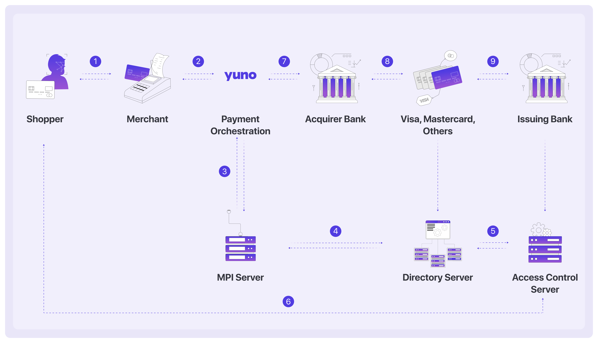
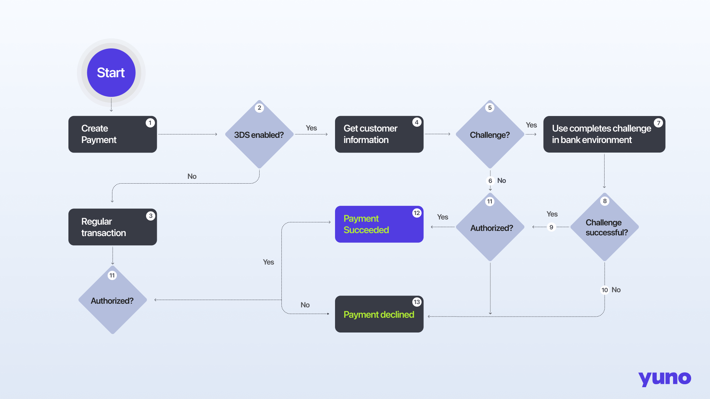

import { AuthOnceFlow } from '/snippets/three-d-secure/AuthOnceFlow.jsx';

O Yuno 3DS executa a autenticação 3D Secure 2 como uma etapa própria na sua rota de cartão, antes de o pagamento chegar a um provedor de pagamento. O resultado da autenticação (ECI, criptograma e ID da transação no Directory Server) fica armazenado no pagamento, para que qualquer provedor da rota possa usá-lo.

## Autentique uma vez, direcione para qualquer provedor {#authenticate-once-route-to-any-provider}

Quando um provedor de pagamento executa o 3DS por você, a autenticação geralmente fica com esse provedor. Se o provedor recusar o pagamento e você tentar novamente com outro, o segundo provedor inicia sua própria autenticação e o seu cliente recebe um segundo desafio.

Com o Yuno 3DS, a autenticação vem primeiro e o provedor vem depois. Se o provedor A recusar e a sua rota tiver um fallback, a Yuno envia os mesmos dados de autenticação para o provedor B. O seu cliente não precisa se autenticar de novo.

<AuthOnceFlow
  label="Comparação de dois fluxos de pagamento. Com o 3DS embutido em um provedor: o cliente paga, conclui um desafio 3DS executado pelo provedor A, o provedor A recusa, o cliente precisa concluir um segundo desafio 3DS para o provedor B e, então, o provedor B tenta a autorização. Com o Yuno 3DS: o cliente paga, conclui um único desafio 3DS executado pela Yuno, o provedor A recusa e o provedor B recebe a mesma autenticação e aprova."
  lanes={[
    {
      eyebrow: 'Sem a Yuno',
      title: '3DS embutido em cada provedor',
      count: '2',
      result: 'desafios para a mesma compra',
      steps: [
        { kind: 'customer', title: 'O cliente paga', body: 'Dados do cartão enviados no checkout' },
        { kind: 'auth', title: 'Desafio 3DS', body: 'Executado pelo provedor A, válido para o provedor A' },
        { kind: 'declined', title: 'Provedor A', tag: 'Recusado', body: 'A autenticação não pode passar para outro provedor' },
        { kind: 'repeat', title: 'Desafio 3DS', tag: 'De novo', body: 'O provedor B inicia sua própria autenticação' },
        { kind: 'provider', title: 'Provedor B', body: 'Tentativa de autorização, se o cliente ainda estiver lá' },
      ],
    },
    {
      eyebrow: 'Com a Yuno',
      title: 'Yuno 3DS como etapa de roteamento',
      highlight: true,
      count: '1',
      result: 'desafio, não importa quantos provedores a rota tente',
      steps: [
        { kind: 'customer', title: 'O cliente paga', body: 'Dados do cartão enviados no checkout' },
        { kind: 'auth', title: 'Desafio 3DS', body: 'Executado pela Yuno, antes de qualquer provedor' },
        { kind: 'declined', title: 'Provedor A', tag: 'Recusado', body: 'A rota segue o ramo Declined' },
        { kind: 'approved', title: 'Provedor B', tag: 'Aprovado', body: 'Recebe o mesmo ECI e o mesmo criptograma' },
      ],
    },
  ]}
/>

| Etapa | 3DS embutido em cada provedor | Yuno 3DS como etapa de roteamento |
| :--- | :--- | :--- |
| Autenticação | Executada pelo provedor A, vinculada ao provedor A | Executada pela Yuno antes de qualquer provedor |
| O provedor A recusa | A autenticação é perdida | A autenticação permanece no pagamento |
| Nova tentativa no provedor B | O cliente conclui um segundo desafio | O provedor B recebe o mesmo ECI e o mesmo criptograma |
| Desafios para uma compra | Dois | Um |

### Como funciona na sua rota {#how-it-works-in-your-route}

1. Adicione a etapa **3DS** à sua rota CARD, antes da etapa do provedor. Consulte [Configurando o 3D Secure para os seus pagamentos](#configuring-3d-secure-for-your-payments).
2. A Yuno autentica o cliente uma única vez. O fluxo é sem atrito (frictionless) quando o emissor aprova em segundo plano, ou um desafio quando o emissor solicita um.
3. A Yuno envia o pagamento ao primeiro provedor com o resultado da autenticação anexado.
4. Se esse provedor recusar ou retornar um erro, a rota segue o ramo **Declined** ou **Error** que você configurou. Consulte [Tentativas de fallback e resultados do pagamento](/pt-br/docs/using-yuno/dashboard-overview/routing#fallback-attempts-and-payment-outcomes).
5. O próximo provedor recebe o mesmo resultado da autenticação. A resposta do pagamento o retorna no [objeto `three_d_secure`](#yuno-3d-secure-2-integration).

<Note>
Uma tentativa de fallback é uma nova autorização. O emissor ainda pode recusá-la. Leia `liability_shift` em cada pagamento em vez de deduzi-lo a partir do status do pagamento.
</Note>

## Escolha a sua integração {#choose-your-integration}

| Integração | Quem executa a autenticação | Quando usar | Guia |
| :--- | :--- | :--- | :--- |
| Yuno SDK | A Yuno. O SDK coleta os dados do dispositivo e exibe o desafio | Você usa o Yuno Checkout na web ou no celular | [Primeiros passos com o Yuno SDK](/pt-br/docs/yuno-sdk/get-started) |
| API direta | A Yuno. Você redireciona o cliente para a `redirect_url` | Você está em conformidade com o PCI e cria pagamentos a partir do seu servidor | [Configuração e testes do 3DS](/pt-br/docs/direct-integration-use-cases/3ds-configuration-and-testing) |
| 3DS Standalone | A Yuno. Somente autenticação, sem provedor e sem autorização | Você quer o ECI e o criptograma para autorizar em outro lugar | [3DS Standalone](/pt-br/docs/payment-features/3ds-standalone) |
| 3DS externo | O seu próprio servidor 3DS ou MPI | Você já faz a autenticação e só envia o resultado para a Yuno | [Criar pagamento](/reference/payments/create-payment) |

Os requisitos de cada opção estão em [Integração do Yuno 3D Secure 2](#yuno-3d-secure-2-integration).

## Resultados da autenticação {#authentication-outcomes}

| Resultado | O que o cliente vê | O que você recebe |
| :--- | :--- | :--- |
| Sem atrito (frictionless) | Nada. O emissor faz a autenticação em segundo plano | ECI e criptograma |
| Desafio | Uma senha de uso único ou uma confirmação no app do banco | ECI e criptograma depois que o cliente passa no desafio |
| Somente dados | Nada. Os dados da transação são compartilhados com o emissor e nenhum desafio é solicitado | Um registro de autenticação (`pares_status` `I`, normalmente ECI 04). Sem transferência de responsabilidade: a responsabilidade pela fraude continua com você |
| Falha ou rejeição | Um desafio malsucedido, ou nada quando o emissor rejeita | Um pagamento `DECLINED` e nenhuma transferência de responsabilidade |

[3DS Standalone](/pt-br/docs/payment-features/3ds-standalone#authentication-outcomes) mostra a resposta completa de cada resultado. Para pedir ao emissor que dispense o desafio em pagamentos elegíveis, consulte [Isenções de SCA](/pt-br/docs/payment-features/sca-exemptions).

## Configurando o 3D Secure para os seus pagamentos {#configuring-3d-secure-for-your-payments}

<Note>
**Yuno SDK: o 3DS é executado dentro da transação**

Com o [Yuno SDK](/pt-br/docs/yuno-sdk/get-started), não há configuração separada do 3DS nem chamada extra para sequenciar. O SDK cria o pagamento, executa o 3DS quando a rota ou o emissor solicita e entrega o status final para [`onStatus`](/pt-br/docs/yuno-sdk/controllers/on-status). Se você criar o pagamento a partir do seu próprio backend com [`createPayment`](/pt-br/docs/yuno-sdk/controllers/create-payment), o SDK ainda executa o 3DS e informa o resultado. Consulte [Como uma transação flui](/pt-br/docs/yuno-sdk/how-a-transaction-flows) para ver a sequência completa.
</Note>

<Note>
**Experiência do desafio no Yuno SDK**: o próprio SDK apresenta o desafio, então você não abre uma URL de desafio nem trata um redirecionamento. No celular, o desafio é executado em uma WebView em tela cheia por padrão. No Android, adicione o módulo 3DS da Netcetera para executá-lo de forma nativa no seu app, para pagamentos e cadastro. No iOS 3.x, o módulo nativo ainda não está disponível, então os desafios são executados na WebView. Consulte [Módulos nativos](/pt-br/docs/yuno-sdk/features/native-modules) para ver a configuração.
</Note>

<Note>
**Usa um SDK legado?** Os SDKs legados continuam com suporte durante a transição, e o 3DS funciona da seguinte forma:

- Full, Lite e Seamless: a partir do SDK v1.1, `continuePayment()` trata o 3DS sem configuração separada. Consulte o [guia do Web SDK legado](/docs/sdks/full-checkout/web-payments).
- Headless web: chame `getThreeDSecureChallenge` e abra a URL retornada com `embedded=true` para exibir o desafio em um iFrame em vez de um redirecionamento de página inteira, no desktop e na web mobile. Sem `embedded=true`, o desafio abre em uma nova aba. Consulte o [Passo 6](/pt-br/docs/sdks/headless-web/payment#step-6-get-the-3ds-challenge-url). Isso se aplica somente ao provedor 3DS web da Yuno.
- Apps mobile nativos: o desafio é executado dentro do app por meio dos SDKs 3DS nativos da Netcetera. Consulte os guias de [iOS](/pt-br/docs/sdks/external-native-modules/netcetera-3ds-ios) e [Android](/pt-br/docs/sdks/external-native-modules/netcetera-3ds-android).
</Note>

Você decide se o seu sistema vai implementar o 3DS2 ou não. A etapa de verificação 3DS2 é adicionada ao definir o [roteamento dinâmico](/pt-br/docs/using-yuno/dashboard-overview/routing#configuring-the-dynamic-routing) dos seus cartões. Ao iniciar as suas rotas de cartão, você pode adicionar a etapa 3DS2 antes de definir o provedor de pagamento. Com a etapa de verificação 3DS2 adicionada, quando um pagamento com cartão é iniciado, o sistema da Yuno analisa se o cartão precisa de um desafio extra. Se um desafio extra for necessário, o usuário será redirecionado para o ambiente do banco para concluir a autorização. Caso contrário, o processo de pagamento segue normalmente.

Para criar pagamentos com o fluxo 3DS DIRECT, você precisa cumprir alguns requisitos.

### Requisitos {#requirements}

Antes de usar o 3DS DIRECT, você precisa habilitar o 3DS no seu [Yuno Dashboard](https://dashboard.y.uno/) e especificar os cenários em que quer que os seus clientes possam usá-lo. Isso pode ser configurado no Yuno Dashboard em: **Routing > Card Routes > 3DS Step**. Esses cenários devem ser indicados na sua rota CARD. Além disso, você vai precisar dos seguintes dados de configuração do 3DS na conexão com o provedor de pagamento:

* **BIN do adquirente (Acquirer BIN)**: é o Bank Identification Number (BIN) usado para compensar e liquidar a transação, junto com o país em que ele está licenciado para uso. Esse valor é específico de cada bandeira: solicite um por bandeira de cartão que você vai autenticar (veja o aviso abaixo).
* **ID do lojista (Merchant ID)**: é o número de afiliação fornecido pelo adquirente.
* **Merchant Category Code (MCC)**: o adquirente vai fornecer um código específico que representa a sua categoria de lojista.
* **Nome do lojista (Merchant's Name)**: refere-se ao nome oficial ou à razão social da empresa ou entidade que realiza a transação comercial.
* **URL do lojista (Merchant URL)**: o site ou a plataforma online do lojista.
* **Código do país (Country Code)**: o país em que o pagamento precisa ser processado, seguindo os códigos de país padrão da [ISO 3166-1](/reference/country-reference).

<Warning>
**O BIN do adquirente é específico de cada bandeira, e não é o ICA nem o Seller ID**

O Directory Server de cada bandeira de cartão só aceita requisições de autenticação que contenham um BIN do adquirente registrado naquela bandeira específica. Ao coletar as credenciais 3DS com o seu adquirente, lembre-se de:

* Solicitar um BIN do adquirente **por bandeira de cartão** que você planeja autenticar (Visa, Mastercard, American Express, Discover/Diners). Um BIN registrado para uma bandeira não funciona para outra: por exemplo, um BIN de adquirência Visa (que começa com 4) não é válido para autenticações Mastercard.
* Para **Mastercard**, os adquirentes às vezes compartilham o número ICA (um identificador de associação da Mastercard, muitas vezes com zeros à esquerda) em vez de um BIN do adquirente. O Directory Server da Mastercard não aceita o ICA: as autenticações falham com o erro EMV 3DS `303` ("Access denied, invalid endpoint / acquirerBIN not recognized"). Peça ao seu adquirente especificamente o **BIN de adquirência Mastercard registrado para o Identity Check (EMV 3DS)**, um valor dentro das faixas de BIN da Mastercard (série 2 ou série 5).
* Para **American Express e Discover**, o Seller ID ou número SE é o seu identificador de lojista nessas redes (ele corresponde ao Acquirer Merchant ID) e não é o BIN do adquirente da bandeira. Os dois valores são obrigatórios.

Se uma autenticação falhar com o erro `303` do Directory Server, o BIN do adquirente configurado para essa bandeira está errado ou não está registrado para 3DS. Solicite o valor correto ao seu adquirente, por exemplo: *"Para cada rede de cartão (Visa, Mastercard, American Express, Discover), forneça o BIN do adquirente registrado no Directory Server da bandeira para autenticação EMV 3DS com um 3DS Server externo, junto com o nosso Acquirer Merchant ID e o MCC conforme registrados na bandeira."*
</Warning>

<Note>
**Usando um MPI externo para a autenticação**

Se você usa um MPI externo para realizar a autenticação, os seguintes parâmetros são obrigatórios para uma conexão bem-sucedida com o provedor:

* BIN do adquirente
* Código do país do adquirente
* ID do lojista (Merchant ID)
* MCC
</Note>

## Integração do Yuno 3D Secure 2 {#yuno-3d-secure-2-integration}

Existem diferentes formas de integrar o 3DS na Yuno, dependendo das suas necessidades.

Em termos gerais, uma integração 3DS requer um `setup_id`/`device_fingerprint` para a sessão de pagamento como primeiro passo para a análise de segurança, e esse id só pode ser obtido executando um SDK/JS fornecido por um provedor autorizado de 3DS. Ao usar os nossos SDKs, **cuidamos de toda a lógica para você**, então você não precisa se preocupar com as necessidades de cada provedor.

Por isso, dependendo da sua integração com a Yuno, você tem três opções diferentes:

1. **Integração Checkout**: o fluxo Checkout faz parte da solução [Checkout](/pt-br/docs/yuno-sdk/get-started) fornecida pela Yuno. Use os nossos SDKs para que possamos tratar toda a lógica relacionada aos requisitos e às execuções de provedores externos para o 3DS. Se você quiser definir casos específicos para a análise 3DS, pode fazer isso na rota CARD do seu dashboard da Yuno.
2. **Integração externa**: use o seu próprio 3DS e depois envie os campos de autorização correspondentes na [criação do pagamento](/reference/payments/create-payment) (card\_data - eci, cryptogram etc.). Disponível somente para lojistas em conformidade com o PCI.
3. **Integração direta**: o fluxo Direct está disponível somente para lojistas em conformidade com o PCI. Ele oferece uma forma simples de criar um pagamento e validar as informações do usuário, exigindo que o lojista faça apenas uma requisição para criar o pagamento. Para implementar a integração direta com sucesso, siga os passos descritos no [guia de integração](/pt-br/docs/direct-integration-use-cases/direct-flow) e forneça as informações exigidas conforme as instruções. Para cada pagamento, você terá:
   1. Status/substatus `PENDING/WAITING_ADDITIONAL_STEP`.
   2. `sdk_action_required` definido como `true`.
   3. `redirect_url` definida em `payment.payment_method.payment_method_detail.card`.

Você é responsável por redirecionar os seus clientes para a URL fornecida em `redirect_url`, para que possamos coletar as informações do dispositivo e apresentar o desafio ao cliente, se necessário. Depois que o cliente concluir o desafio 3DS com sucesso, ele será redirecionado automaticamente para a `callback_url` que você informou ao criar o pagamento com o endpoint Create Payment.

Em todos os cenários, os [webhooks](/pt-br/docs/webhooks/configure-webhooks) da Yuno vão notificar você prontamente sobre o resultado do desafio 3DS e o status final do pagamento. Isso garante que você receba atualizações em tempo real sobre o andamento e a conclusão da transação de pagamento. Além disso, você sempre pode obter as informações do pagamento usando o nosso [serviço de consulta de pagamento](/reference/payments/retrieve-payment-by-id).

Depois de executar o 3DS em cada cenário, você vai receber todas as informações necessárias na resposta do pagamento, dentro do objeto `payment_method.detail.card.card_data.three_d_secure`:

| Campo | Descrição | Exemplo |
| :--------------------------------- | :---------------------------------------------------------------------------------------------------------------------------------------------------------------------------------------------------------------------------------------------------------------------------------------------------------------------------------------------------------------------------------------------------------------------------------------------------------------------------------------------------------------------------------------------------------------------------------------------------------------------------------------------------------------------------------------------------------------------- | :------------------------------------------------------------------------------------------- |
| version | Refere-se à versão do protocolo da especificação EMV 3-D Secure utilizada. 1.0, 2.0, 2.1.0, 2.2.0, 2.2.1. | 2.2.1 |
| electronic\_commerce\_indicator | Este campo deve ser preenchido com o resultado do campo ECI fornecido pelo serviço 3d Secure. O Electronic Commerce Indicator (ECI) informa ao emissor do cartão se a transação foi protegida por um protocolo de segurança como VbV ou MCSC. A Visa e a MasterCard exigem que todas as transações 3-D Secure tenham esse valor preenchido na requisição de autorização (MAX: 2, MIN: 0). | 04 |
| cryptogram | O valor do criptograma fornecido pelo serviço 3DSecure, que comprova que o titular do cartão foi autenticado (MAX: 40, MIN: 0). | BA0BB1Z3N5Q4kjkBU3c3ELGUsJY = |
| transaction\_id | Para 3DS v1: é o Unique Transaction Identifier. É gerado automaticamente pelo MPI. Normalmente tem 28 bytes e é codificado em base64. É comumente chamado de XID (MAX: 40, MIN: 0). Para 3DS v2: identificador de transação universalmente único atribuído pelo DS para identificar uma única transação. (MAX: 36, MIN:36). | Ex. para V1: “TjY0MjAxRjA4MD4987DUzMzYyNjU=” Ex. para V2: “c4e59ceb-a382-4d6a-bc87-385d591fa09d” |
| directory\_server\_transaction\_id | ID da transação gerado pelo directory server da Mastercard durante a autenticação (MAX 255; MIN 3). | f38e6948-5388-41a6-bca4-b49723c19437 |
| pares\_status | Indica o resultado da autenticação do titular do cartão durante o processo 3-D Secure. Informa se a autenticação foi bem-sucedida (Y), falhou (N), não pôde ser concluída (U) ou foi apenas tentada (A). | Y |
| acs\_id | Identificador único fornecido pelo Access Control Server (ACS) durante o processo de autenticação 3-D Secure. | ACS-1234567890 |
| liability\_shift | Boolean que indica se a responsabilidade pela fraude foi transferida do lojista para o emissor do cartão como resultado da autenticação: `true` quando foi transferida para o emissor, `false` quando o lojista a mantém. Também pode ser `null`, inclusive em alguns casos de autenticação bem-sucedida. Se você receber `null` inesperadamente e depender deste campo para tratar chargebacks, entre em contato com o suporte da Yuno. | true |

<Warning>
**Não deduza a transferência de responsabilidade a partir do status do pagamento**

Um pagamento `SUCCEEDED` significa que a autorização foi aprovada. Isso não significa que a responsabilidade pela fraude foi transferida para o emissor. Dependendo das regras da bandeira do cartão, uma isenção de SCA ou uma tentativa de autenticação (`pares_status` `A`) pode deixar a responsabilidade com você.

Leia `liability_shift` na resposta do pagamento de cada transação. Trate `null` como "desconhecido", nunca como `true`. Se você depende deste campo para tratar chargebacks e recebe `null` depois de uma autenticação bem-sucedida, entre em contato com o suporte da Yuno.
</Warning>

Em transações Visa, o `cryptogram` representa o Cardholder Authentication Verification Value (CAVV), um valor criptográfico gerado pelo emissor como prova da autenticação do pagamento durante a compra online, usado para obter a proteção contra chargebacks. As transações Mastercard trazem um valor equivalente chamado Accountholder Authentication Value (AAV), ou Universal Cardholder Authentication Field (UCAF). Ao enviar uma transação para autorização, o lojista deve incluir o CAVV ou o AAV/UCAF para demonstrar que o titular do cartão foi autenticado.

```json Example
[...]
     "payment_method": {
        "vaulted_token": "",
        "type": "CARD",
        "vault_on_success": false,
        "token": "",
        "detail": {
            "card": {
                "verify": false,
                "capture": false,
                "installments": 1,
                "installments_plan_id": null,
                "first_installment_deferral": 0,
                "installments_type": "MERCHANT",
                "installment_amount": null,
                "soft_descriptor": "",
                "authorization_code": "",
                "retrieval_reference_number": "",
                "acquirer_reference_number": "",
                "voucher": null,
                "card_data": {
                    "holder_name": "John Doe",
                    "iin": "40000000",
                    "lfd": "1026",
                    "number_length": 16,
                    "security_code_length": 3,
                    "brand": "VISA",
                    "issuer_name": "",
                    "issuer_code": null,
                    "category": "STANDARD",
                    "type": "CREDIT",
                    "three_d_secure": {
                        "version": "2.1.0",
                        "electronic_commerce_indicator": null,
                        "cryptogram": null,
                        "transaction_id": null,
                        "directory_server_transaction_id": null,
                        "pares_status": null,
                        "acs_id": "z1A6ZTh7NopIhdb2R420"
                    }
                }
[...]
```

### Status das transações {#transactions-status}

Uma transação 3DS funciona de forma semelhante a uma transação de compra comum. Ela passa por diferentes estados que representam o processo de autorização. Quando a transação 3DS é marcada como SUCCEEDED, a Yuno segue para o processador e gera uma transação PURCHASE para cobrar o cliente. A tabela a seguir descreve todos os estados possíveis e suas descrições.

| Status | Descrição |
| :---------- | :--------------------------------------------------------------------- |
| CREATED | O pagamento foi criado e está aguardando o id de sessão do SDK da Yuno. |
| PENDING | O desafio é necessário, e a `redirect_url` é retornada pela Yuno. |
| IN\_PROCESS | O usuário está concluindo o desafio. |
| SUCCEEDED | O desafio foi concluído corretamente. |
| DECLINED | O desafio foi concluído, mas recusado pelo banco. |
| ERROR | Ocorreu um erro ao redirecionar para o desafio do usuário. |

Como mencionado anteriormente, se o pagamento estiver em PENDING/WAITING\_ADDITIONAL\_STEP, a transação 3DS ficará em PENDING quando um desafio for necessário. Depois que o desafio for concluído, com sucesso ou não, o pagamento e a transação serão atualizados para os estados correspondentes (SUCCEEDED ou DECLINED).

### Usando o 3DS em cenários específicos {#using-3ds-for-specific-scenarios}

Ao configurar a rota CARD no dashboard da Yuno, você pode especificar em quais situações o 3DS deve ser executado usando as [condições disponíveis](/pt-br/docs/using-yuno/dashboard-overview/routing#configuring-the-dynamic-routing). Como mencionado anteriormente, algumas etapas preliminares serão necessárias para executar o 3DS, dependendo do método de integração usado.

## O que é o 3D Secure? {#what-is-3d-secure}

O 3D Secure, ou 3DS, é um protocolo de segurança para pagamentos online criado para impedir o uso fraudulento de cartões de crédito em transações com cartão não presente (CNP). O protocolo, desenvolvido em 1999, exige etapas adicionais de verificação para que os clientes se autentiquem durante o processo de compra e reduzam o risco de fraude. O fluxo abaixo apresenta um processo de pagamento usando 3DS:

<Frame></Frame>

Onde:

* **Merchant Plugin Interface (MPI)** inicia o processo de verificação, facilitando a troca segura de informações entre o lojista, o Directory Server da bandeira e o banco emissor do titular do cartão.
* **Scheme Directory Server (DS)** funciona como um banco de dados centralizado e facilita a identificação do banco emissor do titular do cartão e do método de autenticação correspondente a ser usado.
* **Issuer Access Control Server (ACS)** é responsável por verificar e validar a identidade do titular do cartão durante uma transação 3DS. O ACS do emissor recebe as requisições de autenticação e realiza avaliações de risco e verificações de autenticação com base nas regras e políticas predefinidas do banco.

O 3D Secure 2, ou 3DS2, publicado em 2016, é uma versão atualizada do protocolo 3DS original e usa métodos de autenticação dinâmicos, como biometria e autenticação baseada em token, enquanto o protocolo 3DS original depende de senhas estáticas. O 3DS2 busca oferecer uma experiência de usuário melhor, com um fluxo mais fluido para os usuários finais durante a autenticação. A EMVCo, organização controlada pelas principais bandeiras de cartão, desenvolveu e gerenciou os dois protocolos. Todas as principais bandeiras de cartão deixaram de oferecer suporte à primeira versão do 3DS em outubro de 2022. Por isso, integrar a etapa de verificação 3DS2 é essencial para garantir a experiência e a segurança dos seus clientes. A Yuno já oferece uma integração 3DS2 fácil para o seu negócio.

<div className="company_card_wrapper">
<Columns cols={3}>
  <Card horizontal title="Visa" icon="https://icons.prod.y.uno/visa_logosimbolo.png" />

  <Card horizontal title="Mastercard" icon="https://icons.prod.y.uno/mastercard_logosimbolo.png" />

  <Card horizontal title="American Express" icon="https://icons.prod.y.uno/amex_logosimbolo.png" />

  <Card horizontal title="JCB" icon="https://icons.prod.y.uno/jcb_logosimbolo.png" />

  <Card horizontal title="Diners Club" icon="https://icons.prod.y.uno/dinnersclub_logosimbolo.png" />

  <Card horizontal title="UnionPay" icon="https://icons.prod.y.uno/unionpay_logosimbolo.png" />

  <Card horizontal title="Cartes Bancaires" icon="https://icons.prod.y.uno/cartabancaire_logosimbolo.png" />
</Columns>
</div>

## Benefícios do 3D Secure 2 {#benefits-of-3d-secure-2}

Como mencionado, o 3DS2 foi desenvolvido para melhorar a experiência do usuário e adaptar o protocolo 3DS ao cenário moderno de pagamentos.

### Preparado para novas tecnologias {#prepared-for-new-technologies}

O 3DS2 foi projetado considerando a popularização dos smartphones e permitiu que os bancos oferecessem experiências de autenticação inovadoras por meio dos seus apps de mobile banking, como a autenticação biométrica por impressão digital ou reconhecimento facial. Assim, os lojistas podem oferecer vários métodos de autenticação alinhados às preferências dos consumidores e aos avanços tecnológicos, resultando em um processo de autenticação mais conveniente e seguro.

### Recursos de integração {#integration-capabilities}

Em relação à integração, o 3DS2 inclui um componente SDK que permite a integração nativa em apps mobile. Com isso, os lojistas podem autenticar transações dentro dos seus próprios apps. Agora, o fluxo de desafio acontece diretamente dentro dos fluxos de checkout mobile, eliminando a necessidade de redirecionamentos de página inteira e oferecendo uma experiência de usuário mais fluida.

### Quantidade de dados disponíveis para a autenticação {#amount-of-data-available-for-authentication}

O 3DS2 permite que as empresas troquem dez vezes mais dados sobre cada transação com o banco do titular do cartão. Isso inclui dados específicos do pagamento, como o endereço de entrega, e dados contextuais, como o ID do dispositivo do cliente ou o histórico de transações anteriores. Isso permite que o banco avalie o nível de risco da transação e possivelmente autentique o pagamento sem nenhuma ação adicional do titular do cartão. Por isso, um pagamento usando os protocolos 3DS2 pode passar por um **fluxo sem atrito (frictionless)** ou por um **fluxo de desafio (challenge)** para ser concluído.

#### Fluxo sem atrito (frictionless) {#frictionless-flow}

Em um fluxo sem atrito, os dados do cliente são confirmados sem nenhuma digitação manual. Isso acontece quando o sistema reconhece e verifica o dispositivo do cliente, e os dados são trocados em segundo plano. Como o cliente é identificado e validado com essas informações, não são necessárias solicitações adicionais por parte dos sistemas de pagamento.

#### Fluxo de desafio (challenge) {#challenge-flow}

O fluxo de desafio acontece quando as informações armazenadas não são suficientes para validar o cliente. Como a identidade do cliente não está confirmada, o sistema exige uma etapa adicional para validá-lo, usando uma senha de uso único ou verificação biométrica. Dependendo do sistema de validação, o cliente pode ser redirecionado para uma página do emissor do cartão para inserir as informações necessárias.

O uso do 3DS2 resulta em uma experiência de usuário mais fluida e com menos atrito. Os fluxos de dados aprimorados e a capacidade de tomada de decisão viabilizados pelo 3DS2 reduzem a taxa de abandono de carrinho e melhoram as taxas de conversão.

## Pagamento com 3D Secure 2 {#3d-secure-2-payment}

Adicionar a etapa de verificação 3DS2 ao processo de checkout altera o fluxo normal. Abaixo há um fluxograma do checkout completo e uma descrição de cada etapa para ajudar você a entender melhor o processo.

<Frame></Frame>

1. O cliente informa os dados do cartão para iniciar o processo de checkout do lojista.
2. O sistema do lojista verifica se ele oferece suporte ao 3DS2.
3. Se o lojista não oferecer suporte ao 3DS2, o processo de checkout segue o fluxo de pagamento normal, sem usar a verificação 3DS2.
4. Se o lojista oferecer suporte ao 3DS2, a Yuno envia as informações da transação ao provedor de serviço 3DS do emissor para avaliar o risco da transação. Esses dados incluem informações do titular do cartão e do dispositivo, conforme as restrições legais regionais ou de mercado, como ID do dispositivo, endereço MAC, geolocalização, transações anteriores e outros.
5. O provedor de serviço 3DS do emissor determina se a transação é de alto risco e se um desafio é necessário para uma verificação adicional.
6. O pagamento segue para a etapa de autorização se nenhum desafio for necessário (fluxo sem atrito).
7. Se um desafio for necessário (fluxo de desafio), ele é apresentado ao titular do cartão para verificar a sua identidade. Essa verificação pode usar biometria e/ou autenticação de dois fatores, como uma senha de uso único ou uma impressão digital.
8. O sistema verifica se o titular do cartão concluiu o desafio com sucesso.
9. O pagamento segue para a etapa de autorização se o titular do cartão verificar a sua identidade com sucesso.
10. Se o titular do cartão não conseguir verificar a sua identidade, o pagamento é cancelado.
11. O lojista verifica com o emissor do cartão se a transação foi autorizada.
12. Se a transação for autorizada, o pagamento é processado com sucesso.
13. Se a transação não for autorizada, o pagamento é cancelado ou recusado.
