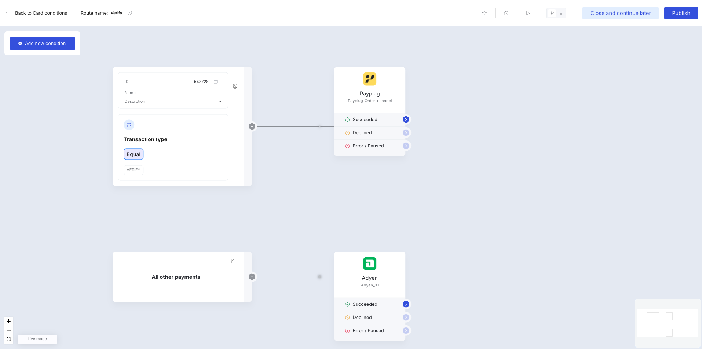

A Yuno permite que você verifique se o cartão de crédito do cliente é real e está funcionando. A nossa API de verificação de cartão de crédito foi criada para oferecer às suas aplicações um mecanismo robusto de validação de transações com cartão de crédito, garantindo uma experiência de pagamento fluida e segura para os seus usuários. Essa operação não gera nenhuma cobrança para o seu cliente.

## Vantagens {#advantages}

Com o serviço de verificação de cartão da Yuno, você pode proteger o seu negócio em tempo real:

* **Verificação em tempo real**: valide instantaneamente os dados do cartão de crédito para garantir a precisão e a autenticidade.
* **Prevenção de fraude**: reduza o risco de transações fraudulentas verificando a legitimidade das informações do cartão de crédito.
* **Integração simples**: integre facilmente a nossa API ao seu sistema de processamento de pagamentos atual, reduzindo o tempo e o esforço de desenvolvimento.

## Integração {#integration}

Primeiro, você precisa definir uma rota para usar o recurso de verificação de cartão. Ao configurar a rota, não deixe de selecionar:

* **Card** como meio de pagamento.
* Defina o **Transaction type** como **Equal** a **VERIFY**.

Com as configurações acima, todas as verificações de cartão serão processadas de acordo com a configuração da rota criada.

<Frame></Frame>

<Note>
**Selecione o provedor correto**

* O processo de verificação de cartão de crédito não é oferecido por todos os provedores. Sempre entre em contato com o seu gerente técnico de conta para verificar quais provedores oferecem suporte à verificação de cartão.
* A Yuno usa uma autorização de valor zero para as validações de cartão. Se o provedor não oferecer suporte a esse fluxo, internamente nós vamos:
  * Autorizar o menor valor possível e depois cancelar a autorização, no caso de cartões de crédito.
  * Fazer uma compra do menor valor possível e depois reembolsá-la, no caso de cartões de débito.
</Note>

Além de criar a rota, você precisa escolher quando usar a validação. Você pode verificar os cartões durante o [processo de cadastro](/reference/payment-methods-checkout/enroll-payment-method-checkout) ou ao fazer um [pagamento com cartão](/reference/payments/create-payment) de crédito. Dependendo do processo escolhido, você deve usar endpoints ou funções do SDK diferentes.

### Verifique o cartão no cadastro {#verify-the-card-at-the-enrollment}

Você pode verificar o cartão no cadastro tanto na integração Direct quanto na integração via SDK.

#### Integração via SDK {#sdk-integration}

Se você usa uma integração baseada em SDKs, precisa definir o objeto `verify`, informando a `currency` e `vault_on_success = true` ao fazer o cadastro. O bloco de código abaixo apresenta um exemplo de requisições e respostas de verificação de cartão usando o SDK.

```json Request
{
  "payment_method_type": "CARD",
	"country":"DE",
	"account_id":"493e9374-510a-4201-9e09-de669d75f256",
    "verify": {
        "vault_on_success": true,
        "currency": "EUR"
    }
}

```

```json Response
{
    "id": "fbc68364-0456-41b6-9743-1acb07d55f14",
    "idempotency_key": null,
    "account_id": "493e9374-510a-4201-9e09-de669d75f256",
    "name": "Card",
    "description": "Card",
    "type": "CARD",
    "category": "CARD",
    "country": "BR",
    "status": "READY_TO_ENROLL",
    "created_at": "2024-01-31T14:44:33.552281Z",
    "updated_at": "2024-01-31T14:44:33.552283Z",
    "enrollment": {
        "session": "232b123d-c4d9-4ddc-b776-e0b0eaa6bb8b",
        "sdk_required_action": true
    },
    "provider": {
        "id": "YUNO",
        "type": "YUNO",
        "provider_status": null
    },
    "customer_payer": {
        "first_name": "Fernando",
        "last_name": "Iglesias",
        "email": "Anastasia.Kirlin16@yahoo.com",
        "gender": null,
        "date_of_birth": null,
        "document": null,
        "phone": null,
        "billing_address": null
    },
    "verify": {
        "vault_on_success": true,
        "currency": "BRL",
        "payment": null
    },
    "preferred": null
}
```

Acesse a página [Integração via SDK](/reference/payment-methods-checkout/enroll-payment-method-checkout) para mais informações sobre o processo de cadastro.

#### Integração Direct {#direct-integration}

Para verificar o cartão no cadastro com a integração Direct, você vai usar o endpoint [Cadastrar meio de pagamento](/reference/payment-methods-direct-workflow/enroll-payment-method-api). Além do objeto `card_data`, você precisa fornecer o objeto `verify`. Dentro do objeto `verify`, você define a `currency` e informa  `vault_on_success = true`. O bloco de código abaixo apresenta um exemplo de requisições e respostas de verificação de cartão usando o [Cadastrar meio de pagamento](/reference/payment-methods-direct-workflow/enroll-payment-method-api).

```json Request
{
    "account_id": "493e9374-510a-4201-9e09-de669d75f256",
    "country": "DE",
    "type": "CARD",
    "workflow": "DIRECT",
    "card_data": {
        "holder_name": "John Smith",
        "expiration_month": 10,
        "expiration_year": 24,
        "number": "4988080000000000",
        "security_code": "123"
    },
    "verify": {
        "vault_on_success": true,
        "currency": "EUR"
    }
}
```

```json Response
{
    "name": "VISA ****0000",
    "description": "VISA ****0000",
    "type": "CARD",
    "category": "CARD",
    "country": "BR",
    "status": "ENROLLED",
    "sub_status": null,
    "vaulted_token": "5d4d8b95-c6f8-4336-b051-9eb06a436139",
    "callback_url": null,
    "action": "FORM",
    "redirect_url": null,
    "created_at": "2024-01-31T14:47:39.643700Z",
    "updated_at": "2024-01-31T14:47:39.643701Z",
    "card_data": {
        "iin": "49880800",
        "lfd": "0000",
        "expiration_month": 10,
        "expiration_year": 24,
        "number_length": 16,
        "security_code_length": 3,
        "brand": "VISA",
        "issuer": null,
        "issuer_code": null,
        "category": "BUSINESS ENHANCED",
        "type": "DEBIT"
    },
    "last_successfully_used": null,
    "last_successfully_used_at": null,
    "preferred": null,
    "verify": {
        "vault_on_success": true,
        "currency": "BRL",
        "payment": {
            "id": "0aacd66c-6933-4827-813f-8d76637f874d",
            "account_id": "493e9374-510a-4201-9e09-de669d75f256",
            "description": "VERIFY CARD",
            "country": "BR",
            "status": "SUCCEEDED",
            "sub_status": "VERIFIED",
            "merchant_order_id": "VERIFY_CARD_5d4d8b95-c6f8-4336-b051-9eb06a436139",
            "created_at": "2024-01-31T14:47:39.717571Z",
            "updated_at": "2024-01-31T14:47:41.617945Z",
            "amount": {
                "currency": "BRL",
                "value": 0,
                "refunded": 0,
                "captured": 0
            },
            "transactions": [
                {
                    "id": "ead4ed19-5998-4b40-9910-d2dfe25b9fe0",
                    "type": "VERIFY",
                    "status": "SUCCEEDED",
                    "response_code": "SUCCEEDED",
                    "response_message": "Transaction successful",
                    "category": "CARD",
                    "merchant_reference": "VERIFY_CARD_5d4d8b95-c6f8-4336-b051-9eb06a436139",
                    "provider_data": {
                        "id": "CIELO",
                        "transaction_id": "",
                        "account_id": "",
                        "status": "true",
                        "sub_status": "",
                        "status_detail": "",
                        "response_message": "Transacao autorizada",
                        "response_code": null,
                        "raw_response": {
                            "ReturnCode": "00",
                            "ReturnMessage": "Transacao autorizada",
                            "Valid": true
                        },
                        "third_party_transaction_id": null,
                        "third_party_account_id": null
                    },
                    "created_at": "2024-01-31T14:47:39.827470Z",
                    "updated_at": "2024-01-31T14:47:41.567732Z"
                }
            ]
        }
    }
}
```

<Note>
**Disponibilidade do recurso de verificação**

O recurso de verificação no cadastro está disponível apenas para lojistas em conformidade com o PCI ao usar a integração Direct.
</Note>

### Verifique o cartão no pagamento {#verify-the-card-at-the-payment}

Se você quiser verificar o cartão usando uma operação de pagamento, precisa cumprir dois requisitos:

* Informar `amount.value=0`.
* Adicionar `verify = true` dentro do objeto `payment_method.detail.card.`.

Seguindo as instruções acima, a operação resultante não vai gerar nenhuma cobrança para o seu cliente.

#### Integração via SDK {#sdk-integration-1}

O bloco de código abaixo apresenta um exemplo de verificação de cartão usando a operação de pagamento em uma integração via SDK.

```json Request
{
    "description": "Test Cards",
    "account_id": "493e9374-510a-4201-9e09-de669d75f256",
    "merchant_order_id": "0000022",
    "merchant_reference": "Test Payment",
    "country": "DE",
    "amount": {
        "currency": "EUR",
        "value": 0
    },
    "checkout": {
        "session": "5752d02a-64d2-4953-b8f7-defff1e1b7e6"
    },
    "customer_payer": {
        "id": "9d58f32a-1ec9-4092-94b2-6725363ab447"
    },
    "payment_method": {
        "token": "2c37e3b7-8b06-4e8b-a212-334d7c77e349",
        "detail": {
            "card": {
                "verify":true
            }
        }
    }
}
```

```json Response
{
    "id": "47646d8b-1f99-4097-9df2-3097bf318bb9",
    "account_id": "493e9374-510a-4201-9e09-de669d75f256",
    "description": "Test Cards",
    "country": "BR",
    "status": "SUCCEEDED",
    "sub_status": "VERIFIED",
    "merchant_order_id": "0000022",
    "created_at": "2024-01-31T15:19:03.599525Z",
    "updated_at": "2024-01-31T15:19:06.992590Z",
    "amount": {
        "captured": 0,
        "currency": "BRL",
        "refunded": 0,
        "value": 0
    },
    "checkout": {
        "session": "5752d02a-64d2-4953-b8f7-defff1e1b7e6",
        "sdk_action_required": false
    },
    "payment_method": {
        "vaulted_token": "1f275d9f-a60a-4643-a5b0-ae6e40019fd1",
        "type": "CARD",
        "vault_on_success": true,
        "token": "2c37e3b7-8b06-4e8b-a212-334d7c77e349",
        "payment_method_detail": {
            "card": {
                "verify": true,
                "capture": true,
                "installments": 1,
                "installments_plan_id": null,
                "installments_total_amount": null,
                "first_installment_deferral": 0,
                "installments_type": "MERCHANT",
                "installment_amount": null,
                "soft_descriptor": "",
                "authorization_code": "",
                "retrieval_reference_number": "",
                "acquirer_reference_number": "",
                "voucher": null,
                "card_data": {
                    "holder_name": "Pepito Perez2",
                    "iin": "49880800",
                    "lfd": "0000",
                    "number_length": 16,
                    "security_code_length": 3,
                    "brand": "VISA",
                    "issuer_name": "DEUTSCHE BANK AG INDIA",
                    "issuer_code": null,
                    "category": "BUSINESS ENHANCED",
                    "type": "DEBIT",
                    "three_d_secure": {
                        "version": null,
                        "electronic_commerce_indicator": null,
                        "cryptogram": null,
                        "transaction_id": null,
                        "directory_server_transaction_id": null,
                        "pares_status": null,
                        "acs_id": null
                    }
                }
            }
        }
    },
    "customer_payer": {
        "id": "9d58f32a-1ec9-4092-94b2-6725363ab447",
        "merchant_customer_id": "1706712254",
        "first_name": "Fernando",
        "last_name": "Iglesias",
        "gender": "",
        "date_of_birth": null,
        "email": "Anastasia.Kirlin16@yahoo.com",
        "nationality": null,
        "ip_address": "181.117.11.229",
        "device_fingerprint": null,
        "browser_info": {
            "user_agent": "",
            "accept_header": "",
            "accept_content": null,
            "accept_browser": null,
            "color_depth": "",
            "screen_height": "",
            "screen_width": "",
            "javascript_enabled": null,
            "java_enabled": null,
            "browser_time_difference": null,
            "language": ""
        },
        "document": {
            "document_type": "DNI",
            "document_number": "38799992"
        },
        "phone": null,
        "billing_address": null,
        "shipping_address": null
    },
    "additional_data": null,
    "taxes": null,
    "transactions": {
        "id": "9be01510-afab-450a-86cc-916d0d4cd8a5",
        "type": "VERIFY",
        "status": "SUCCEEDED",
        "category": "CARD",
        "amount": 0,
        "provider_id": "CIELO",
        "payment_method": {
            "vaulted_token": "1f275d9f-a60a-4643-a5b0-ae6e40019fd1",
            "type": "CARD",
            "vault_on_success": true,
            "token": "2c37e3b7-8b06-4e8b-a212-334d7c77e349",
            "detail": {
                "card": {
                    "verify": true,
                    "capture": true,
                    "installments": 1,
                    "installments_plan_id": null,
                    "installments_total_amount": null,
                    "first_installment_deferral": 0,
                    "installments_type": "MERCHANT",
                    "installment_amount": null,
                    "soft_descriptor": "",
                    "authorization_code": "",
                    "retrieval_reference_number": "",
                    "acquirer_reference_number": "",
                    "voucher": null,
                    "card_data": {
                        "holder_name": "Pepito Perez2",
                        "iin": "49880800",
                        "lfd": "0000",
                        "number_length": 16,
                        "security_code_length": 3,
                        "brand": "VISA",
                        "issuer_name": "DEUTSCHE BANK AG INDIA",
                        "issuer_code": null,
                        "category": "BUSINESS ENHANCED",
                        "type": "DEBIT",
                        "three_d_secure": {
                            "version": null,
                            "electronic_commerce_indicator": null,
                            "cryptogram": null,
                            "transaction_id": null,
                            "directory_server_transaction_id": null,
                            "pares_status": null,
                            "acs_id": null
                        }
                    }
                }
            }
        },
        "response_code": "SUCCEEDED",
        "response_message": "Transaction successful",
        "reason": null,
        "description": "Test Cards",
        "merchant_reference": "Pago de test 001",
        "provider_data": {
            "id": "CIELO",
            "transaction_id": "",
            "account_id": "",
            "status": "true",
            "sub_status": "",
            "status_detail": "",
            "response_message": "Transacao autorizada",
            "response_code": "SUCCEEDED",
            "raw_response": {
                "ReturnCode": "00",
                "ReturnMessage": "Transacao autorizada",
                "Valid": true
            },
            "third_party_transaction_id": "",
            "third_party_account_id": ""
        },
        "created_at": "2024-01-31T15:19:03.704095Z",
        "updated_at": "2024-01-31T15:19:06.639476Z"
    },
    "split": [],
    "callback_url": "https://google.com/?checkoutSession=5752d02a-64d2-4953-b8f7-defff1e1b7e6",
    "workflow": "SDK_CHECKOUT",
    "metadata": [],
    "fraud_screening": null,
    "payment_link_id": "",
    "subscription_code": null
}
```

#### Integração Direct {#direct-integration-1}

O bloco de código abaixo apresenta um exemplo de verificação de cartão usando a operação de pagamento em uma integração Direct.

```json Request
{
    "description": "SUCCESSFUL",
    "account_id": "{{account-code}}",
    "merchant_order_id": "0000023",
    "country": "DE",
    "merchant_reference" : "reference-{{$randomUUID}}",
    "amount": {
        "currency": "EUR",
        "value": 0
    },
    "customer_payer": {
        "first_name": "John",
        "last_name": "Smith",
        "merchant_customer_id": "example00234"
    },
    "workflow": "DIRECT",
    "payment_method": {
        "type": "CARD",
        "detail": {
            "card": {
                "capture": true,
                "verify":true,
                "card_data": {
                    "number": "4988080000000000",
                    "holder_name": "JOHN SMITH",
                    "expiration_month": 10,
                    "expiration_year": 24,
                    "security_code": "456"
                }
            }
        }
    }
}
```

```json Response
{
    "id": "bcb42b81-c729-48cb-b782-1a0b6b706b31",
    "account_id": "493e9374-510a-4201-9e09-de669d75f256",
    "description": "SUCCESSFUL",
    "country": "CO",
    "status": "SUCCEEDED",
    "sub_status": "VERIFIED",
    "merchant_order_id": "0000023",
    "created_at": "2024-01-31T15:07:04.513703Z",
    "updated_at": "2024-01-31T15:07:06.573556Z",
    "amount": {
        "captured": 0,
        "currency": "COP",
        "refunded": 0,
        "value": 0
    },
    "checkout": {
        "session": "",
        "sdk_action_required": false
    },
    "payment_method": {
        "vaulted_token": "",
        "type": "CARD",
        "vault_on_success": false,
        "token": "",
        "payment_method_detail": {
            "card": {
                "verify": true,
                "capture": true,
                "installments": 1,
                "installments_plan_id": null,
                "installments_total_amount": null,
                "first_installment_deferral": 0,
                "installments_type": "MERCHANT",
                "installment_amount": null,
                "soft_descriptor": "",
                "authorization_code": "",
                "retrieval_reference_number": "",
                "acquirer_reference_number": "",
                "voucher": null,
                "card_data": {
                    "holder_name": "JOHN DOE",
                    "iin": "49880800",
                    "lfd": "0000",
                    "number_length": 16,
                    "security_code_length": 3,
                    "brand": "VISA",
                    "issuer_name": "DEUTSCHE BANK AG INDIA",
                    "issuer_code": null,
                    "category": "BUSINESS ENHANCED",
                    "type": "DEBIT",
                    "three_d_secure": {
                        "version": null,
                        "electronic_commerce_indicator": null,
                        "cryptogram": null,
                        "transaction_id": null,
                        "directory_server_transaction_id": null,
                        "pares_status": null,
                        "acs_id": null
                    }
                }
            }
        }
    },
    "customer_payer": {
        "id": null,
        "merchant_customer_id": "example00234",
        "first_name": "Pepito",
        "last_name": "Perez",
        "gender": null,
        "date_of_birth": null,
        "email": null,
        "nationality": null,
        "ip_address": null,
        "device_fingerprint": null,
        "browser_info": {
            "user_agent": "",
            "accept_header": "",
            "accept_content": null,
            "accept_browser": null,
            "color_depth": "",
            "screen_height": "",
            "screen_width": "",
            "javascript_enabled": null,
            "java_enabled": null,
            "browser_time_difference": null,
            "language": ""
        },
        "document": {
            "document_type": "CC",
            "document_number": "38799999"
        },
        "phone": null,
        "billing_address": null,
        "shipping_address": null
    },
    "additional_data": null,
    "taxes": null,
    "transactions": {
        "id": "f0da4c61-0c39-493b-a274-16d204fefad9",
        "type": "VERIFY",
        "status": "SUCCEEDED",
        "category": "CARD",
        "amount": 0,
        "provider_id": "CIELO",
        "payment_method": {
            "vaulted_token": "",
            "type": "CARD",
            "vault_on_success": false,
            "token": "",
            "detail": {
                "card": {
                    "verify": true,
                    "capture": true,
                    "installments": 1,
                    "installments_plan_id": null,
                    "installments_total_amount": null,
                    "first_installment_deferral": 0,
                    "installments_type": "MERCHANT",
                    "installment_amount": null,
                    "soft_descriptor": "",
                    "authorization_code": "",
                    "retrieval_reference_number": "",
                    "acquirer_reference_number": "",
                    "voucher": null,
                    "card_data": {
                        "holder_name": "JOHN DOE",
                        "iin": "49880800",
                        "lfd": "0000",
                        "number_length": 16,
                        "security_code_length": 3,
                        "brand": "VISA",
                        "issuer_name": "DEUTSCHE BANK AG INDIA",
                        "issuer_code": null,
                        "category": "BUSINESS ENHANCED",
                        "type": "DEBIT",
                        "three_d_secure": {
                            "version": null,
                            "electronic_commerce_indicator": null,
                            "cryptogram": null,
                            "transaction_id": null,
                            "directory_server_transaction_id": null,
                            "pares_status": null,
                            "acs_id": null
                        }
                    }
                }
            }
        },
        "response_code": "SUCCEEDED",
        "response_message": "Transaction successful",
        "reason": null,
        "description": "SUCCESSFUL",
        "merchant_reference": "reference-d3286de8-0c0b-4681-b29c-0a82a67de8ba",
        "provider_data": {
            "id": "CIELO",
            "transaction_id": "",
            "account_id": "",
            "status": "true",
            "sub_status": "",
            "status_detail": "",
            "response_message": "Transacao autorizada",
            "response_code": "SUCCEEDED",
            "raw_response": {
                "ReturnCode": "00",
                "ReturnMessage": "Transacao autorizada",
                "Valid": true
            },
            "third_party_transaction_id": "",
            "third_party_account_id": ""
        },
        "created_at": "2024-01-31T15:07:04.628781Z",
        "updated_at": "2024-01-31T15:07:06.512878Z"
    },
    "split": [],
    "workflow": "DIRECT",
    "metadata": [],
    "fraud_screening": null,
    "payment_link_id": "",
    "subscription_code": null
}
```

<Warning>
**Importante**

O recurso de verificação no pagamento está disponível apenas para lojistas em conformidade com o PCI ao usar a integração Direct.
</Warning>