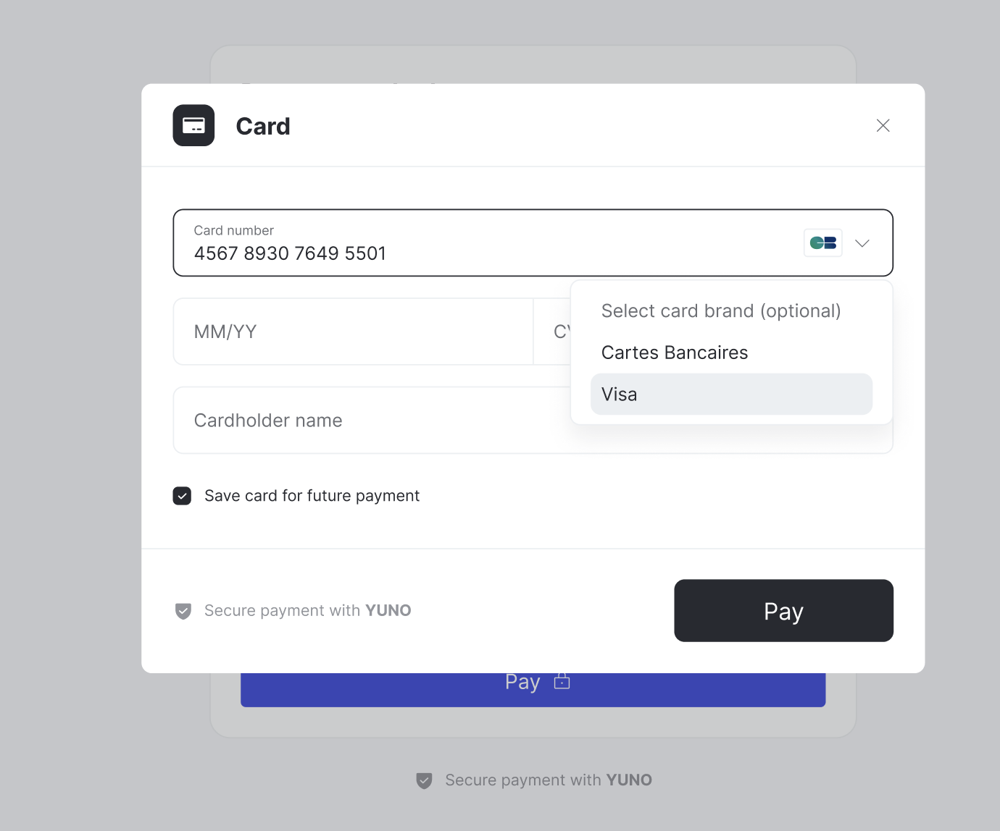

Cartões co-badged são cartões de pagamento que aceitam várias bandeiras de pagamento (por exemplo, um cartão que aceita tanto Cartes Bancaires quanto Visa). Para cumprir o [Artigo 8 do Regulamento IFR da UE 2015/751](https://eur-lex.europa.eu/eli/reg/2015/751/oj), os lojistas devem permitir que os clientes escolham qual bandeira usar ao processar pagamentos com cartões co-badged.

## O que são cartões co-badged? {#what-are-co-badged-cards}

Cartões co-badged são cartões de pagamento que trazem os logotipos de várias bandeiras e podem ser processados por diferentes bandeiras de pagamento. Exemplos comuns:

* Cartões que aceitam tanto uma bandeira nacional (por exemplo, Cartes Bancaires na França) quanto uma bandeira internacional (por exemplo, Visa ou Mastercard)
* Cartões que aceitam várias bandeiras internacionais

Quando um lojista aceita pagamentos por várias bandeiras suportadas pelo mesmo cartão, as regulamentações da UE exigem que os clientes possam escolher qual bandeira usar.

## Quando a conformidade é obrigatória? {#when-is-compliance-required}

A conformidade com o Artigo 8 do Regulamento IFR da UE 2015/751 é obrigatória quando:

* Um lojista aceita bandeiras nacionais e internacionais (por exemplo, Cartes Bancaires e Visa)
* O cartão do cliente suporta várias bandeiras que o lojista aceita
* A transação é processada dentro do Espaço Econômico Europeu (EEE)

Se um lojista aceita apenas uma bandeira, ou se o cartão do cliente suporta apenas uma bandeira que o lojista aceita, a seleção de bandeira não é necessária. O regulamento se aplica a transações processadas dentro do EEE; transações fora do EEE não estão sujeitas a esse requisito.

## Artigo 8 do Regulamento IFR da UE 2015/751 {#eu-ifr-regulation-2015751-article-8}

O [Regulamento (UE) 2015/751](https://eur-lex.europa.eu/eli/reg/2015/751/oj), também conhecido como Interchange Fee Regulation (IFR), é um regulamento da União Europeia sobre as taxas de intercâmbio em transações de pagamento baseadas em cartão. O Artigo 8 trata especificamente de cartões co-badged e exige que os lojistas no EEE permitam que os clientes escolham a bandeira de cartão de sua preferência ao usar cartões co-badged.

### Principais requisitos {#key-requirements}

O Artigo 8 exige que, quando um lojista aceita bandeiras nacionais e internacionais (por exemplo, Cartes Bancaires e Visa), ele exiba aos consumidores do EEE uma opção que permita selecionar qual bandeira usar. Se um lojista aceita apenas uma das bandeiras suportadas pelo cartão, a seleção de bandeira não é necessária.

### Escopo e cronograma do regulamento {#regulation-scope-and-timeline}

O Regulamento (UE) 2015/751 se aplica a todos os Estados-Membros da União Europeia e do Espaço Econômico Europeu (EEE). O regulamento entrou em vigor em 8 de junho de 2015, e o Artigo 8 e as disposições relacionadas se aplicam a partir de 9 de junho de 2016.

## Solução da Yuno {#yuno-solution}

A Yuno simplifica a conformidade de cartões co-badged oferecendo suporte integrado nos nossos SDKs, para que os lojistas cumpram os requisitos regulatórios sem desenvolvimento extra.

<Check>
**Conformidade automática**

Ao usar os Yuno SDKs, os lojistas ficam em conformidade com as regulamentações de cartões co-badged desde o início. O SDK cuida automaticamente da detecção e da seleção de bandeira; veja [Como funciona](#how-it-works) abaixo para saber o que é automatizado.
</Check>

### Versões de SDK compatíveis {#supported-sdk-versions}

A conformidade de cartões co-badged é compatível com versões específicas de cada Yuno SDK:

* **Web SDK**: versão 1.1.0 e posteriores
* **iOS SDK**: versão 2.0.0 e posteriores
* **Android SDK**: versão 2.0.0 e posteriores
* **React Native SDK**: versão 1.0.16 e posteriores

### Como funciona {#how-it-works}

O SDK cuida da conformidade automaticamente, sem nenhuma configuração. A conformidade é habilitada por padrão assim que um lojista aceita as duas bandeiras de um cartão co-badged.

O SDK automaticamente:

* Detecta quais bandeiras são suportadas pelo cartão do cliente com base no IIN do cartão (Issuer Identification Number)
* Exibe opções de seleção de bandeira aos clientes quando há várias bandeiras disponíveis
* Trata automaticamente a frase exigida pela Mastercard "Select card brand (optional)"
* Armazena a bandeira selecionada para uso em pagamentos recorrentes

Quando um cartão co-badged é detectado, o SDK apresenta automaticamente opções de seleção de bandeira ao cliente. A interface não é personalizável e é exibida de forma consistente em todas as plataformas (Web, iOS, Android, React Native).

<Frame></Frame>

### Pagamentos recorrentes {#recurring-payments}

Quando um cliente seleciona uma bandeira no primeiro pagamento, o SDK armazena essa preferência automaticamente. Em todos os pagamentos recorrentes seguintes com o mesmo cartão, o SDK usa automaticamente a bandeira selecionada inicialmente, garantindo a conformidade com o requisito do regulamento de que todas as compras seguintes sejam processadas pela mesma bandeira.

O SDK rastreia e usa a bandeira selecionada automaticamente, sem envolvimento do lojista.

## Integração direta {#direct-integration}

Nas integrações diretas via API, os próprios lojistas precisam cuidar da conformidade de cartões co-badged. Veja abaixo as etapas necessárias.

<Info>
**Implementação manual necessária**

Para lojistas que usam integrações diretas via API (sem SDKs), são necessárias etapas adicionais para garantir a conformidade com as regulamentações de cartões co-badged. Os lojistas devem implementar por conta própria a detecção de bandeira, a interface de seleção e o armazenamento da bandeira.
</Info>

### Requisitos para o lojista {#merchant-requirements}

Os lojistas que usam integrações diretas via API devem implementar as medidas de conformidade por conta própria. Para estar em conformidade com o Artigo 8 do Regulamento IFR da UE 2015/751, os lojistas que usam integrações diretas devem:

1. Detectar quais bandeiras são suportadas pelo cartão do cliente
2. Apresentar opções de seleção de bandeira aos clientes quando há várias bandeiras disponíveis
3. Incluir a bandeira selecionada nas requisições de pagamento
4. Armazenar a bandeira selecionada para pagamentos recorrentes
5. Exibir a frase exigida pela Mastercard "Select card brand (optional)" quando aplicável

### Detecção do IIN do cartão {#card-iin-detection}

A Yuno oferece métodos para detectar quais bandeiras são suportadas por um cartão com base no IIN do cartão (Issuer Identification Number). O IIN do cartão corresponde aos primeiros 6 a 8 dígitos do número do cartão e identifica o emissor do cartão e as bandeiras suportadas.

### Requisitos da API {#api-requirements}

Para processar pagamentos com a bandeira selecionada, os lojistas devem incluir a seleção de bandeira nas suas requisições à API de pagamentos. Ao criar um pagamento, os lojistas devem incluir a bandeira selecionada na requisição de pagamento. Os seguintes parâmetros são usados:

```json
{
  "payment_method": {
    "detail": {
      "card": {
        "network": "selected_network_here"
      }
    }
  }
}
```

### Implementação da interface de seleção de bandeira {#network-selection-ui-implementation}

Os lojistas devem implementar a sua própria interface de seleção de bandeira. A interface deve exibir todas as bandeiras disponíveis para o cartão do cliente, permitir que os clientes selecionem a bandeira de sua preferência e exibir a frase exigida pela Mastercard "Select card brand (optional)" quando aplicável. Essa frase deve estar claramente visível e ser exibida antes ou ao lado das opções de seleção de bandeira.

A interface de seleção de bandeira mostrada na seção do SDK acima serve de referência para a forma como a seleção de bandeira deve ser apresentada aos clientes.

### Pagamentos recorrentes (integração direta) {#recurring-payments-direct-integration}

Nos pagamentos recorrentes, os lojistas devem garantir que a bandeira selecionada inicialmente seja usada em todos os pagamentos seguintes com o mesmo cartão. Isso exige:

1. Armazenar a bandeira selecionada quando o meio de pagamento é usado pela primeira vez
2. Incluir a bandeira armazenada em todas as requisições de pagamento seguintes desse meio de pagamento
3. Manter essa preferência em todas as transações recorrentes

## Exemplos {#examples}

### Exemplo: seleção de bandeira necessária {#example-network-selection-required}

Um cliente francês usa um cartão co-badged que aceita tanto Cartes Bancaires quanto Visa. O lojista aceita as duas bandeiras. O sistema detecta as duas bandeiras, apresenta uma seleção ao cliente e processa o pagamento pela bandeira selecionada. Nos pagamentos recorrentes futuros, a bandeira selecionada inicialmente é usada automaticamente.

### Exemplo: nenhuma seleção necessária {#example-no-selection-required}

Um lojista aceita apenas Visa, e um cliente usa um cartão co-badged que aceita tanto Cartes Bancaires quanto Visa. Como o lojista aceita apenas Visa, a seleção de bandeira não é necessária e o pagamento é processado pela Visa.

## Resumo {#summary}

* **Integração via SDK**: os lojistas que usam os Yuno SDKs ficam em conformidade desde o início (veja [Como funciona](#how-it-works)).
* **Integração direta**: os lojistas devem implementar a detecção de bandeira, a interface de seleção e o armazenamento da bandeira para pagamentos recorrentes.
* **Requisito regulatório**: o Artigo 8 do Regulamento IFR da UE 2015/751 exige a seleção de bandeira para cartões co-badged no EEE. O regulamento entrou em vigor em 8 de junho de 2015, e o Artigo 8 se aplica a partir de 9 de junho de 2016.
* **Requisito da Mastercard**: a frase "Select card brand (optional)" deve ser exibida quando aplicável.
* **Pagamentos recorrentes**: a bandeira selecionada inicialmente deve ser usada em todos os pagamentos seguintes com o mesmo cartão.