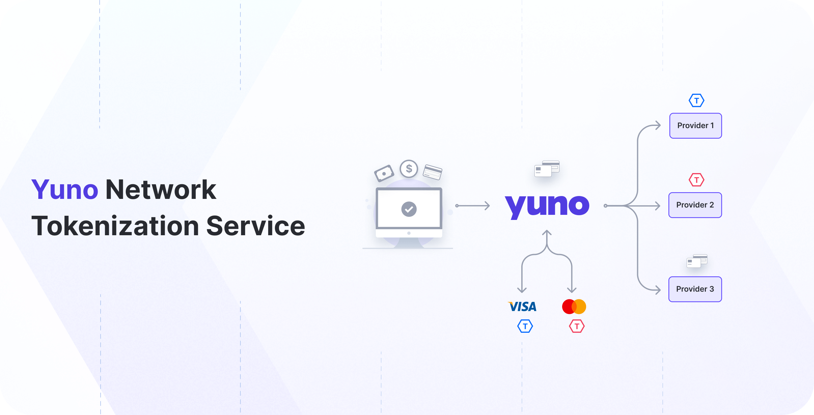
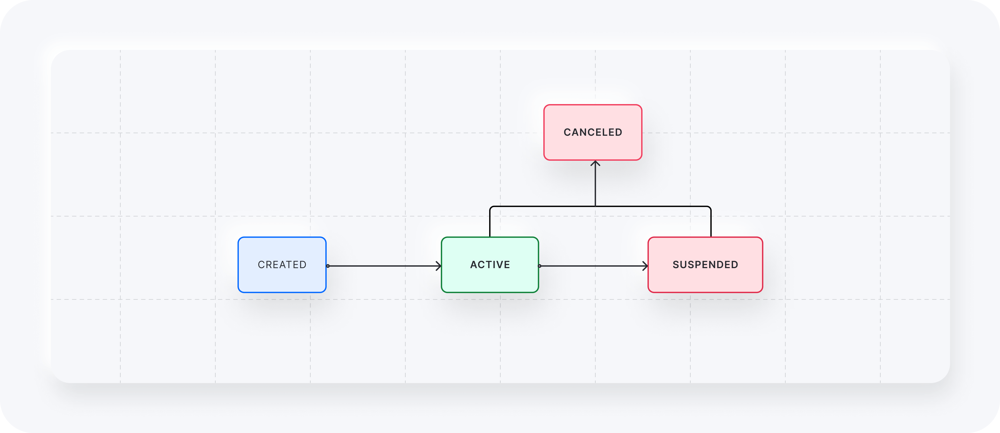

import NetworkTokenRequestFlag from '/snippets/pt-br/network-token-request-flag.mdx';

Os network tokens representam um avanço significativo no setor de processamento de pagamentos, atuando como substitutos digitais de dados sensíveis de cartões de pagamento, incluindo números de cartão de crédito. Emitidos por redes de pagamento como Visa, Mastercard e American Express, esses tokens estão na linha de frente do aumento da segurança das transações no nosso cenário digital em evolução.

<Frame></Frame>

### Benefícios dos network tokens {#benefits-of-network-tokens}

* **Segurança aprimorada**: ao substituir os dados reais do cartão durante as transações, os network tokens têm um papel crucial no reforço das medidas de segurança, reduzindo significativamente o risco de exposição a possíveis fraudes.
* **Integração simples**: com um esforço mínimo de integração, seguindo os padrões de network token da EMVCo, nossa solução garante um processo de implementação simples e eficiente, permitindo uma adaptação rápida a vários cenários de pagamento.
* **Atualizações automáticas**: os network tokens, gerenciados e atualizados automaticamente pelas bandeiras de cartão, contribuem para reduzir o atrito para o comprador e os pagamentos recusados. Essa adaptabilidade inerente garante uma taxa de autorização maior em comparação com transações sem network tokens.
* **Suporte à autenticação**: para mais segurança e taxas de aprovação maiores, você pode combinar os network tokens com a [Network Token Authentication](/pt-br/docs/payment-features/network-token-authentication), permitindo a autenticação do comprador com passkey diretamente pelas bandeiras de cartão.

## Token de uso único vs. token armazenado no vault vs. network token {#one-time-use-token-vs-vaulted-token-vs-network-token}

| Token de uso único                                                                                                                                                                                                                                                                                                                                             | Token armazenado no vault                                                                                                                                                                                           | Network token                                                                                                                                                                                                                                                                                                                                     |
| :------------------------------------------------------------------------------------------------------------------------------------------------------------------------------------------------------------------------------------------------------------------------------------------------------------------------------------------------------------- | :------------------------------------------------------------------------------------------------------------------------------------------------------------------------------------------------------ | :------------------------------------------------------------------------------------------------------------------------------------------------------------------------------------------------------------------------------------------------------------------------------------------------------------------------------------------------ |
| Ao usar o SDK da Yuno, reunimos todas as informações necessárias para processar o pagamento e as armazenamos em um token de uso único, independentemente do meio de pagamento escolhido pelo cliente. Você usará o token ao criar o pagamento. Observe que esse token funciona apenas uma vez. Você precisará gerar um novo token de uso único para cada sessão de checkout criada. | Um token armazenado no vault é criado pela Yuno depois que um meio de pagamento é cadastrado e armazenado com as informações do cliente. Você pode usar o token armazenado no vault criado para identificar o meio de pagamento em pagamentos futuros. | Representações digitalizadas de informações sensíveis de cartões de pagamento, como números de cartão de crédito, emitidas pelas principais redes de pagamento, como Visa, Mastercard ou American Express. Esses tokens servem para substituir os dados reais do cartão nas transações, aumentando a segurança ao minimizar a exposição a possíveis atividades fraudulentas. |

Quando o recurso de network tokens está ativado, a Yuno gera network tokens para todos os cartões cadastrados e armazenados com segurança no nosso vault. Essa abordagem está totalmente alinhada com a forma como a tokenização de rede deve funcionar, conforme definido pela Visa e pela Mastercard após a validação do cartão, garantindo melhor desempenho, segurança e confiabilidade em transações recorrentes e futuras. Cartões não armazenados na Yuno (como cartões de uso único) ficam naturalmente fora desse processo, já que a tokenização de rede não se aplica nesses casos.

<Note>
**Cadastros duplicados**

Se o mesmo cartão for cadastrado várias vezes, cada cadastro cria um `vaulted_token` distinto. Para network tokens, a Yuno usa um `network_token_fingerprint` que funciona como o fingerprint do cartão e tem como escopo a sua organização e o identificador único do network token no vault PCI. Isso significa que cadastros duplicados do mesmo PAN podem corresponder ao mesmo network token. Use o [Card Fingerprint](/pt-br/docs/security-and-compliance/fingerprint) para detectar duplicatas de tokens armazenados no vault do seu lado.
</Note>

## Ciclo de vida dos network tokens {#network-tokens-lifecycle}

Os network tokens podem ter os status descritos na seção abaixo.

<Frame></Frame>

| Status    | Descrição                                                                                                                     |
| --------- | ------------------------------------------------------------------------------------------------------------------------------- |
| Created   | O status inicial de um network token que foi criado.                                                                    |
| Active    | O network token está ativo e pode ser usado para fazer um pagamento.                                                                  |
| Suspended | Os tokens podem ser suspensos se o titular do cartão entrar em contato com o emissor e pedir que os pagamentos de um determinado lojista sejam bloqueados. |
| Canceled  | Os tokens podem ser cancelados por vários motivos, como o encerramento da conta do titular do cartão associada ao token.              |

## Tipos de integração {#types-of-integration}

Para fazer pagamentos com network tokens, você tem duas opções disponíveis:

1. Deixar a Yuno provisionar e coletar os network tokens.
2. Usar os seus network tokens existentes.

### 1. Deixar a Yuno provisionar e coletar os network tokens {#1-let-yuno-provision-and-collect-network-tokens}

Obtemos network tokens das principais bandeiras de cartão, incluindo Visa, Mastercard e American Express. Esses tokens são armazenados com segurança na infraestrutura da Yuno e são usados no lugar dos cartões reais durante o processo de autorização.

Não é necessária nenhuma integração adicional para aproveitar os benefícios da tokenização de rede quando a Yuno gerencia a solicitação e o acúmulo de tokens em seu nome. Basta seguir o fluxo de pagamento padrão correspondente à sua integração específica de pagamento com cartão. A Yuno cuida do processo de forma transparente, substituindo os dados do cartão por um network token, o que resulta em taxas de autorização maiores.

Para ativar pagamentos com network tokens, entre em contato com a nossa equipe de suporte para provisionar ou solicitar as credenciais necessárias.

#### Exemplo de resposta {#response-example}

Durante o cadastro ou a criação do pagamento, você receberá as informações básicas do network token usado na operação correspondente.

```json
{
    "description": "Test",
    "account_id": "{{account-code}}",
    "merchant_order_id": "0000023",
    "country": "DE",
    "merchant_reference" : "reference-{{$randomUUID}}",
    "amount": {
        "currency": "EUR",
        "value": 5000
    },
    "customer_payer": {
        "id":"967ecd18-d898-4b88-9400-dd5b01b18edc"
    },
    "workflow": "DIRECT",
    "payment_method": {
        "type":"CARD",
        "vaulted_token": "61d49d6e-7c0e-49d0-be79-7eb08871f998",
        "detail": {
           "card": {
               "network_token":{
                  "network":"MASTERCARD",
                  "status": "ACTIVE",
                  "par":"V0010014622074319305424002620",
                  "token_data":{
                    "iin":"45079900",
                    "lfd": "0010",
                    "expiration_month":"10",
                    "expiration_year":"2028",
                    "response":{
                      "code":"succeeded",
                      "message": "Transaction Succeeded"
                    }
                  }
              }
           }
        }
    }
  [...]
}
```

#### Escolha por cartão {#choose-per-card}

<NetworkTokenRequestFlag />

O booleano `payment_method.network_token` é uma opção da requisição. Ele é um campo diferente do objeto `payment_method.detail.card.network_token`, que traz os dados do token mostrados no exemplo de resposta acima e os network tokens que você mesmo envia (veja a próxima seção).

```json
{
    "payment_method": {
        "type": "CARD",
        "vaulted_token": "61d49d6e-7c0e-49d0-be79-7eb08871f998",
        "network_token": false
    }
}
```

### 2. Usar os seus network tokens existentes {#2-use-your-existing-network-tokens}

Depois de configurar as credenciais necessárias na sua conta Yuno e entrar em contato com a nossa equipe de suporte, você estará pronto para executar transações tokenizadas sem complicações.

<Danger>
  Com esta opção, a Yuno atua apenas como intermediária (passthrough) das informações do network token. O lojista deve fornecer as informações necessárias sobre os network tokens para que a Yuno possa compartilhá-las com os parceiros de pagamento upstream.
</Danger>

As transações com network token utilizam as requisições de API de transação de pagamento existentes. Assim como na criação de um pagamento com os dados do cartão de crédito, quando um lojista usa a API da Yuno para finalizar um pagamento, ele pode optar por incluir o objeto "network\_token" para usar um network token na transação.

#### Campos da requisição de pagamento {#payment-request-fields}

Junto com o objeto `card_data`, estes campos devem ser adicionados ao objeto `payment_method.detail.card.network_token.token_data` para enviar pagamentos usando a API da Yuno.

| Campo                           | Tipo    | Descrição                                                                                                                                                                                             |
| ------------------------------- | ------- | ------------------------------------------------------------------------------------------------------------------------------------------------------------------------------------------------------- |
| `number`                        | number  | \[Obrigatório] - Número do token sem separadores. (MAX 19; MIN 8) - disponível apenas para lojistas com certificação PCI                                                                                      |
| `holder_name`                   | string  | Nome completo do titular do cartão como aparece no token (MAX 26; MIN 2) - disponível apenas para lojistas com certificação PCI                                                                                          |
| `expiration_month`              | integer | \[Obrigatório] - Mês de expiração do token - MM (MAX 2; MIN 2) - disponível apenas para lojistas com certificação PCI                                                                                                |
| `expiration_year`               | integer | \[Obrigatório] - Ano de expiração do token - YYYY (MAX 4; MIN 4) - disponível apenas para lojistas com certificação PCI                                                                                               |
| `cryptogram`                    | string  | \[Obrigatório] - O criptograma único gerado pelo emissor para o network token usado na transação. Opcional para transações recorrentes                                                       |
| `electronic_commerce_indicator` | string  | \[Obrigatório apenas para alguns provedores] - Se o token foi autenticado pela Mastercard, o campo deve ser definido como 02. Para tokens Visa ou não autenticados, não é necessário enviar o campo. |
| `token_requestor_id`            | string  | \[Obrigatório apenas para alguns provedores] - Token requestor ID do lojista                                                                                                                             |

#### Exemplo de requisição {#request-example}

```json
{
  "description": "Test",
    "account_id": "{{account-code}}",
    "merchant_order_id": "0000023",
    "country": "DE",
    "merchant_reference" : "reference-{{$randomUUID}}",
    "amount": {
        "currency": "EUR",
        "value": 5000
    },
    "customer_payer": {
        "id":"967ecd18-d898-4b88-9400-dd5b01b18edc"
    },
    "workflow": "DIRECT",
    "payment_method": {
        "type":"CARD",
        "detail": {
           "card": {
             "card_data": {
                "number": "4000000000001026",
                "holder_name": "John Doe",
                "expiration_month": 1,
                "expiration_year": 26,
                "security_code": "123"
              },
             "network_token":{
                  "token_data":{
                    "number":"4000000000001026",
                    "holder_name":"Jhohn Doe",
                    "expiration_month":1,
                    "expiration_year":26,
                    "cryptogram":"CCADBxYzRTBBXXXXXXXYZa0AbZD"
                  }
              }
           }
        }
    }
  [...]
}
```

#### Exemplo de resposta {#response-example-1}

```json
{
    "description": "Test",
    "account_id": "{{account-code}}",
    "merchant_order_id": "0000023",
    "country": "DE",
    "merchant_reference" : "reference-{{$randomUUID}}",
    "amount": {
        "currency": "EUR",
        "value": 5000
    },
    "customer_payer": {
        "id":"967ecd18-d898-4b88-9400-dd5b01b18edc"
    },
    "workflow": "DIRECT",
    "payment_method": {
        "type":"CARD",
        "detail": {
           "card": {
              "card_data": {
                        "holder_name": "John Doe",
                        "iin": "48710499",
                        "lfd": "9910",
                        "number_length": 16,
                        "security_code_length": 3,
                        "brand": "VISABANCONTACT",
                        "issuer_name": "BNP PARIBAS FORTIS NVSA",
                        "issuer_code": null,
                        "country_code": "BE",
                        "category": "CLASSIC",
                        "type": "DEBIT",
                        "expiration_month": 3,
                        "expiration_year": 30,
                        "fingerprint": "4d486017-afa0-4f2c-ba51-a09af528bd38"
                        [...]
                    }, 
              "network_token":{
                  "network":"MASTERCARD",
                  "status": "ACTIVE",
                  "par":"V0010014622074319305424002620",
                  "token_data":{
                    "iin":"45079900",
                    "lfd": "0010",
                    "holder_name":"Jhohn Doe",
                    "expiration_month":10,
                    "expiration_year":28,
                    "response":{
                      "code":"succeeded",
                      "message": "Transaction Succeeded"
                    }
                  }
              }
           }
        }
    }
  [...]
}
```