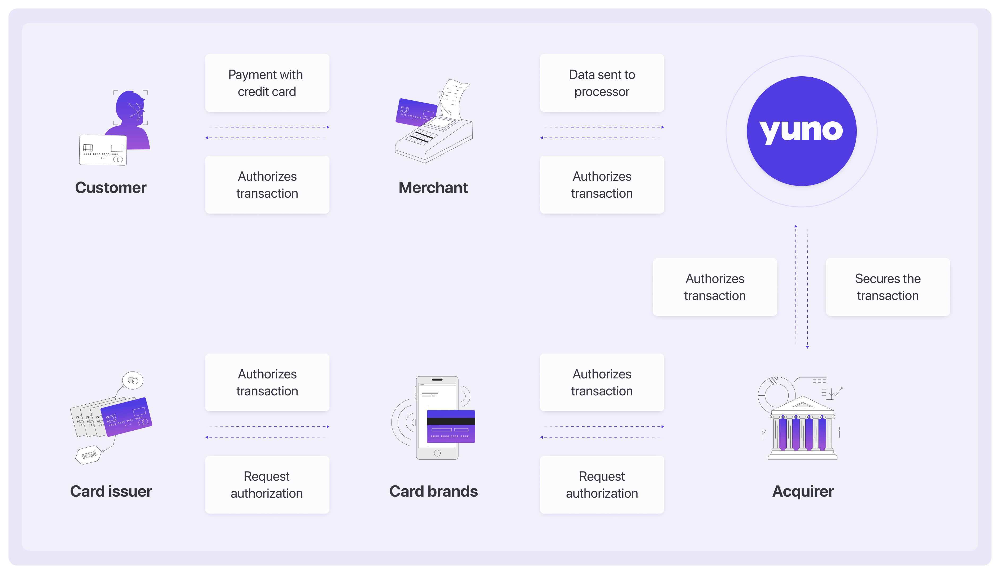
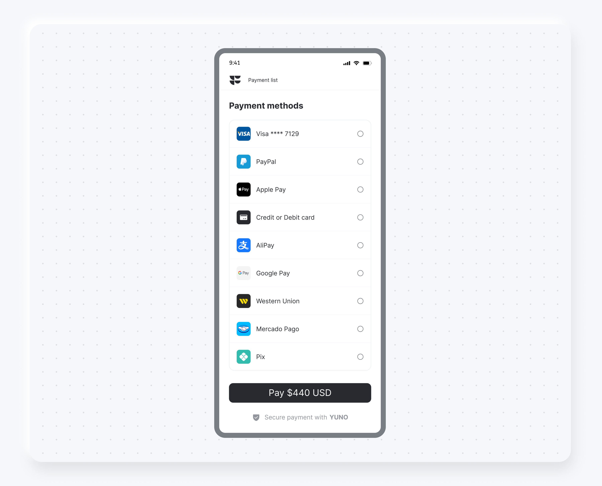

O Payment Card Industry Data Security Standard (PCI DSS) exige que toda empresa que armazena, processa ou transmite dados do titular do cartão atenda a um conjunto definido de controles de segurança. A não conformidade pode resultar em multas das bandeiras de cartão e em maior responsabilidade em caso de vazamento.

Ao integrar com a Yuno, os seus sistemas nunca armazenam nem transmitem dados de cartão em texto puro. A solução PCI DSS Nível 1 da Yuno trata todas as informações sensíveis de pagamento por meio da tokenização, substituindo os dados de cartão por um token não sensível antes que eles cheguem à sua infraestrutura. Isso reduz significativamente o seu escopo PCI e o esforço de validação necessário.

<Frame></Frame>

## Como a Yuno reduz o seu escopo PCI {#how-yuno-reduces-your-pci-scope}

Quando você integra usando os SDKs da Yuno (Full Checkout, Lite Checkout ou Secure Fields), os dados sensíveis de cartão trafegam diretamente entre o navegador ou o app do cliente e o ambiente seguro da Yuno. Os seus servidores recebem apenas tokens.

Isso significa que a maioria dos lojistas que usam o SDK da Yuno se qualifica para o **SAQ A** (a autoavaliação PCI mais curta, composta por apenas 22 perguntas), em vez do SAQ D completo, que tem 329 perguntas e é exigido quando um lojista armazena ou processa dados de cartão diretamente.

<Note>
**Direct Flow**

Se a sua integração usa o [Direct Flow](/pt-br/docs/direct-integration-use-cases/direct-flow), a sua empresa lida diretamente com dados de cartão e precisa fornecer um Attestation of Compliance (AOC) assinado pela sua empresa e por um auditor certificado.
</Note>

## O que a tokenização oferece a você {#what-tokenization-gives-you}

Além da conformidade, a tokenização da Yuno traz benefícios práticos para as suas operações de pagamento:

* **Checkout com um clique**: clientes recorrentes pagam com um único toque usando o vaulted token armazenado
* **Cobrança recorrente e por assinatura**: meios de pagamento tokenizados são reutilizados sem atrito entre os ciclos de cobrança
* **Portabilidade entre processadores**: um único vaulted token funciona em todos os processadores conectados à sua conta da Yuno
* **Menos recusas**: os network tokens são atualizados automaticamente quando os cartões são renovados ou reemitidos

Para um detalhamento completo dos tipos de token e de como eles funcionam, consulte [Tokens](/pt-br/docs/basic-concepts/tokens).

<Frame></Frame>

## Como escolher uma integração via SDK {#choosing-an-sdk-integration}

As integrações via SDK da Yuno estão disponíveis para web (JavaScript) e mobile (iOS, Android, Flutter). Consulte o [guia de SDKs](/docs/sdks/overview/quickstart) para escolher a integração certa para o seu caso de uso.

Para saber mais sobre os requisitos do PCI DSS e os questionários de autoavaliação, consulte o [PCI Security Standards Council](https://www.pcisecuritystandards.org/) e a [PCI Document Library](https://www.pcisecuritystandards.org/document_library/?category=saqs#results).