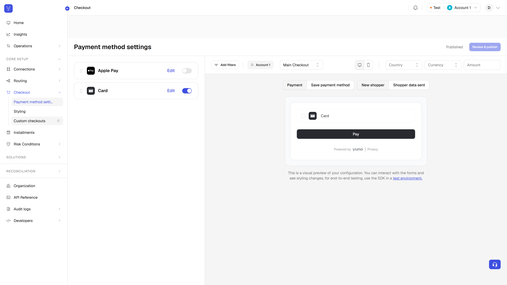
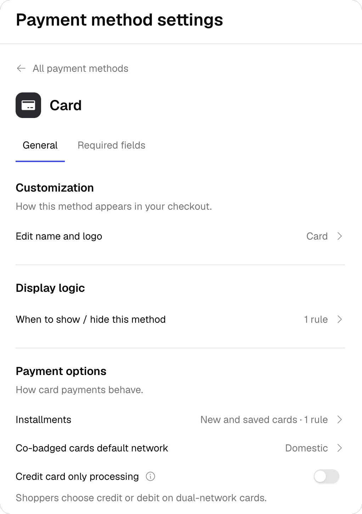
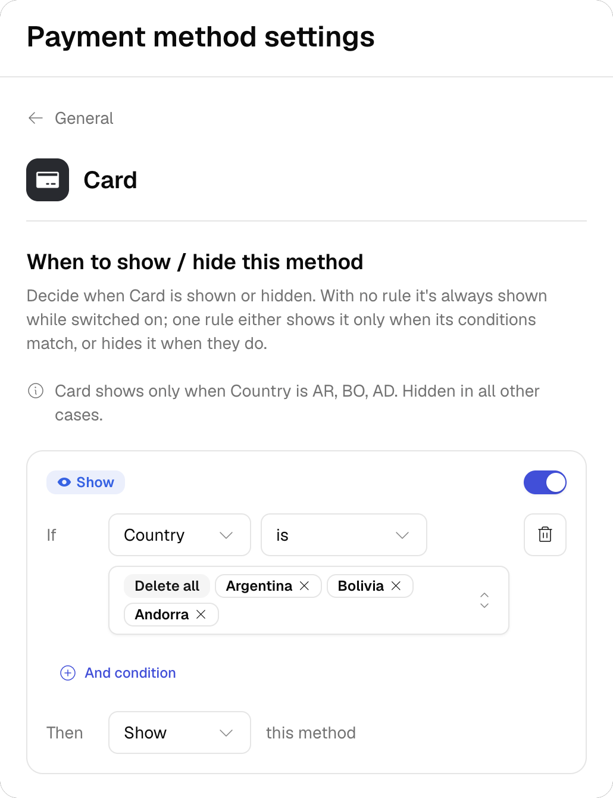
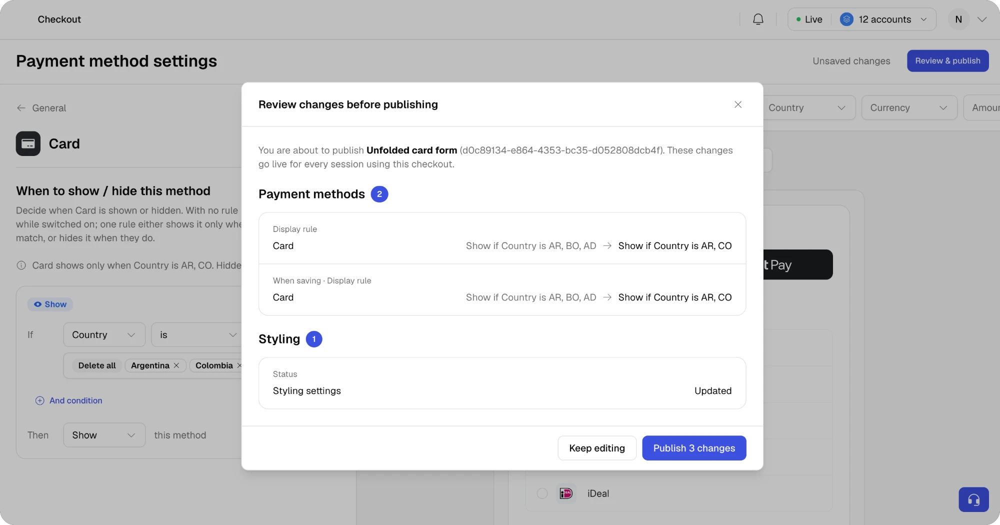
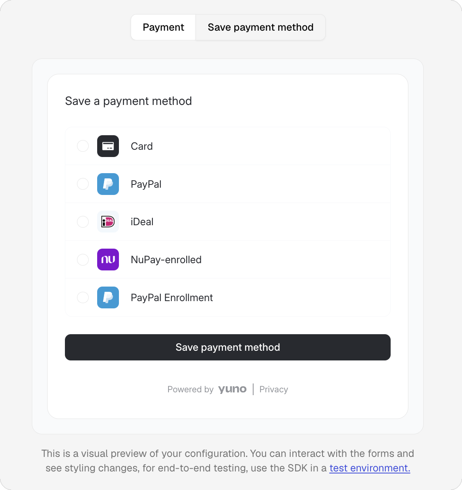

A seção **Payment method settings** do Checkout Builder foi reconstruída. Ela está sendo liberada aos poucos, conta por conta, então durante um tempo as duas versões convivem. Esta página descreve o que muda para você quando a sua conta passa para a nova versão. **Styling settings** continua exatamente como está, e a prévia ao vivo continua funcionando da mesma forma, com uma novidade descrita abaixo.

<Note>
  **Como saber qual versão você tem.** A nova versão mostra uma linha por meio de pagamento com um botão **Edit**, e o botão do cabeçalho diz **Review & publish**. A versão atual mostra duas listas (**Enrolled** e **Non-enrolled payment methods**), um menu de **três pontos (⋯)** em cada linha e um botão **Publish settings**. Se você vê a segunda, nada nesta página se aplica a você ainda: continue usando a página [Checkout Builder](/pt-br/docs/using-yuno/dashboard-overview/checkout-builder).
</Note>

## O que mudou em resumo {#what-changed-at-a-glance}

| Área | Antes | Agora |
| :--- | :--- | :--- |
| Lista de meios de pagamento | Duas listas, **Enrolled** e **Non-enrolled payment methods**. | Uma lista para todos os meios de pagamento. Cartão e os meios de débito direto (ACH, Bacs, PAD, SEPA) são um único item que cobre tanto o fluxo novo quanto o salvo; o fluxo salvo deles é ativado na página do meio. |
| Edição de um meio | Um menu de **três pontos (⋯)** por linha abria um painel diferente para cada configuração: **Edit name and logo**, **Set Conditions**, **Set Required fields**. | **Edit** abre uma página por meio com duas abas, **General** e **Required fields**. |
| Condições de exibição | Conjuntos de condições com nome criados a partir de um pop-up (**Add new condition**), vários conjuntos por meio. | **Display logic** na aba General: uma regra por meio, escrita como uma frase em linguagem simples. |
| Parcelas | Um switch dentro do painel **Required fields**. | **Payment options** na página de Card, com sua própria regra de exibição. |
| Botões express | Definidos pelo SDK e pelo estilo da lista. | Um switch **Render as express button** por carteira. Até três, ordenados pela sua lista. |
| Campos de endereço | Apenas endereço de cobrança, ou cobrança e entrega. | O endereço de entrega também pode ser solicitado sozinho. |
| Tipos de documento | Um painel acessado a partir de cada meio. | Um único modal global **Document types** acessado a partir do campo Document. |
| Copiar para outras contas | No menu de **três pontos (⋯)**. | **Manage [method] on other accounts** na aba General. |
| Publicação | **Publish settings** aplicava todas as alterações pendentes de uma vez. | **Review & publish** lista todas as alterações, antes e depois, e você confirma a partir dali. |
| Prévia | Mostrava apenas o fluxo de pagamento. | Um switch **Payment** / **Save payment method** acima da prévia mostra qualquer um dos fluxos. |

## Uma lista para todos os meios de pagamento {#one-list-for-every-payment-method}

Os meios cadastrados e não cadastrados agora compartilham uma única lista. Cada linha tem um switch de ativação, uma alça para arrastar e um botão **Edit**.

<Frame></Frame>

- **Ordem.** Arraste as linhas para reordenar. A ordem é a que os seus compradores veem, e ela também decide quais carteiras viram botões express quando mais de três estão ativadas.
- **Um item para novo e salvo.** **Card** e os meios de débito direto (**ACH**, **Bacs**, **PAD**, **SEPA**) não têm mais uma linha separada de cadastro. Cada um é um único item que cobre os dois fluxos, e o fluxo salvo é ativado ou desativado na página do meio, com **Show shoppers their saved cards** ou **Show shoppers their saved bank accounts** na aba General. Outros meios que podem ser salvos, como as carteiras, mantêm seu próprio item salvo na lista, como antes.
- **Meios salvos no checkout.** Os meios que um comprador recorrente salvou continuam aparecendo acima do resto da lista, qualquer que seja a ordem no Builder. Isso não mudou.
- **Ativar ou desativar.** O switch em cada linha substitui os switches das duas listas anteriores. Um meio ainda precisa de uma rota publicada para aparecer aqui.

## Uma página por meio {#one-page-per-method}

**Edit** abre a página do meio. A aba **General** reúne todas as configurações que antes ficavam em painéis separados:

<Frame></Frame>

| Seção | O que contém | Exibida para |
| :--- | :--- | :--- |
| **Customization** | **Edit name and logo**, como antes. **Render as express button** para as carteiras que oferecem suporte. | Todos os meios; o switch express apenas para carteiras compatíveis com express. |
| **Display logic** | Quando mostrar ou ocultar este meio. Veja [Lógica de exibição](#display-logic). | Todos os meios. |
| **Payment options** | **Installments** (movido para cá a partir de Required fields), **Co-badged cards default network** (Domestic ou International) e processamento somente crédito para cartões com duas redes. | Card. |
| **Consent management** | O switch **Debit authorization text** documentado em [Texto de autorização](/pt-br/docs/using-yuno/dashboard-overview/checkout-builder#authorization-text). | Meios de débito direto. |
| **Saved cards** / **Saved bank accounts** | **Show shoppers their saved cards** (ou contas bancárias). Compradores recorrentes podem pagar com o que salvaram antes. Se os compradores recebem a opção de salvar durante um pagamento é definido na sua integração com o SDK, não aqui. | Card e os meios de débito direto (ACH, Bacs, PAD, SEPA). |
| **Accounts** | **Manage [method] on other accounts**, o antigo **Copy to other accounts**. | Organizações com mais de uma conta. |

A aba **Required fields** mantém os mesmos campos de antes, com três mudanças:

- Os campos que um provedor torna obrigatórios mostram o logo do provedor ao lado do switch, com um tooltip **Required by …**. Eles não podem ser desativados no Builder.
- Cada campo pode ter sua própria regra de exibição. Abra o campo e clique em **Add condition** para mostrá-lo ou ocultá-lo por país, moeda, valor ou metadata.
- **Document** abre o modal global **Document types**. Ele se aplica a todos os meios de pagamento do checkout, e é a única configuração global nesta versão.

<Note>
  **Card e cartões salvos.** A página de Card tem um segundo bloco, **When this method is saved**, para os campos que os compradores preenchem ao pagar com um cartão salvo. Marque **Apply these settings when shoppers save this method** para reutilizar a configuração principal, ou desmarque para configurar os campos do cartão salvo separadamente. As regras de exibição dos campos obrigatórios de Card se aplicam aos dois fluxos.
</Note>

## Lógica de exibição {#display-logic}

As condições agora são escritas como uma frase: **If** um atributo **is** ou **is not** alguns valores, **Then** **Show** ou **Hide** este meio. O Builder mantém a frase atualizada enquanto você edita, por exemplo *Card shows only when Country is Brazil, Mexico. Hidden in all other cases.*

<Frame></Frame>

- **Atributos:** Country, Currency, Amount e Metadata. Country e Currency aceitam vários valores. Amount aceita maior que, menor que, entre e igual a. Metadata recebe uma chave e um valor, comparados apenas com **is** ou **is not**, e uma regra pode ter várias condições de metadata.
- **Uma regra por meio, e uma por campo obrigatório.** Os atributos dentro de uma regra são combinados com AND.
- **Amount precisa de uma única moeda.** O atributo Amount não é oferecido enquanto duas ou mais moedas estiverem selecionadas na mesma regra.
- **Resultado.** Cada regra é **Show** ou **Hide**. Um meio sem regra é sempre exibido enquanto estiver ativado.

As suas condições existentes são migradas. Valores armazenados como *equal* ou *not equal* aparecem como **is** e **is not**.

<Note>
  As contas que têm **mais de um conjunto de condições ativo no mesmo meio de pagamento** continuam na versão atual por enquanto, com as configurações intactas.

  O mesmo vale para as contas cujas condições comparam **metadata com maior que ou menor que**: a nova versão só oferece **is** e **is not** para metadata, então essas regras não podem ser editadas nela. Elas continuam na versão atual até que as regras sejam reescritas.
</Note>

## Review & publish {#review--publish}

**Publish settings** foi substituído por **Review & publish**. Nada entra no ar até você confirmar a partir da revisão.

1. Enquanto você edita, o cabeçalho mostra **Unsaved changes**. As alterações ficam guardadas no Builder, e o checkout ao vivo não é afetado.
2. Clique em **Review & publish**. O diálogo lista todas as alterações pendentes agrupadas por **Payment methods**, **Method settings**, **Required fields** e **Styling**, com o valor antes e depois. As alterações que se aplicam ao fluxo de cartão salvo são marcadas como **When saving**.
3. Clique em **Publish N changes**. O cabeçalho muda para **Published** com a data de publicação.

<Frame></Frame>

Sair do Builder com alterações não salvas pede uma confirmação, porque as alterações não publicadas são descartadas.

## Prévia: pagamento ou salvar meio de pagamento {#preview-payment-or-save-payment-method}

A prévia ao vivo ganha um switch no topo com duas opções:

- **Payment** mostra o checkout que um comprador vê ao pagar: botões express, meios salvos como um cartão terminado em 1234 e o resto da lista, na ordem que você definiu.
- **Save payment method** mostra o checkout de cadastro, com o título **Save a payment method**: apenas os meios que um comprador pode salvar, com um botão **Save payment method** em vez de **Pay**.

<Frame></Frame>

Use-a para conferir os dois fluxos enquanto você edita um meio, em especial os campos de **When this method is saved** em Card e os switches **Show shoppers their saved cards** e **Show shoppers their saved bank accounts**. Os filtros Country, Currency e Amount, e o formulário interativo, funcionam nos dois.

## Endereço de entrega sozinho {#shipping-address-on-its-own}

A aba **Required fields** permite solicitar **Shipping address** sem **Billing address**. Antes, o endereço de entrega só podia ser coletado junto com o de cobrança. Nesse caso, o Web SDK renderiza o formulário de entrega sozinho.

## Um tour rápido na primeira vez que você abrir {#a-short-tour-the-first-time-you-open-it}

Na primeira vez que você abrir a nova versão, o Builder mostra a lista, uma página de meio, os campos obrigatórios, a prévia e **Review & publish**. O tour usa dados de demonstração: nada é publicado e o seu checkout ao vivo continua como está. Você pode pular o tour já na primeira etapa.

## O que não mudou {#what-did-not-change}

- **Styling settings**, incluindo **Payment method list style** (exibição expandida, meio de pagamento pré-selecionado, visualização condensada do checkout, edição da lista de meios de pagamento e empilhamento dos botões express), **Colors** (incluindo as cores de fundo dos campos e secundárias), **Typography** e **Form styles**.
- **Forms collect data styling tools**, incluindo a personalização do rótulo **Button text**, o toggle **Yuno Pay button** e **Display ‘Powered by Yuno’ tag**. Observe que **Credit card only processing** foi movido para a página do meio Card, em **Payment options**, na interface redesenhada.
- **A prévia ao vivo**, seu formulário interativo e os filtros Country, Currency e Amount, exceto pelo novo switch **Payment** / **Save payment method**. Os botões express seguem os switches que você define por carteira.
- **Checkouts personalizados** e o seletor de checkout acima da prévia.
- **Authorization text** para os meios de débito direto, agora acessado a partir da aba General.
- **A sua integração com o SDK.** A nova seção grava a mesma configuração que o SDK já lê. Nenhuma alteração de código é necessária do seu lado.
