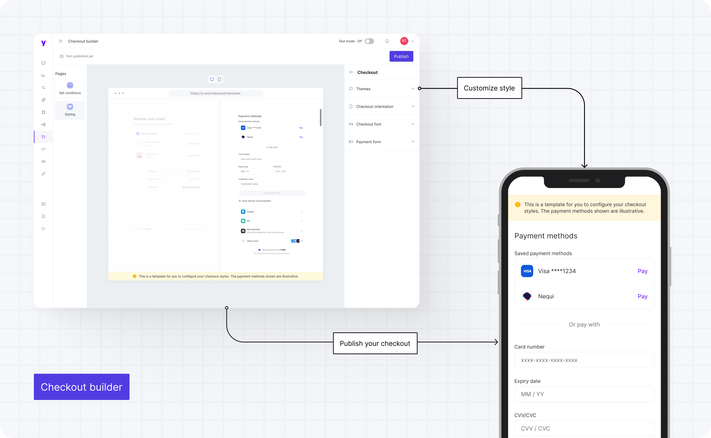
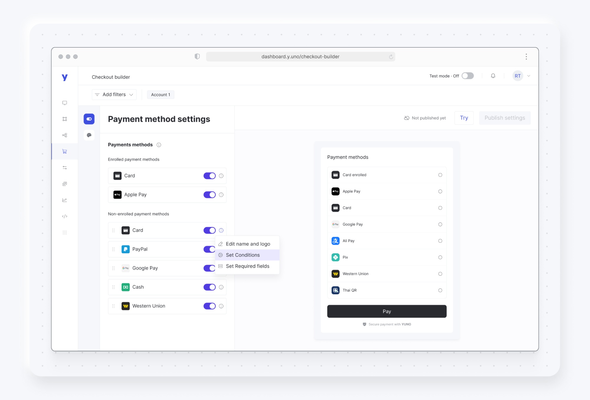
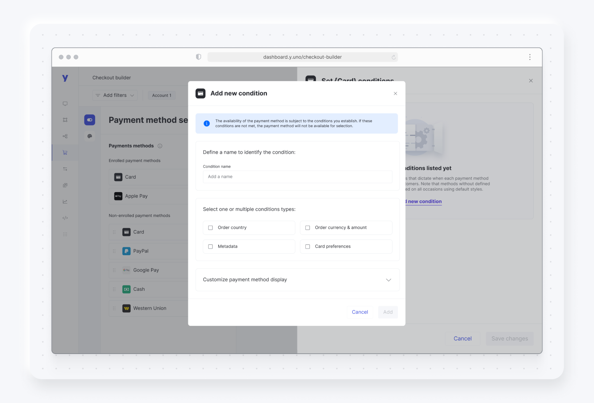
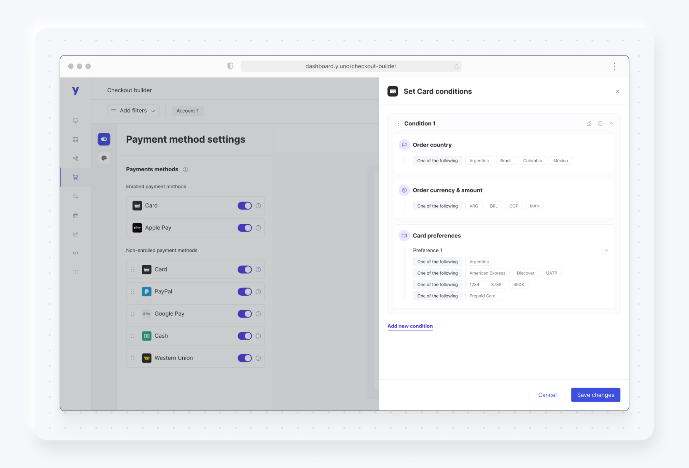
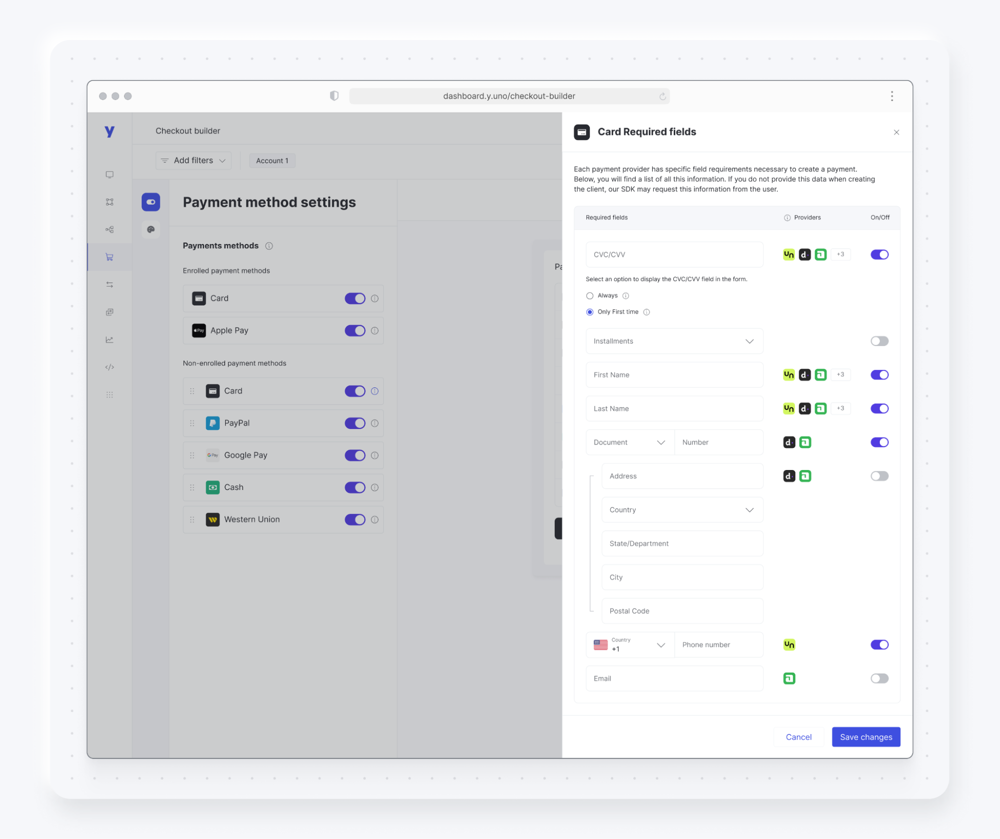
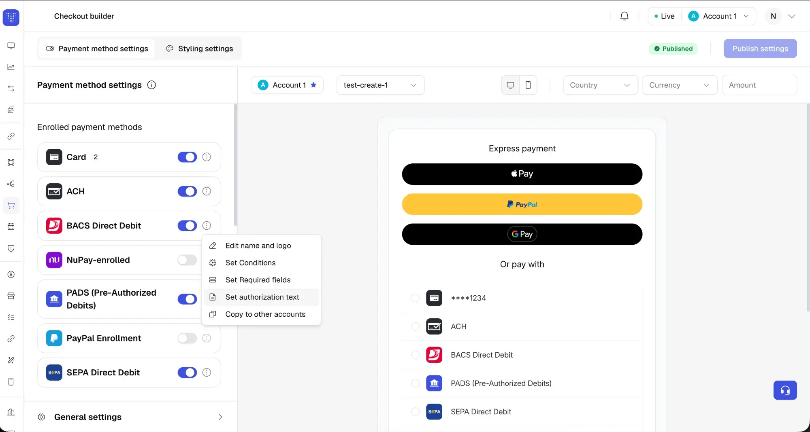
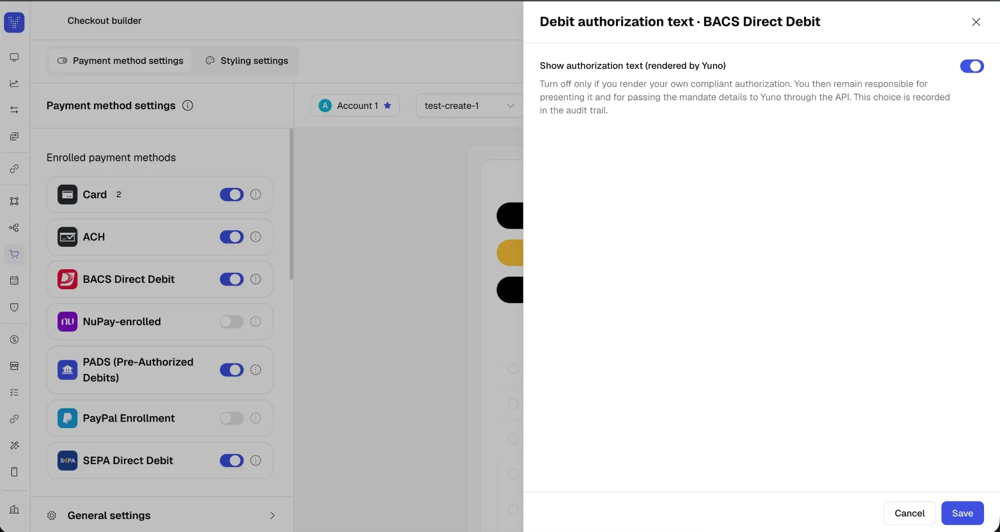
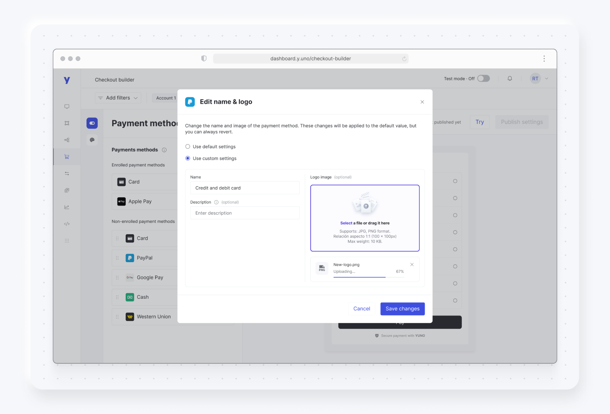

<Note>
  A seção **Payment method settings** está sendo redesenhada e é liberada conta por conta. Se a sua mostra uma única lista de meios de pagamento, um botão **Edit** por meio de pagamento e um botão **Review & publish**, sua conta está na nova versão: veja [as novas Payment method settings](/pt-br/docs/using-yuno/dashboard-overview/checkout-builder-new-payment-method-settings). Todo o restante desta página continua valendo.
</Note>

O Checkout Builder é uma ferramenta no-code criada para personalizar a sua experiência de checkout. Ele inclui dois módulos principais:

* **Payment method settings**: habilite meios de pagamento com uma rota publicada para mostrá-los aos seus clientes. Além disso, você pode definir em quais circunstâncias meios de pagamento específicos são exibidos.
* **Checkout styling**: ajuste os elementos visuais do checkout para desktop e dispositivos móveis, incluindo cores e tipografia. Isso garante que a experiência de checkout seja consistente com a sua marca.

Qualquer alteração feita no Checkout Builder é refletida imediatamente no checkout exibido ao usuário, oferecendo uma forma simples de gerenciar e adaptar a experiência de checkout às necessidades do seu negócio.
<Frame></Frame>
## Vantagens de usar o Checkout Builder {#advantages-of-using-checkout-builder}

* **Personalização sem código**: aproveite a flexibilidade de adaptar a sua experiência de checkout sem precisar de programação complexa. Isso permite que você crie um processo de checkout alinhado à sua marca e aos objetivos do seu negócio.
* **Flexibilidade de meios de pagamento**: habilite, organize e exiba com facilidade os meios de pagamento mais adequados à sua base de clientes e ao seu mercado.
* **Interface intuitiva**: a interface da Yuno torna muito fácil configurar meios de pagamento, definir condições de exibição e personalizar o estilo.

## Configurações de meios de pagamento {#payment-method-settings}

Este módulo permite configurar e personalizar os meios de pagamento usados na experiência de checkout. Além de ativar meios de pagamento, você pode ajustar a ordem em que eles são exibidos, personalizar a aparência deles, definir campos obrigatórios e determinar as condições em que cada meio de pagamento é exibido. Essa amplitude de personalização garante que a experiência de checkout se adapte ao seu público e ao seu caso de uso específico.

Você precisa clicar em **Publish settings** no Checkout Builder para aplicar todas as alterações ao checkout.

<Note>
  **Status de publicação**: ao lado de **Publish settings**, o Checkout Builder mostra um selo de status com dois valores possíveis, **Published** ou **Not published**. Ele reflete o seu estado real de publicação: as alterações que você salva aparecem como **Not published** até você clicar em **Publish settings**, e mudam para **Published** depois que a publicação é concluída e as alterações são implantadas no checkout.
</Note>

### Condições {#conditions}

Você pode controlar quando um meio de pagamento aparece no checkout definindo condições de exibição com base em critérios como país, valor, moeda ou metadados de integração do pedido. Para configurar essas opções:

<Steps>
  <Step title="Inicie as condições">
    Ao lado do meio de pagamento, clique no ícone de três pontos e selecione **Set Conditions**. Clique em **Add new condition** na janela pop-up.
    <Frame></Frame>
  </Step>
  <Step title="Defina as especificações">
    Insira um nome descritivo e selecione parâmetros como país do pedido, moeda ou metadados.
    <Frame></Frame>
  </Step>
  <Step title="Conclua a configuração">
    Preencha os campos que aparecem de acordo com as especificações selecionadas.
    <Frame></Frame>
  </Step>
</Steps>

### Campos obrigatórios {#required-fields}

Os campos obrigatórios especificam as informações que os usuários precisam fornecer ao usar cada meio de pagamento. Alguns meios de pagamento exigem dados específicos para processar pagamentos, e a Yuno pode solicitá-los mesmo que você não os tenha especificado. A Yuno simplifica o processo de adicionar ou remover os campos desejados por meio da sua interface. 

O painel **Required Fields** no Checkout Builder permite coletar endereços de cobrança e de entrega como dois formulários independentes durante o checkout. O endereço de cobrança é usado para verificação do cartão (AVS) e para integrações com provedores como Stripe e Adyen, enquanto o endereço de entrega é usado para a entrega física.

<Note>
  **Requisito de versão do SDK**: este recurso está disponível apenas no **Web SDK v1.7 ou posterior**. Lojistas em versões anteriores do SDK não verão os novos formulários de endereço, mesmo que a configuração esteja habilitada no Checkout Builder.
</Note>

#### Onde encontrar {#where-to-find-it}

1. Abra o **Checkout Builder** no Dashboard da Yuno.
2. Em **Payment method settings**, clique nos **três pontos (⋯)** do meio de pagamento que você quer configurar e selecione **Set Required fields**.
3. Encontre a seção **Address configuration** no painel lateral **Required Fields**.

<Note>
  Esta configuração é **por meio de pagamento**, não global. Repita a configuração para cada meio de pagamento que deve coletar endereços.
</Note>

#### Como configurar {#how-to-configure}

1. Na seção **Address configuration**, **ative** o botão de alternância.
2. Escolha o modo de endereço:
   - **Billing Address only**
   - **Billing & Shipping Address**
3. Clique em **Save changes**.
4. Volte ao Checkout Builder e clique em **Publish settings** para que as alterações entrem em vigor no checkout ativo.

<Frame></Frame>

Nenhum parâmetro adicional do SDK é necessário na integração do lojista: desde que o Web SDK v1.7 ou posterior esteja integrado, os formulários de endereço são renderizados automaticamente com base na configuração do Checkout Builder.

#### Configurações disponíveis {#available-configuration}

| Configuração                                | Descrição                                                                                                                        | O que o cliente vê no SDK                                                                                                                                                                    |
| -------------------------------------- | ---------------------------------------------------------------------------------------------------------------------------------- | ---------------------------------------------------------------------------------------------------------------------------------------------------------------------------------------------------- |
| **Botão de alternância Address configuration: OFF** | Chave principal desativada.                                                                                                            | Nenhum formulário de endereço é renderizado no checkout.                                                                                                                                                         |
| **Billing Address only**               | Apenas o formulário de endereço de cobrança é coletado. Use esta opção quando você precisar apenas dos dados de cobrança para AVS / verificação (por exemplo, produtos digitais). | Um único formulário **Billing address** é renderizado na parte inferior do checkout.                                                                                                                         |
| **Billing & Shipping Address**         | Os formulários de endereço de cobrança e de entrega ficam disponíveis.                                                                             | O SDK renderiza um formulário **Shipping address**, seguido de uma caixa de seleção **"Billing address is the same as shipping address"**. O formulário **Billing address** só aparece quando a caixa de seleção está desmarcada. |

<Note>
  A caixa de seleção "Billing address is the same as shipping address" é apenas um elemento de UX do Web SDK. Ela **não** pode ser configurada no Checkout Builder. Ela aparece automaticamente sempre que cobrança e entrega estão habilitadas.
</Note>

#### Observações importantes {#important-notes}

- **Compatibilidade com versões anteriores:** checkouts existentes que tinham apenas `billing_address` habilitado continuam funcionando exatamente como antes: os campos de endereço anteriores são mapeados para o endereço de cobrança. Nenhuma ação é necessária para lojistas que não querem coletar o endereço de entrega.
- **Código postal isolado:** o campo de código postal pode ser usado de forma isolada (sem outros campos de endereço) para todos os provedores e todos os fluxos do SDK. Quando o código postal está habilitado e os outros campos de endereço estão desabilitados, o backend aceita valores nulos em todos os campos de endereço, exceto o código postal. Se tanto o código postal quanto os campos de endereço estiverem habilitados no Checkout Builder, o backend prioriza os campos de endereço em relação ao código postal.
- **Configure em períodos de baixo tráfego:** publicar alterações nos campos obrigatórios afeta todas as sessões de checkout seguintes imediatamente. Clientes no meio de uma sessão em andamento podem ver formulários inconsistentes durante a janela de propagação. Recomendamos configurar e publicar esta opção em períodos de baixo tráfego para minimizar o impacto.

Nos campos obrigatórios, você também pode configurar o comportamento para cartões cadastrados. Você pode configurar se o CVV deve ser solicitado em toda transação ou apenas no primeiro pagamento do cliente.

### Texto de autorização {#authorization-text}

Meios de pagamento de débito direto (ACH, SEPA Direct Debit, Bacs, PAD e iDEAL quando a conta é salva) exigem que o comprador veja o texto de mandato/autorização antes de concluir o pagamento. O painel **Authorization text** controla se a Yuno renderiza esse texto para você ou se isso fica a cargo da sua própria implementação de checkout.

#### Onde encontrar {#where-to-find-it-1}

1. Abra o **Checkout Builder** no Dashboard da Yuno.
2. Em **Payment method settings**, clique nos **três pontos (⋯)** de qualquer meio de pagamento de débito direto (por exemplo, **BACS Direct Debit**) e selecione **Set authorization text**.

<Frame></Frame>

Isso abre o painel lateral **Debit authorization text · [Nome do meio de pagamento]** (por exemplo, *Debit authorization text · BACS Direct Debit*).

<Frame></Frame>

<Note>
  Esta configuração é **por meio de pagamento**, não global. Repita a configuração para cada meio de pagamento de débito direto que você habilitar.
</Note>

#### Como configurar {#how-to-configure-1}

1. No painel lateral, defina o botão de alternância **Show authorization text (rendered by Yuno)**.
2. Clique em **Save**.
3. Volte ao Checkout Builder e clique em **Publish settings** para que as alterações entrem em vigor no checkout ativo.

A pré-visualização do Builder mostra o texto de autorização exato em tempo real enquanto você alterna a configuração, para que você possa revisá-lo antes de publicar.

#### Configurações disponíveis {#available-configuration-1}

| Configuração                                                      | Descrição                                                                                                        | O que o cliente vê no SDK                                                                             |
| ------------------------------------------------------------- | --------------------------------------------------------------------------------------------------------------------------- | ---------------------------------------------------------------------------------------------------------------------------- |
| **Show authorization text (rendered by Yuno): ON**  | A Yuno renderiza o texto de autorização/mandato do esquema para esse meio de pagamento.                                              | O checkout exibe o texto de autorização da Yuno abaixo dos campos bancários. Veja [Consentimento de débito direto](/pt-br/docs/sdks/resources/references/web#direct-debit-consent) para o comportamento completo do SDK. |
| **Show authorization text (rendered by Yuno): OFF** | Para lojistas que renderizam a sua própria autorização em conformidade em vez da autorização da Yuno. O lojista continua responsável por apresentá-la e por enviar os detalhes do mandato à Yuno pela API (`payment_method.detail.bank_transfer.mandate` em [Create Payment](/reference/payments/create-payment)). | Nenhum texto de autorização é renderizado pelo checkout; o lojista é responsável por exibir um texto de mandato em conformidade em outro lugar. |

<Note>
  A escolha deste botão de alternância é registrada na trilha de auditoria.

  O botão de alternância também fica **bloqueado**, com uma dica explicativa, enquanto a configuração da conexão do meio de pagamento estiver incompleta. O texto de autorização só é renderizado com valores reais da empresa/credor, nunca com valores de exemplo.
</Note>

### Estilo da lista de meios de pagamento {#payment-method-list-style}

Além das condições de exibição e dos campos obrigatórios, o Checkout Builder permite controlar como a própria lista de meios de pagamento se comporta para os seus clientes:

- **Unfolded display**: renderiza o formulário do meio de pagamento selecionado diretamente dentro da lista de meios de pagamento, em vez de abrir um modal separado, para que os clientes possam concluir um pagamento com menos cliques. Os formulários de cartão abrem dentro da lista em todos os SDKs. No iOS e no Android, os meios de pagamento alternativos também abrem dentro da lista a partir do SDK 2.22.0.
- **Preselected payment method**: exibe um meio de pagamento pré-selecionado quando o checkout carrega, em vez de mostrar a lista sem nada selecionado.
- **Condensed checkout view**: reduz a poluição visual mostrando apenas o meio de pagamento pré-selecionado. As opções adicionais continuam disponíveis em **View more**.
- **Edit payment method list**: permite que os clientes vejam os próprios meios de pagamento cadastrados e os excluam diretamente da lista.
- **Express button stacking**: controla como vários botões de pagamento expresso (como Apple Pay, Google Pay ou PayPal) são organizados no topo do checkout. Escolha **Horizontal** (os botões ficam lado a lado em uma linha, aumentando a área de toque e minimizando a perda de espaço vertical) ou **Vertical** (os botões são empilhados em uma coluna de largura total, um por linha).

Essas opções são configuradas na seção Styling do Checkout Builder, em **Payment method list style**. Ative ou selecione a configuração que você quer e clique em **Publish settings** para que ela entre em vigor no checkout ativo.

### Editar nome e logo {#edit-name-and-logo}

As configurações de nome e logo controlam como um meio de pagamento aparece durante o checkout. Esta opção não está disponível para meios de pagamento cadastrados. Para ajustar essas configurações:

1. Em **Payment method settings**, clique no ícone de três pontos ao lado de qualquer meio de pagamento não cadastrado e selecione **Edit name and logo**.
2. Selecione **Use custom settings** para fazer alterações.
3. Insira o nome que você prefere para o meio de pagamento.
4. Opcionalmente, você pode adicionar uma descrição e informar uma nova URL de logo. A URL precisa começar com "https\://". Use uma imagem quadrada (JPG ou PNG), com 100x100 pixels e até 10 KB.
5. Clique em **Save changes** e depois em **Publish settings** para aplicar todas as alterações.
<Frame></Frame>
## Estilo do checkout {#checkout-styling}

Reproduza a identidade visual única da sua marca usando o módulo Checkout Styling. As alterações feitas neste módulo são refletidas no checkout do usuário final logo após a publicação.

### Opções gerais de estilo {#general-styling-options}

A seção General Styling permite ajustar os principais elementos visuais, criando uma aparência consistente e profissional em toda a experiência de checkout. Nesta seção, você pode personalizar os seguintes elementos:

| Elemento personalizável          | Descrição                                                                                                                                                                                                                                                                                  |
| :---------------------------- | :------------------------------------------------------------------------------------------------------------------------------------------------------------------------------------------------------------------------------------------------------------------------------------------- |
| **Background Color**          | Defina a cor de fundo aplicada a todos os formulários do checkout, estabelecendo uma base que reflita a estética da sua marca. Essa cor de fundo serve de base para toda a interface do checkout.                                                                                       |
| **Field Background Color**    | Cor de fundo dos campos de entrada do seu formulário de pagamento, como número do cartão, nome e email.                                                                                                                                                                                             |
| **Secondary Background Color**| Usada exclusivamente no fundo da área que agrupa as ações nas telas de Flexible Actions.                                                                                                                                                                                     |
| **Accent Color**              | Selecione uma cor de destaque para realçar os elementos interativos, melhorando a experiência do usuário e adicionando toques específicos da marca. A cor de destaque se aplica a:<ul><li>Cor de fundo do botão primário</li><li>Cor da borda do botão secundário</li><li>Cores das caixas de seleção</li></ul> |
| **Primary Text Color**        | Defina a cor principal do texto para elementos de alta visibilidade. Esta cor se aplica a:<ul><li>Títulos e subtítulo</li><li>Campos de entrada do usuário</li><li>Valores de listas suspensas</li><li>Texto dos botões secundários</li><li>Texto das caixas de seleção</li></ul>                                                            |
| **Secondary Text Color**      | Escolha uma cor de texto secundária para os elementos de texto de apoio. Esta cor se aplica a:<ul><li>Descrições dos campos</li><li>Texto de exemplo dos campos</li><li>Texto de ajuda com orientações adicionais do formulário</li></ul>                                                                                               |
| **Primary Button Text Color** | Defina a cor do texto do botão primário para garantir que a chamada para ação seja visível e acessível.                                                                                                                                                                                         |
| **Typography**                | Selecione a fonte de sua preferência.                                                                                                                                                                                                                                                                  |

### Coleta de dados dos formulários {#forms-collect-data}

A seção **Forms collect data** em Styling permite personalizar os botões de ação do formulário e os selos de confiança:

* **Personalização do rótulo do botão (Button text)**: personalize o texto do botão principal de chamada para ação para que ele se alinhe ao seu fluxo de checkout. Opções disponíveis:
  - **Pay** (padrão)
  - **Book**
  - **Order**
  - **Subscribe**
  - **Donate**
  - **Pay and subscribe**
  Se não houver tradução disponível para o idioma do comprador, o botão usa o inglês por padrão.
* **Botão Yuno Pay** *(somente Universal SDK)*: a Yuno renderiza um botão Pay padrão que fica sincronizado com a validação do formulário e gerencia os estados de carregamento durante a execução do pagamento. Desative este botão de alternância se você renderiza o seu próprio botão de pagamento na sua integração; nesse caso, a sua aplicação passa a cuidar dos estados de carregamento e de transição.
* **Display ‘Powered by Yuno’ tag**: ativa ou desativa a exibição do selo de segurança ‘Powered by Yuno’ na parte inferior do formulário de pagamento. Desativá-lo também oculta o link da Política de Privacidade exibido ao lado dele.
* **Credit card only processing**: força que cartões de rede dupla sejam processados exclusivamente como crédito, desativando a opção de débito.

<Note>
  **Modo escuro**: o estilo do checkout inclui um botão de alternância para mudar automaticamente para um esquema de cores escuro quando o dispositivo ou o navegador do cliente está com o modo escuro ativado, herdando a preferência do sistema do usuário final em vez de sempre aplicar o tema claro configurado acima. O modo escuro não cria uma paleta escura separada configurável pelo lojista nem inverte automaticamente todas as cores que você definiu. Em vez disso, a Yuno aplica o seu tema escuro integrado às superfícies escuras e continua usando as configurações de estilo definidas aqui quando houver suporte, especialmente a sua **Accent Color**, a **Primary Button Text Color** e a **Typography**. Por isso, revise as cores de fundo e de texto na pré-visualização com o modo escuro ativado para confirmar a aparência final.
</Note>

## Pré-visualização do checkout em tempo real {#real-time-checkout-preview}

O Checkout Builder inclui um painel de pré-visualização ao vivo no lado direito da tela. A pré-visualização reflete a sua configuração atual à medida que você faz alterações, sem exigir que você publique antes.

A pré-visualização está disponível nas abas **Payment method settings** e **Styling settings**.

### O que a pré-visualização mostra {#what-the-preview-shows}

- Os meios de pagamento habilitados no momento e a ordem de exibição deles
- Os botões de pagamento expresso (PayPal, Apple Pay, Google Pay), quando ativos
- O formulário de cartão com todos os campos obrigatórios configurados
- As alterações de cor, tipografia e estilo à medida que você as ajusta

### Campos interativos {#interactive-fields}

Você pode interagir com os campos do formulário diretamente no painel de pré-visualização. Isso permite testar a validação dos campos e as mensagens de erro: por exemplo, inserir um CVV inválido exibe o texto de erro em tempo real.

<Note>
A pré-visualização permite testar os campos de forma interativa até o botão **Pay**. Ela não simula um fluxo de pagamento completo de ponta a ponta. Para testar uma transação completa, use o SDK em um [ambiente de teste](https://docs.y.uno/pt-br/docs/direct-integration-use-cases/yuno-testing-gateway).
</Note>

### Simulando condições {#simulating-conditions}

Use os filtros **Country**, **Currency** e **Amount** acima do painel de pré-visualização para simular diferentes contextos de pedido. Isso permite verificar se as suas condições de exibição estão funcionando como esperado antes de publicar: por exemplo, confirmando que um meio de pagamento só aparece para países ou valores específicos.

### Pré-visualização das configurações de estilo {#styling-settings-preview}

Quando você muda para a aba **Styling settings**, a pré-visualização é atualizada em tempo real à medida que você ajusta cores, tipografia e opções de layout. As alterações ficam visíveis imediatamente na pré-visualização, incluindo a cor de fundo, a cor de destaque e as cores do texto, antes de você salvar ou publicar.