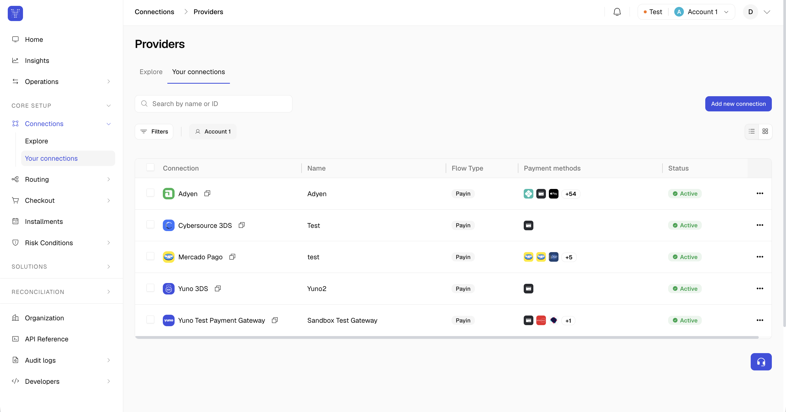
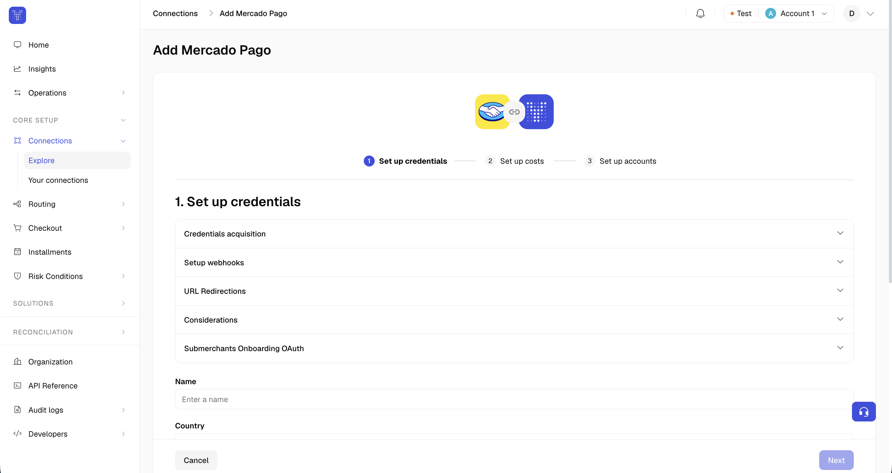

A seção Connections do dashboard permite integrar e gerenciar vários provedores, incluindo meios de pagamento, processadores de pagamento e soluções antifraude. A possibilidade de se conectar a provedores do mundo todo usando a Yuno reduz muito os tempos de integração e traz funcionalidades adicionais para seus clientes, aumentando a conveniência e a receita.

Vamos percorrer o processo de adicionar, criar e gerenciar conexões para ampliar seus recursos de processamento e roteamento de pagamentos.

## Adicionar uma conexão {#adding-a-connection}

1. A aba **Explore** aparece por padrão ao abrir Connections no dashboard. Nela, navegue pela lista de provedores disponíveis ou use a caixa **Search** para encontrar a conexão desejada. Os provedores podem incluir meios de pagamento, processadores e soluções antifraude. Clique em **Connect** para continuar.

<Frame></Frame>

2. Depois de selecionar um provedor, você começa o processo rápido de três etapas para configurar a conexão. Primeiro, você precisará informar as credenciais do provedor, necessárias para estabelecer uma conexão segura. Insira um nome fácil de lembrar para a conexão e depois os dados exigidos. As informações específicas que você precisa inserir variam de acordo com o provedor, mas é bem provável que você já tenha esses dados. Entre em contato com o provedor se tiver dúvidas sobre algum desses campos ou se faltar alguma informação. Opcionalmente, você pode marcar **3DS Credentials** e inserir os dados necessários para ativar o recurso. Clique em **Next**.

<Frame></Frame>

3. A próxima tela, **Set up costs**, permite inserir informações de custos para usar no Smart Routing e em Reconciliations (Fees). Selecione **Set up cost** para inserir os custos de pagamentos bem-sucedidos e malsucedidos. Esta opção é totalmente opcional, então você pode clicar em **Next** sem inserir dados.

4. **Set up accounts** permite selecionar as contas que serão afetadas pelas alterações. Marque contas específicas ou **Current account only** e clique em **Save** para concluir. O sistema confirmará que a conexão foi criada, estabelecendo uma ponte entre sua conta Yuno e o provedor escolhido.

<Note>
**Editar conexões**

Ao criar conexões, uma conexão é configurada para cada conta que você selecionar. Se precisar fazer alterações depois, você deve editar cada conexão individualmente: a edição em massa não é suportada.
</Note>

5. Com suas conexões configuradas, você pode seguir para a seção [Roteamento](/pt-br/docs/using-yuno/dashboard-overview/routing) para configurar as rotas de processamento de pagamentos usando o provedor e os meios de pagamento disponíveis na Yuno.

<Note>
**Configurar custos para novas conexões**

Ao adicionar uma nova conexão, você pode configurar os custos dela. Esta etapa opcional permite definir custos diferentes para pagamentos bem-sucedidos e malsucedidos, ajudando a gerenciar tarifas com o [recurso Smart Routing](/pt-br/docs/using-yuno/dashboard-overview/routing#smart-routing).

Você pode definir custos padrão para todos os pagamentos e adicionar condições específicas para situações diferentes, como definir um custo próprio quando um cliente usa Visa.

Os custos são aplicados na ordem em que você os cria, mas você pode reorganizá-los arrastando e soltando. Essa configuração ajuda a Yuno Payments a escolher automaticamente a rota mais econômica para cada transação quando você ativa o Smart Routing.

Os custos são usados tanto no Smart Routing quanto em Fees, em Reconciliations.
</Note>

## Gerenciar conexões {#managing-connections}

A aba **Your connections** em Connections permite gerenciar as conexões existentes conforme as necessidades do seu negócio mudam. As ações disponíveis incluem:

* **Editar conexões**: Atualize facilmente as credenciais ou altere as configurações de uma conexão selecionando os três pontos ao lado da conexão e depois **Edit**.
* **Pausar e retomar conexões**: Para interromper temporariamente a interação com um provedor específico, você pode usar **Pause** em uma conexão. Quando quiser retomar, use **Unpause**. Essa flexibilidade permite se adaptar a mudanças de circunstâncias sem precisar refazer suas conexões.
* **Excluir conexões**: Se uma conexão não for mais necessária, você pode excluí-la. Tenha cuidado ao excluir conexões, pois essa ação é irreversível.
* **Gerenciar várias conexões**: Marque a caixa ao lado de duas ou mais conexões para pausar, retomar e excluir conexões em massa.

## Configuração de metadados dinâmicos {#dynamic-metadata-configuration}

O recurso Dynamic Metadata permite controlar quais campos de metadados são enviados a cada provedor conectado, configurando exatamente quais chaves de metadados são enviadas a partir das configurações da sua conexão. Isso é especialmente útil quando provedores diferentes exigem metadados diferentes.

Para usar o Dynamic Metadata:

1. Ative a flag "Dynamic Metadata Configuration" nas configurações da sua conexão.
2. Configure os mapeamentos de chaves dos metadados da sua API pública para os metadados específicos do provedor.
3. Apenas as chaves de metadados configuradas serão enviadas ao provedor durante as transações.

<Info>
**Importante para usuários do Stripe**

A lógica atual de metadados no Stripe será removida em **29 de agosto de 2025**. Atualize sua conexão para usar o mapeamento dinâmico antes dessa data para evitar qualquer interrupção no processamento dos seus pagamentos.
</Info>