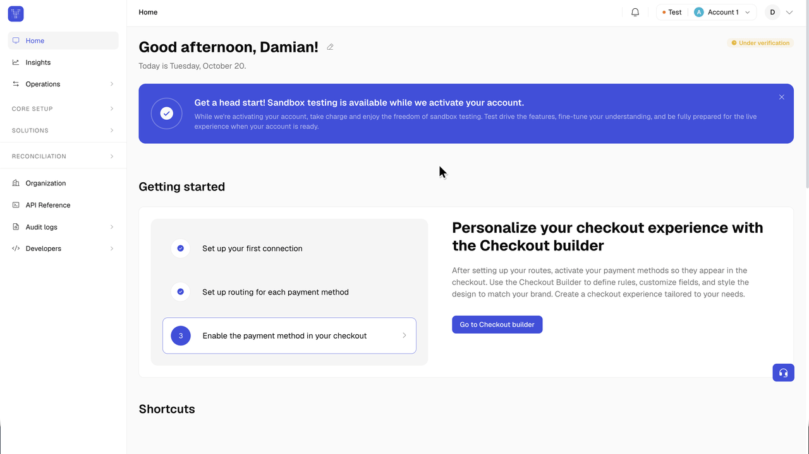
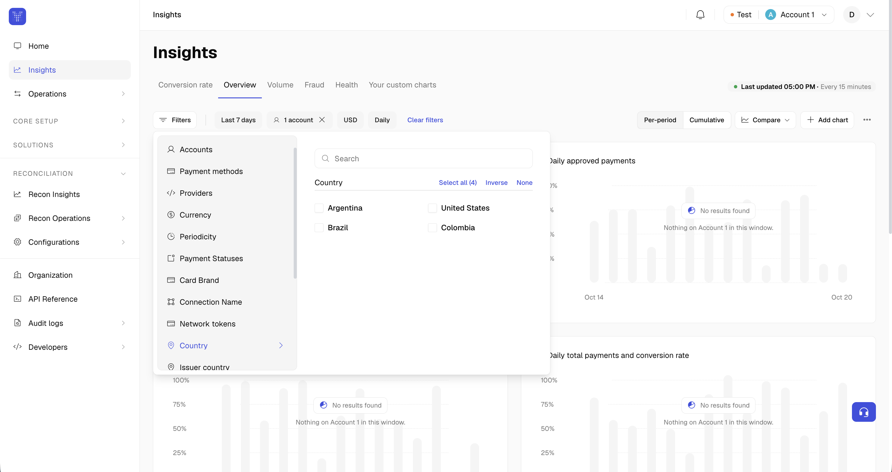
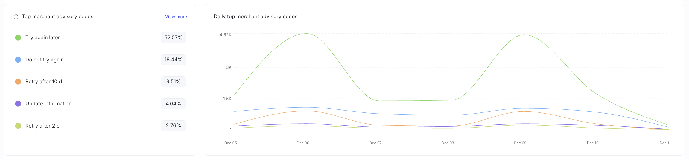

A seção **Insights** oferece uma visão unificada das métricas e análises de desempenho dos seus pagamentos, diretamente no dashboard. Ela transforma dados brutos de transações em gráficos de volume, conversão e fraude, com uma interface personalizável e adaptada às necessidades do seu negócio.
<Frame></Frame>
## Entenda o seu cenário de pagamentos {#understand-your-payment-landscape}

Tenha uma compreensão completa do seu ecossistema de pagamentos por meio de análises detalhadas. Acesse todos os dados críticos de pagamento em uma plataforma centralizada, incluindo:

* Volumes de pagamento
* Tipos de transação
* Meios de pagamento
* Perfil demográfico dos clientes

Com os dados históricos, você pode acompanhar as tendências de desempenho dos pagamentos ao longo do tempo, identificar pontos fortes e apontar áreas de otimização para refinar continuamente suas estratégias de pagamento.

O Yuno Insights organiza seus dados em quatro abas distintas, cada uma com uma perspectiva própria:

<CardGroup cols={2}>
  <Card title="Overview" icon="chart-simple">
    Uma visão geral do processamento dos seus pagamentos, incluindo o volume total de pagamentos, o ticket médio e as tendências da taxa de conversão.
  </Card>
  <Card title="Volume" icon="chart-line">
    Detalhes sobre o volume de pagamentos, reembolsos e chargebacks por provedor, meio de pagamento e país.
  </Card>
  <Card title="Conversion rate" icon="percent">
    Métricas de desempenho, incluindo taxas de aprovação, novas tentativas e sucesso das validações.
  </Card>
  <Card title="Fraud" icon="shield-check">
    Métricas de detecção e prevenção de fraude, incluindo taxas de fraude e análises de padrões.
  </Card>
</CardGroup>

## Decisões bem informadas {#informed-decision-making}

Os dados apresentados no Yuno Insights são organizados de forma estratégica em torno de dois aspectos principais:

* Volume: dados alinhados às métricas de negócio para entender o fluxo geral e o valor das suas transações.
* Desempenho: dados de eficiência operacional para medir a eficácia e a taxa de sucesso dos seus processos de pagamento.

Analisar os dados disponíveis a partir desses dois ângulos permite extrair facilmente informações valiosas, incluindo:

* Taxas de conversão gerais e segmentadas (por meio de pagamento e provedor) para identificar as opções com melhor desempenho.
* Informações detalhadas sobre transações recusadas, que ajudam você a entender e tratar os motivos da não conversão.
* Visibilidade clara das tendências de volume de transações, permitindo acompanhar o crescimento e identificar oscilações.

## Personalize e exporte os insights {#tailor-and-export-insights}

A seção Insights tem várias opções para filtrar, personalizar e extrair dados de acordo com as suas preferências:

* **Filtros**: use o botão **Add filters** para segmentar as informações exibidas por bandeira do cartão, moeda, período e outros critérios, incluindo **country**, **issuer country** e **network tokens**. Assim você pode se concentrar em segmentos específicos de dados para uma análise direcionada. Você pode aplicar ou limpar rapidamente seleções grandes com os controles **Select all** e de seleção inversa de cada filtro.
<Frame></Frame>
* **Personalização**: clique em **Customize** para controlar quais relatórios você vê e como eles são organizados.
 Arraste e solte os elementos para reordená-los de acordo com as suas prioridades ou clique no ícone de lixeira para remover os relatórios menos relevantes. Lembre-se de clicar em **Done** para salvar o seu layout personalizado.

* **Configure seus gráficos**: use o botão **Add chart** para ajustar as visualizações exibidas. Depois de selecionar essa opção, clique no ícone ao lado de cada relatório para mostrá-lo ou ocultá-lo. Selecione **Apply** para confirmar a seleção de gráficos.

* **Exportar como PDF**: o botão **Download** permite exportar a página atual do Insights como um arquivo PDF. Esse recurso simplifica o compartilhamento dos relatórios da Yuno com toda a sua organização.

## Seus gráficos personalizados {#your-custom-charts}

Esta seção permite criar dashboards totalmente personalizados usando prompts em linguagem natural. Gere visualizações de dados sob medida que se adaptam às suas necessidades de análise, sem nenhuma configuração manual. Você pode criar quantos gráficos precisar, cada um a partir do texto que você escreve.

Cada gráfico tem um ícone de informação (ⓘ) onde você pode ver o prompt exato usado para gerá-lo, o que oferece total transparência e permite reutilizar ou refinar os prompts com facilidade.

<CardGroup cols={2}>
  <Card title="Valor único" icon="1">
    Mostre um total ou uma métrica principal de relance.
  </Card>
  <Card title="Gráficos de linha ou de barras" icon="chart-bar">
    Visualize tendências ou compare o desempenho ao longo do tempo.
  </Card>
  <Card title="Gráficos de várias linhas" icon="chart-line-up">
    Compare categorias como países, meios de pagamento ou provedores.
  </Card>
  <Card title="Gráficos de pizza" icon="chart-pie">
    Mostre a distribuição proporcional das categorias nos seus dados.
  </Card>
</CardGroup>

### Boas práticas para prompts {#best-practices-for-prompting}

* **Seja específico e detalhado**: descreva claramente o que você quer visualizar, incluindo detalhes relevantes como tipo de transação, status, país, provedor ou quaisquer filtros que deseje aplicar.

<Tip>
  "Mostre um gráfico de barras das transações aprovadas com cartão de crédito por país nos últimos 3 meses."
</Tip>

* **Sempre inclua um período e uma frequência**: ao pedir gráficos de linha ou de barras, especifique tanto o período quanto o nível de agregação (por exemplo, diário, semanal, mensal) para uma análise de tendências precisa.

<Tip>
  "Gráfico de linha do volume total por semana no último trimestre."
</Tip>

* **Use referências de tempo dinâmicas em gráficos reutilizáveis**: em vez de datas fixas, use períodos relativos como "última semana" ou "mês anterior" para que seus gráficos continuem atualizados automaticamente.

<Tip>
  "Mostre o total de transações por dia nos últimos 30 dias."
</Tip>

## Insights de merchant advisory codes (MAC) {#merchant-advisory-codes-mac-insights}

O Insights inclui gráficos que destacam os merchant advisory codes (MAC), ajudando você a entender por que os emissores recomendam ações como tentar novamente mais tarde ou atualizar informações.

As principais visualizações de MAC incluem:

* **Top merchant advisory codes**: um detalhamento dos códigos MAC mais frequentes retornados nas suas transações, com a participação relativa de cada um.
* **Daily top merchant advisory codes**: um gráfico de série temporal que mostra como os principais códigos MAC evoluem ao longo do tempo, ajudando você a identificar tendências e mudanças no comportamento dos emissores.

Use essas visualizações para identificar padrões comuns de recomendação, refinar suas estratégias de novas tentativas e trabalhar com emissores ou provedores para reduzir recusas evitáveis.
<Frame></Frame>
## Insights de fraude {#fraud-insights}

A aba Fraud detalha a análise de fraude, a autenticação 3DS e a atividade de chargebacks nos gráficos abaixo, organizados em três seções principais:

### Análise de fraude {#fraud-screening}

Acompanhe as atividades e o desempenho da análise de fraude:

* **Total fraud screening volume**: acompanhe o número total de análises de fraude realizadas
* **Successful fraud screening volume**: monitore as análises de fraude bem-sucedidas
* **Unsuccessful fraud screening volume**: acompanhe as análises de fraude malsucedidas
* **Daily fraud screening conversion rate**: veja as tendências da taxa de conversão ao longo do tempo em gráficos de barras

### 3DS {#3ds}

Analise o desempenho da autenticação 3D Secure:

* **Total 3DS authentication volume**: acompanhe o total de tentativas de autenticação 3DS
* **Successful 3DS authentication volume**: monitore as autenticações 3DS bem-sucedidas
* **Unsuccessful 3DS authentication volume**: acompanhe as autenticações 3DS malsucedidas
* **Daily 3DS conversion rate**: veja as tendências da taxa de conversão ao longo do tempo
* **3DS decline reasons**: analise os motivos das recusas na autenticação 3DS
* **Daily fraudiness vs challenge**: compare os scores de fraudiness (um score que indica a probabilidade de uma transação ser fraudulenta) com as taxas de challenge

### Chargebacks {#chargebacks}

Acompanhe a atividade e os resultados dos chargebacks:

* **Total chargebacks volume**: acompanhe o total de chargebacks recebidos
* **Won chargebacks volume**: monitore os chargebacks ganhos
* **Lost chargebacks volume**: acompanhe os chargebacks perdidos
* **Disputed chargebacks volume**: monitore os chargebacks atualmente em disputa
* **Daily chargebacks rate**: veja as tendências da taxa de chargebacks ao longo do tempo
* **Chargebacks rate by provider and card brand**: analise as taxas de chargeback segmentadas por provedor e bandeira do cartão
* **Chargeback reason distribution**: entenda a distribuição dos motivos de chargeback
* **Daily chargebacks win rate**: acompanhe a taxa de chargebacks ganhos
* **Daily disputed chargebacks**: monitore os chargebacks em status de disputa
* **Chargebacks status distribution**: veja a distribuição dos status de chargeback
* **Chargebacks by type**: analise os chargebacks classificados por tipo

Use os insights de fraude para otimizar suas estratégias de prevenção de fraude, ajustar as regras de detecção de fraude e garantir que você esteja protegendo seu negócio sem recusar transações legítimas sem necessidade.