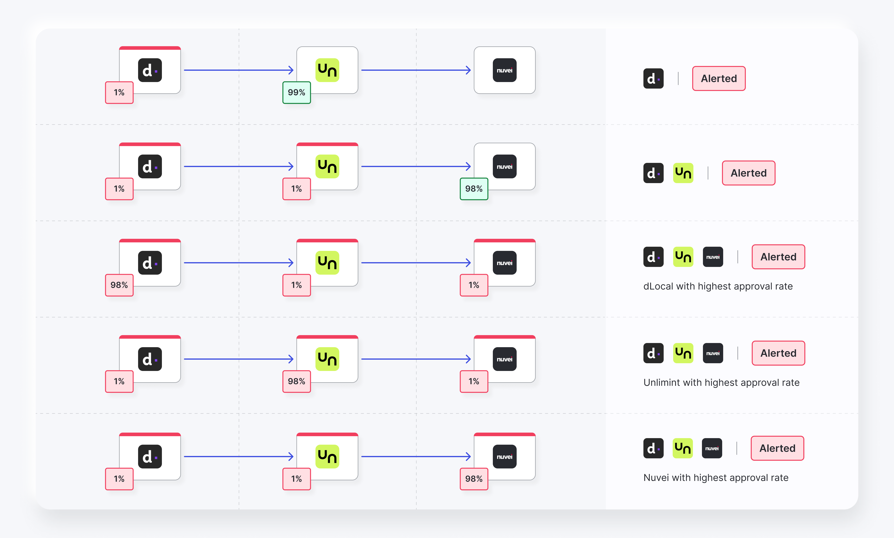
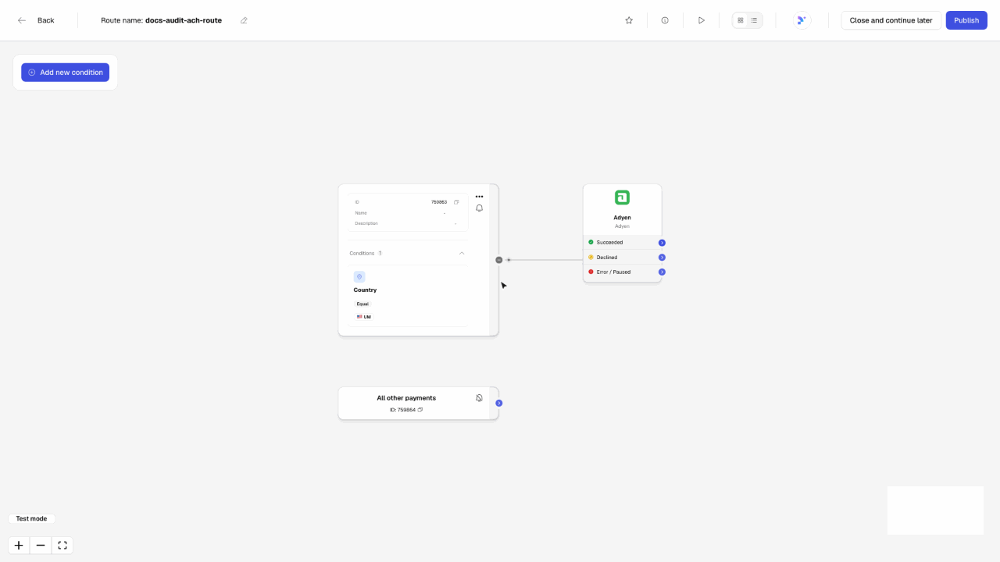

O recurso de monitores da Yuno ajuda você a detectar e resolver problemas no processamento de pagamentos em tempo real. Acessível pela seção Monitors do seu dashboard da Yuno, essa ferramenta identifica automaticamente anomalias no desempenho dos provedores de pagamento e toma ações imediatas para manter taxas de aprovação ideais e altas taxas de conversão em todas as suas rotas de pagamento.

## Como funciona o processo de monitoramento {#monitoring-process-operation}

O processo de monitoramento consiste em quatro etapas principais que ajudam a identificar e restaurar rotas de pagamento:

<Steps>
  <Step title="Detecção de anomalias">
    O sistema monitora continuamente as taxas de aprovação. Quando as taxas caem abaixo do limite definido por você, ele dispara alertas pelos canais configurados, como email ou **Opsgenie**.
  </Step>
  <Step title="Notificação de alerta">
    Se as taxas de aprovação caírem abaixo do limite, a Yuno notifica você imediatamente pelos canais de alerta escolhidos.
  </Step>
  <Step title="Redirecionamento de tráfego">
    Ao detectar taxas de aprovação baixas, a Yuno redireciona automaticamente os pagamentos para seus provedores de fallback. Uma pequena parte das transações continua passando pelo provedor original para monitorar a recuperação do serviço.
  </Step>
  <Step title="Recuperação da rota">
    Quando a taxa de aprovação do provedor principal volta a ficar acima do limite, o tráfego retorna automaticamente para a rota original.
  </Step>
</Steps>
Esse processo automatizado ajuda a manter o processamento de pagamentos ideal, detectando problemas rapidamente e aplicando soluções para manter as taxas de aprovação altas.

### Cenários adicionais de monitoramento {#additional-monitoring-scenarios}

O recurso de monitor lida com vários cenários de rotas de pagamento para manter o processamento ideal. Veja como ele trata situações específicas:

Interrupções de provedor:

* Quando um provedor tem interrupções, o tráfego é redirecionado automaticamente para o provedor de fallback configurado
* Se o provedor de fallback apresentar problemas, o tráfego passa para um segundo provedor de fallback (se configurado)
* Quando todos os provedores estão indisponíveis, o tráfego é roteado para o provedor com a maior taxa de aprovação recente
* O sistema monitora continuamente os provedores e ajusta o tráfego dinamicamente para obter taxas de aprovação ideais
* O status do provedor (fora do ar/recuperado) é determinado pelas suas configurações

Sequência de redirecionamento de tráfego:

1. Quando um provedor cai abaixo do limite de aprovação, o tráfego é redirecionado para o provedor de fallback
2. Se o provedor de fallback também cair abaixo do limite, o tráfego passa para o segundo fallback (se disponível)
3. Se todos os provedores estiverem abaixo do limite, o tráfego é roteado para o provedor que tiver a maior taxa de aprovação

O diagrama abaixo ilustra esses cenários de redirecionamento de tráfego:
<Frame></Frame>
## Configurar um monitor {#configure-a-monitor}

Para configurar um monitor para suas rotas de pagamento:

1. Acesse a aba **Routing** no seu dashboard e abra uma rota existente. Você pode configurar monitores de taxa de aprovação diferentes para cada condição.

2. Personalize sua rota de pagamento com as configurações que preferir.

3. Adicione as condições e os provedores de pagamento necessários para cada conjunto.

4. Clique no ícone de Monitors (sino) e configure estas opções:

   * **Time frame**: defina por quanto tempo a taxa de aprovação será medida
   * **Approval rate limit**: defina o limite que dispara alertas e ações
   * **Number of payments**: defina o mínimo, o máximo ou o intervalo de pagamentos necessários para disparar a condição. Isso evita redirecionamentos causados por anomalias em períodos de baixo volume de pagamentos
   * **Alert channels**: escolha notificações por email ou **Opsgenie**
   * **Automatic traffic redistribution**: ative o redirecionamento automático quando os alertas forem disparados. Exige um provedor de fallback para as condições **Error** e **Pause**
   * **Percentage of traffic**: defina quanto tráfego permanece com o provedor original para monitoramento

5. Salve as alterações do monitor ou salve-o como template para uso futuro.
<Frame></Frame>
<Note>
**Restrição de monitor**

Não é possível criar monitores para rotas que já estão publicadas.
</Note>