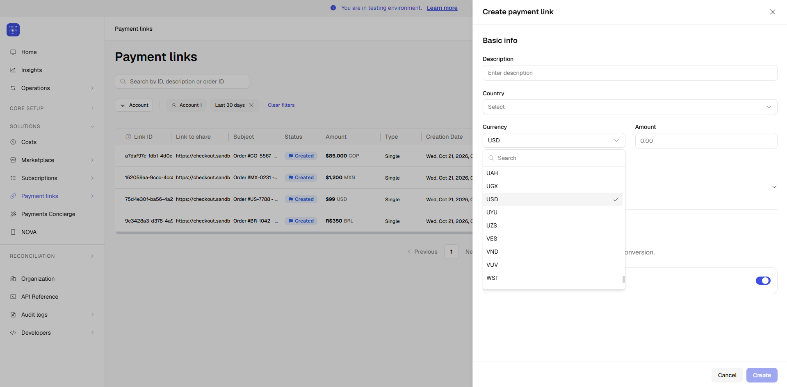
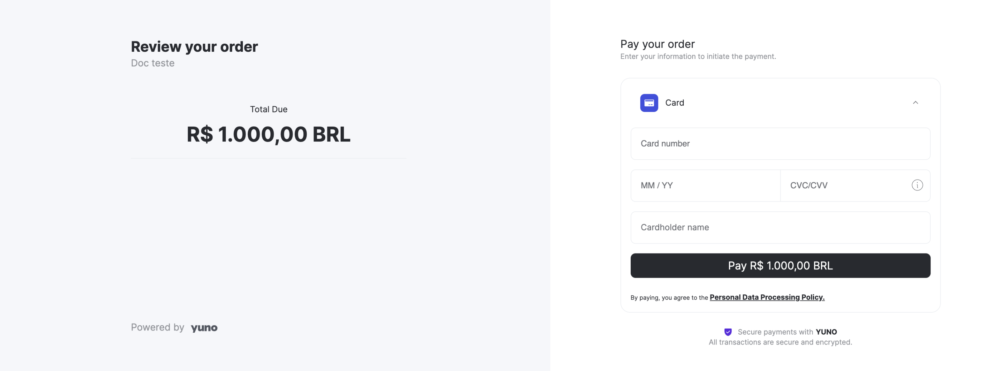
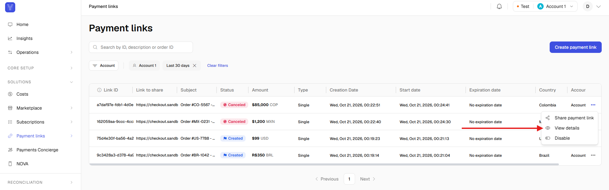

A seção de links de pagamento do dashboard permite criar URLs para receber pagamentos sem escrever código. Os links de pagamento da Yuno combinam uma configuração simples com opções avançadas de checkout.

## Uma experiência sem código {#a-no-code-experience}

* **Links de pagamento sob medida**: Você pode criar links de pagamento adaptados às suas necessidades sem programar
* **Configuração simples**: Monte um link de pagamento em poucos passos intuitivos. Defina um país, uma moeda, um valor e pelo menos um meio de pagamento para criar o link rapidamente
* **Datas de início e de expiração**: Aumente a utilidade do link de pagamento definindo datas de início e de expiração. Tenha mais controle definindo o horário exato e o fuso horário

<Frame></Frame>

## Vantagens dos links de pagamento {#advantages-of-payment-links}

* Uma interface intuitiva, sem necessidade de programação
* Links altamente personalizáveis, alinhados às necessidades do negócio e que aumentam o engajamento do cliente
* Mais controle, com a possibilidade de cancelar links quando quiser
* Os insights de transações oferecem visibilidade profunda e análises valiosas sobre a atividade de pagamentos e o status das transações

## Criar um link de pagamento {#create-a-payment-link}

Se você usa o dashboard, siga estes passos para criar um link de pagamento:

1. Acesse o [dashboard da Yuno](https://auth.y.uno/u/login?)
2. Navegue até **Solutions** → **Payment links** na barra lateral do dashboard
3. Clique em **Create payment link**
4. Preencha as **Basic info** (descrição, país, moeda e valor) do seu pagamento. Depois, configure as **Advanced options**
5. (Opcional) Use **Payment settings** para adicionar mais meios de pagamento, o que pode aumentar a conversão
6. Compartilhe o link de pagamento com seu cliente

Se você usa a integração por API, siga estes passos:

1. (Opcional) Crie um cliente usando o endpoint [Create customer](/reference/customers/create-customer).
2. Crie o link de pagamento usando o endpoint [Create payment link](/reference/payment-links/create-payment-link).
3. Compartilhe o link de pagamento com seu cliente.

## Opções avançadas {#advanced-options}

Os links de pagamento podem ser aprimorados de várias formas:

* **Vincular o link de pagamento a um ID de pedido existente**: Simplifique o acompanhamento de pedidos associando o link de pagamento a um ID de pedido
* **Receber vários pagamentos**: Defina se um link deve aceitar vários pagamentos ou uma única transação
* **Definir datas de início e de expiração**: Defina um período em que seu link ficará ativo, com precisão de minuto e fuso horário. Se você não definir uma data de início, seu link ficará ativo imediatamente
* **Adicionar detalhes do pedido**: Inclua itens, serviços ou causas para oferecer uma visão completa do pedido no checkout do link de pagamento
* **Informações de passagem aérea**: Útil para companhias aéreas e empresas de viagens, este recurso permite incluir informações de passagens aéreas no checkout do link de pagamento

## Usar links de pagamento {#using-payment-links}

Quando os clientes abrem links de pagamento, eles veem uma interface limpa que informa o valor a pagar e os meios de pagamento disponíveis, de acordo com o que você selecionou ao gerar o link. O visual da página se adapta dinamicamente a celulares e tablets. Depois de seguir as instruções na tela, os clientes poderão concluir o pagamento, que pode ser visto no dashboard ao gerenciar os links de pagamento.

<Frame></Frame>

### Personalização da página de pagamento hospedada {#hosted-payment-page-customization}

Aplique a identidade visual da sua marca à página de pagamento hospedada pelo Checkout Builder: adicione seu logotipo como miniatura e defina as cores da sua marca.

Por padrão, a página de pagamento hospedada aparece no idioma do navegador do cliente. Os clientes podem mudá-lo a qualquer momento usando o seletor de idioma.

<Note>
  Os botões de pagamento expresso (PayPal, Apple Pay, Google Pay) também estão disponíveis na página de pagamento hospedada, a partir do Web SDK v1.6.
</Note>

<Note>
  Quando [Promoções](/docs/payment-features/promotions) está habilitado para sua organização, a página de pagamento hospedada aplica automaticamente as promoções que correspondem ao cartão do cliente e mostra o preço com desconto no resumo do pedido. Não há nada a configurar no link. Links de pagamento de assinatura não mostram promoções e cobram o preço normal.
</Note>

<Note>
  Quer que os clientes abram o link de pagamento no seu próprio domínio, sem a marca da Yuno? Consulte [Payment Link White Label](/docs/sdks/customization/web/payment-link-white-label).
</Note>

## Gerenciamento de links de pagamento {#payment-link-management}

**Payment links** exibe todos os seus links em uma lista. Clique em qualquer link para ver um resumo e os pagamentos realizados. Você também pode refinar sua busca pelo ID do link de pagamento ou usando filtros. Além disso, ao selecionar os três pontos ao lado de cada link, aparecem:

* **Share payment link**: Obtenha rapidamente o link para compartilhar com seus clientes
* **View details**: Veja os meios de pagamento e os pagamentos anteriores
* **Disable**: Desative o link quando ele não for mais necessário

<Frame></Frame>

Para informações detalhadas e dúvidas, consulte a documentação da Yuno ou entre em contato com a equipe de suporte.