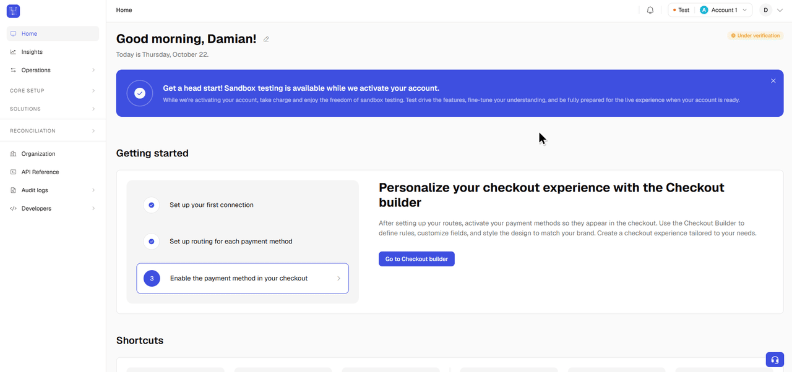
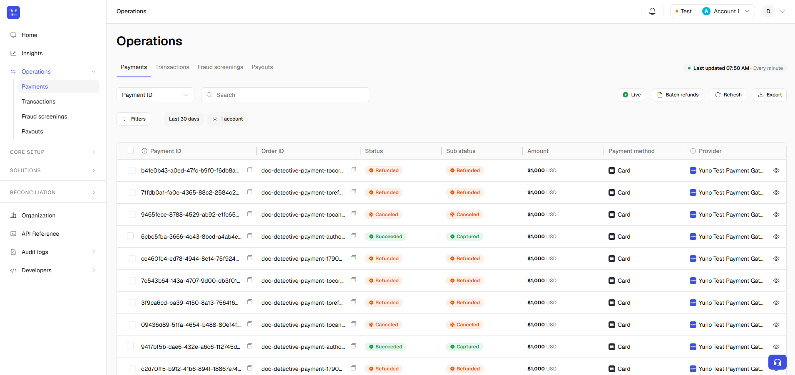

A seção Payments do dashboard mostra todos os dados de pagamentos, transações, análise de fraude e payouts. Além disso, você pode usar filtros para refinar suas buscas e aproveitar uma configuração ampla de exportações e relatórios.
<Frame></Frame>
## Visão geral da seção Payments {#payments-section-breakdown}

<CardGroup cols={2}>
  <Card title="Todos os pagamentos" icon="wallet">
    Visualização padrão que mostra todos os pagamentos, independentemente do status.
  </Card>
  <Card title="Reembolsos em lote" icon="receipt">
    Processe vários reembolsos fazendo upload de um arquivo CSV.
  </Card>
  <Card title="Todas as transações" icon="arrow-right-arrow-left">
    Visualização detalhada de todas as transações relacionadas aos seus pagamentos.
  </Card>
  <Card title="Todas as análises de fraude" icon="shield-halved">
    Verifique possíveis transações fraudulentas em uma visualização dedicada.
  </Card>
  <Card title="Ver todos os payouts" icon="hand-holding-dollar">
    Acesse e filtre todos os payouts para encontrar transações específicas.
  </Card>
  <Card title="Exportar relatórios" icon="file-export">
    Exporte dados personalizados e agende relatórios recorrentes por email.
  </Card>
</CardGroup>
A seção Payments permite visualizar, filtrar e exportar dados de pagamentos, além de processar reembolsos em lote, tudo a partir de uma única visualização do dashboard.

<Frame></Frame>

## Reembolsos em lote {#batch-refunds}

O recurso de reembolso em lote permite processar reembolsos de várias transações ao mesmo tempo, economizando tempo e esforço. Você pode reembolsar até 1000 pagamentos de uma vez.

Para executar reembolsos em lote, acesse a aba **All payments** e selecione **Batch refunds → Upload**. Em seguida, faça upload de um arquivo CSV com seus reembolsos. Você pode baixar um arquivo de exemplo para ajudar na formatação. Para cada pagamento a ser reembolsado, informe:

* ID do pagamento
* ID da transação
* Valor a reembolsar
* Moeda
* Referência do lojista
* Motivo (`DUPLICATE`, `FRAUDULENT` ou `REQUESTED_BY_CUSTOMER`)

Você também pode baixar o [arquivo de exemplo de reembolsos em lote](https://dashboard-assets.y.uno/samples-files/Batch_refunds_sample_file.xlsx).

Depois de fazer upload do arquivo, você pode acompanhar o status do reembolso de cada pagamento acessando **All payments** e selecionando **Batch refunds → Overview**.

## Exportação de dados {#exporting-data}

Clique no botão **Export** para ver três abas, cada uma com controle especializado sobre as suas exportações de dados:

**Quick export**: selecione um intervalo de datas específico e personalize as colunas visíveis na exportação.\
**Scheduled reports**: configure um relatório para ser enviado periodicamente ao seu endereço de email. Você também pode definir as colunas a exportar.
**Downloads**: os relatórios anteriores ficam salvos nesta aba para facilitar o download.