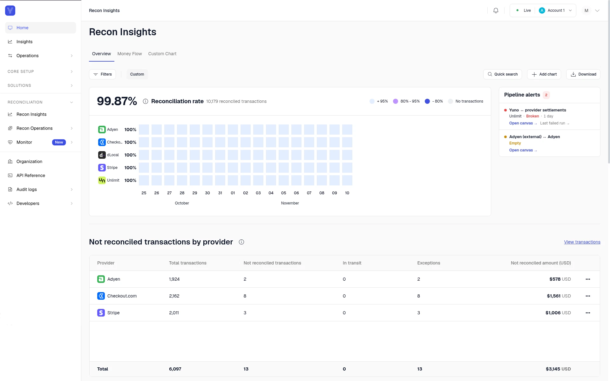
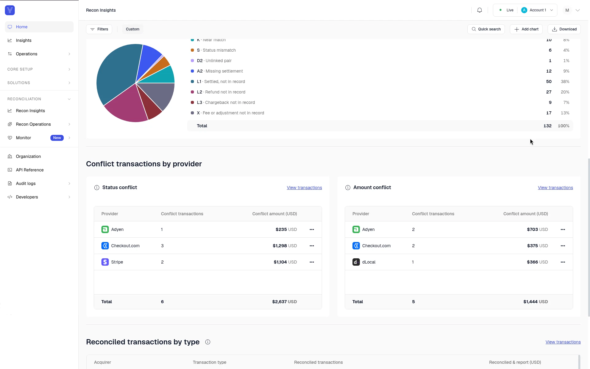
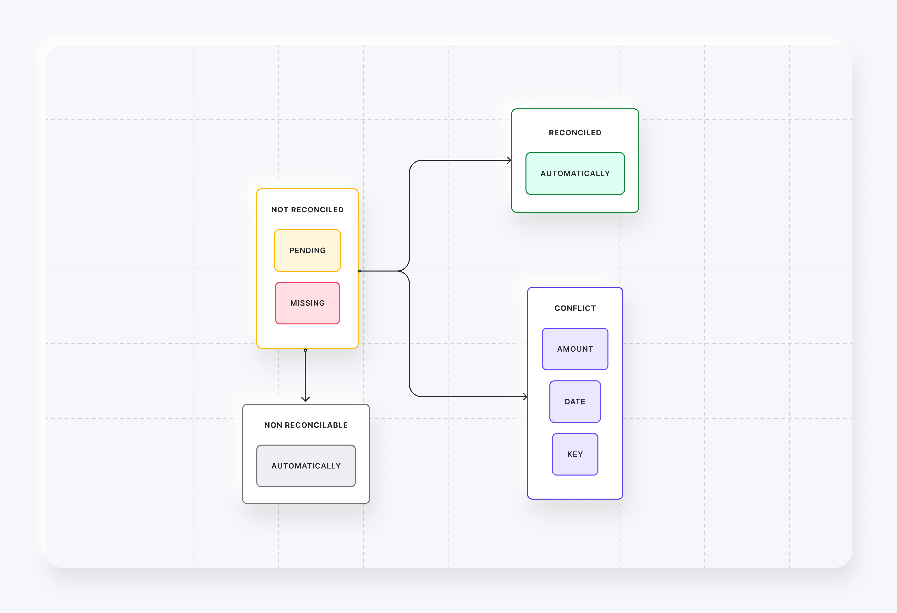
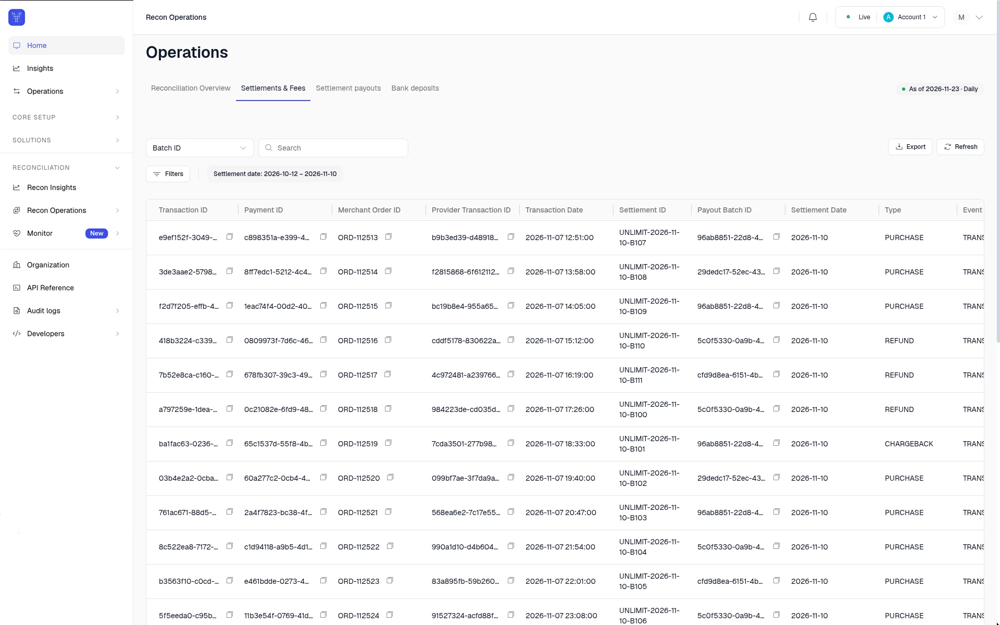

A conciliação é um processo que compara suas transações com os documentos de liquidação dos provedores de pagamento para:

* Identificar e resolver divergências
* Garantir que todas as transações processadas sejam liquidadas corretamente
* Manter registros financeiros precisos

O processo de conciliação funciona assim:

<Steps>
  <Step title="Coleta dos arquivos de liquidação">
    Reúna os arquivos de liquidação de cada provedor de pagamento.
  </Step>
  <Step title="Comparação dos arquivos">
    Compare esses arquivos com as transações processadas pela Yuno.
  </Step>
  <Step title="Verificação dos saldos">
    Verifique os saldos das contas com seus adquirentes.
  </Step>
  <Step title="Validação dos registros">
    Confirme que todos os registros estão precisos, consistentes e atualizados.
  </Step>
</Steps>
<Frame></Frame>
## Por que a conciliação é importante {#why-reconciliation-matters}

A conciliação ajuda você a identificar e resolver divergências no processamento dos seus pagamentos. Embora algumas divergências sejam inofensivas, fatores como o momento do pagamento, depósitos e transações pendentes podem afetar os saldos da sua conta bancária. Fazer a conciliação com regularidade permite:

* Detectar e evitar erros de saldo
* Identificar possíveis fraudes
* Acompanhar pagamentos com falha
* Garantir registros financeiros precisos

Os principais objetivos da conciliação são:

* Verificar se os lojistas recebem todos os pagamentos das transações bem-sucedidas na Yuno
* Garantir o cumprimento dos prazos de pagamento entre lojistas e adquirentes
* Monitorar os custos de processamento da adquirência e validá-los com os termos acordados
* Manter a integridade dos dados e os estados corretos das transações no dashboard da Yuno

Para melhores resultados, faça a conciliação diariamente. Se a conciliação diária não for viável, procure conciliar semanalmente ou, no mínimo, mensalmente.

## Como a Yuno facilita a conciliação {#how-yuno-facilitates-reconciliation}

A Yuno oferece um processo completo de conciliação de transações que ajuda você a:

* Garantir o crédito correto dos pagamentos
* Verificar o cumprimento dos prazos de pagamento
* Acompanhar os custos de processamento

Nosso sistema orquestra e gerencia dados da Yuno, dos parceiros e dos lojistas para executar uma conciliação precisa.

### Status de conciliação {#reconciliation-status}

Cada transação pode ter um dos seguintes status de conciliação:

| Status           | Descrição                                                                                                               |
| :--------------- | :------------------------------------------------------------------------------------------------------------------------ |
| Reconciled       | A transação foi encontrada na liquidação do provedor e será creditada na sua conta bancária                          |
| Non reconcilable | A transação não pode ser conciliada porque não atende aos critérios de conciliação. Nenhuma outra ação será tomada          |
| Not reconciled   | A transação está pendente de identificação em uma liquidação. Verifique o sub-status para ver se ela ainda está dentro dos prazos de pagamento |
| Conflict         | Uma transação correspondente foi encontrada na liquidação, mas tem divergências em relação ao registro processado                        |

<Frame></Frame>

### Máquina de estados {#state-machine}
<Frame></Frame>
### Relatórios {#reports}

A Yuno oferece três relatórios de conciliação. No dashboard, você os encontra como abas em **Recon Operations**:

1. **Reconciliation Overview**
   * Mostra o status e o sub-status de conciliação
   * Inclui o ID de conciliação de cada transação

2. **Settlements & Fees**
   * Lista todas as transações nas transferências bancárias para a sua conta
   * Inclui os detalhes de conciliação de cada transação

3. **Settlement Payouts report**
   * Lista os payouts (transferências bancárias) que cada provedor de pagamento informa ter pago às suas contas de lojista
   * Disponível na aba **Settlement payouts** e pela Reports API para lojistas no novo motor de conciliação da Yuno. Consulte [Settlement Payouts](/reference/reports/reports-fields#settlement-payouts)

<Frame></Frame>

### Obter dados de conciliação por API {#getting-reconciliation-data-by-api}

Para acompanhar os valores liquidados por provedor, conta e moeda a partir do seu backend (por exemplo, para a contabilidade), solicite os relatórios de conciliação pela Reports API: [crie o relatório](/reference/reports/create-a-report), [verifique se ele está pronto](/reference/reports/retrieve-a-report) e [faça o download](/reference/reports/download-a-report). Consulte [Gerar relatórios](/pt-br/docs/direct-integration-use-cases/build-reports) para ver o fluxo completo.

* Use [Settlements & Fees](/reference/reports/reports-fields#settlements--fees) para as linhas de liquidação e as tarifas de cada transação.
* Use [Settlement Payouts](/reference/reports/reports-fields#settlement-payouts) para os valores bruto, de tarifas e líquido de cada transferência que um provedor informa ter pago às suas contas de lojista. Solicitar esse relatório para uma organização que ainda não está no novo motor de conciliação retorna um erro 400.

<Note>
Os campos `balance` retornados por [Get Account Details](/reference/banking-connectivity/accounts/get-account-details-banking) pertencem a contas bancárias criadas pelo [Banking Connectivity](/reference/banking-connectivity). Eles não são saldos mantidos com seus adquirentes ou provedores de pagamento.
</Note>