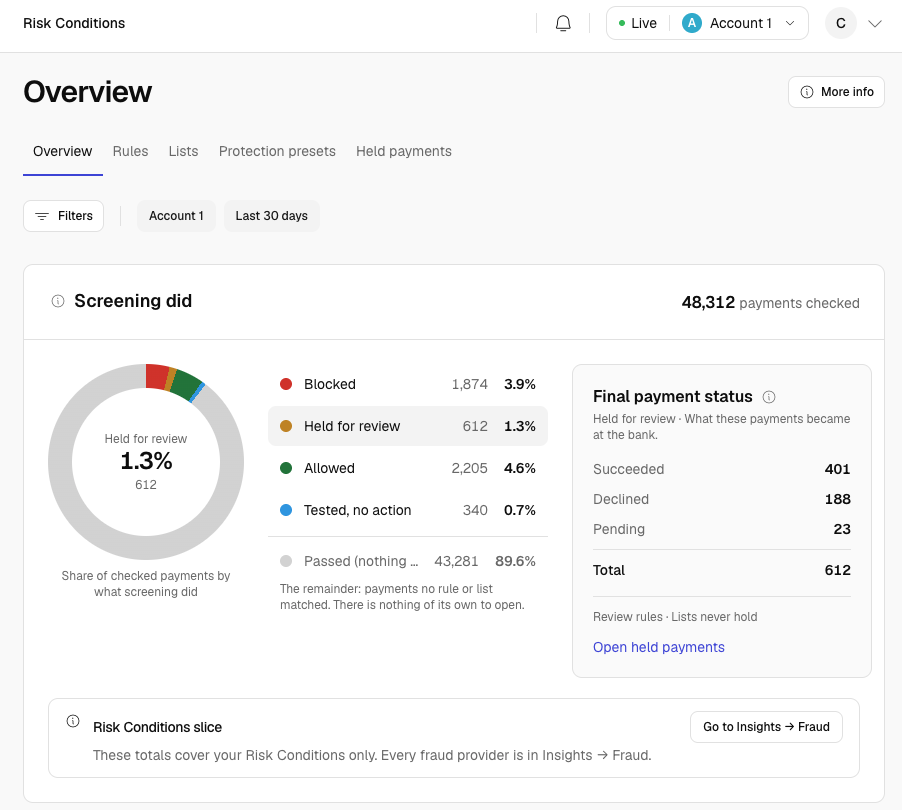
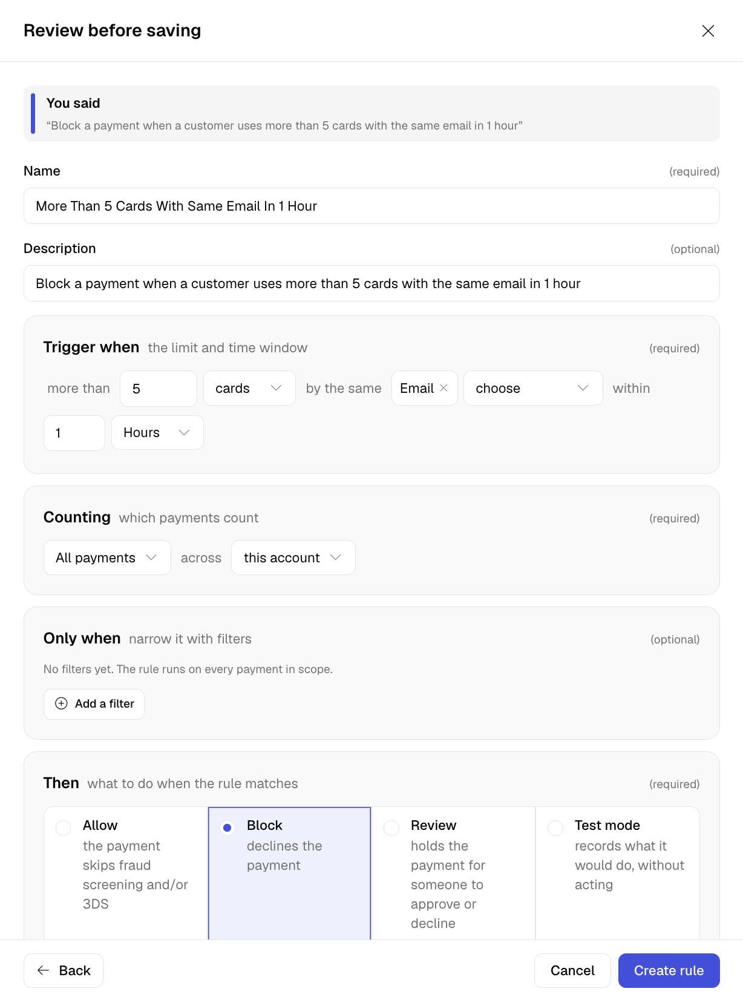
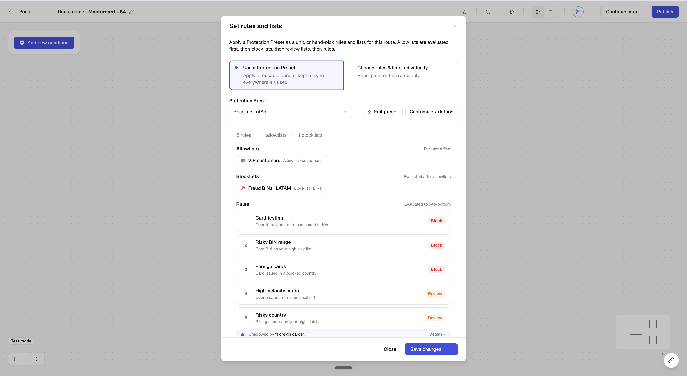
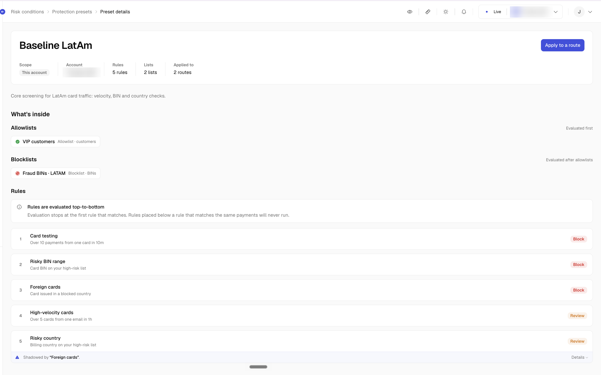

**Risk Conditions** é a etapa de triagem própria da Yuno. Você escreve regras e listas que identificam pagamentos arriscados (ou confiáveis), adiciona essas regras e listas às suas rotas, e a Yuno verifica cada pagamento nessas rotas. Como a verificação roda dentro da Yuno, ela também reduz o número de requisições que você envia a provedores externos de fraude.

A seção tem cinco abas:

* [Overview](#overview): o que a triagem fez e quais regras e listas fazem o trabalho.
* [Rules](#rules): condições que contam pagamentos ao longo do tempo, como "mais de 5 cartões do mesmo email em 1 hora".
* [Lists](#lists): valores fixos para bloquear, permitir ou enviar para revisão, como um email ou um BIN de cartão.
* [Protection presets](#protection-presets): conjuntos reutilizáveis de regras e listas.
* [Held payments](#held-payments): pagamentos aguardando que alguém os aprove ou recuse.

<Frame></Frame>

## Antes de começar {#before-you-start}

Uma regra ou lista não faz nada até estar em uma rota, e a rota estar publicada. Para configurar isso uma única vez:

<Steps>
  <Step title="Conecte o Risk Conditions">
    Acesse **Connections**, pesquise por **Risk Conditions** e clique em **Connect**. Siga as etapas na tela.
  </Step>
  <Step title="Adicione uma verificação de triagem a uma rota">
    Acesse **Routing**, abra uma rota e adicione **Risk Conditions** como uma etapa. Na etapa **Set rules and lists**, aplique um preset de proteção ou escolha regras e listas uma a uma.
  </Step>
  <Step title="Publique a rota">
    As alterações em uma rota são salvas como rascunho. Publique a rota para iniciar a triagem.
  </Step>
</Steps>

### O que roda primeiro {#what-runs-first}

Em cada verificação de triagem, a Yuno avalia nesta ordem e para na primeira correspondência:

1. Allowlists
2. Blocklists
3. Listas de revisão
4. Regras, de cima para baixo, na ordem definida na rota

Assim, uma correspondência em uma allowlist vence tudo, e uma correspondência em uma blocklist vence uma lista de revisão. Uma regra colocada abaixo de uma regra mais ampla que identifica os mesmos pagamentos nunca roda. A aba [Overview](#overview) e a página de detalhes de cada regra informam quando isso acontece.

### Permissões {#permissions}

Cada ação em Risk Conditions tem sua própria permissão: visualizar a seção, criar e editar regras, listas e presets, criar presets para toda a organização e aprovar ou recusar pagamentos retidos. Você pode adicionar essas permissões a qualquer função personalizada. A função **Admin** inclui todas elas por padrão.

## Overview {#overview}

A aba Overview mostra o que a triagem fez no período que você escolher (os últimos 7, 30 ou 90 dias).

* **Screening did**: quantos pagamentos a triagem verificou, divididos em **Blocked**, **Held for review**, **Allowed**, **Tested, no action** e **Passed (nothing matched)**. Cada pagamento é contado uma vez, pela correspondência que decidiu sobre ele.
* **Final payment status**: o que esses mesmos pagamentos se tornaram no banco, por exemplo, bem-sucedido, recusado pelo banco ou com chargeback.
* **Rule health** e **Blocklists & allowlists**: contagens por status. Cada card abre a aba Rules ou Lists, já filtrada.
* **Which rules & lists do the work**: regras e listas classificadas pela frequência com que tiveram correspondência. Se uma regra nunca dispara porque uma regra acima dela captura os mesmos pagamentos primeiro, ela mostra **Never fires**, indica essa regra e leva a Routing, onde você muda a ordem.
* **Needs you**: tudo que pede uma ação, como uma regra Block que não está realmente bloqueando ou pagamentos aguardando revisão.

<Note>
  A classificação conta eventos de correspondência, enquanto o número principal conta pagamentos. Um pagamento identificado por uma lista e por uma regra conta uma vez no número principal e duas vezes na classificação, então a classificação pode somar mais que o total.
</Note>

A sobreposição entre regras é calculada dentro de uma conta. Quando você visualiza um grupo de contas ou a organização inteira, a aba Overview mostra apenas totais. Use **Narrow to one account** para ver a classificação e os avisos de "never fires".

Esses totais cobrem apenas Risk Conditions. Para comparar todos os provedores de fraude nas suas rotas, acesse **Insights > Fraud**.

## Rules {#rules}

Uma regra conta pagamentos em uma janela de tempo e age quando a contagem passa de um limite. Por exemplo: reter um pagamento para revisão quando um cliente usa mais de 5 cartões do mesmo email em 1 hora.

<Note>
  Use uma lista, e não uma regra, quando quiser identificar um único valor fixo em um só pagamento, como um email reconhecidamente fraudulento. Consulte [Lists](#lists).
</Note>

### Criar uma regra {#create-a-rule}

Na aba **Rules**, clique em **Create rule**. A forma mais rápida de começar é descrever a regra em inglês simples, por exemplo "Hold a payment when a customer uses more than 5 cards from one email in 1 hour", e clicar em **Generate**. A Yuno cria um rascunho da regra e o mostra em **Review before saving**, ao lado do que você escreveu, para que você possa conferir e ajustar antes de criá-la. Se o que você descrever for um único valor sem limite ao longo do tempo, a Yuno sugere uma entrada de blocklist.

Você também pode começar a partir de um modelo, copiar uma regra existente ou começar do zero. Os modelos são:

* **Card testing**: um cartão tentado vezes demais em uma janela curta.
* **High-value first order**: o primeiro pagamento de um novo cliente está acima de um limite.
* **Prior chargebacks**: reter clientes cujos pagamentos já tiveram um chargeback recentemente.
* **Repeated charges on the same card**: bloquear várias cobranças feitas no mesmo cartão em até uma hora.

Dê um nome à regra e, opcionalmente, uma descrição. Depois, preencha as quatro partes dela:

| Parte | O que você define |
| --- | --- |
| **Trigger when** | O limite e a janela de tempo: mais que um número de pagamentos ou cartões, pelo mesmo valor (como email, número do cartão, fingerprint do dispositivo ou endereço IP), dentro de uma janela de até 30 dias. |
| **Counting** | Quais pagamentos contam (todos os pagamentos, bem-sucedidos, recusados ou recusados por fraude) e se a contagem é feita nesta conta ou na organização inteira. |
| **Only when** | Filtros opcionais que restringem a regra, até 10. Os filtros do mesmo grupo precisam todos corresponder (AND). Adicione outro grupo para corresponder a qualquer um deles (OR). |
| **Then** | O que acontece quando a regra tem correspondência. Veja os resultados abaixo. |

Enquanto você monta a regra, o **Rule summary** descreve a regra de volta em inglês simples, para que você confira se ela faz o que você pretendia.

<Frame></Frame>

Os filtros que você pode adicionar são agrupados pelo que verificam:

* **Same across payments**: o mesmo BIN de cartão, número do cartão, nome do titular do cartão, meio de pagamento, endereço IP, endereço de entrega, ID do dispositivo ou valor entre os pagamentos que você conta.
* **Amount**: o valor de um único pagamento ou o total acumulado na janela.
* **Card & response codes**: bandeira do cartão, o código de resposta ou o Merchant Advice Code que um emissor retorna após uma recusa.
* **Chargeback history**: se o cliente teve chargebacks no último número de dias que você definir.
* **Verification**: se os pagamentos contados incluem uma verificação de cartão de $0.
* **Metadata**: seus próprios campos personalizados enviados à Yuno.

### Resultados {#outcomes}

| Resultado | O que acontece |
| --- | --- |
| **Allow** | O pagamento pula a triagem de fraude, o 3DS ou ambos. Você escolhe qual. |
| **Block** | O pagamento é recusado. |
| **Review** | O pagamento fica retido até que alguém o aprove ou recuse em [Held payments](#held-payments). |
| **Test mode** | Nada acontece com o pagamento. A regra registra o que teria feito. |

<Tip>
  Comece uma nova regra em **Test mode**. A página de detalhes dela mostra o que ela teria feito e como esses pagamentos terminaram. Quando os números parecerem certos, clique em **Enforce this rule** e escolha o resultado.
</Tip>

Depois que uma regra passa a ser aplicada, o resultado dela fica fixo. Para testar um resultado diferente, copie a regra.

<Warning>
  Uma regra **Review** retém o pagamento, e o comprador fica em processamento até que alguém decida. Verifique [Held payments](#held-payments) regularmente para que os pagamentos não fiquem esperando.
</Warning>

### Status das regras {#rule-statuses}

Toda regra tem um status:

| Status | Significado |
| --- | --- |
| **Live** | Em uma rota publicada e fazendo a triagem de pagamentos. |
| **Not live** | Salva, mas ainda sem estar em nenhuma rota. Não está fazendo a triagem de nada. |
| **Dormant** | Em uma rota, mas sem correspondências recentes. |
| **Needs you** | Algo precisa ser corrigido, como uma regra Block em uma rota onde o bloqueio acontece depois do banco, ou uma regra que nunca dispara porque uma regra acima dela tem correspondência primeiro. |
| **Test** | Registrando o que faria, sem agir. |

A aba **Rules** lista todas as regras com o que cada uma verifica, a conta, o resultado e o status. Filtre por status para encontrar as regras que precisam de você.

### Detalhes da regra {#rule-detail}

Abra uma regra para ver se ela está funcionando:

* **Health**: quantos pagamentos ela identificou desde a última edição e qual parcela do tráfego da conta isso representa.
* **Where it runs**: os mesmos números, por rota.
* **What it did**: para Block, o que ela impediu. Para Allow, como os pagamentos permitidos terminaram. Para Review, o que está aguardando e o que foi aprovado ou recusado. Para Test mode, o que ela teria feito.
* **What it caught**: os pagamentos identificados, do mais recente para o mais antigo, com o motivo da correspondência de cada um.
* **Change history**: quem criou, editou, promoveu ou publicou a regra, e quando.

<Note>
  **Brecha de proteção.** Se uma regra Block estiver em uma etapa de triagem que roda depois do banco, ela pode identificar pagamentos que ainda assim são bem-sucedidos, porque um bloqueio nesse ponto não consegue reverter a cobrança. Os detalhes da regra mostram quantos pagamentos passaram, e a regra é marcada como **Needs you**. Para impedir um pagamento antes que ele seja cobrado, a etapa de triagem precisa rodar antes do provedor.
</Note>

### Adicionar uma regra a uma rota {#add-a-rule-to-a-route}

Na lista de regras ou nos detalhes da regra, clique em **Add to a route**. Escolha a rota e depois a verificação de triagem à qual adicioná-la, ou adicione uma nova. A regra entra no rascunho da rota. Abra **Routing** para revisar e publicar o rascunho.

### Excluir uma regra {#delete-a-rule}

Você só pode excluir uma regra quando ela não está ativa. Se uma rota a usa, remova-a da rota primeiro. A exclusão não pode ser desfeita.

## Lists {#lists}

Uma lista identifica um valor em um pagamento, como um email, um BIN de cartão ou um dispositivo. Existem três tipos:

| Tipo | O que acontece em uma correspondência |
| --- | --- |
| **Blocklist** | O pagamento é recusado. |
| **Allowlist** | O pagamento pula a triagem de fraude, o 3DS ou ambos. |
| **Review list** | O pagamento fica retido até que alguém o aprove ou recuse. |

Uma lista pode buscar correspondência em qualquer um destes:

* Email ou domínio de email
* Número de telefone
* BIN do cartão
* BIN do cartão + últimos 4 dígitos
* Endereço IP ou faixa de endereços IP
* ID do cliente no lojista
* ID do cliente
* Número do documento
* Nome do titular do cartão/da conta bancária
* ID do dispositivo
* Fingerprint
* Endereço de entrega
* Metadados

### Criar uma lista {#create-a-list}

Na aba **Lists**, clique em **Create list** e preencha:

1. **Name**: um nome claro e descritivo.
2. **Type**: Blocklist, Allowlist ou Review list.
3. **Match on**: o valor a identificar, como email ou BIN do cartão. Para BIN do cartão, escolha se uma entrada corresponde a todo cartão que começa com ela ou apenas àquele BIN exato.
4. **Outcome** (somente allowlists): pular a triagem de fraude, pular o 3DS ou pular ambos.
5. **Entries**: digite valores separados por vírgulas ou tabulações, ou envie um arquivo CSV. Opcionalmente, remova entradas automaticamente depois de um período que você definir.
6. **Accounts**: por padrão, a lista se aplica à conta atual. Selecione outras contas para aplicá-la a elas também.

A aba **Lists** mostra todas as listas em uma tabela. Filtre por tipo para ver apenas blocklists, allowlists ou listas de revisão.

### Blocklists {#blocklists}

Uma blocklist recusa qualquer pagamento que corresponda a uma de suas entradas. Use-a para clientes, cartões ou dispositivos que você nunca quer aceitar.

### Allowlists {#allowlists}

Uma allowlist deixa clientes confiáveis passarem com menos atrito. Ao criar uma, escolha o resultado dela: pular a triagem de fraude, pular o 3DS ou pular ambos. Uma correspondência em uma allowlist vence todas as outras listas e todas as regras, então reserve as allowlists para clientes que você verificou.

### Listas de revisão {#review-lists}

Uma lista de revisão funciona como uma blocklist, mas, em vez de recusar o pagamento, a Yuno o retém para que uma pessoa decida. Use-a para clientes, cartões ou dispositivos que você quer que alguém analise sem perder a venda.

Quando um pagamento corresponde a uma lista de revisão em uma etapa de triagem antes do provedor:

* A Yuno retém o pagamento antes que ele chegue ao provedor. O pagamento mostra o status `PENDING` com o substatus `PENDING_FRAUD_REVIEW`, e o cliente não é cobrado enquanto aguarda.
* O pagamento aparece em [Held payments](#held-payments), onde alguém da sua equipe o aprova ou recusa.

Um pagamento que corresponde a uma lista de revisão e a uma blocklist é recusado. Um pagamento que corresponde a uma allowlist pula a revisão, assim como pula os bloqueios.

<Tip>
  As regras também podem enviar um pagamento para revisão. Defina o resultado da regra como **Review** quando quiser que uma contagem ao longo do tempo, e não uma lista fixa, decida quais pagamentos uma pessoa analisa.
</Tip>

<Note>
  Não é possível excluir uma lista. A Yuno a mantém para que você sempre tenha o histórico dos pagamentos que ela identificou. Para deixar de usar uma lista, remova-a das suas rotas e presets.
</Note>

## Protection presets {#protection-presets}

Um preset de proteção é um conjunto nomeado de allowlists, blocklists, listas de revisão e regras. Você o monta uma vez e o aplica a qualquer rota, em vez de escolher as mesmas regras e listas rota por rota.

Uma rota **segue** o preset em vez de copiá-lo. Quando você edita um preset, todas as rotas que o usam mudam na hora, sem republicar cada rota. O dashboard avisa você antes de salvar uma edição que alcança rotas ativas.

### Criar um preset {#create-a-preset}

Na aba **Protection presets**, clique em **Create preset**:

1. Dê um nome a ele e, opcionalmente, uma descrição.
2. Escolha o escopo: **This account** ou **Entire organization**.
3. Adicione allowlists, blocklists, listas de revisão e regras. Um preset precisa de pelo menos um item. As regras rodam de cima para baixo e a avaliação para na primeira correspondência, então a ordem importa.

Um preset da organização pertence à organização inteira, não a uma conta. Ele não chega a nenhuma conta sozinho: você mesmo o aplica às rotas de cada conta.

### Aplicar um preset a uma rota {#apply-a-preset-to-a-route}

Em **Routing**, abra a etapa **Set rules and lists** da rota e escolha **Use a Protection Preset**. Depois, publique a rota.

<Frame></Frame>

* Para adicionar regras ou listas a apenas uma rota, além do preset, adicione-as em **Also on this route only**. Elas são avaliadas antes do preset.
* Para mudar uma rota sem mudar o preset, clique em **Customize / detach**. As regras e listas do preset são copiadas para a rota, e as edições posteriores no preset deixam de alcançá-la.

### Detalhes do preset {#preset-detail}

Abra um preset para ver o que há nele, as rotas que o usam, se alguma das regras dele precisa de você e o histórico de alterações.

<Frame></Frame>

## Held payments {#held-payments}

**Held payments** lista todos os pagamentos que uma lista de revisão ou uma regra **Review** está retendo, do mais antigo para o mais recente. A aba mostra um contador, para que você saiba quando algo está aguardando. A tabela mostra o pagamento, o valor, a regra ou lista que o reteve, há quanto tempo ele está retido e por quê.

Para cada pagamento retido, escolha:

* **Approve**: informa à triagem que a verificação de fraude passou. O pagamento continua pela rota. Isso não é o mesmo que marcá-lo como bem-sucedido: o provedor ainda precisa aprová-lo.
* **Decline**: interrompe o pagamento. Ele não continua pela rota.

As retenções não expiram. O comprador espera até que alguém decida, então verifique a aba regularmente. A aba mostra as retenções dos últimos 30 dias.

<Note>
  Um pagamento que a triagem reteve **depois** que o provedor já o aprovou é listado para que você o veja, mas não pode ser aprovado nem recusado pelo dashboard, porque o valor já foi cobrado.
</Note>
