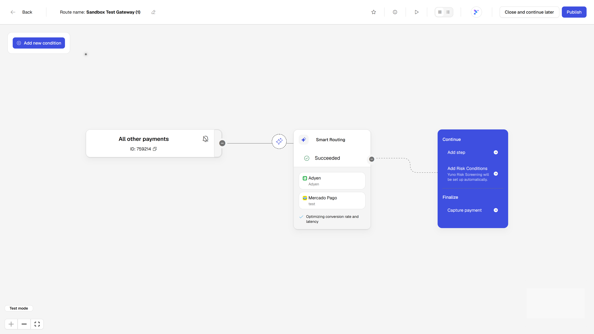
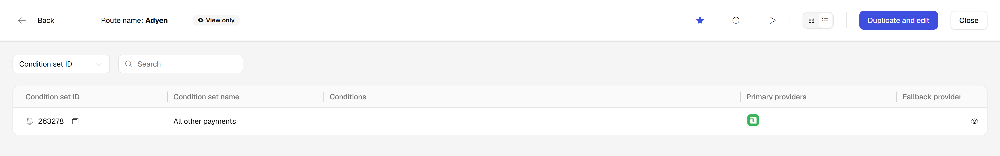

import { Video } from "/snippets/Video.jsx";
import { ExplainerVideo } from "/snippets/pt-br/ExplainerVideo.jsx";

## O que é roteamento dinâmico? {#what-is-dynamic-routing}

O roteamento dinâmico é uma técnica de orquestração de pagamentos que melhora a experiência de pagamento dos usuários enquanto automatiza o processo de aumentar as taxas de aprovação. Ele consiste em direcionar as transações de pagamento ao provedor de serviços de pagamento ou banco adquirente mais adequado, com base em vários fatores, como tipo de cartão, valor da transação, moeda e origem do pagamento. Você também pode usar o recurso [Smart Routing](#smart-routing), que usa inteligência artificial para identificar a taxa de conversão ideal e alocar as transações ao provedor mais adequado.

<Note>
**Configuração do roteamento**

Se você usa as integrações de checkout Embedded ou Semi-lite, pode configurar o roteamento dos meios de pagamento habilitados depois de definir as condições em que cada meio deve ser exibido. No entanto, se você usa a versão Lite, todos os meios de pagamento disponíveis ficam acessíveis imediatamente, e você pode começar a configurar como cada pagamento é processado.
</Note>

<Note>
**Edição de rotas publicadas**

Você pode configurar e editar qualquer aspecto de uma rota publicada, incluindo monitores e outras configurações. As rotas publicadas continuam totalmente editáveis.
</Note>

<ExplainerVideo src="/videos/explainers/smart-routing-fallback.mp4" poster="/videos/explainers/smart-routing-fallback.jpg" title="Smart Routing e fallback" duration="66 s" />

## Por que usar roteamento dinâmico? {#why-use-dynamic-routing}

O [dashboard](https://dashboard.y.uno/auth/login) fácil de usar da Yuno oferece uma interface gráfica para configurar regras de negócio para pagamentos. O recurso de roteamento dinâmico da Yuno permite criar fluxos de pagamento personalizados, definindo serviços de validação e processamento de acordo com seus requisitos específicos. Assim, você pode priorizar os serviços que atendem às suas necessidades, como os de tarifas menores ou taxas de aprovação maiores.

Ao aproveitar o roteamento dinâmico, você terá várias vantagens:

<CardGroup cols={2}>
  <Card title="Otimização" icon="bolt">
    Otimize sua estratégia de processamento de pagamentos diante de mudanças de mercado ou exigências regulatórias, ajustando rapidamente as regras de roteamento.
  </Card>
  <Card title="Custos reduzidos" icon="money-bill-transfer">
    Reduza significativamente as tarifas de processamento de pagamentos roteando as transações pelo PSP ou serviço com melhor custo-benefício.
  </Card>
  <Card title="Mitigação de fraude" icon="shield-check">
    Direcione transações de alto risco a provedores especializados em prevenção de fraude, minimizando sua exposição a atividades fraudulentas.
  </Card>
  <Card title="Maior velocidade de processamento" icon="gauge-high">
    Garanta um processamento eficiente das transações direcionando o volume ao PSP mais adequado com base na capacidade e nos tempos de resposta.
  </Card>
</CardGroup>

## Configurando o roteamento dinâmico {#configuring-the-dynamic-routing}

<Tip>
Os meios de pagamento que ainda não têm rota não aparecem em **Published**: procure a aba **Not published** no topo da seção Routing. É lá que você encontra todos os meios de pagamento conectados à sua conta que ainda precisam de uma rota.
</Tip>

1. Primeiro, acesse seu [dashboard da Yuno](https://dashboard.y.uno/auth/login) e vá para **Routing**. A seção Routing separa os meios de pagamento em **published** e **Not published**. Na aba **Not published**, você encontra os meios de pagamento conectados à sua conta que não têm uma rota publicada.
2. Escolha um meio de pagamento e clique em **Set up**. Em seguida, um painel aparece; clique em **Create new route** para começar a configurar as rotas.
3. Dê um nome à rota que você vai montar e clique em **Save**.
4. Use o botão **Add new condition** para definir a condição que vai acionar a rota de processamento do pagamento.
5. Selecione e defina um ou mais tipos de condição para restringir o uso da rota. As condições disponíveis variam de acordo com o meio de pagamento selecionado. Marque uma condição para ver opções intuitivas de configuração de cada uma.
6. Adicione conexões à condição criada. Clique na seta ao lado da condição e depois em **Add step**. Você verá uma lista de conexões disponíveis, incluindo soluções de fraude, processadores e adquirentes; selecione uma e clique em **Select**. Se você selecionar mais de uma conexão, terá que clicar em **Next** e definir a porcentagem de pagamentos que passa por cada uma ou selecionar Smart Routing para fazer a alocação automaticamente de acordo com sua preferência.
7. Para cada nova conexão, você pode definir caminhos para cada caso possível (**Succeeded**, **Pending**, **Declined** e **Error**). Novas etapas podem ser conectadas a cada cenário para montar um roteamento completo que atenda às suas demandas.
8. Depois de adicionar todas as etapas da rota do processo de pagamento, você pode publicá-la usando o botão **Publish**, deixando-a disponível para o respectivo meio de pagamento.

<Video src="https://github.com/writechoiceorg/yuno-images/raw/main/doc/yourPaymentsOperationSystem/routing_V3.mp4" />

## Tentativas de fallback e resultados do pagamento {#fallback-attempts-and-payment-outcomes}

Os ramos **Error** e **Declined** seguem os caminhos configurados para esses resultados. Chegar a outro provedor significa que outra tentativa de pagamento pode ser feita; essa tentativa ainda pode falhar ou ficar pendente. Em um pagamento dividido entre conexões (consulte [roteamento dividido](/pt-br/docs/basic-concepts/transactions)), uma parte bem-sucedida, sozinha, não estabelece que o pagamento inteiro foi bem-sucedido.

Use o [`status` e o `sub_status`](/reference/payments/status-and-response-codes/payment) do pagamento para determinar o resultado dele. [Recupere o pagamento por ID](/reference/payments/retrieve-payment-by-id) para obter o estado atual e use [webhooks](/docs/webhooks) para receber atualizações. Por exemplo, `PENDING` com `AUTHORIZED` significa que o pagamento com cartão está autorizado e ainda não foi capturado.

## Smart routing {#smart-routing}

O Smart Routing é uma solução criada para otimizar de forma inteligente o desempenho dos pagamentos de acordo com a variável que você, como lojista, escolher otimizar. Para ativar o Smart Routing, selecione duas ou mais conexões ao definir as condições, clique em **Next** e ative a opção Smart Routing.

O Smart Routing pode otimizar seus pagamentos de duas formas:

* **Taxa de conversão e latência**: toma decisões inteligentes para otimizar o tempo de processamento e, ao mesmo tempo, alcançar a maior taxa de conversão.
* **Taxa de conversão e custos**: toma decisões inteligentes para otimizar os custos e, ao mesmo tempo, alcançar a maior taxa de conversão. Informe os custos associados a cada provedor na seção [Connections](/pt-br/docs/using-yuno/dashboard-overview/connections). O Smart Routing usa os custos que você configura na página da conexão para otimizar seus custos.

Você só precisa especificar com quais provedores quer trabalhar e qual variável quer otimizar, e o Smart Routing vai rotear cada pagamento pelo caminho ideal.

O Smart Routing pode ser aplicado automaticamente, otimizando a distribuição dos pagamentos para você. Como alternativa, o controle manual permite definir a porcentagem exata de transações a rotear por cada conexão.

<Video src="https://github.com/writechoiceorg/yuno-images/raw/refs/heads/main/doc/yourPaymentsOperationSystem/smart-routing.mp4" />

## Pós-autorização depois do Smart Routing {#post-authorization-after-smart-routing}

Você pode adicionar um provedor de pós-autorização depois de uma etapa de Smart Routing. Isso permite executar ações adicionais, como análises de risco ou liquidações/capturas, após a aprovação. Adicione uma nova etapa e escolha o provedor desejado (por exemplo, Cybersource).

<Frame></Frame>

## Antifraude e autenticação {#antifraud--authentication}

Você pode configurar fluxos de antifraude e autenticação como parte da configuração de roteamento. Esses fluxos ajudam a aumentar a segurança e a conformidade do seu processamento de pagamentos.

### Como configurar fluxos de antifraude e autenticação {#how-to-configure-antifraud-and-authentication-flows}

Ao montar ou editar uma rota na seção Routing:

1. Depois de adicionar uma conexão ou etapa à rota, clique na etapa para configurá-la.
2. No painel de configuração da etapa, você encontra opções para fluxos de **Antifraud & Authentication**.
3. Selecione o tipo de fluxo que deseja configurar:
   * **3DS**: habilite a autenticação 3D Secure para adicionar uma camada extra de segurança aos pagamentos com cartão. Isso exige que os titulares do cartão concluam uma autenticação adicional durante o processo de pagamento.
   * **Preauth**: configure fluxos de pré-autorização para validar os meios de pagamento antes de concluir a transação. Isso permite verificar se há fundos disponíveis e se o meio de pagamento é válido antes de finalizar a transação.
   * **Postauth**: configure fluxos de pós-autorização para fazer verificações adicionais depois que um pagamento foi autorizado. Se uma verificação de pós-autorização for recusada, você pode configurar uma ação de cancelamento da transação para reverter a autorização automaticamente.
4. Configure as demais opções específicas do tipo de fluxo selecionado.
5. Salve as alterações para aplicar a configuração à rota.

### Fluxos disponíveis {#available-flows}

* **3DS**: configure a autenticação 3D Secure para adicionar uma camada extra de segurança aos pagamentos com cartão. Esse fluxo exige que os titulares do cartão concluam etapas adicionais de autenticação durante o processo de pagamento, ajudando a reduzir a fraude e a cumprir os requisitos de Strong Customer Authentication (SCA).
* **Preauth**: configure fluxos de pré-autorização para validar os meios de pagamento antes de concluir a transação. Isso permite verificar se há fundos disponíveis e se o meio de pagamento é válido antes de finalizar a transação, reduzindo o risco de pagamentos recusados mais adiante no processo.
* **Postauth**: configure fluxos de pós-autorização para fazer verificações de segurança adicionais depois que um pagamento foi autorizado. Se uma verificação de pós-autorização for recusada, você pode configurar uma ação de cancelamento da transação para reverter a autorização automaticamente, protegendo seu negócio de transações fraudulentas que passam pela autorização inicial.

### Captura automática {#automatic-capture}

Você pode configurar a captura automática com um atraso definido. Isso permite capturar automaticamente os pagamentos autorizados após um período especificado, simplificando o fluxo de processamento de pagamentos.

<Note>
**Configuração da captura automática**

A captura automática com atraso é configurada pela [API Create Payment](/reference/payments/create-payment) usando `delayed_capture_settings` ao criar um pagamento. Esse recurso não está disponível no momento na interface de Routing do dashboard. Para informações detalhadas sobre como configurar a captura com atraso, incluindo o formato e as configurações do atraso, consulte a documentação [Fluxo de cancelamento e captura](/docs/payment-features/Cancel-and-capture-flow).
</Note>

Ao usar a captura automática:

* Defina `capture: false` na requisição de pagamento
* Configure `delayed_capture_settings` com um campo `delay` no formato ISO 8601 (por exemplo, "P7D" para 7 dias, "PT3H" para 3 horas)
* Opcionalmente, defina `simplified_mode: true` para habilitar a nova tentativa automática se a captura falhar

A captura automática vai processar os pagamentos autorizados após o período de atraso especificado, reduzindo a intervenção manual e garantindo a liquidação das transações no prazo.

## Perfis de risco nas condições de roteamento {#risk-profiles-in-routing-conditions}

Uma condição de roteamento pode ser protegida por um perfil de risco: uma conexão que não é de pagamento (Fraud, 3DS ou Authentication) colocada no início da condição, antes dos provedores de pagamento. Isso habilita block lists, allow lists e regras de velocidade em uma rota.

Esse recurso permite adicionar e remover perfis de risco no lugar, deixando a cadeia de pagamento existente intacta. Antes, era preciso excluir a condição de roteamento e reconstruí-la do zero.

<Note>
**Disponibilidade**

Esse recurso está disponível apenas para Payins (fica oculto para Payouts) e pode ser acessado a partir de três pontos de entrada:
* O menu por condição (⋮) na visualização em árvore.
* O menu por linha (⋮) na visualização em lista.
* A barra de ações em massa na visualização em lista, para aplicar a alteração a várias condições de uma vez.
</Note>

### Adicionando um perfil de risco {#adding-a-risk-profile}

Ao adicionar um perfil de risco:
1. Selecione uma conexão de Fraud, 3DS ou Authentication.
2. A conexão é inserida no início da condição: a saída **Succeeded** dela herda o que a condição tinha antes como início.
3. O roteamento de pagamento existente, incluindo as divisões por porcentagem, é preservado sem alterações, e o perfil de risco passa a ser o novo ponto de entrada.

<Tip>
**Empilhamento de perfis de risco**

Os perfis de risco se empilham: adicionar um segundo perfil de risco o coloca à frente do existente (por exemplo, 3DS → Risk Screening → Payments).
</Tip>

Quando a conexão escolhida é o Yuno Risk Screening, uma segunda etapa opcional permite configurar a block list, a allow list ou as regras de velocidade dele no mesmo fluxo, aplicadas a todas as condições selecionadas. Pular essa etapa insere a conexão sem nenhuma configuração adicional.

### Removendo um perfil de risco {#removing-a-risk-profile}

Remover um perfil de risco o tira do início da condição e promove o ramo Succeeded dele de volta ao início: o roteamento de pagamento que ele protegia volta a ser o ponto de entrada, com as divisões de tráfego preservadas.

Só o ramo **Succeeded** permanece. Qualquer rota que fique inalcançável como resultado, como os ramos de fallback **Error**, **Declined** ou **Pending** do perfil removido e tudo o que vem depois deles, é removida recursivamente.

Uma rota que ainda pode ser alcançada pelo ramo **Succeeded** (por exemplo, um provedor que é destino tanto de Succeeded quanto de Declined) é mantida. O resultado é sempre um grafo de roteamento limpo, sem nós órfãos.

Nas ações em massa, a remoção atinge a conexão escolhida em todas as condições selecionadas. As condições que não usam a conexão selecionada ficam intactas.

## Visualização em lista {#list-view}

Ao trabalhar com rotas complexas ou extensas, você pode usar a List view em vez do diagrama de fluxo visual. A List view oferece uma representação estruturada, em formato de tabela, da configuração da rota, facilitando revisar e gerenciar rotas que têm muitos conjuntos de condições ou configurações complexas.

Para acessar a List view, navegue até uma rota na seção Routing e clique no botão **List view** na barra de navegação superior. A List view mostra a configuração da rota em formato de tabela, com colunas para Condition set ID, Condition set name, Conditions, Primary providers, Fallback providers e Other providers.

Você pode filtrar os conjuntos de condições por ID, buscar configurações específicas e clicar no ícone de olho em qualquer linha para ver informações detalhadas. Essa visualização é especialmente útil quando a rota tem muitos conjuntos de condições ou quando fica difícil navegar pelo diagrama visual.

<Frame></Frame>
