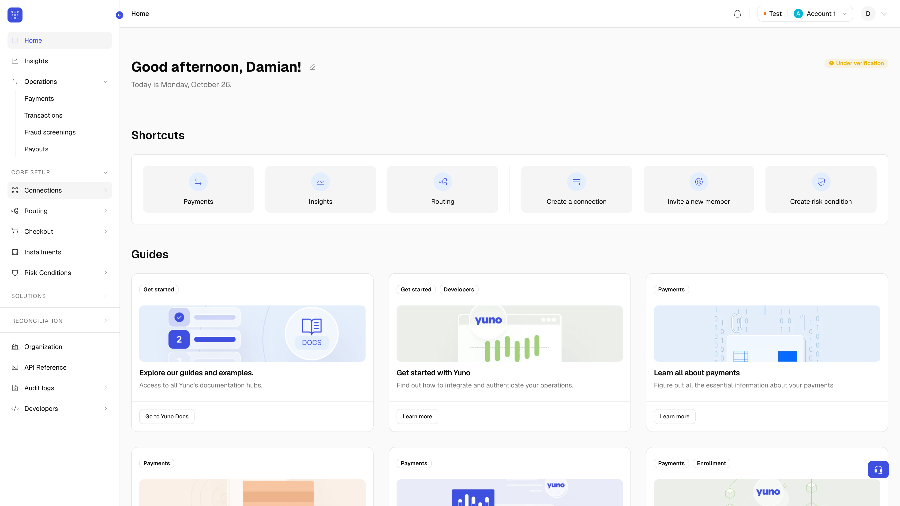

O dashboard da Yuno oferece uma interface centralizada para gerenciar e configurar suas contas da Yuno, com as principais funcionalidades organizadas para acesso rápido. Algumas das funcionalidades do dashboard são:

* Conectar-se a uma lista cada vez maior de provedores
* Criar experiências de checkout personalizadas
* Visualizar dados completos de pagamentos
* Configurar o Smart Routing
* E muito mais

<Frame></Frame>

O checkout unificado e a integração de pagamentos da Yuno simplificam sua stack de pagamentos e integram APIs e ferramentas de toda a web, criando fluxos de pagamento dinâmicos de ponta a ponta. Nossa documentação vai guiar você pela arquitetura do dashboard, pelos principais componentes e pelas funcionalidades, para que você aproveite ao máximo os recursos de orquestração de pagamentos da Yuno.