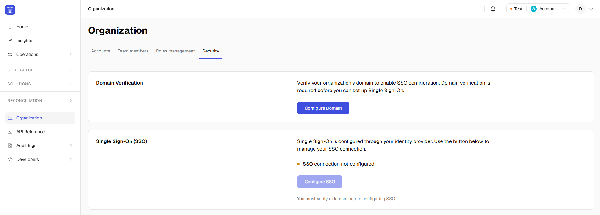
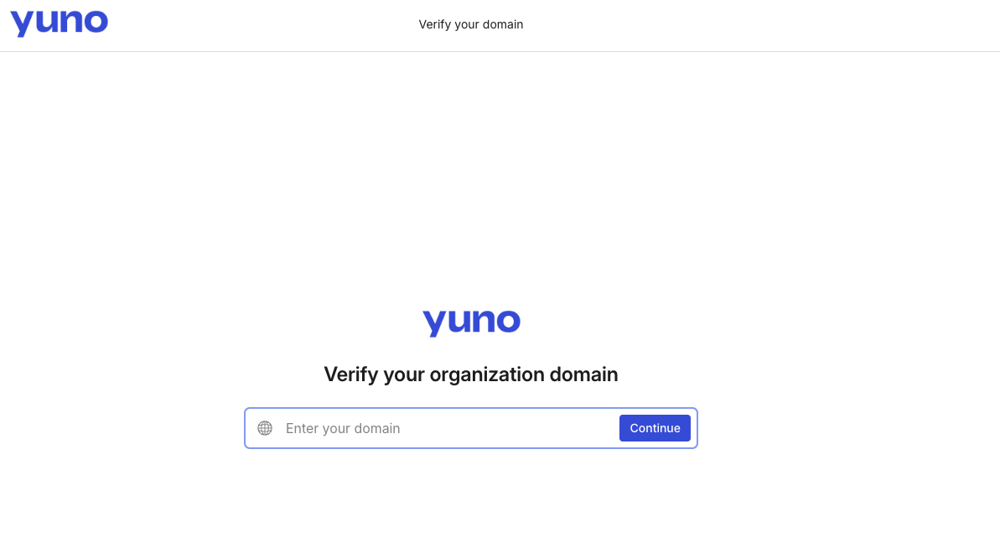
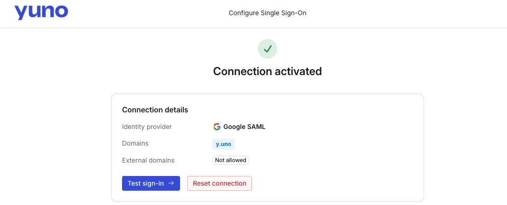

O **Single Sign-On (SSO)** permite que sua equipe faça login no dashboard da Yuno usando o provedor de identidade (IdP) que sua empresa já usa, em vez de criar credenciais separadas para a Yuno.

<Tip>
**Está sem acesso agora?** Os emails de redefinição de senha não vão devolver seu acesso se a sua organização usa SSO. Envie um email diretamente para [support@y.uno](mailto:support@y.uno) com o seu endereço de email e o horário aproximado em que você tentou entrar, para que a equipe possa verificar o que está bloqueando o acesso. Não fique esperando um email de redefinição de senha que talvez nunca resolva o problema.
</Tip>

A Yuno oferece SSO pelo padrão **SAML 2.0** e é compatível com uma ampla variedade de provedores de identidade, incluindo Google Workspace, Microsoft Entra ID (Azure AD), Okta, OneLogin, JumpCloud, ADFS, Ping Identity, Auth0, Keycloak e qualquer provedor compatível com SAML 2.0. A configuração é feita em um portal hospedado dedicado: você não precisa colar metadados SAML, entity IDs nem certificados dentro do dashboard da Yuno.

<Note>
Esta página descreve o fluxo atual de configuração do SSO, que usa um portal hospedado tanto para a verificação de domínio quanto para a configuração do SSO. Se a sua organização configurou o SSO pelo método anterior, dentro do dashboard, refaça a configuração seguindo as etapas abaixo.
</Note>

## Pré-requisitos {#prerequisites}

<Warning>
**Antes de começar**

- **Perfil de administrador** em todas as contas que pertencem à sua organização.
- **Acesso ao DNS** para adicionar um registro TXT durante a verificação de domínio.
- **Acesso de administrador ao IdP** para concluir a configuração SAML no console do seu provedor de identidade.
</Warning>

## Configuração do SSO {#setting-up-sso}

A aba **Security → Single sign-on** contém dois cards: **Domain Verification** e **Single Sign-On**. Conclua-os nessa ordem. A configuração do SSO fica bloqueada até que seu domínio seja verificado.

<Frame></Frame>

<Steps>
  <Step title="Verifique o domínio da sua organização">
    A verificação de domínio comprova que sua organização é dona do domínio de email que os usuários vão usar para entrar (por exemplo, `acme.com`).

    1. No dashboard da Yuno, vá para **Organization** → **Security** → **Single sign-on**.
    2. No card **Domain Verification**, clique em **Configure Domain**.
    3. Uma nova aba do navegador abre com o portal de verificação de domínio da Yuno.

    <Frame></Frame>

    4. Informe o domínio de email que você quer verificar e clique em **Continue**.
    5. Copie o registro TXT fornecido pelo portal e adicione-o ao seu provedor de DNS exatamente como mostrado, sem aspas ou espaços extras.
    6. Volte ao portal e clique em **Verify**.
    7. Volte ao dashboard da Yuno. Quando o registro se propagar e o portal validá-lo, o card Domain Verification exibe o selo verde **Domain verified · your-domain.com**.

    <Note>
    A propagação do DNS pode levar de alguns minutos a algumas horas. O status da verificação é atualizado automaticamente quando você abre a página de novo.
    </Note>
  </Step>

  <Step title="Configure sua conexão de SSO">
    Depois que o domínio é verificado, o botão **Configure SSO** do card Single Sign-On fica ativo. Se o domínio ainda não foi verificado, o botão fica desabilitado e o card mostra a mensagem *"You must verify a domain before configuring SSO."*

    1. Clique em **Configure SSO**. Uma nova aba do navegador abre com o portal hospedado de configuração do SSO.
    2. Escolha seu provedor de identidade no catálogo (Google, Microsoft Entra ID, Okta, OneLogin, JumpCloud, Generic SAML e outros).
    3. O portal guia você pela configuração da conexão com instruções específicas de cada provedor. Os campos mais comuns são:

    | Campo | Direção |
    |-------|-----------|
    | **ACS URL** (Assertion Consumer Service URL) | Fornecido pelo portal, cole no seu IdP |
    | **SP Entity ID** | Fornecido pelo portal, cole no seu IdP |
    | **IdP Sign-In URL** | Fornecido pelo seu IdP, cole no portal |
    | **IdP X.509 Certificate** | Fornecido pelo seu IdP, cole no portal |

    4. Salve a conexão no portal. O portal valida a conexão de ponta a ponta antes de ela entrar em funcionamento.

    <Frame></Frame>

    5. Volte ao dashboard da Yuno. O card **Single Sign-On** exibe um dos seguintes status:

    | Status | Significado |
    |--------|---------|
    | **SSO is ready to use** · `Google SAML` / `Okta SAML` / `SAML` | A conexão está ativa e os usuários podem entrar com SSO. O selo inclui o tipo de conexão. |
    | **SSO connection active** | A conexão existe e funciona, mas ainda não foi marcada como pronta para uso geral |
    | **SSO connection not configured** | Não existe conexão ou a conexão está inativa. Clique em **Configure SSO** para concluir a configuração |

    <Note>
    Você não precisa enviar metadados XML, colar um entity ID nem enviar um certificado dentro do dashboard da Yuno. Toda a configuração SAML fica no portal hospedado.
    </Note>
  </Step>
</Steps>

## Login com SSO {#signing-in-with-sso}

Quando a conexão estiver ativa, os usuários podem entrar com SSO pela página de login da Yuno:

1. Abra `dashboard.y.uno`. Você é redirecionado rapidamente por `id.y.uno`, o domínio de autenticação da Yuno.
2. Informe seu endereço de email corporativo e clique em **Continue with SSO**.
3. Você é redirecionado ao seu provedor de identidade para se autenticar.
4. Depois que o seu IdP autenticar você, você volta ao dashboard da Yuno.

## Gerenciamento do SSO {#managing-sso}

- **Desativar ou reativar o SSO**: **Security** → **Login methods** mostra se o SSO está habilitado para a sua organização. A alteração não é self-service: entre em contato com a equipe da Yuno para ativar ou desativar o SSO. Consulte [Métodos de login](/pt-br/docs/using-yuno/organization/security#login-methods).
- **Editar uma conexão existente**: vá para **Security** → **Single sign-on** e clique em **Configure SSO** para abrir de novo o portal hospedado e atualizar a configuração.

## Solução de problemas {#troubleshooting}

**Os usuários voltam para a tela de login**

A Yuno exige que tanto a resposta SAML quanto a asserção sejam assinadas com SHA-256. Se o login falhar, confirme no seu IdP que a resposta e a asserção estão assinadas com SHA-256 e que o certificado registrado no portal hospedado é o mesmo que o seu IdP está usando no momento.

**Rotação de certificados**

Quando você trocar os certificados no seu IdP, abra de novo o portal hospedado de SSO e atualize o certificado lá. Até que o portal tenha o novo certificado, os logins com SSO vão falhar.

**Logs de login com SSO**

Os usuários do dashboard não podem ver diretamente os logs de auditoria das tentativas de SSO. Para investigar um problema de autenticação, entre em contato com o suporte da Yuno informando o endereço de email do usuário e o horário aproximado, para que a equipe de suporte possa recuperar os logs relevantes.
