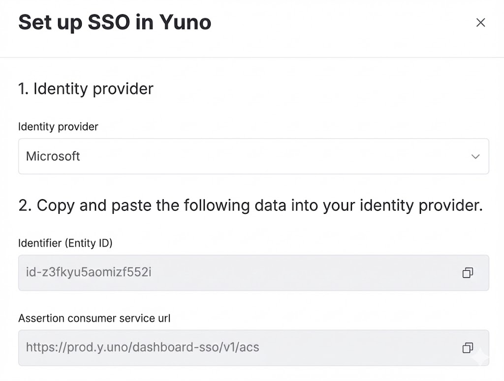
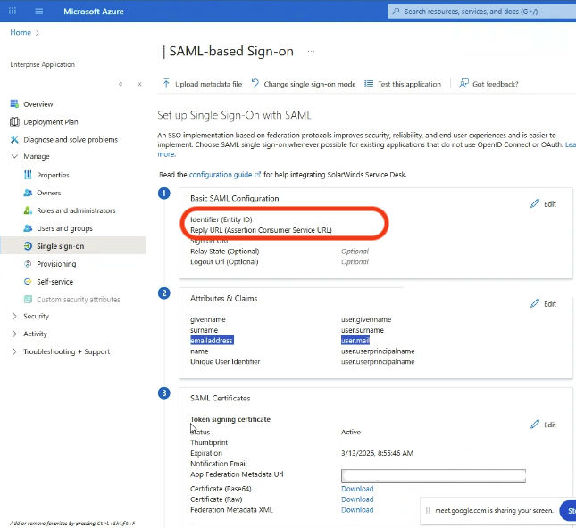
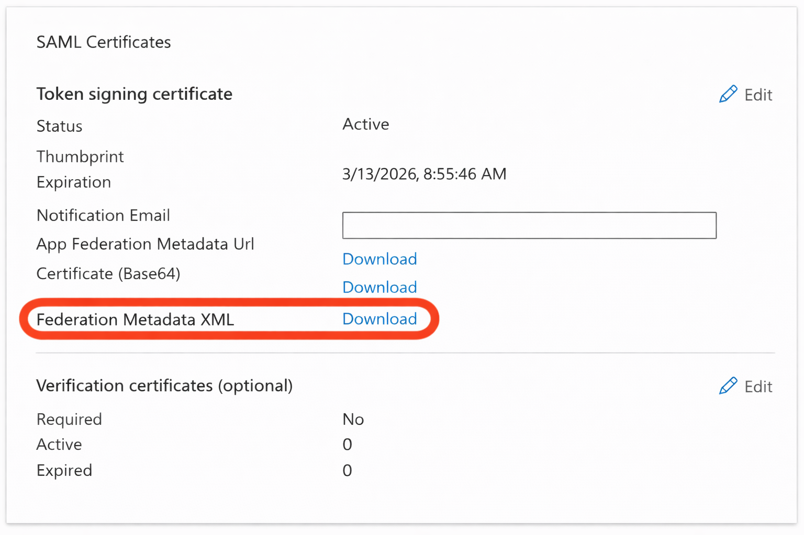
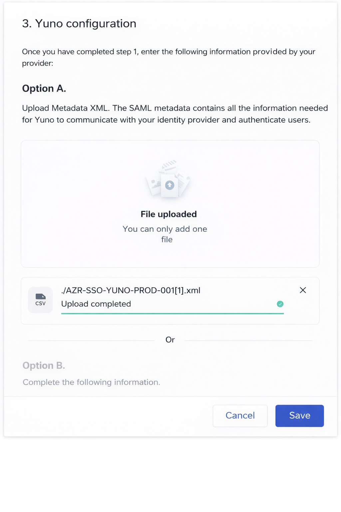

Este guia explica como conectar a Yuno ao Microsoft Entra ID (antigo Azure Active Directory) usando SAML 2.0.

## Pré-requisitos {#prerequisites}

* Um tenant do Microsoft Entra ID
* Um aplicativo para uso com a Yuno
* Privilégios de administrador no Entra ID para gerenciar as configurações de SSO
* Acesso ao [dashboard da Yuno](https://dashboard.y.uno/)

<Steps>
  <Step title="Defina as configurações básicas de SAML">
    Primeiro, acesse o dashboard, clique na sua imagem de perfil e abra **Security**. Navegue até a aba Single Sign-On (SSO), clique em **Set up** e reúna estas informações:

    * Identifier (Entity ID)
    * Assertion Consumer Service URL

    <Frame></Frame>

    No Microsoft Entra ID, acesse:

    **Enterprise applications → All applications → Your application → Single sign-on**

    Em **Basic SAML configuration**, informe os valores do dashboard da Yuno.

    <Frame></Frame>
  </Step>

  <Step title="Exporte e envie o XML de metadados de federação">
    No Microsoft Entra ID, navegue até a seção **SAML certificates** e baixe o arquivo **Federation Metadata XML**.

    <Frame></Frame>

    Em seguida, no dashboard da Yuno:

    1. Envie o arquivo XML em **Yuno configuration → Option A: Upload metadata XML**
    2. Aguarde a confirmação **Upload completed**
    3. Clique em **Save**

    <Frame></Frame>

    Como alternativa, você pode usar as informações listadas na **Option B** e informá-las manualmente.
  </Step>

  <Step title="Verifique as configurações do certificado SAML">
    No Microsoft Entra ID, abra **SAML certificates** e confirme que:

    * A opção de assinatura é **Sign SAML response and assertion**
    * O algoritmo de assinatura é **SHA-256**

    Clique em **Save** para aplicar as alterações.
  </Step>
</Steps>

## Solução de problemas {#troubleshooting}

Se você não conseguir configurar a conexão SSO ou tiver problemas após a configuração inicial:

* Lembre-se de que a Yuno exige **respostas SAML assinadas**. Verifique se:
  * A resposta SAML e a asserção estão assinadas
  * O algoritmo de assinatura é **SHA-256**
  * O certificado de assinatura corresponde ao que foi enviado para a Yuno
* Revise os logs de SSO no dashboard da Yuno em **Security → Single sign-on (SSO)**