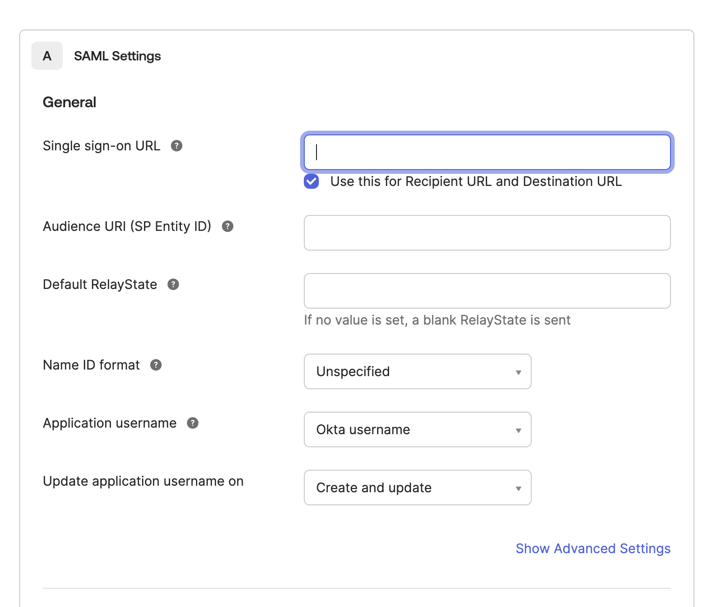
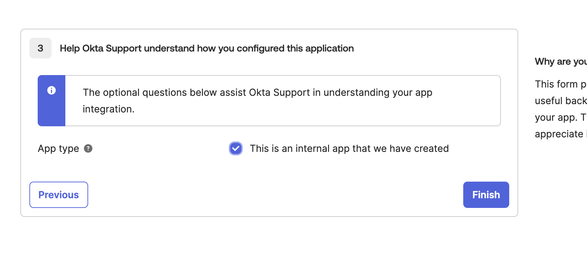
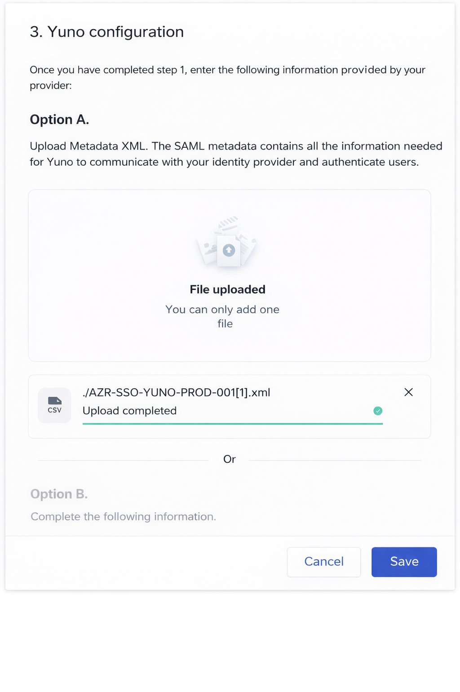

Este guia explica como conectar a Yuno ao Okta usando SAML 2.0.

## Pré-requisitos {#prerequisites}

* Uma conta no Okta
* Privilégios de administrador no Okta para gerenciar as configurações de SSO e criar aplicações (você vai criar a aplicação SAML para a Yuno no Passo 1 abaixo; nenhuma aplicação precisa existir antes)
* Acesso ao [dashboard da Yuno](https://dashboard.y.uno/)

<Steps>
  <Step title="Crie uma aplicação SAML no Okta">
    No Okta, acesse:

    **Applications → Create App Integration → SAML 2.0 → Next**

    Escolha um nome para a sua aplicação e, se quiser, faça upload de um logo. Em seguida, você verá o formulário de configuração SAML.

    <Frame></Frame>
  </Step>

  <Step title="Configure as definições SAML usando os valores da Yuno">
    Abra o dashboard da Yuno, clique na sua imagem de perfil e abra **Security**.  Navegue até a aba **Single Sign-On (SSO)**, clique em **Set up** e reúna estas informações:

    * Identifier (Entity ID)
    * Assertion Consumer Service URL

    Copie esses valores para o formulário SAML do Okta:

    * **Audience URI (SP Entity ID)** → Identifier (Entity ID)
    * **Single sign-on URL** → Assertion Consumer Service URL

    Clique em **Next**, marque a opção **This is an internal app…** e conclua a configuração.

    <Frame></Frame>
  </Step>

  <Step title="Exporte e faça upload do XML de metadados">
    No Okta, localize a **Metadata URL** nas configurações da aplicação e abra-a. Salve o arquivo como `metadata.xml`.

    Depois, no dashboard da Yuno:

    1. Faça upload do arquivo `metadata.xml` em **Yuno configuration → Option A: Upload metadata XML**
    2. Aguarde a confirmação **Upload completed**
    3. Clique em **Save**

    <Frame></Frame>

    Como alternativa, você pode pegar as informações listadas em **Option B** e inseri-las manualmente.
  </Step>

  <Step title="Atribua usuários no Okta (opcional)">
    Depois que a configuração estiver concluída, você pode atribuir usuários ou grupos do Okta à aplicação para que eles possam fazer login usando SSO.
  </Step>
</Steps>

## Solução de problemas {#troubleshooting}

Se você não conseguir configurar a conexão SSO ou tiver problemas após a configuração inicial:

* A Yuno exige **respostas SAML assinadas**; verifique se:
  * Tanto a resposta SAML quanto a asserção estão assinadas
  * O algoritmo de assinatura configurado no Okta é **SHA-256**
  * O certificado usado para assinatura corresponde ao incluído nos metadados
* Revise os logs de SSO no dashboard da Yuno em **Security → Single sign-on (SSO)**