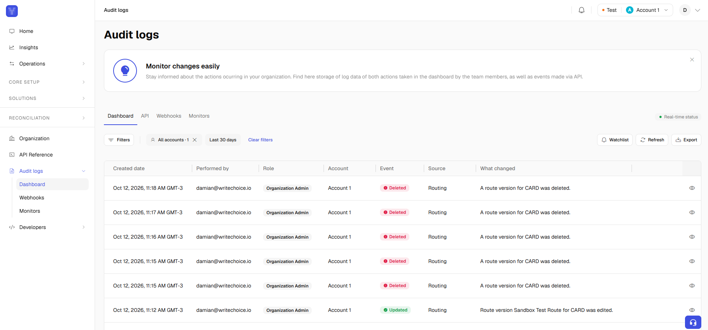

A seção **Audit logs** oferece transparência, segurança e conformidade regulatória ao registrar e rastrear todas as atividades dos membros da equipe no dashboard. Com os logs de auditoria, você fica informado sobre as ações que acontecem dentro da sua organização.

<Frame></Frame>

Os logs de auditoria da Yuno simplificam as tarefas de gerenciamento com vários recursos:

* **Registro completo de atividades**: acompanhe cada ação realizada no dashboard, quando ela ocorreu e as alterações feitas. Esse nível de detalhe garante transparência e responsabilização em todas as operações.
* **Rastreamento de usuários**: os logs de auditoria garantem que cada ação possa ser atribuída a uma pessoa específica, permitindo identificar a causa de qualquer alteração e analisar o comportamento dos usuários para melhoria contínua.
* **Dados técnicos detalhados**: clicar na tag **Event** de cada ação (como "Updated" ou "Created") mostra informações adicionais para desenvolvedores e usuários técnicos, incluindo o endereço IP do dispositivo usado para fazer a alteração e o corpo da resposta do endpoint da API.
* **Recursos avançados de busca**: selecione **Add filters** para refinar sua busca rapidamente. Escolha entre vários filtros, incluindo contas, datas, membros da equipe e outros, para localizar com eficiência os dados de que você precisa.

Os logs de auditoria são essenciais para a segurança e a conformidade da Yuno, garantindo que cada ação seja registrada. Isso oferece um controle fundamental, protege suas operações e facilita a análise de causa raiz após alterações feitas por usuários.

## Navegar pelos logs de auditoria {#navigating-audit-logs}

A seção **Audit logs** oferece total transparência sobre as ações realizadas na sua conta da Yuno. Ela é organizada em duas abas principais:

* **Dashboard**: aqui você encontra um registro das ações realizadas pelos membros da equipe diretamente no dashboard da Yuno.
* **Monitors**: esta aba permite acompanhar eventos criados via API, oferecendo uma visão das atividades automatizadas ou programáticas.

Nas duas abas, você pode ajustar facilmente o período para visualizar os eventos. Escolha entre opções predefinidas, como hoje, este mês ou os últimos 30 dias, ou defina um intervalo de datas personalizado.

Para encontrar informações específicas com eficiência, use o botão **Add filters**. Ele oferece várias opções para refinar sua busca:

### Na aba Dashboard {#within-the-dashboard-tab}

* **Accounts**: organize os eventos pelas diferentes contas do seu dashboard da Yuno.
* **Date**: selecione entre vários filtros de tempo ou informe um intervalo de datas personalizado.
* **Event**: filtre por ações específicas, como eventos "created", "updated" ou "deleted".
* **Source**: filtre por origem (webhooks, links de pagamento, conexões, roteamento, reembolsos e outras origens) para refinar sua busca.
* **Team member**: veja os logs gerados por ações de um ou mais membros específicos da equipe.

### A aba Monitors oferece um conjunto diferente de filtros {#the-monitors-tab-offers-a-different-set-of-filters}

* **Actions**: filtre por eventos que redistribuem ou não o tráfego.
* **Created at**: especifique o período da sua busca.
* **Payment methods**: organize pelos diferentes meios de pagamento que você configurou, como cartão de crédito.
* **Providers**: filtre por provedores de pagamento específicos.
* **Status**: veja apenas eventos resolvidos ou não resolvidos.