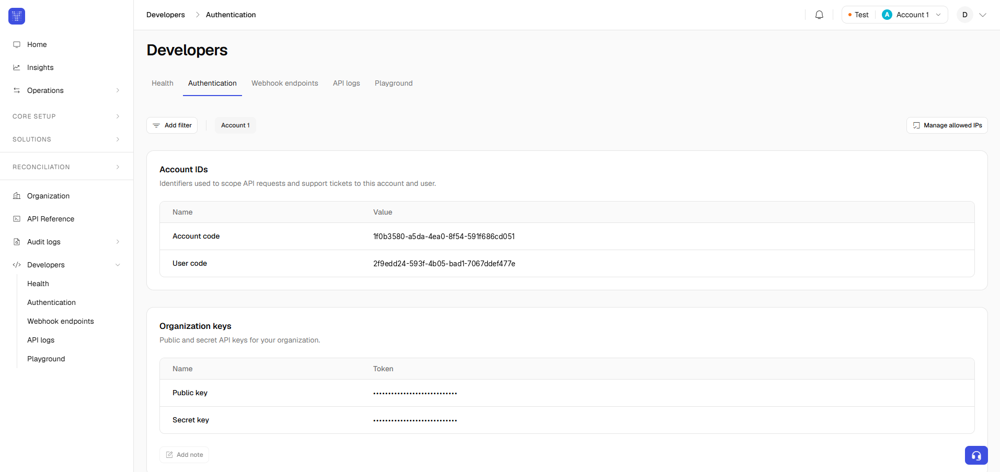

A seção **Developers** do dashboard da Yuno fornece credenciais de autenticação seguras (também chamadas de chaves) para integrar os serviços da Yuno. A Yuno mantém chaves separadas para os ambientes Test e Live, o que mantém as credenciais isoladas entre os ambientes e reduz o risco de usar credenciais de produção por engano nos testes.

## Estrutura das credenciais {#credential-structure}

A Yuno usa uma hierarquia de autenticação em dois níveis:

1. **Chaves da organização**
   * Camada principal de autenticação, que funciona como gateway para todas as suas operações
   * Dão acesso a todas as [contas](/pt-br/docs/using-yuno/organization/accounts) associadas à sua organização
   * São atribuídas à sua organização depois do registro na Yuno
   * A chave da organização é o que você envia no cabeçalho `X-Organization-Code` nos endpoints que o exigem (por exemplo, [Create a Report](/reference/reports/create-a-report))

2. **Chaves da conta**
   * Exclusivas de cada conta da sua organização
   * Funcionam de forma independente nos modos Test e Live
   * Oferecem controle de acesso granular

## Acesso às credenciais {#accessing-credentials}

Você pode acessar suas credenciais de autenticação de duas formas:

* **Contas**: a aba [**Accounts**](https://dashboard.y.uno/organization/accounts) da seção Organization contém as credenciais de cada conta. Clique no nome de cada conta para acessar as chaves dela na hora.
* **Seção Developers**:  você também pode acessar suas credenciais de autenticação na seção **Developers**. A aba **Authentication**, aberta por padrão, mostra as chaves da conta, as chaves da organização e as chaves de API personalizadas. Suas permissões determinam quais chaves ficam visíveis. Essa área é especialmente útil ao integrar funcionalidades da Yuno às suas aplicações ou sistemas.

<Frame></Frame>

## Chaves de API personalizadas {#customized-api-keys}

A Yuno permite criar chaves de API personalizadas para mais segurança e controle, garantindo que somente membros autorizados acessem dados e relatórios pela API.

Na aba Authentication da seção Developers, procure Customized API keys e clique em **Create key** ao lado. Ali, você pode definir vários parâmetros:

* O nome da chave e o membro que pode acessá-la.
* Uma ou mais contas associadas à nova chave.
* Um ou mais produtos que a chave pode acessar, como assinaturas, pagamentos, planos de parcelamento e outros.

A flexibilidade das chaves de API personalizadas simplifica o controle de acesso e de permissões, permitindo gerenciar integrações de API de forma fácil e segura pelo dashboard da Yuno.

<Info>
**Importante: exibição da chave de API**

Quando você cria uma chave de API personalizada, o valor da chave é exibido somente uma vez, durante a criação. Copie e guarde a chave em local seguro imediatamente, porque não será possível vê-la de novo. Se você perder a chave ou precisar trocá-la por motivos de segurança, pode regenerá-la (roll), o que invalida a chave anterior e gera uma nova.
</Info>

## Proteção das suas credenciais {#safeguarding-your-credentials}

Proteger suas credenciais de autenticação é fundamental para manter operações seguras. Siga estas orientações:

* Trate as credenciais como informações sensíveis
* Nunca compartilhe credenciais com pessoas não autorizadas
* Monitore o uso das credenciais

<Note>
**Alerta de segurança**

Se você suspeitar de exposição de credenciais ou de acesso não autorizado, entre em contato com nossa equipe de suporte imediatamente. Agir rápido ajuda a manter a segurança das suas operações.
</Note>

## IPs permitidos {#allowed-ips}

Você pode configurar uma lista de endereços IP permitidos para restringir o acesso à API a endereços IP ou faixas de IP específicos. Isso adiciona uma camada extra de segurança, garantindo que as requisições à API só possam vir de endereços IP aprovados.

<Info>
**Importante: validação de IP**

Se nenhum endereço IP for adicionado, os IPs não são validados por padrão. Tenha cuidado ao adicionar novos IPs, pois é uma alteração sensível que pode afetar o processamento de pagamentos.
</Info>

Para configurar os IPs permitidos:

1. Acesse a seção **Developers** no dashboard da Yuno.
2. Vá para a aba **Authentication**.
3. Clique no botão **Manage allowed IPs** (no canto superior direito da aba Authentication).
4. No modal que abrir, informe endereços IP ou faixas de IP no campo **Enter IP address**. Você pode:
   * Informar endereços IP individuais (por exemplo, `192.168.1.1`)
   * Informar faixas de IP usando notação CIDR (por exemplo, `192.168.1.0/24`)
   * Adicionar vários IPs separando-os com vírgula, ponto e vírgula, espaço ou pressionando Enter
5. Revise a lista de IPs permitidos na tabela abaixo.
6. Clique em **Save changes** para aplicar a configuração.

Depois da configuração, as requisições à API vindas de endereços IP fora da lista de permitidos são rejeitadas, aumentando a segurança das suas integrações de API.

<Note>
**Gerenciamento de endereços IP**

Você pode adicionar vários endereços IP ou faixas, e atualizá-los ou removê-los quando necessário. As alterações na lista de IPs permitidos entram em vigor imediatamente.
</Note>

## Webhooks {#webhooks}

A aba **Webhooks** da seção Developers permite criar e gerenciar webhooks para receber notificações em tempo real sobre eventos na sua conta da Yuno.

### Criar um webhook {#creating-a-webhook}

Para criar um novo webhook:

1. Acesse a seção **Developers** no dashboard da Yuno.
2. Clique na aba **Webhooks**.
3. Clique em **Add webhook** para abrir o formulário de criação de webhook.
4. Preencha as informações obrigatórias na seção **Details**:
   * **Name**: informe um nome descritivo para o webhook.
   * **Endpoint URL**: informe a URL para onde a Yuno deve enviar as notificações do webhook.
   * **x-api-key** e **x-secret**: defina as credenciais de autenticação para a verificação do webhook (obrigatório).
   * **Use OAuth 2.0 authentication**: autentique a entrega do webhook usando um token OAuth 2.0 (opcional).
   * **Use HMAC signing**: assine os payloads do webhook com um segredo HMAC (opcional).
5. Em **Trigger on** (obrigatório), selecione os eventos que devem disparar o webhook. As categorias de eventos disponíveis incluem:
   * **Enrollment**: Enroll, Unenroll
   * **Payment**: Authorize, Cancel, Capture, Refund, Verify, Chargeback, Purchase
   * **Report**: Create, Update
   * **Subscription**: Create, Pause, Resume, Cancel, Complete
   A Yuno recomenda selecionar todos os eventos relevantes para garantir uma cobertura completa.
6. Em **Apply this webhook to other accounts** (obrigatório), selecione quais contas devem receber as notificações do webhook. Você pode:
   * Selecionar contas específicas na lista
   * Usar "Select all" para aplicar a todas as contas
   * Usar "Inverse" para inverter sua seleção
   * Escolher "Current account only" para limitar o webhook à conta atual
7. Clique em **Create** para criar o webhook.

### Gerenciar webhooks {#managing-webhooks}

Depois de criado, você pode:

* **Ver os detalhes do webhook**: veja a configuração do webhook, a URL do endpoint e os eventos que o disparam.
* **Editar o webhook**: atualize o nome do webhook, a URL do endpoint, as credenciais de autenticação ou os eventos que o disparam.
* **Testar o webhook**: envie uma notificação de teste para verificar se o webhook está funcionando corretamente.
* **Excluir o webhook**: remova um webhook que não é mais necessário.

<Note>
**Segurança de webhooks**

Use sempre HTTPS nas URLs de endpoint dos seus webhooks para garantir a transmissão segura dos dados do webhook. Além disso, verifique as assinaturas dos webhooks usando a chave pública e a chave secreta privada fornecidas, para garantir que os webhooks são autênticos e não foram adulterados.
</Note>