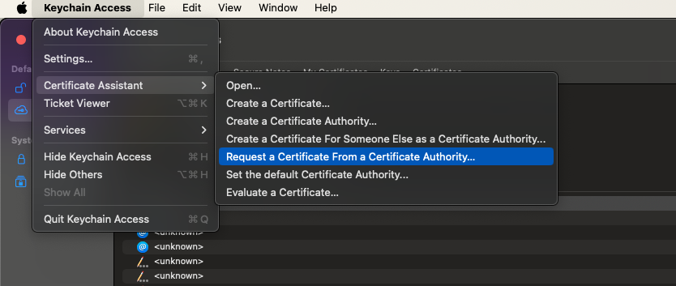
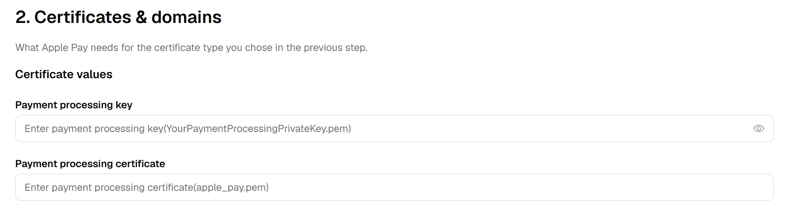
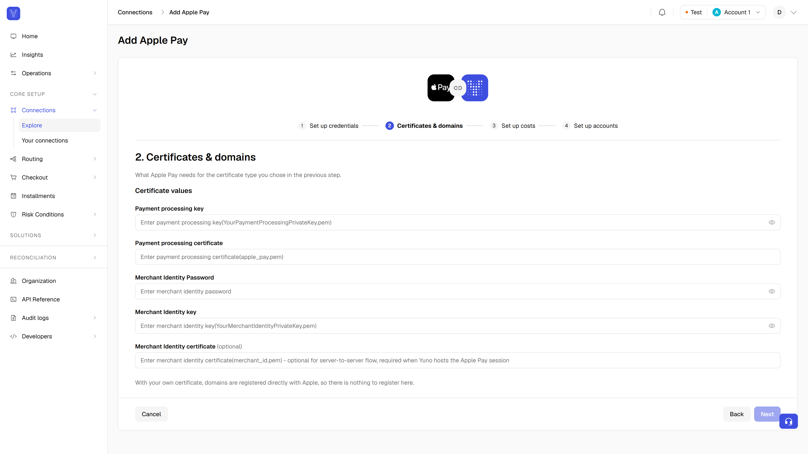
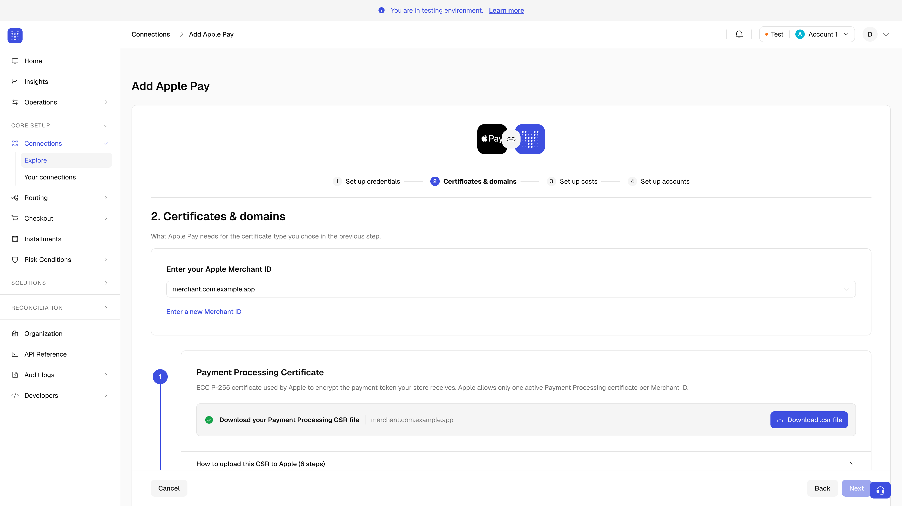
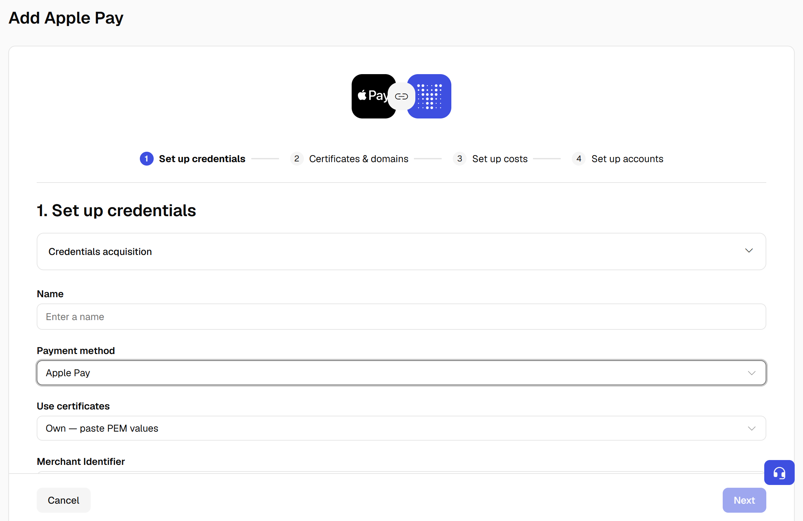
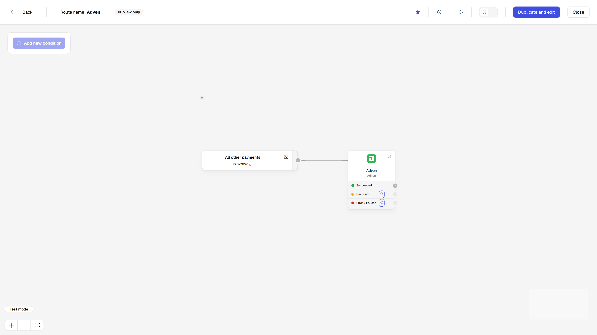
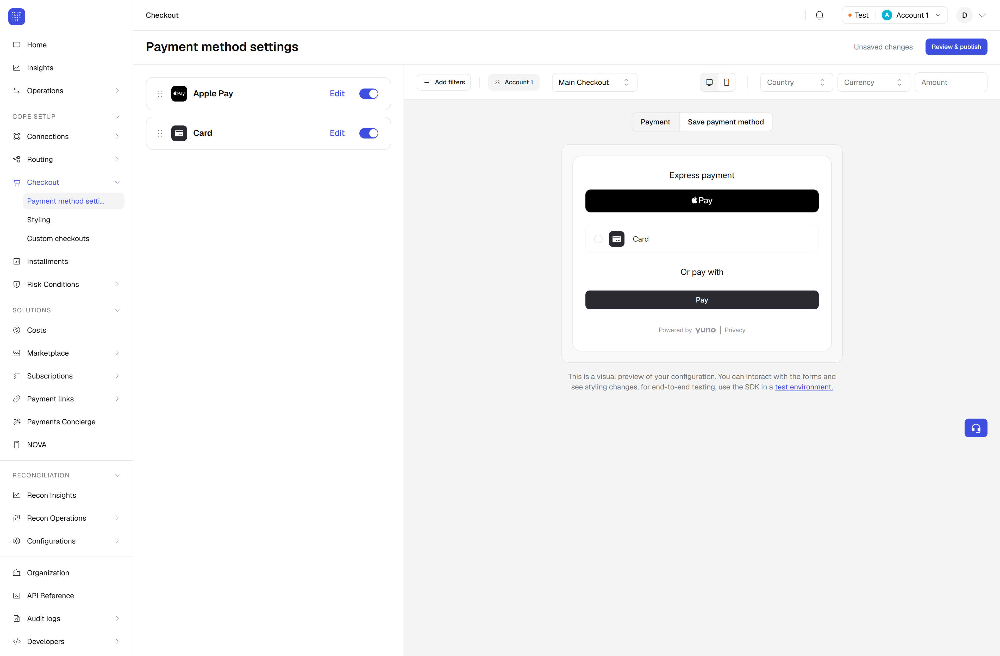

Use este guia para preparar e configurar o Apple Pay com a Yuno.

- [**Pré-requisitos do Apple Developer**](#apple-pay-certificate-options): dependendo do tipo de certificado, talvez você precise criar um identificador de lojista (Merchant ID) e gerar certificados/chaves (Own), ou registrar os domínios do lojista (Yuno).
- [**Configuração no Dashboard da Yuno**](#finish-in-the-dashboard): adicione a conexão do Apple Pay, configure o roteamento e habilite o Apple Pay no Checkout Builder.

Ao terminar, você estará pronto para [escolher o caminho de integração](#next-steps)  (SDK ou Direct) para pagamentos únicos e recorrentes.

## Opções de certificado do Apple Pay {#apple-pay-certificate-options}

No Dashboard da Yuno, você encontra três opções de certificados do Apple Pay:

- **Yuno**: esta opção é para lojistas que não têm uma conta Apple Developer nem um aplicativo móvel (ou seja, que atuam apenas na web). Nesses casos, você precisa registrar os domínios do lojista para usar os certificados da Yuno. [→ Certificados da Yuno: registre os domínios do lojista](#yuno-certificates-register-your-merchant-domains)
- **Own (manual)**: esta opção é para lojistas que têm uma conta Apple Developer e preferem gerenciar as próprias chaves privadas. Você gera e converte os certificados manualmente usando o Keychain Access e o OpenSSL (Passos 2–9) e depois cola os valores PEM no Dashboard da Yuno. [→ Certificados próprios (manual)](#own-certificates-manual)
- **Own — Yuno generates the CSRs**: esta opção é para lojistas que têm uma conta Apple Developer, mas não querem gerar chaves privadas nem executar comandos do OpenSSL. A Yuno gera as Certificate Signing Requests para você; depois, você as envia para a Apple e devolve os certificados assinados. [→ Certificados próprios com CSRs gerados pela Yuno](#own-certificates-with-yuno-generated-csrs)

## Certificados próprios (manual) {#own-certificates-manual}

Este caminho é para lojistas que têm uma conta Apple Developer e querem gerar e gerenciar os certificados manualmente usando o Keychain Access e o OpenSSL.

### Passo 1: Registre um identificador de lojista {#step-1-register-a-merchant-identifier}

<Note>
  Se você usa a VTEX como plataforma de e-commerce, precisa configurar o Merchant ID do Apple Pay. Para instruções detalhadas, consulte a [documentação oficial da VTEX](https://developers.vtex.com/docs/guides/setting-up-merchant-id-in-apple-pay).
</Note>

No painel do Apple Developer:

1. Faça login no [Apple Developer](https://idmsa.apple.com/IDMSWebAuth/signin?appIdKey=891bd3417a7776362562d2197f89480a8547b108fd934911bcbea0110d07f757&path=%2Faccount%2F&rv=1), acesse **Certificates, Identifiers & Profiles** e selecione **Register a new identifier**.
2. Escolha **Merchant IDs**.
3. Informe uma **Description** (por exemplo, `Apple Pay Integration`) e um **Identifier** no formato `merchant.com.y.uno.YourBusinessName`.

### Passo 2: Gere um certificado de processamento de pagamentos {#step-2-generate-a-payment-processing-certificate}

1. Crie um novo diretório (por exemplo, `Downloads/ApplePayFiles`) para guardar os arquivos de certificado.
2. Abra o **Keychain Access** no seu Mac.
3. Acesse **Keychain Access \> Certificate Assistant \> Request a Certificate From a Certificate Authority**.

<Frame>
  
</Frame>

4. Preencha o formulário:
   - **Email Address**: seu endereço de email
   - **Common Name**: um nome para o certificado (por exemplo, `John Doe ProcessingCertificate`)
   - **CA Email Address**: deixe em branco
   - Selecione **Saved to disk**
   - Marque **Let me specify key pair information**
5. Clique em **Continue** e salve o arquivo como `CertificateSigningRequestPaymentProcessingCertificate.certSigningRequest` no seu diretório de trabalho.
6. Quando forem solicitadas as configurações do par de chaves, use:
   - **Key Type**: Elliptic Curve (EC)
   - **Key Size**: 256-bit
   - **Algorithm**: ECDSA

### Passo 3: Obtenha e converta o certificado de processamento de pagamentos {#step-3-retrieve-and-convert-the-payment-processing-certificate}

1. Acesse a [lista de Merchant IDs do Apple Developer](https://developer.apple.com/account/resources/identifiers/list/merchant).
2. Selecione o seu Merchant ID e clique em **Create Certificate** em **Apple Pay Payment Processing Certificate**.
3. Quando solicitado, responda **No** a "Will payments... be processed exclusively in China mainland?"
4. Envie o arquivo `CertificateSigningRequestPaymentProcessingCertificate.certSigningRequest`.
5. Baixe o certificado assinado como `apple_pay.cer` e salve-o no seu diretório.
6. Converta o certificado para o formato PEM:

```bash
openssl x509 -inform DER -in apple_pay.cer -out apple_pay.pem
```

### Passo 4: Exporte a chave privada {#step-4-export-the-private-key}

1. No **Keychain Access**, encontre a chave que você criou (por exemplo, `John Doe ProcessingCertificate`).
2. Clique com o botão direito e escolha **Export**.
3. Exporte a chave como um arquivo `.p12` (por exemplo, `JohnDoeProcessingCertificate.p12`) e salve-o no seu diretório de trabalho.
4. Defina uma senha forte (você vai usá-la no próximo passo).
5. Converta o `.p12` em uma chave privada no formato PEM:

```bash
openssl pkcs12 -in JohnDoeProcessingCertificate.p12 -nocerts -nodes | sed -ne '/-BEGIN PRIVATE KEY-/,/-END PRIVATE KEY-/p' > ProcessingCertificatePrivateKey.pem
```

A chave privada ficará armazenada em `ProcessingCertificatePrivateKey.pem`.

### Passo 5: Envie o certificado e a chave para a Yuno {#step-5-upload-the-certificate-and-key-to-yuno}

1. Abra o [Dashboard da Yuno](https://dashboard.y.uno/auth/login) **\> Connections \> Apple Pay \> Connect**
2. Insira o conteúdo de `ProcessingCertificatePrivateKey.pem` no campo **Payment processing key**.
3. Insira o conteúdo de `apple_pay.pem` no campo **Payment processing certificate**.

<Frame>
  
</Frame>

### Passo 6: Gere um certificado de Merchant Identity {#step-6-generate-a-merchant-identity-certificate}

1. Abra o **Keychain Access**, acesse **Certificate Assistant \> Request a Certificate From a Certificate Authority** e informe:

- **Email Address**: seu email
- **Common Name**: por exemplo, `John Doe MerchantIdentityCertificate`
- Deixe **CA Email Address** em branco
- Selecione **Saved to disk**

2. Salve como `CertificateSigningRequestMerchantIdentityCertificate.certSigningRequest`.

### Passo 7: Obtenha e converta o certificado de Merchant Identity {#step-7-retrieve-and-convert-the-merchant-identity-certificate}

1. Acesse a [lista de Merchant IDs do Apple Developer](https://developer.apple.com/account/resources/identifiers/list/merchant).
2. Selecione o seu Merchant ID e clique em **Create Certificate** em **Apple Pay Merchant Identity Certificate**.
3. Envie o arquivo `CertificateSigningRequestMerchantIdentityCertificate.certSigningRequest`.
4. Baixe o certificado assinado como `merchant_id.cer` e salve-o.
5. Converta-o para PEM:

```bash
openssl x509 -inform DER -in merchant_id.cer -out merchant_id.pem
```

### Passo 8: Exporte a chave privada de Merchant Identity {#step-8-export-the-merchant-identity-private-key}

1. No **Keychain Access**, encontre o certificado criado no passo 6, por exemplo, `John Doe MerchantIdentityCertificate`.
2. Clique com o botão direito e exporte como `JohnDoeMerchantIdentityCertificate.p12`.
3. Defina uma senha forte.
4. Converta a chave privada para PEM:

```bash
openssl pkcs12 -in JohnDoeMerchantIdentityCertificate.p12 -nocerts -nodes | sed -ne '/-BEGIN PRIVATE KEY-/,/-END PRIVATE KEY-/p' > MerchantIdentityCertificatePrivateKey.pem
```

A chave privada ficará disponível como `MerchantIdentityCertificatePrivateKey.pem`.

### Passo 9: Envie o certificado e a chave de Merchant Identity {#step-9-upload-the-merchant-identity-certificate-and-key}

1. Volte para a sua conexão do Apple Pay no [Dashboard da Yuno](https://dashboard.y.uno/auth/login) e acesse o passo **Certificates & domains**.
2. Copie o conteúdo de `MerchantIdentityCertificatePrivateKey.pem` e cole no campo **Merchant Identity key**.
3. Cole o conteúdo de `merchant_id.pem` no campo **Merchant Identity certificate**.

<Frame>
  
</Frame>

## Certificados próprios com CSRs gerados pela Yuno {#own-certificates-with-yuno-generated-csrs}

Esta opção é para lojistas que têm uma conta Apple Developer, mas não querem gerar chaves privadas, executar comandos do OpenSSL nem colar valores PEM no Dashboard. A Yuno gera as duas Certificate Signing Requests (Payment Processing e Merchant Identity) para você. Você as envia para a Apple, baixa os arquivos .cer assinados que a Apple devolve e envia esses arquivos .cer de volta para a Yuno pelo formulário da conexão do Apple Pay.

**Onde encontrar:** no Dashboard da Yuno, abra a sua conexão do Apple Pay e acesse o passo **Certificates & domains**. Ao criar a conexão, o passo vem logo depois das credenciais; em uma conexão existente, abra-a e acesse o mesmo passo.

### Passo 1: Informe o seu Apple Merchant ID {#step-1-enter-your-apple-merchant-id}

No campo **Your Apple Merchant ID**, informe o Merchant ID que você registrou no Apple Developer Portal (por exemplo, `merchant.com.example.app`).

<Note>
  Encontre o seu Apple Merchant ID no Apple Developer Portal → Certificates, Identifiers & Profiles → Merchant IDs.
</Note>

### Passo 2: Gere o CSR de Payment Processing {#step-2-generate-the-payment-processing-csr}

O Apple Pay exige dois certificados separados. O Payment Processing Certificate é um certificado ECC P-256 que a Apple usa para criptografar o token de pagamento que a sua loja recebe.

<Note>
  A Apple permite apenas um certificado de Payment Processing ativo por Merchant ID.
</Note>

Clique em **Generate Payment Processing CSR**. A Yuno gera a requisição de assinatura. Clique em **Download .csr file** para salvá-la localmente.

### Passo 3: Gere o CSR de Merchant Identity {#step-3-generate-the-merchant-identity-csr}

O Merchant Identity Certificate é um certificado RSA 2048 usado para autenticar o seu servidor na Apple via mTLS ao iniciar uma sessão do Apple Pay na Web.

<Note>
  É permitido ter vários certificados de Merchant Identity ativos por Merchant ID.
</Note>

Clique em **Generate Merchant Identity CSR**. Clique em **Download .csr file** para salvar o segundo .csr localmente.

### Passo 4: Envie cada .csr para a Apple {#step-4-upload-each-csr-to-apple}

Repita estes passos duas vezes: uma para o CSR de Payment Processing e outra para o CSR de Merchant Identity.

1. Acesse [developer.apple.com](https://developer.apple.com) → **Certificates, Identifiers & Profiles**.
2. Selecione o seu Merchant ID.
3. Em **Apple Pay Payment Processing Certificate** (primeira vez) ou **Apple Pay Merchant Identity Certificate** (segunda vez), clique em **Create Certificate**.
4. Quando solicitado, responda **No** a "Will payments… be processed exclusively in China mainland?"
5. Envie o arquivo .csr quando solicitado.
6. Baixe o arquivo .cer que a Apple fornecer.

No final, você terá dois arquivos .cer: um de Payment Processing e um de Merchant Identity.

### Passo 5: Configure a conexão do Apple Pay {#step-5-set-up-the-apple-pay-connection}

1. Em **Use certificates**, selecione **Own — Yuno generates the CSRs**.
2. Escolha o seu **Merchant Identifier** na lista suspensa, preenchida com os CSRs que você gerou.
3. Preencha **Display Name** e **Domain Name**.
4. Em **Payment Processing Certificate** → **Apple-issued .cer file**, clique em **Choose file** e selecione o .cer emitido pela Apple para Payment Processing.
5. Em **Merchant Identity Certificate** → **Apple-issued .cer file**, clique em **Choose file** e selecione o .cer emitido pela Apple para Merchant Identity.

<Frame>
  
</Frame>

## Certificados da Yuno: registre os domínios do lojista {#yuno-certificates-register-your-merchant-domains}

Para que o botão do Apple Pay apareça no seu site, todos os domínios que o exibem precisam estar registrados. Você tem duas opções:

### Dashboard (recomendado) {#dashboard-recommended}

Registre os seus domínios diretamente no Dashboard da Yuno: a Yuno registra cada domínio na Apple em seu nome.

Os domínios pertencem à conexão do Apple Pay em que você os registra, então registre-os na conexão para a qual o seu roteamento envia os pagamentos do Apple Pay.

1. No Dashboard, abra essa conexão do Apple Pay e acesse o passo **Certificates & domains**.
2. Abra **Association file**, clique em **Download file** e hospede o conteúdo dele em todos os domínios que você vai registrar (veja o aviso abaixo).
3. Clique em **Add domain**.
4. Informe os domínios em que o botão do Apple Pay vai aparecer, **um por linha** (até 10 por conexão). Cada subdomínio é registrado separadamente: `example.com`, `www.example.com` e `checkout.example.com` são três domínios.

<Warning>
  Antes de adicionar um domínio, você precisa hospedar nele o arquivo de verificação como texto simples (não o deixe como arquivo para download), usando o seguinte caminho:

  `/.well-known/apple-developer-merchantid-domain-association`

  Mantenha o arquivo hospedado permanentemente. A Apple verifica o arquivo novamente de tempos em tempos, e o Apple Pay pode parar de funcionar em um domínio cujo arquivo não esteja mais acessível. Um domínio só pode hospedar um arquivo desse tipo, então um domínio registrado com o certificado da Yuno não pode ser verificado também com o seu próprio Merchant ID da Apple.
</Warning>

5. Clique em **Add**. Cada domínio aparece na tabela com o status **Verifying** enquanto a Yuno conclui o registro na Apple.
6. Quando o registro for bem-sucedido, o status muda para **Active**: o domínio está pronto para exibir o Apple Pay. Se aparecer **Failed**, verifique se o arquivo está acessível nesse domínio e use **Retry** na linha.

<Note>
  Ao criar uma nova conexão, pelo menos um domínio precisa chegar a **Active** antes que você possa avançar do passo, porque o Apple Pay não consegue processar um pagamento até que um domínio esteja registrado e verificado. A edição de uma conexão existente nunca é bloqueada, então uma conexão cujos domínios falhem depois ainda pode ser corrigida.

  Com o seu próprio certificado, não há lista de domínios neste passo: você registra os seus domínios diretamente na Apple, com o seu próprio Merchant ID.
</Note>

### API {#api}

Use os endpoints a seguir para gerenciar o registro dos seus domínios. O Register domain retorna um `id` por domínio: passe-o como `domain_id` para consultar o status ou para excluí-lo.

- [Registrar domínio](/reference/domains/register-domain): `POST /v1/payment-methods/domains`
- [Obter domínio](/reference/domains/get-domain): `GET /v1/payment-methods/{payment_method}/domains/{domain_id}`
- [Excluir domínio](/reference/domains/delete-domain): `DELETE /v1/payment-methods/{payment_method}/domains/{domain_id}`

A API informa os mesmos estados que o Dashboard mostra: `CREATED` é **Verifying**, `REGISTERED` é **Active**, `ERROR` é **Failed** e `INACTIVE` é um domínio excluído. Os eventos de domínio não são enviados por webhook: leia o status na resposta do Register domain e chame o Get domain até que ele saia de `CREATED`.

<Warning>
  A Apple permite 99 nomes de domínio por identificador de lojista. A Yuno registra um identificador por conexão do Apple Pay, então uma conexão comporta no máximo 99 domínios, seja você os adicionando no Dashboard ou pela API. Excluir um domínio que você não usa mais libera a vaga dele. Se você espera ter mais de 99 domínios em uma conexão (por exemplo, um domínio por vendedor), entre em contato com a Yuno antes de escalar.
</Warning>

## Finalize no Dashboard {#finish-in-the-dashboard}

Os três caminhos de certificado, Yuno, Own e Own (CSRs gerados pela Yuno), convergem aqui para concluir a configuração no Dashboard da Yuno.

### Passo 1: Conecte o Apple Pay {#step-1-connect-apple-pay}

1. Faça login no [Dashboard da Yuno](https://dashboard.y.uno/connections).
2. Acesse **Connections**, encontre **Apple Pay** no catálogo de provedores e clique em **Connect**.
3. Informe um **Name** para a conexão, selecione **Apple Pay** como **Payment method** e, na lista suspensa **Use certificates**, selecione a opção que corresponde à sua configuração:
   - **Yuno**: a Yuno gerencia os certificados automaticamente em seu nome. Nenhuma configuração adicional de certificado é necessária.
   - **Own — paste PEM values** (manual): cole os valores PEM que você gerou nos passos anteriores.
   - **Own — Yuno generates the CSRs**: selecione esta opção, depois gere as requisições de assinatura e envie os arquivos `.cer` emitidos pela Apple no passo **Certificates & domains**, como descrito na seção [Certificados próprios com CSRs gerados pela Yuno](#own-certificates-with-yuno-generated-csrs).
4. Clique em **Next**. O passo **Certificates & domains** pede o que o tipo de certificado escolhido exige: os seus domínios, com o certificado da Yuno; a configuração do seu certificado, com qualquer uma das opções de certificado próprio.
5. Clique em **Next** novamente e conclua as duas telas seguintes: custos de configuração (opcional) e contas.
6. Clique em **Save**. O Apple Pay será adicionado às suas conexões.

<Note>
  O tipo de certificado não pode ser alterado depois que a conexão existe, porque o que está vinculado a um tipo não passa para o outro. Para trocar, crie uma nova conexão e aponte o seu roteamento para ela.
</Note>

<Frame>
  
</Frame>

### Passo 2: Configure o roteamento {#step-2-configure-routing}

Configure uma nova rota para controlar como os pagamentos são processados pelo Apple Pay.

<Note>
  Consulte a página [Roteamento](/pt-br/docs/using-yuno/dashboard-overview/routing) para mais informações sobre este passo.
</Note>

1. No [Dashboard da Yuno](https://dashboard.y.uno/), acesse a seção **Routing**.
2. Encontre a conexão do **Apple Pay**. Se você ainda não criou uma rota para o Apple Pay, ela estará na aba **Not published**.
3. Configure uma nova rota clicando em **Setup** no seu módulo **Apple Pay** (ou em **View**, se a rota estiver publicada) e depois em **Create new route**. Dê um nome à conexão e clique em **Save**.
4. Adicione condições para especificar como os pagamentos devem ser roteados pelo Apple Pay.
5. Adicione o Apple Pay como processador de pagamentos desta rota para garantir que os pagamentos que atendem às condições definidas sejam processados pelo Apple Pay.
6. Clique em **Publish** para publicar a rota quando todas as configurações estiverem definidas.

Veja uma rota simples que processa todos os pagamentos pelo Apple Pay.

<Frame>
  
</Frame>

### Passo 3: Habilite o Apple Pay no Checkout Builder {#step-3-enable-apple-pay-in-checkout-builder}

<Note>
  Consulte a página [Checkout Builder](/pt-br/docs/using-yuno/dashboard-overview/checkout-builder) para mais informações sobre este passo.
</Note>

Para disponibilizar o Apple Pay para os seus usuários finais, você precisa habilitá-lo no Checkout Builder:

1. No [Dashboard da Yuno](https://dashboard.y.uno/), acesse a seção **Checkout Builder**.
2. Localize os **Payment methods** disponíveis e habilite **Apple Pay**. Clique em **Edit** ao lado de um meio de pagamento para ver opções adicionais.
3. Clique em **Review & publish** para disponibilizar o Apple Pay como opção de pagamento em todas as transações que atendem aos critérios de roteamento definidos.

<Frame>
  
</Frame>

<Note>
  Se você pretende implementar pagamentos recorrentes, precisará configurar uma URL adicional na sua conexão do Apple Pay, onde os clientes possam gerenciar as assinaturas (cancelar, modificar etc.). Essa URL precisa ser criada e hospedada pela plataforma do lojista.
</Note>

## Próximos passos {#next-steps}

Depois de concluir a configuração no Dashboard, escolha o seu caminho para integrar via SDK ou Direct:

- **Integração via SDK**: [único](/pt-br/docs/wallets/apple-pay/apple-pay-sdk-integration#one-time-payments-with-sdk) e [recorrente](/pt-br/docs/wallets/apple-pay/sdk-integration/recurring-payments)
- **Integração direta**: [único](/pt-br/docs/wallets/apple-pay/apple-pay-direct-integration#one-time-payments)  e [recorrente](/pt-br/docs/wallets/apple-pay/apple-pay-direct-integration#recurring-payments-with-direct-api)