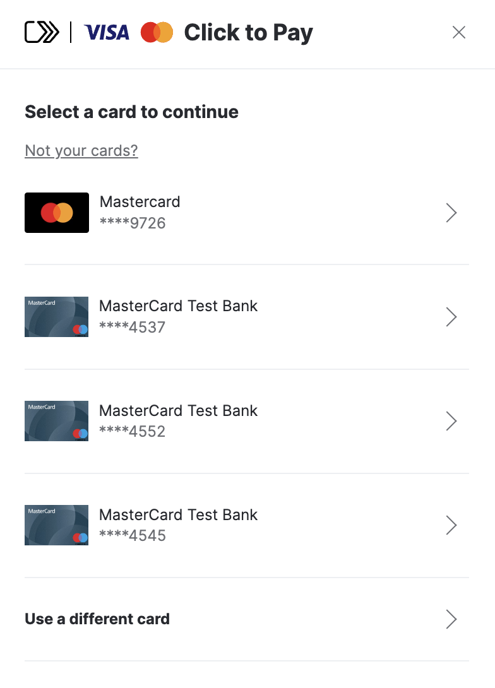
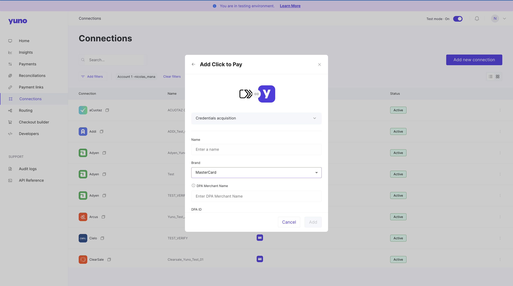
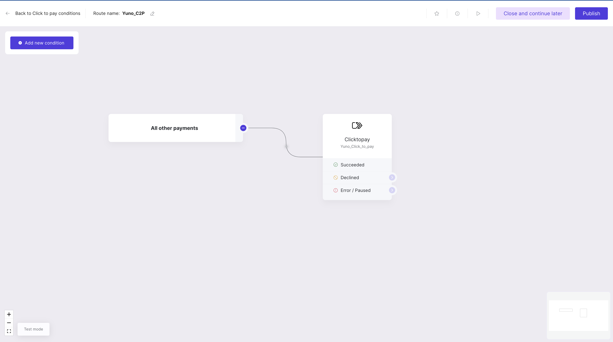
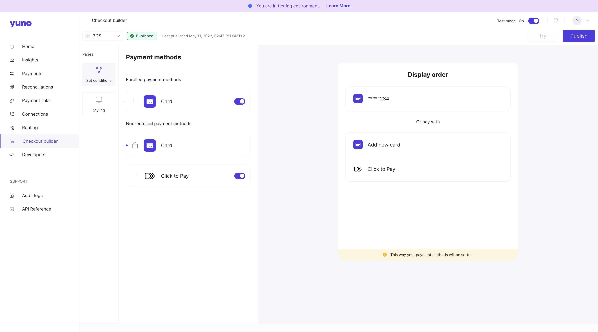
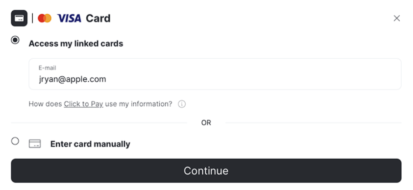

O Click to Pay é uma solução de pagamento online criada para simplificar e proteger transações online. Ele é baseado no padrão de pagamento seguro da EMVCo, um consórcio global formado pelas principais bandeiras de cartão, como Visa, MasterCard, American Express e Discover.

<div style={{width: "400px", margin: "0 auto"}}><Frame></Frame></div>

*Redes disponíveis na Yuno*: [MasterCard](https://www.mastercard.us/en-us/personal/ways-to-pay/click-to-pay.html)

<Note>
  O suporte a passkeys está disponível no momento apenas para **Mastercard**. O suporte a passkeys da Visa está em desenvolvimento.
</Note>

## Principais recursos e benefícios {#key-features-and-benefits}

* **Facilidade de uso**: permite que os consumidores façam compras online com um único clique, eliminando a necessidade de digitar manualmente os dados do cartão de crédito a cada compra.
* **Segurança aprimorada**: utiliza padrões modernos de autenticação para minimizar o risco de fraude. Isso pode incluir métodos como autenticação de dois fatores ou tokens de pagamento.
* **Consistente em diferentes sites**: oferece uma experiência de pagamento semelhante em todos os sites que suportam essa tecnologia, ou seja, os consumidores não precisam aprender processos diferentes para cada loja online.
* **Integração com as bandeiras de cartão**: por ter o apoio das principais bandeiras de cartão, o Click to Pay é amplamente aceito e confiável.
* **Compatibilidade com celular e desktop**: projetado para funcionar em vários dispositivos, facilita as compras online tanto em desktops quanto em dispositivos móveis.

Esse recurso melhora a experiência do cliente e está alinhado às tendências modernas de pagamento digital, podendo aumentar as taxas de conversão e a fidelidade do cliente. Ao incorporar o Click to Pay, você pode reduzir o atrito no checkout e resolver preocupações de segurança nas transações online.

<Info>
**Requisito de network tokens**

O suporte a network tokens é obrigatório para o Click to Pay em todos os fluxos (Golden Flow e APM, com e sem passkeys). Os lojistas devem configurar network tokens nas regras de **Routing** para garantir o processamento bem-sucedido.
</Info>

## Integração {#integration}

Para integrar e começar a oferecer o Click to Pay aos seus clientes, siga estes 4 passos simples:

1. Crie uma [conexão](https://dashboard.y.uno/connections) no dashboard da Yuno usando suas credenciais do Click to Pay.

   <Frame></Frame>
2. Defina a rota do meio de pagamento na seção [Routing](https://dashboard.y.uno/routing) para ativá-lo no Checkout Builder.

   <Frame></Frame>
3. Ative o Click to Pay no [Checkout builder](https://dashboard.y.uno/checkout-builder).

   <Frame></Frame>
4. Defina a rota de Card: considerando que o Click to Pay é uma wallet que armazena informações de cartão de crédito, a **rota** em que você precisa definir os provedores para cada cenário é a mesma do meio de pagamento **Card**.

## Fluxos de checkout {#checkout-flows}

Os lojistas podem escolher como o Click to Pay aparece no checkout. As duas experiências suportam passkeys em plataformas web e mobile.

<Note>
  **Comportamento da passkey**: a primeira transação de um comprador sempre é autenticada com 3DS, já que ele ainda não tem uma passkey. Quando essa transação é concluída, uma passkey é criada e as transações seguintes são autenticadas com ela. Uma passkey fica vinculada ao mesmo dispositivo, navegador e cartão: se qualquer um deles mudar, uma nova passkey precisa ser criada.
</Note>

### 1. Meio de pagamento independente (fluxo APM) {#1-standalone-payment-method-apm-flow}
O Click to Pay aparece como um botão de pagamento separado, ao lado dos cartões e de outros meios.
* **Cadastro obrigatório**: a criação de conta é obrigatória para todos os usuários.
* **Requisito de payload**: exige um payload específico de C2P.
* **Visibilidade**: ideal para lojistas que querem dar destaque ao Click to Pay.

### 2. Incorporado ao cartão (Golden Flow) {#2-embedded-in-card-golden-flow}
O Click to Pay fica incorporado ao meio de pagamento de cartão e só aparece quando o usuário seleciona "Card".
* **Cadastro opcional**: o cadastro é feito por uma caixa de seleção. Se ele for recusado, o usuário segue com a digitação manual do cartão (a transação ainda mostra `CLICK_TO_PAY` no token de uso único (OTT)).
* **Visibilidade**: ideal para uma UX com pouco atrito, em que o cadastro parece opcional.

<Frame></Frame>

## Armazenamento do cartão após um pagamento bem-sucedido {#card-vaulting-on-successful-payment}

Quando um comprador faz o cadastro durante o checkout (de forma obrigatória no fluxo APM ou aceitando a caixa de seleção de cadastro no Golden Flow), o cartão dele é armazenado na wallet do Click to Pay assim que o pagamento é aprovado. O armazenamento acontece como parte do pagamento bem-sucedido; não é necessária uma chamada de cadastro separada.

Na próxima visita do comprador, o Click to Pay o reconhece (pelo dispositivo ou pela busca por email) e exibe os cartões armazenados diretamente no checkout, para que compradores recorrentes possam pagar sem digitar de novo os dados do cartão.

## Ciclo de vida do status do pagamento {#payment-status-lifecycle}

No Click to Pay, a autenticação por passkey acontece **antes** de o pagamento existir: o comprador se autentica dentro da experiência do Click to Pay, e só depois que a autenticação é concluída o token de uso único (OTT) é gerado (o OTT já carrega o resultado dessa autenticação). Em seguida, você cria o pagamento usando o OTT. Se a etapa da passkey não for concluída, o fluxo é interrompido e nenhum pagamento é criado.

Depois de criar o pagamento, continue o fluxo no SDK com `continuePayment`. Nesse momento, o SDK avalia o status do pagamento:

* `READY_TO_PAY` (ou `PENDING` com subestado `WAITING_ADDITIONAL_STEP` ou `DELAYED_PROVIDER_RESPONSE`) significa que o provedor exige uma etapa adicional (por exemplo, 3DS, um redirecionamento ou um OTP do provedor), e o SDK a executa.
* Qualquer outro status significa que o pagamento já foi resolvido, e o SDK informa o status final.

Esses status intermediários são condicionais: um pagamento que não exige nenhuma etapa adicional nunca passa por eles.

Veja [Status de pagamento](/reference/payments/status-and-response-codes/payment) para conhecer o ciclo de vida completo.

## Guia de ativação {#activation-guide}

Siga os passos abaixo de acordo com a configuração desejada:

### Opção 1: somente Click to Pay (APM) {#option-1-click-to-pay-only-apm}
1. Solicite o **DPA ID** à rede do cartão (por exemplo, Mastercard).
2. Adicione a **conexão do Click to Pay** no dashboard da Yuno usando o DPA ID.
3. Adicione a **conexão de cartão** que vai processar esses cartões.
4. Defina a rota do meio de pagamento em **Routing** e ative o Click to Pay no **Checkout Builder**.

### Opção 2: Click to Pay + Passkey {#option-2-click-to-pay--passkey}
*Suportado na web e nos SDKs nativos de Android e iOS. No mobile, o SDK abre a experiência de passkey do Click to Pay no navegador do sistema e retorna por uma URL de callback de deep link, que precisa estar configurada nas suas configurações do Click to Pay. Passkeys não estão disponíveis dentro de WebViews incorporadas; sem uma URL de callback, o SDK volta para o fluxo padrão do Click to Pay sem passkeys.*
1. Solicite o **DPA ID** à rede do cartão (por exemplo, Mastercard).
2. Adicione a **conexão do Click to Pay** usando o DPA ID.
3. Adicione a **conexão de cartão** e configure o **BIN do adquirente**.
4. Solicite à equipe de backend da Yuno que ative as flags **Passkey** e **Dual Payload**.
5. Crie sessões de checkout com um `price` para que a Passkey funcione corretamente.

### Opção 3: Click to Pay + Golden Flow {#option-3-click-to-pay--golden-flow}
1. Solicite o **DPA ID** à rede do cartão (por exemplo, Mastercard).
2. Adicione a **conexão do Click to Pay** usando o DPA ID.
3. Adicione a **conexão de cartão** que vai processar esses cartões.
4. Solicite à equipe de backend da Yuno que ative a flag **Golden Flow**.

### Opção 4: Click to Pay + Golden Flow + Passkey {#option-4-click-to-pay--golden-flow--passkey}
*Suportado na web e nos SDKs nativos de Android e iOS. No mobile, o SDK abre a experiência de passkey do Click to Pay no navegador do sistema e retorna por uma URL de callback de deep link, que precisa estar configurada nas suas configurações do Click to Pay. Passkeys não estão disponíveis dentro de WebViews incorporadas; sem uma URL de callback, o SDK volta para o fluxo padrão do Click to Pay sem passkeys.*
1. Solicite o **DPA ID** à rede do cartão (por exemplo, Mastercard).
2. Adicione a **conexão do Click to Pay**.
3. Adicione a **conexão de cartão** e configure o **BIN do adquirente**.
4. Solicite à equipe de backend da Yuno que ative as flags **Passkey**, **Dual Payload** e **Golden Flow**.
5. Crie sessões de checkout com um `price` para que a Passkey funcione corretamente.

## Click to Pay na VTEX {#click-to-pay-on-vtex}

O Click to Pay também é suportado em lojas VTEX por meio do [plugin VTEX da Yuno](/docs/plugins/vtex). Os passos de ativação acima (conexão, roteamento, Checkout Builder) se aplicam da mesma forma.

<Info>
O Click to Pay depende da existência de um registro de cliente na Yuno. Ao usar o plugin VTEX, defina o campo **Create Customer** como **Yes** na configuração do provedor Yuno para que o plugin crie ou atualize o registro do cliente em cada pagamento. Veja as [perguntas frequentes do plugin VTEX](/docs/plugins/vtex/faqs) para mais detalhes.
</Info>

## Integração do SDK (Click to Pay Passkey) {#sdk-integration-click-to-pay-passkey}

<Info>
**Importante**

Os fluxos padrão de cartão do Click to Pay usam os callbacks existentes do SDK, mas usuários de Passkey precisam incluir uma `callback_url` que corresponda ao esquema de deeplink do app, para que o comprador volte ao app depois da autenticação (no Android, ela precisa corresponder ao esquema configurado no `AndroidManifest.xml`). Por exemplo:

```json
{
  "callback_url": "myapp://pay/ctp"
}
```

Em transações com Passkey, o token de uso único (OTT) nunca chega aos callbacks habituais do SDK (incluindo o `callbackOTT` no Android). Sempre leia-o nos parâmetros do deeplink antes de continuar o fluxo.
</Info>

### Mobile: tratamento da resposta (OTT e deeplink) {#mobile-handling-the-response-ott-and-deeplink}

O fluxo de integração do Click to Pay Passkey tem um tratamento de resposta específico, diferente do fluxo de pagamento padrão.

Quando um comprador conclui um pagamento usando CTP Passkey, o token de uso único (OTT) **não** é entregue pelos métodos habituais de delegate/listener. Em vez disso, o resultado da transação (tanto sucesso quanto falha) é comunicado ao seu app pela **URL de deeplink**.

Isso é igual no **iOS, Android e Flutter**: o lojista lê o resultado na URL de deeplink e age de acordo. Só muda *onde* o deeplink chega em cada plataforma.

**Leia dois parâmetros da URL de deeplink**

- `has_error`: ocorreu um erro ou o comprador cancelou. Leia o parâmetro `message` e mostre o erro.
- `one_time_token`: a transação foi bem-sucedida e o OTT está contido na URL.

**Depois de obter o `one_time_token`**

1. Envie-o ao seu backend para criar o pagamento pelo endpoint [Create payment](/reference/payments/create-payment).
2. Continue o fluxo no SDK com `continuePayment` para finalizar a transação.

**Onde o deeplink chega em cada plataforma**

- **iOS**: em `application(_:open:options:)`. Chame `Yuno.receiveDeeplink(url)` para fechar o navegador da Passkey e depois leia os parâmetros de `url`.
- **Flutter**: no seu handler de deeplink. Use `await Yuno.receiveDeeplink(url: uri)` para fechar o navegador da Passkey e depois leia os parâmetros de `uri`.
- **Android**: o deeplink reabre a sua `Activity` (não há chamada de fechamento do SDK). Leia os parâmetros de `intent.data` em `onCreate`/`onNewIntent`. A activity que recebe o deeplink precisa declarar um `intent-filter` no `AndroidManifest.xml` que corresponda ao scheme/host/path da sua `callback_url`.

<CodeGroup>
```swift iOS
func application(_ app: UIApplication, open url: URL, options: [UIApplication.OpenURLOptionsKey : Any] = [:]) -> Bool {
    guard url.scheme == "myapp" else { return false }
    Yuno.receiveDeeplink(url) // closes the Passkey browser

    let items = URLComponents(url: url, resolvingAgainstBaseURL: false)?.queryItems
    if items?.contains(where: { $0.name == "has_error" }) == true {
        // handle error (read the `message` parameter)
    } else if let ott = items?.first(where: { $0.name == "one_time_token" })?.value {
        // send `ott` to your backend, then continue the flow in the SDK
    }
    return true
}
```

```dart Flutter
Future<void> _handleDeepLink(Uri uri) async {
    await Yuno.receiveDeeplink(url: uri); // closes the Passkey browser

    if (uri.queryParameters.containsKey('has_error')) {
        // handle error (read the `message` parameter)
    } else {
        final ott = uri.queryParameters['one_time_token'];
        if (ott != null) {
            // send `ott` to your backend, then continue the flow in the SDK
        }
    }
}
```

```kotlin Android
override fun onNewIntent(intent: Intent) {
    super.onNewIntent(intent)
    val uri = intent.data ?: return

    when {
        uri.getBooleanQueryParameter("has_error", false) ->
            showError(uri.getQueryParameter("message") ?: "Operation canceled")

        uri.getQueryParameter("one_time_token") != null -> {
            val ott = uri.getQueryParameter("one_time_token")
            // send `ott` to your backend, then continue the flow in the SDK
        }
    }
}
```
</CodeGroup>

## Método de autenticação {#authentication-method}

Toda transação do Click to Pay retorna um campo `authentication_method` na resposta do pagamento, indicando exatamente como o comprador foi autenticado: por exemplo, passkey (FIDO2), 3DS, OTP, SMS ou email, login federado e SPC, entre outros.

Isso é útil para prevenção de fraude, decisões de roteamento e acompanhamento de métricas como a taxa de aprovação por método de autenticação.

<Note>
  Esse campo é retrocompatível: transações que não usam Click to Pay simplesmente retornam o campo sem um valor relevante.
</Note>

Para lê-lo, chame [Get payment](/reference/payments/retrieve-payment-by-id-v2) e procure `authentication_method` na transação.

## Filtro de tipo de cartão e comportamento do CVV {#card-type-filter-and-cvv-behavior}

**Filtro de tipo de cartão**: você pode bloquear uma origem de fundos de débito ou de crédito nas transações do Click to Pay. Isso é útil para cartões combo, em que o comprador poderia escolher qualquer um dos tipos: por exemplo, mostrar apenas a opção de crédito quando um lojista quer bloquear o débito.

<Note>
  Isso ainda não é self-service. Entre em contato com a equipe de plantão da Yuno para configurar na sua conta. A configuração self-service para todos os meios de pagamento está em desenvolvimento.
</Note>

**CVV com network token**: a partir da versão 1.7 do SDK, o Click to Pay só solicita o campo CVV quando o cartão **não** suporta network token. Antes da versão 1.7, o CVV era sempre obrigatório, mesmo quando o cartão tinha um network token. Não há opção de ativação ou desativação para o lojista: esse comportamento é automático depois que você atualiza para a versão 1.7. Ele se aplica apenas ao fluxo do Click to Pay (tanto o fluxo APM independente quanto o Golden Flow), não ao fluxo padrão de cartão.